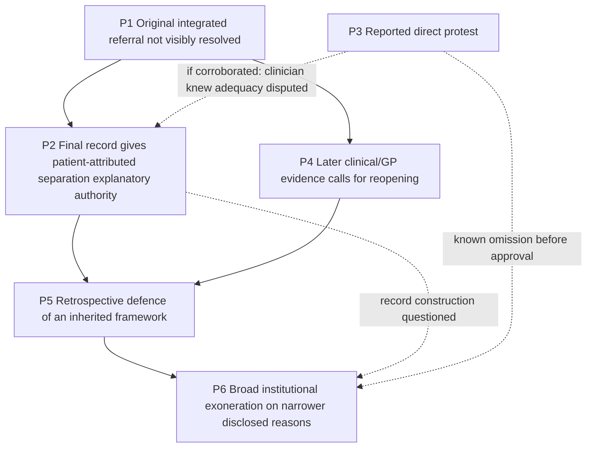
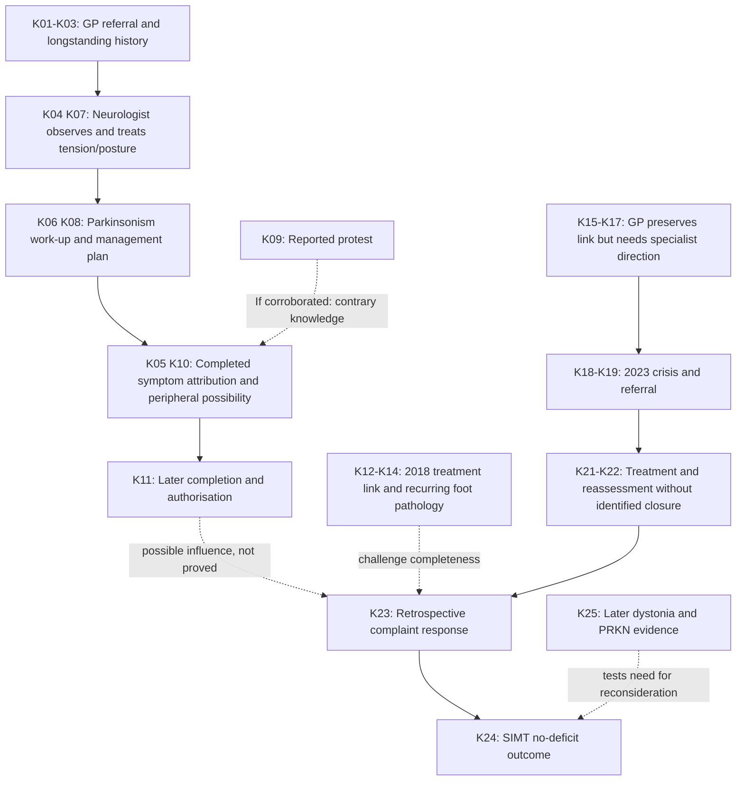

<!-- GENERATED TUR MASTER v5 -->

# The Unanswered Referral

> Its defensibility should be a consequence of its integrity.

For independent examination. Original sources and their qualifications remain controlling.

## Investigative essays

<!-- BEGIN hospital-chance -->

### The Hospital Had Its Chance

[Original source](journalistic-essay.html)

Liam Moloney entered University Hospital Galway in July 2017 with painful, clawing feet, a stiff and profoundly abnormal gait and a body he could scarcely relax. His GP wanted a neurological opinion. After a week in hospital Moloney protested that his feet had not been properly investigated. The neurologist knew of the protest; the discharge summary did not carry it. Twice in the following eight years neurological medication transformed his physical experience. Between those recoveries came pain so severe that his GP feared for him. This is the story of the patient who lived through those years, the doctor who knew their clinical history and the account that went out into medicine.

The patient’s case · Preamble, seven parts and legal reading guide · November 2026

<article><section id="preamble"><h2>Before the case became a case</h2>

In April 2017 there was no case against a hospital. There was a man with painful feet and a doctor who listened to him. Over the course of nearly three months, Liam Moloney and his general practitioner, Aaron Brennan, arrived at a point where the condition of the feet could no longer sensibly be considered without the abnormal gait, the clawing of the toes and the extraordinary tension in the man's body. Brennan did not have to know whether all these manifestations shared a cause. He had recognised the need to investigate their relationship.

That was the purpose of the <a href="https://github.com/TitanicParker/for-counsel/blob/main/docs/source-records/gp-referral.html">referral of 29 June 2017</a>. It was the product of a functioning relationship between a patient and his doctor. Moloney understood why he was going to hospital because he had been part of the process that took him there.

Imagine the ordinary possibilities of such an admission. On Monday the original referral is read, the history taken and the patient examined. On Tuesday the findings are discussed with senior colleagues. A supervised trial of neurological medication might be considered, not necessarily as the beginning of lifelong treatment but as a way of learning what changes and what remains. The result might inform a diagnosis, a treatment strategy or further investigation. Perhaps the patient could go home within a few days; perhaps the work would take longer. The point is not the length of the admission or the choice of one drug. It is the opportunity to learn something about the body in front of medicine.

This is not an idea imported into Galway with the benefit of nine years' hindsight. On 14 August 2017, the department's own educational paper, <a href="https://www.neurology.org/doi/10.1212/WNL.0000000000004231"><em>Clinical Reasoning: A demure teenager and her dystonic foot</em></a>, appeared online in <em>Neurology</em>. Patrick Cullinane, Patrick Browne, Michael Hennessy and Timothy Counihan described a thirteen-year-old girl whose abnormal foot movement resembled foot drop but was classified as dystonia. A levodopa trial produced little benefit; subsequent genetic investigation established Parkin-associated juvenile Parkinsonism. The authors distinguished the value of investigating the presentation from the reasons for postponing long-term levodopa treatment. They used serial clinical videos to teach readers how to reason through the case.

The two patients were not identical, and the paper does not establish what treatment Moloney should have received. Its relevance is more immediate: the department possessed the intellectual tools to investigate an abnormal foot movement in the context of a possible inherited movement disorder. Counihan, one of the authors, had participated in the complex-case discussion of Moloney's presentation. Moloney himself had supplied a history stretching back approximately thirteen years, and the neurologist had observed and filmed a gait suggestive of dystonic posture. Here was an exceptional opportunity for a teaching hospital to learn from the physical course of a young man's illness, with his participation and for his benefit.

On the second Monday of his admission, four medical students stood in the presence of a patient who wanted that work undertaken. He summoned his neurologist and protested that his feet had not been investigated adequately. Whether the purpose of the original referral had been lost in its compression or had been understood without being adequately acted upon, the warning was before the hospital while the patient was still there. The account authorised a week later did not carry it.

Six years afterwards Brennan wrote that the pain had become so extreme that it was producing a death wish. In March 2025 the neurologist himself recorded Moloney's words: “I won’t live with it.” The later warnings carry a distinct patient-safety significance. Where was the assessment of his distress, the response to the danger it might represent, and the plan for keeping him safe while the physical suffering was addressed? Where, too, was the answer to the original referral? These are questions the subsequent records and the hospital's assessment must be capable of answering.

It is November 2026. A public institution's authority should not depend upon a patient's inability to examine its paperwork. A professional network is not an answer to a clinical question; seniority is not evidence of work done; solidarity among colleagues must never take precedence over the safety and dignity of a patient. The demand for transparency is not hostility to medicine. It is a demand that medicine live up to its own purpose. A generation accustomed to asking institutions to show their work should recognise this case for what it asks of them.

There is no need to understand genetics, pharmaceutical strategy, institutional governance or data protection before beginning this story. Put the original referral beside the subsequent record and ask where the question was answered. The hospital has declared that there was no deficit in care. The patient is still asking where the work was done.

The complexity lies in what happened to the question, not in the question itself.
</section><section id="chapter-1"><h2>I. The question that went into Galway</h2>

On the second Monday of his admission to University Hospital Galway, Liam Moloney asked four medical students to fetch his neurologist. He had been examined, questioned and introduced to the prospect of living with a serious neurological condition. He had learned a great deal. But there was something he could not understand about the work of the preceding week.

His feet still needed to be investigated.

He used the analogy of the National Car Test. What was the point of all that inspection if the car was going to come out with bald tyres?

That was 10 July 2017. Moloney left the hospital the next day. On 17 July, at half past seven in the evening, the completed account of his admission was confirmed. It said a great deal about the patient's understanding of his condition. It did not say that he had challenged the investigation of it. His <a href="https://github.com/TitanicParker/the-unanswered-referral/blob/main/Article_16_Supplementary_Statement_July_2017.pdf">signed supplementary statement</a> supplies the account of the encounter on which this narrative proceeds.

To understand what he was asking, it is necessary to go back three months.

On 10 April, Aaron Brennan, a Galway GP, examined a thirty-nine-year-old man with painful feet, bent toes, abnormal nails, calluses and an abnormal gait. Moloney wondered whether an old episode of sciatica had left him walking habitually in a peculiar way. Brennan did not adopt the explanation. He examined him and arranged investigations. The patient had a story about his body; the GP had a body to investigate.

There was a history to the feet. Moloney had worked in bars, spending long periods standing. He recalled treatment for corns and calluses around 2009 and 2010. When he left bar work in 2012, standing less made the pain less prominent. Something else, however, persisted: an extraordinary difficulty in relaxing his body. As far back as 2004 he had become aware of a need to put himself in positions in which he could feel tension, as though the presence of tension were necessary to experience relaxation. By 2017, his writing, balance and dexterity had deteriorated. Handling cardboard boxes at work was becoming difficult.

In 2014 he had attended hospital with tension in his arms and legs but had not seen a neurologist. In the handwritten history of July 2017 he described his present condition as the maturation of that earlier state. The sequence mattered: the events of April to June 2017 marked a change in the recognition of his condition, not necessarily its beginning.

Brennan's observations increasingly suggested that the problem extended beyond the feet. On 8 June he wanted a specialist opinion on the patient's “gait, feet and ‘muscle tension’”. By 23 June he was recording markedly increased tone and brisk reflexes. On 29 June he arranged urgent hospital assessment.

The <a href="https://github.com/TitanicParker/for-counsel/blob/main/docs/source-records/gp-referral.html">referral</a> begins with the feet: bilateral problems, feet in a poor state, a stiff and unusually festinant gait. Later come the trouble initiating movement, the difficulty relaxing in bed and the clawing of the toes. Brennan considered Parkinsonian or other disease. He did not claim to know how all these features related to one another. That was why he was sending the man to hospital.

Employment was at stake. Brennan described the increasing difficulty of gowning up and down in the clean room, sorting papers and fitting scalpel blades to handles. He had already sought an outpatient neurological opinion, but feared the man would lose his job if the deterioration continued. The urgency attached to the combined presentation, not merely to a diagnostic label.

Something happened to the description on its way into neurology. The abbreviated reason for admission retained difficulty initiating movement, stiffness and increased tone in all four limbs. Brennan's tentative “?Some cogwheeling at the wrist” became “COGWHEELING AT THE WRIST”. Cogwheeling is a ratchety resistance a doctor may feel on moving a limb. The feet and the clawing toes disappeared from the précis.

The full referral may have been available to the team. But the question of what the neurologist knew cannot be settled by looking at the abbreviated version, because Thomas Monaghan examined the patient himself on 3 July.

Abbreviation may be a practical necessity, but it cannot replace the full referral. The institution that compresses information must ensure that the clinician investigating the patient has the material needed to understand why he was sent there. If the full question was not known, its absence from the work requires an operational explanation. If it was known, the question is why it was not adequately answered. Either way, by the second Monday seven days of opportunity had elapsed. The neurologist had also acquired independent knowledge of the feet and the movement; administrative compression cannot account for everything that followed.

He took the history of the tension, the feet and the years in which the man had struggled to move. He found a strikingly abnormal gait, absent arm swing, severe rigidity and slowness of movement. The lower limb appeared to move as though the patient had foot drop, but Monaghan expressly wrote that it was not foot drop. He thought it somewhat suggestive of a dystonic posture. Dystonia is involuntary muscular activity that can produce twisting movements or abnormal postures. He also found flattened arches, hammertoes and mild swelling. With the patient's consent, he filmed the examination.

Brennan had sent him a man with painful, clawing feet and disordered movement. Monaghan had now observed a specific abnormality of movement that might be relevant to those feet. A corn can hurt because of the pressure placed upon it. A bent toe can itself be painful. A muscular contraction can hurt; a disorder of peripheral nerves can cause burning or altered sensation. More than one of these things can happen in the same foot. The neurologist did not need to choose among them on the first day. He had a reason to investigate their relationship.

He also began treating the longstanding tension. Clonazepam was given at night; sweating followed, and Monaghan considered whether it might reflect Parkinsonian disturbance of autonomic function. Moloney recalls that treatment commencing before the senior case discussion. Whatever the precise first-dose time, the <a href="https://github.com/TitanicParker/for-counsel/blob/main/docs/source-records/discharge-summary.html">admission record</a> establishes that the symptom had become an object of neurological treatment.

Moloney places the Neurology Department's complex-case meeting at half past eight on Tuesday 4 July. Immediately afterwards, he remembers Monaghan coming to him with the decision about levodopa: “We're not going to give you the good stuff.” The decision had been made sufficiently definite to be communicated to the patient six days before he protested. The exact meeting record and the material supplied to those attending remain to be established. It brought access to senior expertise, including Timothy Counihan, whose interest in the genetics and management of Parkinson's disease was directly relevant to a young man with an unusual presentation. The completed account records a probable idiopathic Parkinsonian diagnosis with atypical features and the advice to exercise great care over dopamine agonists and levodopa. The risks of treatment in a younger patient deserved consideration. But the referral, the history, the examination and the treatment of tension had generated a question independent of the timing of levodopa. The meeting's authority cannot establish that this other question was examined unless it can be shown that it was placed before the meeting. The underlying meeting material matters because the expertise of a doctor is not a substitute for the information with which he is supplied.

During the week there was an extensive investigation of Parkinsonism: brain and cervical imaging, laboratory work, physiotherapy and occupational therapy input, plans for a dopamine-transporter scan and a strategy for introducing medication. Moloney was not complaining that the hospital had done nothing. He was complaining that one part of the problem for which he had been sent there was not receiving comparable attention.

The admission had established an important neurological finding but had not supplied a corresponding account of the feet. A focused examination might have mapped the painful sites against posture and loading, distinguished fixed deformity from changing muscular activity, considered sensory findings and arranged observation of the effects of treatment. The precise tests appropriate in 2017 are a matter for a specialist examining the case. The patient was not asking for an instant answer to every one of those questions. He was asking for the clinical work from which an answer could emerge.

By the second Monday he wanted the neurologist to come back to it.

</section><section id="chapter-2"><h2>II. What the account made of the patient</h2>

The history Monaghan took on 3 July survives in handwriting. On the first page, in the repository's working transcription, is a question: “Where do I begin?” What follows is the attempt of a man who has not yet acquired the specialist's language to describe what has happened to his body over thirteen years.

On the third page the account reaches the period after he left bar work. The relevant words are “Began to be aware that foot pain and leg tension weren’t the same”. At the bottom of the page, separately, are the words “(as the leg pain settled)”. Moloney disputes the origin of those words. He says that he described foot pain and leg tension, not leg pain, and alleges that the parenthesis was written after his protest. The date of the interview cannot establish the date of every inscription on the page.

The distinction was genuine. The sensation of standing on a painful corn was not the sensation of an unrelenting need to hold the body in tension. It was useful for the clinician to know that. It was not, of itself, an explanation of the origins of either sensation.

The peculiarity is small but consequential. The patient had distinguished both the location and the quality of two experiences. The parenthesis combines the location from one with the sensation from the other, then introduces the settling of the resulting third phenomenon. It is that disputed expression which is carried into the typed history and made to explain the distinction from which its vocabulary was drawn.

The typed account reads:

<blockquote>

“Therefore in 2012 he began to realise that the foot pain and the leg tension were not the same problem because: as the leg pain settled --- he was more aware of the tension”

</blockquote>

In the final clinical Impression, the consultant says the patient had “in his own mind - markedly divorced” the leg tension from the corns, calluses and pain of the feet.

These are not three independent reports of what Moloney believed. They are stages in the professional account of one interview, including a manuscript inscription whose provenance is itself disputed. The <a href="https://github.com/TitanicParker/the-unanswered-referral/blob/main/JULY_2017_CLINICAL_RECORD_SOURCE_RECONSTRUCTION.md">documentary reconstruction</a> allows them to be examined together.

The difference between the first and last formulations might seem small until one reads the sentence immediately preceding the final attribution. The clinician was considering whether the foot symptoms might have been completely separate or might represent secondary peripheral neuropathy, possibly associated with earlier alcohol consumption. “Not clear,” he wrote.

There is nothing intrinsically objectionable about a doctor proposing an uncertain explanation. Moloney had reported substantial previous alcohol consumption, around seventy units a week, and alcohol-related nerve damage was a possibility worth considering. The same history also recorded that reduction and cessation had not produced improvement. The Impression's reference to improvement leaves it unclear exactly what had improved and over what period. Pain diminishing after a man ceases to stand all day is not the same observation as symptoms improving after abstinence.

The important feature of the passage is the different degree of certainty attached to the two propositions. The physician's peripheral explanation is uncertain. The account of the patient's own mind is emphatic. The latter appears to lend support to the former, as though the patient, from his intimate experience of his body, had independently recognised the division the clinician was proposing.

The apparent corroboration was not independent. Both the tentative peripheral hypothesis and the emphatic attribution rested in the account written by the same clinician. The distinction between what the patient had felt and what the doctor inferred was therefore not a matter of literary precision alone. It affected the evidential basis of the clinical impression.

Moloney disputes that attribution. He had distinguished experiences, not undertaken an investigation of their medical causes.

What had the hospital established about those causes? The account records the shape of the feet, the lesions, the abnormal gait and the potentially dystonic movement. On 6 July Brennan had prioritised the podiatry route in light of the emerging Parkinsonian diagnosis. The hospital recorded an attempt by a junior doctor to arrange podiatry during admission and requested that the GP arrange it subsequently. Local treatment of corns and calluses could be valuable without explaining the movement and loading that might have contributed to them. The neurological medication plan was extensive; no comparably defined inquiry into that relationship is apparent in the completed account.

At the end of the recommendations appear the words “As per above”.

The discharge letter praises the patient’s intelligence, insight and ability to ask appropriate questions. It was intended in part to consolidate the discussions of the admission for him. Yet the question he had asked most urgently was the one it did not preserve.

</section><section id="chapter-3"><h2>III. The second Monday, and the information that went out</h2>

When Monaghan came to the ward on the second Monday, Moloney was not asking to be taught how to find a podiatrist. He had a GP who had already arranged that kind of care. He was asking why the neurological department had not investigated what was happening to his feet.

Monaghan’s response, as Moloney describes it, was that arranging podiatry was as straightforward for the patient as it was for the consultant. Four medical students had been there. The reply answered a different question: the patient was asking for neurological investigation, not access to local treatment.

In the ordinary language of patient safety, this was a red flag: a patient in a teaching hospital identifying an important unresolved part of the investigation before discharge. He should not have had to supervise the transmission of his GP's clinical purpose through the hospital. A man absorbing a serious neurological diagnosis, in pain and facing the possible loss of his livelihood, had become the person attempting to safeguard that purpose. The intervention called for an answer and, if necessary, corrective work. Its omission meant that the shared account did not preserve the warning or the patient's attempt to protect his own care.

The doctor could still examine the patient. He could see the way the man stood and moved. He could look at the location of a painful pressure lesion in relation to the posture of a toe. He could consider which abnormalities were fixed and which varied with muscular activity. If the work already done was sufficient, he could explain why. If a further inquiry was needed, he could identify the person responsible for undertaking it. The particular examinations required are matters for independent clinical judgment; what made the moment valuable was that the original patient was still there.

Moloney makes a more serious allegation than that an inadequate account subsequently proved useful in defending an inadequate investigation. He says that the account was made defensible at the point when its adequacy had been challenged. A neurological course of management had already been settled. On the second Monday he called attention to the work on his feet that had not been done. The completed account supplied apparent patient endorsement of a separation that the medical investigation had not established, and excluded the objection that had brought the sufficiency of that investigation into question.

His allegation is that the construction began within the handwritten material itself, with the disputed parenthesis, and that the peripheral explanation and strengthened attribution took shape after the confrontation. He alleges that the neurologist deliberately constructed the representation to protect the disposition already reached. On this reading, the uncertain peripheral hypothesis did not need to be established as a diagnosis to become functional in the allocation of care; the patient-attributed separation and the omission of his objection allowed it to operate. The evidential question is whether that was the actual response to the protest or whether the wording and disposition have another explanation. The chronology of the final authorisation is established; the first composition of the disputed wording is not. The manuscript, the successive versions of the account, the evidence of those on the ward and the neurologist’s explanation are the means of testing that allegation. Its seriousness should not be hidden in the description of what the record subsequently did. Nor does the clinical case depend upon proving the intention alleged: an inaccurate representation and an unanswered clinical question require examination even if their origin was an error rather than a deliberate act.

There was already a considerable professional predicament on 10 July. It did not require the pain of 2023 or the recovery of 2025 to bring it into existence. The original referral, its narrowed representation, the neurologist’s recovered knowledge, the observed movement, the treatment already begun, the senior advice and the missed educational opportunity were all present before the patient left. Reopening the clinical question could also have meant reopening the information supplied to a senior colleague and the departmental decision that followed. If Counihan had not received the material information, the question is why; if he had received it, the question is how it was considered. His expertise and the department’s contemporary educational work make that distinction especially important. The actual meeting material, rather than speculation about what he would have concluded, is needed to resolve it.

These circumstances supply a contemporaneous basis for investigating the patient’s allegation of premature defensibility. They do not establish an intention to protect reputations, still less a collective agreement to conceal information. The later history potentially increased the exposure; it did not create the original predicament. At the point of the protest the patient was still available to be examined and the original clinical and educational opportunity was still alive.

Moloney left on 11 July. The DaTscan, performed on 13 July, showed markedly reduced dopamine-transporter uptake on both sides and supported the diagnosis of Parkinsonism. At 19.30 on 17 July the completed account was confirmed. The scan result had found its way into the record. The protest had not. Whatever the date on which the contested wording was first drafted, the authorisation took place after the encounter, with the knowledge the consultant had acquired on the ward.

On 18 July Brennan recorded that extensive specialist correspondence had arrived. Imagine what a single additional sentence could have told him: the patient had challenged the adequacy of the investigation of his feet before discharge.

It would not have instructed Brennan to diagnose dystonia. It would not have required a movement-disorders nurse to recommend levodopa. It would have told them something relevant about the state of the work as the patient left hospital. Without it, neither could recover that fact from the letter. Whether it was transmitted by some other means remains to be established.

The difference existed before a later prescription was written or a later injury suffered. A reasonable decision made by someone receiving the incomplete account would not make the account complete. Nor does the omission, by itself, demonstrate that a later decision was unreasonable.

Brennan did not lose his clinical judgment when the letter arrived. Nor did the nurse lose her capacity to recognise new symptoms. But neither could recover the protest from the summary. Subsequent decisions could be made reasonably on the information available to their makers while the information supplied by the author remained incomplete. That is the distinction between the immediate disparity and the clinical consequences that require further examination.

The practical arrangements for care were identifiable: the GP was asked to arrange physiotherapy, occupational therapy and podiatry; neurology retained responsibility for the medication strategy. Less identifiable is the person charged with investigating the relationship between movement, muscular activity, abnormal posture and painful loading, and with bringing the results of that inquiry back into the treatment of the movement disorder.

A podiatrist could treat the lesion. A GP could treat the pain. A neurologist could treat the movement. All three could do useful work without the relationship among those things being investigated together.

There was another consequence of leaving the hospital. The feet of July 2017 could never again be examined under precisely those circumstances. Treatment, disease progression, altered activity and local care would intervene. If an integrated baseline ought to have been established then, its absence would deprive subsequent medicine of a comparison and the patient of evidence with which to demonstrate what had changed.

Years later the consultant could refer a reviewer to his contemporaneous interpretation. Moloney could not place before that reviewer the untreated body that had stood in front of the consultant on the ward. The absence of an integrated baseline was a problem for the interpretation of treatment as well as for the patient’s eventual ability to challenge the record.

The body would change. The document would remain.

</section><section id="chapter-4"><h2>IV. The year in which medicine knew how well he could be</h2>

And then the hospital made him well.

Monaghan sought the advice of Daniel Healy, a Beaumont neurologist with expertise in Parkinsonism and genetics. In the <a href="https://github.com/TitanicParker/for-counsel/blob/main/docs/source-records/clinician-to-healy-2017-myself-and-tim.md">correspondence</a> he wrote: “Myself and Tim are keen to hold back on Levodopa insofar as maybe possible unless you'd advise otherwise?” In <a href="https://github.com/TitanicParker/for-counsel/blob/main/docs/source-records/healy-response-2017-09-12.md">September 2017</a> Healy considered PARK2 disease a probable explanation and suggested genetic testing, initially for that possibility and then a panel if necessary. He recorded a dramatic improvement in motor symptoms on procyclidine and rasagiline. The specialist inquiry had already begun to approach the genetic explanation that would become important nine years later.

For Moloney, the immediate discovery was not genetic. It was that his walk could come back together.

He had spent years struggling to achieve relaxation, and movement had become something that required effort. Now he could walk without the tension that had accompanied it. The medicine had not merely allowed him to cope better with an illness. It had altered the physical circumstances in which he lived.

There were difficulties with his eyesight, however, and the movement-disorders nurse suggested interrupting procyclidine, an anticholinergic used in Parkinsonism. Rasagiline continued. On 4 October Moloney contacted the consultant. His eyesight was normal again. His tension was building, his feet were restless and his walking was coming apart.

Moloney’s correspondence of 4 October preserves the contrast in his own words. “My walk is back together” described the benefit. During withdrawal he wrote: “I am feeling the tension building up, my feet are restless and my walk is falling apart....but my eyesight is back to normal.” The deterioration was being communicated as it happened, not reconstructed from memory after the complaint.

At the <a href="https://github.com/TitanicParker/for-counsel/blob/main/docs/source-records/neurology-notes-2018.html">consultation of 24 April 2018</a>, Monaghan recorded a more specific observation about that interruption. The first thing the patient had noticed changing rapidly was the return of the outside left corn.

That is a remarkably particular description. The podiatry material locates recurrent pathology around the outer forefoot behind the little toe. The record does not settle whether the patient meant renewed pain at the site, a change in the experience of the lesion or the reappearance of the lesion itself. It does not establish that new hard skin grew overnight. It does establish that a focal problem at a familiar site on the foot had changed, in the patient's experience, when a neurological treatment was removed.

The patient was back on procyclidine by April. He described the relief from tension as fantastic. He could walk twenty metres without it. Moving from one kind of floor surface to another was no longer difficult. He could sleep well and move normally in bed. He had returned to work in shipping, doing physical work and taking on some health and safety responsibilities.

The doctor recorded his words: “I enjoy being alive.”

Monaghan examined him and filmed him again. In July 2017 the record had said “The gait is strikingly abnormal” and “There Is absolutely no arm swing”; it described gross axial rigidity and marked slowness. In April 2018 the consultant wrote: “The walk is actually very good. He has a good arm swing without having to concentrate on it at all.” There was residual slowness, but the walking had become “really relatively excellent”. The contrast belongs to the doctor’s observations, not just to the patient’s recollection.

The two films, if preserved, would enable an independent specialist to examine the man before and after treatment. Their existence is recorded; their present whereabouts and contents require confirmation. In 2018 the neurologist had access to both clinical states without needing the patient to reconstruct either of them for him.

He also recognised that further improvement might be obtainable with levodopa or another dopamine agonist, although he preferred to defer them because of the risks. He discussed the way Parkinsonism can magnify pain from other causes. The suspected Parkin-associated genetic condition was again raised. Testing was available if the patient wished, although Monaghan favoured waiting for developments in genetic knowledge and did not expect an immediate result to alter management.

In the same consultation Monaghan explained that people with Parkinson's can experience an unusually magnified degree of pain. This is an important feature of the case, because it means that even the explanatory model the neurologist would later use in defence of his treatment establishes a relationship between the neurological condition and the experience of pain. The effect of neurological treatment on the patient's feet remained clinically important even if some of the underlying pathology had an independent origin. The doctor did not have to accept the neurological origin of every painful sensation in order to recognise that a neurological intervention could profoundly change the suffering associated with it. He had the patient's evidence of just such a change, including its focal anatomical component. The case does not require the consultant's own theory of pain to be discarded. It requires its implications to be followed.

By April 2018 the same doctor had examined the untreated man, treated his tension, heard his protest, authorised the account, received his report of deterioration on withdrawal, examined the recovered man and documented a focal foot response. Even if his original interpretation had been reached in good faith, the therapeutic evidence provided a new occasion to reconsider it. The April letter records the observation but does not identify it as a reason to revisit the inquiry that the patient had challenged.

Moloney was not thinking about that. He had recovered much of the use of his body. He went to work. He enjoyed being alive. He forgot about the protest.

The consultant possessed the knowledge. The patient possessed the benefit.

The paradox was that the success of medicine made the patient less likely to raise the very concern that its success had made more clinically interesting.

The recovery had not eliminated every physical foot abnormality. Toe supports were still helping. Podiatry continued to treat recurring lesions, including those on the outside of the left foot. In March 2019 Brennan again referred Moloney to podiatry, explicitly associating clawing and foot difficulties with increased tone and abnormal gait in Parkinson's disease. He was still recognising the connection that had brought the patient into hospital. Whether that referral reached the neurologist is not established.

The podiatry record included debridement of lesions, insoles and toe supports; clawing and recurrent pathology at the left fifth metatarsophalangeal joint were observed over the following years. The return of the outside corn and the improvement in walking cannot be treated as proof that the lesions disappeared. The point of putting the records together is to examine the relationship between local pathology and movement rather than to substitute one for the other.

There is an instructive contrast in the neurologist's handling of a different complaint in 2019. Moloney developed severe right shoulder and arm pain. Monaghan examined its distribution, assessed weakness and reflexes, considered a nerve-root or plexus problem and sought imaging. When it remained outstanding, he pursued it. He distinguished the possible physical cause from the way Parkinsonism might magnify the experience of pain.

“The actual cause for us is pretty important,” he wrote.

It was the method the patient had wanted applied to his feet: uncertainty as a reason to investigate, not an endpoint of the inquiry. The same tests need not have been appropriate for both complaints. The comparison is between the ways their causes were examined.

</section><section id="chapter-5"><h2>V. A life that became smaller</h2>

It was not easy to preserve the improvement. Rotigotine, a dopamine agonist, was introduced in late 2018. Medication could make the patient move more freely, but higher doses could bring unwanted movements and behavioural effects. Procyclidine caused visual difficulties, and after a later interruption and resumption Moloney was not consistently certain of its benefit. In February 2019 the neurologist described the management of his condition as an extremely difficult tightrope.

There is a revealing observation in the record of that year. To a doctor looking at Moloney on the day of one consultation, it might not have been apparent that he had Parkinson's. Yet Moloney did not feel sufficiently loose and experienced stiffness later in the day. The neurologist recognised that what he saw in the consulting room could be quite different from the condition the patient experienced over the course of a day.

This distinction would become particularly important in 2021. Sinemet, which combines levodopa and carbidopa, entered the prescription history in September. The patient had felt undertreated. Concerns about pressure in his eyes led to the removal of procyclidine, also known as Kemadrin, and an increase in Sinemet. In the <a href="https://github.com/TitanicParker/for-counsel/blob/main/docs/source-records/neurology-notes-2021.html">October consultation</a>, Monaghan recorded Moloney's hope that the new medication would more than compensate for the removal of the old.

There was a great deal to monitor: the pressure in the eyes, tolerability, the possibility of cognitive benefit from removing Kemadrin, the risks of involuntary movement and the speed at which levodopa could be increased. These were real clinical considerations. The record of 2018, however, gave the replacement of Kemadrin another dimension. There had been an extraordinary improvement in the patient's capacity to relax and walk, and a focal change at the outside of his left foot when the drug was interrupted. The question was whether the replacement preserved those benefits. The available October letter does not show a corresponding comparison of the feet.

Monaghan recognised that the rapid increase from a very small twice-daily dose of Sinemet to four doses a day was justified by the removal of Kemadrin. He also noted that Moloney was already taking Comtess (entacapone), which increased the effective levodopa exposure, and wanted to limit further escalation. The considerations were real. The substitution nevertheless needed a measure of what the old treatment had achieved, not just of how the new treatment was tolerated. The 2018 record had already connected a change in neurological medication with symptoms at the original foot site. That made the consequences of replacing procyclidine relevant to the feet as well as to the general motor syndrome.

There is another detail in that letter. Moloney raised deep-brain stimulation. Monaghan wrote, “As I have reminded him,” before describing the treatment as applicable only to tremor. The patient disputes the implied history of that advice. Both the clinical suitability of the advice and the record of whether it had previously been given require examination. These are different questions: a doctor's belief about a treatment does not establish what the patient has already been told about it.

By 2022 the morning feet were troublesome again. The clinic record describes twenty to twenty-five minutes before they warmed up, painful corns and calluses around the edges, and the patient's wondering whether the pain was neuralgic. The consultant considered the overall position relatively satisfactory. Moloney was pursuing qualifications. He was getting on with his life.

<h3 id="treatment-related-harm">The medication itself as part of the differential</h3>
Moloney describes the years after the substitution as a struggle to remain between two undesirable motor states: dystonia and dyskinesia. His allegation is not that levodopa directly acted as a pain-producing substance. It is that fluctuations in its effect, together with insufficient nighttime coverage, may have produced or aggravated painful muscular activity, abnormal posture and loading. Both inadequate control and excessive stimulation belonged in the differential. The earlier foot-specific treatment observation gave particular reason to investigate those possibilities.

For scale, four tablets of immediate-release Sinemet 12.5/50 mg daily from 1 October 2021 to 1 March 2025 would amount to 4,988 administrations over 1,247 days. This is an illustrative calculation, not a verified consumption total: the records show changes in frequency, interruptions and use of Stalevo. Its significance is the duration and repeated opportunity for examining motor state, dose timing, painful feet and treatment response together, not the number of tablets as evidence of harm.

On 26 March 2023 Brennan sent an urgent referral to the same neurologist. The man who had enjoyed being alive in 2018 was now experiencing severe burning pain in both feet and lower legs. At its worst, the pain had produced a wish for death. Brennan had begun pregabalin, a medicine used for neuropathic pain, at a low dose; the dose had been rapidly escalated through several doctors. He remembered that an earlier episode of arm pain had ultimately subsided with better control of the Parkinsonian condition.

“Despite his facade, I don’t think he is doing well,” the GP wrote. He asked for a review “before we get into trouble here”.

Two days later the movement-disorders nurse emailed the consultant. The patient's quality of life had deteriorated over months. His pain was debilitating despite a reported daily pregabalin dose of 600 mg. He had stopped his Parkinson's medication for ten days and believed, at the time, that he might have been spiritually healed.

That was information a clinician needed to examine, not a reason to discard the history of the man's earlier response to treatment. A patient's understanding of his condition can change, particularly when he is suffering. Medicine has the advantage of being able to examine what happened to him when he was well, what happened when treatment was interrupted and what happened when it was restored.

The warning also created an immediate responsibility of its own. Even if every aspect of the original admission had been appropriate, a report of intolerable pain and a wish for death would still require an appropriate safety assessment and response. One contact note indicates that an appointment on the cancellation list was sought and that Moloney was to follow up with his GP meanwhile. The complete referral, triage, communications and appointment records are needed to establish what happened in response to Brennan's warning and when.

Brennan had not merely reported the intensity of pain. His words in the referral were “Says extreme at time and causing death wish.” His request was for urgent help. The available record does not demonstrate an assessment of whether the patient was at risk of harming himself, an agreed plan for safety, or how responsibility for timely follow-up was allocated. That is not proof that none took place; it is a separate question the hospital must answer. The earlier warning about the investigation had not been resolved in the shared account. Now the GP was warning about the man himself. No defence of a prescribing decision could dispose of that responsibility.

Crucially, this warning arose within the period of disputed neurological treatment and escalating pregabalin. It was not a parallel story of psychological distress detached from the therapeutic history. Brennan himself recalled the earlier pain that had settled with better Parkinsonian control. The patient was reporting severe suffering during a period in which the relationship between the neurological regimen and the painful motor state deserved investigation. The reported ten-day cessation of Parkinson’s medication and the patient’s then belief that the pain was unrelated to Parkinsonism are important counterevidence, not reasons to erase the earlier treatment history. Neither the overlap nor the later recovery establishes a drug-induced psychiatric effect. The question is whether the physical source of distress and the immediate safety risk were adequately examined together.

Later in 2023 the neurological service did recognise a relationship between movement, medication and pain. Monaghan considered whether left lower-limb cramping might be dystonia associated with an OFF state, when the benefit of medication was diminishing, rather than an ON state. He noted that the sudden onset of severe pain was not characteristic of the usual development of peripheral neuropathy. There were further investigations, including testing for Fabry disease, reported as normal. In a separate <a href="https://github.com/TitanicParker/for-counsel/blob/main/docs/source-records/neurology-notes-2023.html">movement-disorders contact</a>, the nurse recorded her view that the patient was undertreated and that leg pain and shuffling were OFF-related. Following discussion with the consultant, the medication was adjusted to Stalevo, which includes a drug that prolongs levodopa's effect.

The <a href="https://github.com/TitanicParker/prima-facie/blob/main/REPAIRED_CANONICAL_V2.md">clinical record</a> also records choreiform movement, evening deterioration and the possibility of excessive medication effect (CLIN-002427, CLIN-002444–45, CLIN-002456–68, CLIN-002579–82). These observations complicate any suggestion that medicine simply ignored motor fluctuations. They also make the unresolved question more precise: where were the competing effects of medication, the original painful foot site and the patient's distress synthesised into a sustained investigation and safety plan?

The nurse’s wording was direct: “From the description given it appears he is being undertreated and the leg pain and shuffling is off related.” Monaghan also noted that the sudden appearance of the severe pain was not characteristic of peripheral neuropathy, notwithstanding the longstanding foot history. These observations were being made by the specialist service itself, rather than by the patient in his later complaint.

These were genuine attempts to understand and treat the changing condition. But the original question had not disappeared. In particular, the widespread burning pain of 2023 should not simply be treated as another name for the focal outer-foot complaint of 2017. What mattered was distinguishing the painful phenomena, tracing them through the changes in movement and treatment, and establishing how much of each could be modified.

The outside-left-foot complaint had not disappeared from the record. It appears in the 2018 withdrawal observation, in the 2023 description of marked discomfort on the outside of that foot and in the residual left-sided pain described in 2024. Alongside that focal history was the new widespread burning pain. The two threads required differentiation, not a choice between accepting every symptom as neurological and treating the feet as a separate problem.

In the <a href="https://github.com/TitanicParker/for-counsel/blob/main/docs/source-records/neurology-notes-2024.html">2024 consultation</a>, Moloney described his life as “a lot smaller”. Folding clothes took a long time. Pumping bicycle tyres for seven minutes could cause his toes to curl. He had previously played darts for three hours a day; now he managed ninety minutes a week. Standing aggravated the pain in his feet.

The same passage records the consultant's assessment of pregabalin: “The Lyrica removed the foot pain – the right foot is much better, there is still some in the left.”

The patient disputes the description. The sentence begins with the removal of pain, then acknowledges improvement in one foot and the persistence of pain in the other. Meanwhile, the physical restriction of the patient's life is there in the same record. By the next annual consultation he had abandoned darts altogether. He told the neurologist that even 600 mg of pregabalin had “certainly not” eliminated the pain. The consultant would later acknowledge its “incomplete effect at maximum dose”.

Moloney now describes the progression from no pregabalin to the maximum prescribed dose and down again as having yielded no meaningful improvement in the underlying physical problem. That retrospective account conflicts with recorded reports of benefit, including the GP’s March 2023 report and the 2024 consultation. Both must be retained. Even if pregabalin helped pain perception or anxiety at times, that would not establish that it corrected the muscular and postural mechanism alleged by the patient. In particular, the 2024 account of continuing toe curling despite pregabalin is a reason to distinguish analgesic response from motor control.

In 2024, notwithstanding those limitations, Moloney said the medication was “spot on”.

Consider what those words might mean in the circumstances in which he uttered them. He was living within a set of physical boundaries. He was finding ways to manage. Twenty-one hours of darts a week had become an hour and a half. There is a difference between a man saying that he is managing his life and medicine establishing the extent of the life he might be capable of living.

The doctor had met another version of that man. He had examined him, recorded the improvement in his walk and filmed him in April 2018.

</section><section id="chapter-6"><h2>VI. The mornings, and the answer that changed the past</h2>

By March 2025 Moloney was hobbling out of bed. His feet were so painful that he could barely tie his runners. He described the first hundred and fifty footsteps as torture. Once his Parkinson's medication took effect, he could walk hundreds of steps over rocks in his wellingtons.

These were not descriptions of two different patients, or of two stages in the progression of a disease separated by years. They were two physical states experienced by the same man in the course of a morning. Both are recorded in the <a href="https://github.com/TitanicParker/for-counsel/blob/main/docs/source-records/neurology-notes-2025.html">consultation of 10 March 2025</a>.

In the same consultation the neurologist recorded something that deserves to be read alongside Brennan's 2023 referral: “To say ‘I won’t live with it’ allows him put words on the situation.” The sentence records the distress and offers an interpretation. What it does not demonstrate is an assessment of the meaning of those words for the patient's safety. A statement of unbearable suffering need not mean an intention to die, but the previous death-wish warning makes it especially important to establish what was asked, what was understood and what protection and follow-up were arranged. The two warnings are in the medical record. The corresponding safeguarding response needs to be accounted for.

Monaghan considered the possibilities. There might be a degree of peripheral neuropathy. Parkinsonism might amplify pain from other causes. Pregabalin remained an option, and increasing Sinemet carried the risk of unwanted movement. He acknowledged the existence of painful dystonia but did not regard this particular kind of pain as directly Parkinsonian. More Sinemet might help, though he thought the pain unlikely to go away.

The terms in the letter were particularly categorical: “Quite simply, pain is not really a direct part of Parkinson's at all.” The consultant acknowledged painful dystonia, but did not consider the pain described to be directly Parkinsonian. Of the effect of Sinemet he wrote: “It would not likely go away. But there would be some relief.” The distinction between predicted relief and what happened four days later matters.

Moloney suggested that his condition on waking might have something to do with how poorly controlled his Parkinsonism was after the overnight medication gap. A controlled-release preparation of Sinemet was considered reasonable. It would release the medicine more gradually through the night.

Before he left the consultation he asked to see a chronic pain specialist. “It would be my own suspicion that they would probably recommend Amitriptyline or increasing the Lyrica,” the neurologist wrote. The patient explained that the latter had not eliminated his pain even at the maximum dose. The next substantive heading was “Follow-up”. He was to return to neurology in a year. No pain-specialist referral appears in the plan.

The patient was asking for the judgment of another doctor. The last recorded response was a prediction of what that doctor might prescribe.

The prescription issued that day introduced another restriction. Moloney retains it. He describes the instruction as paracetamol two to three times a week, not codeine and not more frequently because of constipation. He had found that codeine did something particularly interesting: it relieved pain and, in his experience, helped him organise his feet. That was an observation about function as much as pain. He wanted medicine to understand it.

There was a history to the constipation. In 2024, Moloney recalls presenting to his GP after three weeks of constipation and with persistent bedwetting. He experienced these difficulties as part of a medication regime that was not suiting him. The neurological service had received a report of recurring constipation, and in March 2025 Monaghan associated the bowel difficulty with the cessation of alcohol. Now constipation was also being invoked in the prescription restricting analgesia. The patient's experience of tolerability, the cause of the bowel and bladder symptoms and the effects of the different medicines all deserved to be considered together.

As of November 2026 Moloney reports that he is still being denied codeine. The clinical reasons for limiting an opioid, including constipation and dependence, deserve proper consideration; the issue is not a demand that one particular medicine be supplied regardless of risk. It is what alternative plan addresses the pain and function for which he sought relief, and how the history of psychological distress informs that plan. The responsibility to assess suffering and safety does not disappear when a medicine is judged unsuitable.

On 13 March he collected and took the new controlled-release prescription, issued on the tenth. His initial complaint would describe an independent trial; the clinical decision to prescribe and the patient's initiation of the medicine should not be confused. On the morning of 14 March he woke to a profoundly different experience of his feet.

The prediction had been limited relief. Monaghan himself would acknowledge “profound relief currently”.

The significance of that morning can be understood against the account given four days before: the difficulty tying his runners, the first hundred and fifty steps, the transformation once medication began to work. An alteration to overnight neurological treatment had produced substantial relief from the morning pain for which he had sought another specialist.

In 2018, recovery had directed Moloney's attention towards the life ahead of him. In 2025, recovery directed it towards the life behind him. He could no longer regard all that suffering as simply the inevitable circumstances of his illness. He wanted to understand how he had come to live with it.

Neither recovery was a controlled experiment. The first principally restored movement and relaxation, and generated evidence of a focal foot response to the interruption of treatment. The second profoundly modified the experience of pain on waking. Neither establishes that every deformity was corrected or every painful phenomenon had the same cause. But both brought neurological treatment into the physical territory of the original referral. That is why the patient began looking backwards.

He complained on 19 March. He asked why the therapeutic possibility had not been investigated sooner, why neuropathy and alcohol had retained such explanatory importance, and why his condition had not been reconsidered in light of the response. He sought independent review and the disclosure and preservation of records.

On 25 March Monaghan <a href="https://github.com/TitanicParker/for-counsel/blob/main/docs/source-records/official-rebuttal.html">responded</a>. He explained the difficulties of treating Parkinson's in a young man, the risk of dyskinesia and other adverse effects, the use of pregabalin partly to avoid further escalation of Sinemet and the accepted capacity of Sinemet to relieve pain. He believed the patient had idiopathic Parkinson's disease. He pointed to the introduction of levodopa in 2021 and reproduced the rationale for delaying dopamine replacement in 2017, including the recognition that one might later regret not having started earlier.

This was a defence of clinical decisions that deserved to be understood on their merits. It was also a response to the complaint as it then existed. Moloney had not yet completed his documentary reconstruction of the July 2017 protest. It would be unfair to treat the March letter as though it had been written in response to the fully developed allegation that came later.

But the neurologist said something about the nature of his correspondence that would become important to that allegation. The long letters were intended to bridge the distance between what was said and what was understood, to preserve how decisions had been made, when and by whom. He expected a reviewer to find the reasoning in them.

The letters contained the account of what the patient had understood in July 2017. They contained the outside left corn and the remarkable walk of April 2018. They contained the replacement of Kemadrin, the diminishing capacity to play darts, the torture on waking, the discussion of a pain specialist and the acknowledgment of profound relief.

The response explained why much of the work had been concerned with Parkinsonism. That was precisely the distinction Moloney had made on the second Monday: the hospital had investigated Parkinsonism, but he wanted the feet investigated in relation to the condition. The date on which levodopa entered the prescription history could not answer that question. His protest preceded the later dispute about Sinemet by almost eight years.

They did not, in the reviewed material, contain the encounter on the second Monday of the admission.

The author's defence rested on the very instrument whose completeness the patient would come to challenge.

There was a further question concerning the advice of Timothy Counihan. In 2017 Monaghan had expressed their shared preference to defer levodopa in correspondence with Healy. In May 2025 Counihan said that he had not been involved in Moloney's care and referred him back to the treating clinician. Monaghan subsequently explained to the Medical Council that the advice arose from the initial complex-case discussion and that Counihan had no continuing role in management. In July the Council declined to proceed with the complaint about Counihan on the basis of his lack of direct involvement.

There need be no contradiction between giving collegial advice and having no continuing responsibility for a patient's care. What matters here is the scope of that advice. If the senior neurologist was asked to consider the timing of levodopa, his advice does not answer the question of what investigation of the feet was undertaken. The authority of a meeting cannot substitute for knowledge of what was put before it.

Eight years after that first meeting, another meeting would acquire authority over the same patient's history.

</section><section id="chapter-7"><h2>VII. The hospital's answer</h2>

In April 2025 the Quality and Patient Safety office explained the limits of an ordinary complaints investigation where clinical judgment was concerned. The clinician had provided the clinical response. By <a href="https://github.com/TitanicParker/for-counsel/blob/main/docs/source-records/qps-imf-par-letter-2025-05-30.md">30 May</a> the matter had entered the Incident Management Framework. A Preliminary Assessment Report would inform the consideration of the complaint. In <a href="https://github.com/TitanicParker/for-counsel/blob/main/docs/source-records/qps-imf-letter-2025-06-13.md">June</a> the hospital indicated that an independent review would be undertaken following consultation with the clinical director of medicine, and asked Moloney temporarily to suspend further correspondence because of its volume.

While that assessment was being prepared, the dispute changed in character. Moloney was no longer simply asking why a medication had not been introduced earlier. He was challenging the accuracy of the clinical account upon which the intervening years could be understood.

In June and July he made requests concerning rectification of the record under Article 16 of the GDPR. On 7 July he sought information capable of identifying the four medical students and establishing the arrangements for their attendance on the ward. On 4 August he addressed an Article 18 notice to the relevant data protection and Quality and Patient Safety offices, raising concerns about the processing of contested information before the forthcoming assessment. The following day the hospital responded to his records request, stating that several categories of records were not held and referring to clinical notes for July 2015 rather than July 2017. A clerical error is one possible explanation; the actual scope of the search remains to be established. By 6 August the Preliminary Assessment Report was reported to be in preparation.

These events are traced in the <a href="https://github.com/TitanicParker/the-unanswered-referral/blob/main/WORKING_CASE_THEORY_AND_EVIDENCE_REGISTER.md#10-gdpr-and-institutional-information-flow">working evidence register</a> and the <a href="https://github.com/TitanicParker/the-unanswered-referral/blob/main/RECIPIENT_AND_KNOWLEDGE_AUDIT.md">recipient-and-knowledge audit</a>. They establish a chronology of communications to the institution, not that every member of the reviewing team personally received the material or that a restriction was legally required or implemented.

On 27 August the report was presented to the Serious Incident Management Team. The hospital conveyed its <a href="https://github.com/TitanicParker/for-counsel/blob/main/docs/source-records/simt-outcome-2025-09-03.md">conclusion on 3 September</a>. It described Moloney's complaint as concerning decisions anchored in an understanding of foot pain that was not reflective of his case, and his allegation that Sinemet CR had not been prescribed until March 2025, with prolonged suffering as a consequence. The multidisciplinary team was satisfied that the treatment decisions had been appropriate. It referred to risks associated with starting Sinemet in a young patient, alternative diagnoses and the introduction of Sinemet in 2021. It concluded that there had been no deficit in care.

Read that answer against the original referral. The hospital had given reasons why the treatment of Parkinsonism might have been appropriate. It had not, in the reasons it communicated, shown where the original foot–movement question was investigated, what evidence justified the disputed attribution or how the reported protest had been dealt with.

The underlying report, its source inventory, the reviewers' expertise and the meeting record are not available in the collection examined for this essay. They might establish that the team considered precisely those things. They might not. A preliminary assessment and an independent clinical opinion are not interchangeable merely because both can lead to a conclusion about care.

The institution had been told of the dispute before reaching its conclusion. The question is whether the people who reached that conclusion were given the material necessary to examine it.

In the first week of July 2017 senior neurological expertise had been brought to bear on a complex presentation. It remains unclear what account of the feet was put before that meeting. In August 2025 institutional expertise was brought to bear on a disputed clinical history. It remains unclear what account of the original protest and disputed wording was put before this second meeting. In neither case can the standing of the participants answer the question of what they were asked to consider.

The resemblance to the second Monday is not that the two proceedings can be presumed to have involved the same people, intentions or omissions. It is the timing of the patient’s intervention. In July 2017, before the clinical account was authorised, he challenged the work that was about to be represented as the completed investigation. In August 2025, before the institutional determination, he challenged the accuracy and use of the account on which the history of that care could be assessed. In the first instance the objection is absent from the completed summary; in the second, the disclosed reasons do not demonstrate that the objection and the contested attribution were examined. The full assessment and its distribution history matter precisely because the institution had received the challenge before reaching its conclusion.

The dispute about records continued. The <a href="https://github.com/TitanicParker/for-counsel/blob/main/docs/source-records/gdpr-article16-decision-clinical-2025-09-06.md">September rectification response</a> approached the matter in terms of erasure and the preservation of genuine historical medical opinion. But Moloney was not asking the hospital to pretend that a neurologist had never considered peripheral neuropathy. He wanted to preserve the fact that he had challenged the investigation and disputed the understanding attributed to him. One is a record of the clinician's opinion; the other is a record of the patient's position. They can coexist in an honest clinical history.

The data-protection questions require their own examination. What requests were received, what records were searched, how disputed information was marked or transmitted, and what decisions were made about restriction cannot be determined by a declaration about the appropriateness of medical treatment. In August 2026 the Data Protection Commission's assessment was ongoing; no regulatory finding is asserted here. On 31 August Moloney sought information about the provenance and transmission of the original record and the source and decision history of the institutional assessment. On 2 September he signed a supplementary statement describing the July protest.

On 26 January 2026 Quality and Patient Safety declined to reopen the assessment in response to the subsequently reported dystonia diagnosis. The position was that the later diagnosis did not undermine the review of the contemporaneous decisions. But the case was not simply that a new diagnosis had become available. The potentially dystonic gait, the response to neurological medication and the disputed disposition were all part of the earlier history. The question was whether the review had examined that earlier knowledge.

Meanwhile, the clinical history had acquired a new document. On <a href="https://github.com/TitanicParker/for-counsel/blob/main/docs/source-records/genetics-prkn-2026-02-04.md">4 February 2026</a>, Seán O'Riordan, a movement-disorders neurologist at St Vincent's, wrote to Brennan identifying two pathogenic variants in the Parkin gene and attributing Moloney's Parkinsonism and dystonia to the genetic condition. A later laboratory qualification concerning the phase of those variants means the precise molecular interpretation should follow the genetics team's assessment.

The letter was new. The clinical suspicion was not. Monaghan had observed a dystonic-looking gait in July 2017; Healy had considered PARK2 that September; Monaghan had raised the genetic explanation again in the same consultation in which he recorded the return of the outside left corn. The later diagnosis does not establish that all the earlier pain was dystonic. It does not recreate the feet that the neurologist could have examined in July 2017. It makes the history of that earlier clinical knowledge particularly important.

There is a further distinction. The March 2025 defence expressed the belief that Moloney had idiopathic Parkinson’s disease, a classification in which no specific cause had been established. The possibility of a recessively inherited Parkin-associated condition had already been raised by two neurologists in 2017 and again in 2018. The subsequent genetics letter does not establish that an earlier classification was unreasonable, but it makes the history of that suspicion and the reasons for retaining the idiopathic description important to an independent assessment.

What the patient wants is an independent examination of the original investigation and of the years that followed, disclosure of the material upon which the hospital relied, and a durable clinical record that includes his objection. An independent examination may establish that certain clinical choices were justified, that further work was necessary or that the opportunity for additional treatment was more limited than the patient believes. The allegation of deliberate misrepresentation may be confirmed, qualified or rejected. The amount of potentially avoidable suffering remains a matter for expert assessment. None of these outcomes requires the past to be erased.

In July 2025 Monaghan told the Medical Council that he accepted he might be wrong, but thought and hoped his management had been correct. Moloney knows what it was like when the management worked. In April 2018 the neurologist could see what had happened to the man he had examined the previous July. He filmed him again. He recorded the changes during the interruption of medication and the return of the focal problem on the foot. He heard the man say that he enjoyed being alive.

Five years later Brennan was asking for urgent help for that same man. Two years after that, another alteration in neurological treatment brought profound relief. Moloney had not expected to become a historian of his illness. He had expected to get on with his life.

The hospital has said there was no deficit. It can substantiate its conclusion by showing what was done with the original question, what was known when the patient raised it again, how the subsequent observations were understood and what its independent reviewers examined. A rationale for delaying levodopa is not, by itself, an answer to those questions.

It must also account for the warnings of March 2023 and March 2025. The first was transmitted by the doctor who had made the original referral. The second was preserved in the neurologist's own words. Whether or not the hospital's investigation of the feet is ultimately found adequate, the response to those expressions of intolerable suffering is an independent matter of patient safety. The communicated no-deficit finding does not disclose how either warning was assessed.

In July 2017 the hospital had the patient in front of it. His GP had brought the problem to its attention. The neurologist’s examination had given it greater clinical significance. The patient drew the doctor’s attention to the inadequacy of the investigation while there was still an opportunity to do something about it.

The account that emerged from the admission went out into medicine in his place.

In August 2025 the hospital had another chance. This time it had the patient’s challenge to the accuracy and use of that account before its assessment was concluded. It could examine the work that had been undertaken, the circumstances in which the account was authorised and the discoveries of the intervening years. The answer it communicated was that there had been no deficit. The investigation on which that answer rested remains undisclosed.

Nine years later, the patient is trying to get back into it.
<h3 id="gravity-of-case">The gravity of the decision</h3>
The allegation is not that medicine failed to explain itself. It is that explaining itself became more important than examining the patient. The institution continued to produce reasons for the care it had provided while the patient continued to present reasons why that care needed to change. This is the central thrust of Moloney’s allegation. The referral required investigation; the protest required corrective action; the pharmacological discoveries required reconsideration; the deterioration required intervention; the psychological distress required safeguarding; the complaint required independent examination. The question at each threshold is whether the necessary work was undertaken or whether an explanation was allowed to stand in its place.

There were three opportunities in this history, each carrying a responsibility of its own. The first was the opportunity for clinical discovery in July 2017, when the patient was available to be examined under the original conditions of his illness. The second was the opportunity for therapeutic correction during the ensuing years, when his body supplied information that challenged the original clinical understanding. The third was the opportunity for institutional correction in 2025 and 2026, when the hospital was asked to examine the care independently. The third opportunity did not depend upon establishing deliberate misrepresentation at the first.

Consider what was lost in July 2017. The patient could return to the hospital, but he could never return to July 2017. The relationship between the painful feet, abnormal posture, muscular tension, loading and treatment response could have been investigated while those original clinical circumstances still existed. His protest was an intervention to secure that opportunity before it disappeared. If the necessary baseline observations were not obtained, the omission potentially did two kinds of harm: it impaired the foundation of subsequent care, and it impaired the patient's ability to demonstrate why that care was inadequate. The institution retained an authoritative account of the admission; the patient retained the experience of a condition that could no longer be examined in precisely its original form. Medicine should not derive evidential reassurance from the absence of knowledge it was originally asked to acquire.

That does not establish which additional tests were clinically required, nor does it reverse the legal burden of proof. It makes the missing baseline an object of independent examination, rather than a reason to dismiss the patient's case. The <a href="SIX_DECISIVE_PROPOSITIONS_HOSPITAL_ANSWER.md">Six Decisive Propositions</a> identify the records and expert questions necessary to test this issue.

When the hospital reviewed the care eight years later, it acquired a responsibility distinguishable from its responsibility for the original admission. Even if the original account had been constructed in good faith, the institution still had the opportunity to examine whether its premises had remained adequate, whether the subsequent treatment had contributed to suffering and whether the danger to life had been addressed. Its decision to endorse the care must be examined in its own right. The hospital had its chance to discover. It had its chance to correct. It had its chance to accept responsibility.

By 25 November 2026, 3,425 days had elapsed since the protest. It would be wrong to describe every one of those days as a day of pain: there were intervals of recovery, work, happiness and activity. Nor did medicine cease changing treatments. The allegation concerns something more specific and enduring: a clinical framework capable of surviving changes in the patient’s body without demonstrably reopening the question he had raised. It is an allegation of medical ossification, not therapeutic inactivity.

Consider the distribution of consequences if that allegation is established. The professional disposition could be preserved in a record; the patient had to live in the physical circumstances that the record was meant to help medicine understand. The warning of 2017 concerned the work. The warning of 2023 concerned the man himself. In 2025 the neurologist recorded the man’s own words about the intolerability of his condition. The two later warnings do not establish uninterrupted suicidality between them, but they raise a serious recurring question of risk to life. They occurred during the same therapeutic history: immediate-release levodopa and other neurological medication, pregabalin escalation and reduction, disabling pain, recognised motor fluctuations and ultimately profound relief after the introduction of nighttime controlled-release Sinemet. The possibility of treatment-related harm and the safeguarding question therefore intersect. The gravest allegation is that medicine may have contributed to the physical circumstances generating intolerable suffering, without adequately recognising or correcting that contribution or demonstrating a response to the danger the patient communicated. That is a question of causation and safety requiring independent assessment, not proof that medication caused suicidal distress. The absence of a demonstrated response in the reviewed records must be investigated independently of the original complaint.

The gravest possible case suggested by these records is not simply that an investigation was incomplete, or even that an account was deliberately constructed to defend it. It is that an explicit warning was dealt with in a way that preserved an unresolved framework, that the framework was allowed to persist despite later opportunities for correction, and that severe suffering and a foreseeable danger to life were not adequately addressed. Whether the original decision contributed to those consequences, and whether any clinician or institution failed in a specific duty, require independent evidence and assessment. The patient's survival cannot answer those questions.

A teaching hospital is entitled to defend appropriate decisions. It is not entitled to substitute a defence of one decision for an answer to a different question, or to treat the resolution of a dispute as a substitute for the protection of a patient. If the hospital’s review accounted for the original referral, the protest, the disputed manuscript, the later treatment evidence and the safety warnings, the work should be capable of being shown. If it did not, the breadth of its conclusion demands explanation.

There is now a fourth opportunity: the opportunity to facilitate scrutiny. In August 2026 the patient asked for personal data concerning the creation of the July 2017 clinical account and the 2025 review which endorsed the care. In September he asked that his own account of the protest, including the presence of four potential student witnesses behind the curtain in the cubicle, be associated with the historical clinical synthesis. Neither request asked the hospital to concede negligence or accept his testimony as established fact. One sought information capable of testing the provenance of the account; the other sought to make a material dispute visible to its future recipients.

According to the available correspondence examination, neither request received a timely response. Separate complaints followed in October. Meanwhile the Data Protection Commission announced informal resolution in the earlier complaint concerning access, accuracy and restriction of processing. No finding of infringement has been made in the reported proceedings. The significance of this fourth opportunity is that the hospital need not concede the clinical case in order to facilitate its examination. It must address the patient's information rights in accordance with the applicable law. The <a href="index.html#regulatory-front">regulatory front</a> sets out the live procedural position and the outstanding evidence for counsel.

It is 2026. The traditions of deference that once insulated powerful professions from scrutiny have no legitimate place in the examination of a patient's suffering. Collegial advice has value; collegial protection at the expense of truth does not. The test of an institution is not how effectively it can assemble a defence from its own records, but whether it can expose the work behind those records to independent examination. A hospital should be able to show where it answered a referral, how it responded when challenged, and what it did when the patient told medicine that his suffering had become unbearable.

There is no honour in defending an unanswered question. There is honour in returning to it, acknowledging what was missed and doing the work. A man's life must not be defeated by paperwork. No generation should accept that as the price of trusting medicine.

The referral still exists. Put it beside the defence.

</section>
<section id="legal-reading-guide" class="legal-guide"><h2>From the story to the case: a guide for independent examination</h2>

The narrative ends with two documents placed beside one another. The work of examining the case begins there. A lawyer approaching this history, a clinician asked to review it, or a reader encountering the disciplines of evidence and accountability for the first time should not have to reconstruct nine years of material from a miscellaneous collection of papers. The repository has been organised to take the reader from the original clinical question to the propositions that require testing, from those propositions to the connected histories, and from those histories to the mechanisms by which an unanswered question may have acquired the protection of an authoritative record.

This is not an instruction to arrive at a predetermined legal finding. It is an instruction in how to understand the patient's case sufficiently well to examine it. The difference between a fact, a witness's account, a clinical opinion, an inference about purpose, a proposed causal mechanism and a legal conclusion matters at every stage. The reader who can keep those distinctions intact is equipped to ask the hospital questions that a general defence of Parkinsonism management cannot answer.

<strong>Coordinated technical companions.</strong> The fifty foundations, six sequences and five mechanisms, six decisive propositions, 25 understandings and 56 examination matters are equal views of the same evidential case. Readers may enter through any of them. None is a prerequisite or a source of independent corroboration for another; original exhibits and independently tested testimony control. Each now incorporates the four opportunities, longitudinal clinical and safety history, institutional review and active regulatory evidence routes.

<h3>1. The fifty foundations: establish the propositions</h3>

The <a href="supporting.html?document=foundations">Fifty Foundational Statements of The Unanswered Referral</a> are fifty cumulative, source-grounded statements, not fifty independent allegations. They take the reader through five groups of ten: the referral and the neurologist's knowledge (01–10); construction of the clinical account (11–20); the protest and discharge threshold (21–30); later evidence testing the original disposition (31–40); and defence, review and foundational conclusions (41–50). Each builds upon the earlier statements. Each should be read alongside the material on which it relies.

The first ten establish what was presented and what the neurologist independently knew. The second ten teach the reader to examine how a clinical account is constructed: what changed between the handwritten interview, the typed history and the final Impression; what remained uncertain; and what was attributed to the patient. The third ten establish the decisive threshold of 10 July 2017: the distinction between knowing the symptoms and knowing that the adequacy of their investigation had been challenged. The fourth ten ask what the intervening discoveries required medicine to reconsider, including the 2018 treatment interruption, the GP's continued recognition of the feet and the safety implications of the 2023 crisis. The final ten ask what the clinical defence and institutional review actually answered, distinguishing record accuracy from professional opinion, and suffering from independently established causation.

For the reader preparing a case, the practical exercise is to take a statement, identify its source and status, set it in time, identify the person or institution to whom the information was available, and ask what evidence could establish, qualify or contradict it. This establishes a factual foundation without mistaking an analytical proposition for a proven breach of duty.

<h3>2. The six sequences: reconstruct the histories</h3>

The fifty foundations supply the building blocks. <a href="supporting.html?document=sequences">The Six Sequences and Five Mechanisms</a> shows how they fit together. A conventional chronology orders events by date; the six sequences follow six histories running alongside one another. That is necessary because a change in treatment, a change in the written account, a communication by the patient and a decision about responsibility may occur at different times yet be directly relevant to one another.

<ol class="legal-list"><li><strong>Recognition–treatment.</strong> Follow the GP's integrated observations, the specialist's recognition of longstanding abnormal movement and tension, and the decision to treat the tension. Separate what the neurologist knew from the later senior advice about levodopa.</li><li><strong>Referral–representation.</strong> Follow the original referral through compression, independent examination, handwritten history, typed account and completed Impression. Ask where the clinical question narrowed and where the apparent patient-endorsed separation entered the record.</li><li><strong>Protest–disposition.</strong> Follow the patient's intervention on 10 July through discharge and final authorisation. Ask what corrective action, explanation or allocation of continuing responsibility followed the warning.</li><li><strong>Pharmacological challenge.</strong> Follow treatment, improvement, interruption and the recorded return of the focal foot complaint. Ask whether the new observations were brought back to the original interpretation rather than merely recorded alongside it.</li><li><strong>Patient–GP–podiatry communication.</strong> Follow persistent lesions, local treatment, the patient's experience of neurological medication and the GP's continuing linkage of foot difficulties to movement. Ask who was responsible for investigating their relationship and who was informed.</li><li><strong>Authority–review–defence.</strong> Follow the authorised account into later management, the complaint, clinical rebuttal and the hospital's no-deficit finding. Ask whether the reviewers independently examined the premises of the account on which the defence relied.</li></ol>

The important exercise is to identify where these histories meet. In April 2018, for example, the original clinical knowledge, the patient's treatment experience, the focal foot observation and the neurologist's own documentation met in one consultation. At the 2025 review, the history of the clinical account met the history of the institutional challenge to it. The intersections are places at which knowledge, clinical responsibility and the opportunity for reconsideration can be examined together.

<h3>3. The five mechanisms: test the explanation</h3>

Where the sequences tell the reader how the histories unfolded, the mechanisms ask how one history may have affected another. They are proposed explanations to be tested, not five findings of wrongdoing.

<ol class="legal-list"><li><strong>Documentary separation.</strong> Test whether the original integrated problem became a divided account, supported by a stronger attribution to the patient's understanding than the handwritten history established.</li><li><strong>Diagnostic asymmetry and clinical treatment ownership.</strong> Test how the observed dystonic-looking movement and neurological treatment of tension were weighed against an uncertain peripheral explanation for the painful feet.</li><li><strong>Operational division of care.</strong> Test whether the uncertain explanation became a practical division of responsibilities among neurology, general practice and podiatry, without a demonstrated owner for investigating the relationship between the problems.</li><li><strong>Record-mediated communication distortion.</strong> Test whether the patient's later descriptions of foot-specific changes under neurological medication could be accurately recorded yet fail to change the prior interpretation governing their clinical meaning.</li><li><strong>Institutional entrenchment.</strong> Test whether the clinical account acquired authority within the institution's defence and review without a demonstrated independent examination of its construction, omissions and later complicating evidence.</li></ol>

The synthesis also cross-references fifteen dynamics, the twenty-five essential understandings, fifty-six matters for examination and six decisive propositions. These are not rival versions of the case. They are different levels of analytical resolution: the understanding to acquire, the matter to investigate, the interaction to trace and the question the hospital must answer. A legal reader can use the crosswalk to move between those levels without losing the original clinical purpose of the referral.

<h3>4. Translate understanding into an examination of responsibility</h3>

Begin with the original referral, not the later defence. For each material event establish the information available at that time, the applicable responsibility, the action actually documented, the information communicated to others and the opportunities for correction. Compare the original record with subsequent representations. Identify both supporting and contrary evidence. Where an answer depends on an appropriate professional standard, clinical causation, intentional misrepresentation or legal liability, obtain the evidence and expert assessment needed to test it.

The protest is the central accountability threshold. The later warnings of psychological distress are a separate patient-safety inquiry which must not be made dependent on proving the original allegation. The March 2023 GP warning and March 2025 consultation require their own examination of assessment, intervention, communication and follow-up. Neither the reasonableness of a medication decision nor the eventual relief of pain establishes that the earlier warnings were adequately addressed. The documentary gap is a reason to seek the full records, not to assume that a safety assessment could not have occurred elsewhere.

The <a href="./#gravity-statement">developing statement of the gravest case</a> on the homepage is an investigative horizon, not a predetermined finding. The manuscript provenance, the contemporary professional circumstances at the protest, the information supplied to senior colleagues, the subsequent opportunities for correction and the safety response must be examined together and separately. Seek evidence capable of strengthening or defeating each proposition. Do not project knowledge of later suffering backwards into July 2017.

For counsel, the task is to distinguish potential treatment-related harm (including inadequate or excessive motor control, medication substitution, dose timing and overnight coverage), the original clinical adequacy case, the accuracy and provenance of the account, the allegation of deliberate construction, later duties of reassessment and safeguarding, the adequacy of the institutional review and the separate information-governance questions. Test each independently before considering how they connect. In particular, an alternative explanation for the contested wording would not resolve the clinical adequacy or safeguarding questions. A finding that the record was incomplete would not, by itself, establish the amount of avoidable harm.

The equal companion essay, <a href="integrity-essay.html"><em>Its Defensibility Should Be a Consequence of Its Integrity</em></a>, examines the principle governing both the original clinical record and the later institutional determination. The possible double inversion is a distinct governance question as well as an originating documentary question: did the independent examination reproduce the narrowing it was responsible for detecting? The communicated outcome and the undisclosed PAR must be distinguished. The clinical defence is an object of examination, not a substitute for it.
<h3>5. Enter the case library</h3>

The <a href="library.html">case library</a> is where the reader tests the narrative and analytical documents against their sources. It provides access to the records, documentary comparisons, patient testimony and working analyses. Begin with the referral of 29 June 2017 and the July 2017 clinical account; examine the original manuscript and its successive representations, then the treatment records, the 2023 and 2025 warnings, the clinical defence and the institutional determination. Seek the missing native versions, witness accounts, safety records and review materials where they matter. The purpose of the library is not to multiply documents but to make the propositions examinable.

Read the fifty to learn the case. Read the six sequences to understand its history. Read the five mechanisms to test its explanation. Enter the library to establish what the evidence can support. The referral is the point from which every route begins.

<a href="supporting.html?document=foundations"><strong>Read the 50 foundations</strong>Establish the cumulative propositions.</a><a href="supporting.html?document=sequences"><strong>Six sequences &amp; five mechanisms</strong>Reconstruct and test the connected histories.</a><a href="library.html"><strong>Browse the case library</strong>Examine the underlying evidence.</a>

</section>
<section id="editorial-sources" class="endnote">

<strong>Editorial note and sources.</strong> This is a patient-side investigative narrative, not a finding of clinical negligence, dishonesty or unlawful processing. The reported bedside encounter and post-meeting conversation derive from retrospective patient testimony. Earlier accounts differ by a day on the date of the bedside encounter; this draft follows the later signed statement. The principal records are reproduced or transcribed in the <a href="https://github.com/TitanicParker/the-unanswered-referral/blob/main/Margaret_Tansey.html">documentary source collection</a>. Native-record authentication, independent witnesses, complete review materials, independent clinical and causation assessment, and fresh rights of reply remain outstanding. The allegation of deliberate construction, including the alleged post-protest insertion of the handwritten parenthesis, is stated as the patient's allegation, not an established fact. The principal analytical sources are the <a href="https://github.com/TitanicParker/the-unanswered-referral/blob/main/CASE_FOR_DELIBERATE_MISREPRESENTATION.md">case for deliberate misrepresentation</a>, the <a href="https://github.com/TitanicParker/the-unanswered-referral/blob/main/THE_CASE_THREE_STATEMENTS_AND_MECHANISM.md">three statements and mechanism</a>, the <a href="https://github.com/TitanicParker/the-unanswered-referral/blob/main/WORKING_CASE_THEORY_AND_EVIDENCE_REGISTER.md">working case theory and evidence register</a>, the <a href="https://github.com/TitanicParker/the-unanswered-referral/blob/main/JULY_2017_CLINICAL_RECORD_SOURCE_RECONSTRUCTION.md">source reconstruction</a> and the <a href="https://github.com/TitanicParker/the-unanswered-referral/blob/main/SIX_DECISIVE_PROPOSITIONS_HOSPITAL_ANSWER.md">six decisive propositions</a>. This revision combines the alternative editorial draft and the sixth revision; it does not constitute a fresh authentication of every linked primary document. The published Galway teaching case is used as a contemporary comparator, not as evidence that the two patients required identical clinical management. The alternative admission is illustrative, not a prediction of the outcome of treatment. The absence of a documented safety response in the records examined does not establish that no assessment occurred. The medication-related harm hypothesis is the patient’s proposed mechanism for independent specialist assessment; recorded benefit from pregabalin, interruptions and changes in the levodopa regimen, and alternative explanations are retained. The 4,988-tablet figure is illustrative only.

</section></article>

<!-- END hospital-chance -->

<!-- BEGIN integrity -->

### Its Defensibility Should Be a Consequence of Its Integrity

[Original source](ITS_DEFENSIBILITY_SHOULD_BE_A_CONSEQUENCE_OF_ITS_INTEGRITY.md)

# Its Defensibility Should Be a Consequence of Its Integrity

*The Unanswered Referral — An investigative essay*

## I. The proper order of medicine

There is a distinction between a clinical record that will withstand examination because medicine has discharged its responsibilities and a clinical record whose construction has been influenced by the need to demonstrate that those responsibilities were discharged.

The distinction may be almost imperceptible to the person receiving the document. Its consequences for the person whose life it describes may be profound.

The proper order of medicine is neither complicated nor controversial. A patient presents with a condition. Medicine investigates that condition. Knowledge is acquired, uncertainties emerge, decisions are made and responsibilities are established. The clinical record faithfully represents that undertaking, allowing medicine to continue its work and enabling others to examine what has been done.

**Its defensibility should be a consequence of its integrity.**

There is nothing objectionable about a doctor recording the reasons for a difficult decision. Indeed, the integrity of the record requires it. But those reasons must remain subordinate to the clinical reality from which they arose. There must be no independent requirement to represent the patient in a manner that makes the decisions already taken appear satisfactory.

Once that requirement enters the construction of the record, the proper relationship between medicine and its documentation begins to change. The representation may cease to be an entirely faithful servant of the clinical undertaking and become, instead, an instrument for preserving a professional position.

The consequences need not be confined to an encounter between a doctor and a patient. A clinical record travels. It enters general practice, specialist nursing, subsequent consultations and the deliberations of institutions. People who never witnessed the original encounter depend upon it. Its authority can endure long after the clinical circumstances it describes have disappeared.

In July 2017, a man entered University Hospital Galway with painful, physically abnormal feet and a body displaying the manifestations of a serious neurological disorder.

In March 2023, his general practitioner communicated that his suffering had become so extreme that it was producing a wish for death.

In September 2025, the hospital communicated its determination that there had been no deficit in his care.

The relationship between those three events deserves examination.

For the governing principle applies not only to the clinical record but also to the institutional determination concerning the adequacy of the medicine it represents.

And in this case, there is a substantial question about whether that principle was inverted twice.

## II. What went into Galway

On 29 June 2017, the patient's general practitioner, Dr Aaron Brennan, referred him urgently to University Hospital Galway.

It was the culmination of an increasingly troubling clinical history. The man had joined the practice in April with painful feet, bent toes, calluses and an abnormal gait. Over the ensuing weeks, the doctor had recognised increasing muscular tone, stiffness, difficulty initiating movement and deterioration in dexterity. The patient was finding it difficult to relax his body. His toes clawed in bed. Ordinary manual tasks at work were becoming progressively more difficult.

Earlier that month, Brennan had expressed his interest in obtaining a specialist opinion on the patient's “gait, feet and ‘muscle tension’”.

There was integrity in the formulation of that question. The GP did not pretend to know the relationship between the manifestations. He had recognised that their relationship required investigation.

The hospital's abbreviated reason for referral was different:

> 39Y/O WITH DIFFICULTY INITIATING MOVEMENT, INCREASED TONE AND STIFFNESS IN ALL 4 LIMBS, COGWHEELING AT THE WRIST.

The feet had disappeared. So had the clawing toes, the unusual gait, the physical pathology and much of the history connecting the manifestations. Even Brennan's tentative observation concerning possible wrist cogwheeling had become an unqualified finding.

A clinician receiving only that abbreviated presentation might reasonably have understood his principal undertaking to be the investigation of Parkinsonism.

But something happened during the initial neurological interview that prevents the abbreviation from adequately explaining what followed.

The neurologist recovered much of the missing information himself.

The opening words of the handwritten history, on hospital-numbered page 107, are unusually poignant:

“Where do I begin?”

Here was a man trying to explain the physical experience of his life. He described the extraordinary tension he had experienced since his twenties, the difficulty of relaxing his body, the postures he adopted and the history of his painful feet. Across the opening pages, 107, 108 and 109, the original question began to reassemble itself. Corns, calluses and fallen arches entered the manuscript. So did the circumstances in which prolonged standing had aggravated his suffering and the changes he experienced after leaving bar work.

The neurologist, Dr Thomas Monaghan, then acquired information of his own. He observed a strikingly abnormal gait, resembling foot drop but suggestive of dystonic posture. He expressly distinguished it from actual foot drop.

By then, substantial elements of the original clinical question were again before medicine. The compression of the referral could no longer adequately explain a compression of the investigation. The question was not what the neurologist had been told by others, but what he did with the knowledge he had acquired himself.

The neurologist possessed knowledge of the painful feet, the longstanding tension and the abnormal movement. He recognised and began treating the motor phenomenon. The initiation of clonazepam during the admission placed that longstanding tension within the sphere of neurological treatment.

The hospital undertook considerable work. It investigated Parkinsonism, discussed the presentation with senior colleagues, considered unusual genetic explanations and developed a therapeutic strategy.

But the more substantially that investigation answered the abbreviated referral, the more important became the question of what it had done with the original one.

The patient had not gone into hospital merely to acquire a neurological diagnosis. He had gone there because his physical existence was becoming increasingly difficult and his GP wanted specialist assistance in understanding why.

## III. The second Monday

By the second Monday of his admission, the patient believed that an essential part of the undertaking had not been adequately performed.

According to his subsequent signed account, he approached four medical students on the ward and asked that the neurologist be summoned. He challenged the inadequacy of the investigation of his feet.

It is important to understand precisely what he was doing.

He was not protesting against a clinical record. He had not yet encountered the completed document whose construction would subsequently become the subject of dispute.

He was protesting against a clinical reality.

The professional predicament existed before his intervention. The neurological findings existed. The treatment decisions existed. The departmental discussions had taken place, and the understanding upon which the patient's future treatment would substantially depend was taking shape.

The protest exposed the disparity between the clinical question the GP had referred and the work the patient had experienced. Eleven days had elapsed since the referral. The patient was still on the ward. The opportunity to establish the original clinical baseline had not yet disappeared.

The hospital still had an opportunity to address it.

Further investigation did not necessarily require abandonment of the Parkinsonism diagnosis or commencement of lifelong levodopa treatment. It might have required closer examination of foot posture, abnormal muscular activity, mechanical loading and pain. It might have required further specialist advice or an explicit acknowledgment that the original question remained unresolved and needed an identifiable clinical owner.

There was, moreover, a striking contemporary example of the investigative capabilities of Galway's own neurology department.

In August 2017, members of the department published a teaching paper in *Neurology* concerning a teenager whose abnormal foot movement resembled foot drop. They investigated its dystonic character, undertook a levodopa trial and pursued genetic clarification, ultimately establishing Parkin-associated juvenile Parkinsonism.

The limited response to the levodopa trial was itself useful information. The investigators remained cautious about sustained levodopa treatment.

The two patients were not clinically identical. But the distinction between investigating a manifestation and committing a patient to a long-term treatment strategy was demonstrably available within the department's own intellectual environment.

On 10 July, there were two different problems before the neurologist.

One concerned the adequacy of the clinical work undertaken for the patient.

The other concerned the adequacy of a professional position already established through that work.

Medicine's integrity required the first to determine what happened to the second.

The patient's gravest allegation is that the relationship was reversed.

## IV. The first inversion

The transformation of the patient's account across the handwritten interview, typed history and completed clinical Impression deserves unusually close attention.

The handwritten history on page 109 records an emerging awareness: “Began to be aware that foot pain and leg tension weren't the same”.

A separate parenthetical inscription introduces the words “(as the leg pain settled)”.

The patient denies supplying that formulation and alleges that it was inserted after his protest.

The parenthesis takes the anatomical location from leg tension and the sensation from foot pain. In the typed history, it becomes the explanatory bridge. “Therefore” and “because” turn the emerging distinction into an account of why the patient supposedly recognised two separate problems: as the leg pain settled, he became more aware of the tension.

By the time the reader reaches the completed Impression, the patient has, “in his own mind - markedly divorced” the feelings of tension in his legs from his painful foot problems.

The progression is consequential.

A person can distinguish two physical sensations without possessing any medical knowledge of their relationship. Pain arising from abnormal pressure may feel entirely different from the muscular tension contributing to that pressure.

The distinction between the experiences belongs to the patient. The investigation of their relationship belongs to medicine.

Yet the completed account places this emphatic attribution of separation beside the clinician's own tentative suggestion that the painful manifestations might be separate or represent peripheral neuropathy.

The clinician's hypothesis consequently acquires something resembling corroboration from the patient. Yet the hypothesis and the emphatic patient attribution reach the reader through the same author. One cannot independently corroborate the other merely by appearing beside it.

There are other features of the construction. Fallen arches appear in the earlier foot history; burning enters the grouping supporting the peripheral hypothesis. The positive dystonic-looking movement is recorded, but its significance is not explicitly developed in relation to the painful feet. It is not expressly enlisted among the enumerated reasons for suspecting PRKN disease, whereas the uncertain neuropathy question finds a place within the genetic differential. The history also records no improvement off alcohol; the later Impression invokes improvement beside a possible alcohol-related peripheral explanation without specifying what improved or when.

The cumulative effect matters more than the possibility of supplying an individually innocent explanation for each feature.

The completed account made the unresolved manifestation compatible with the neurological explanation and the existing clinical disposition.

And the patient's reported protest was absent.

Had the document faithfully recorded his objection, the reader would have encountered a patient who considered the relationship insufficiently investigated. Instead, the reader encountered a patient represented as having himself strongly separated the manifestations.

The DaTscan was completed on 13 July, after discharge, and the account was finally authorised on 17 July. The opportunity to record the protest therefore survived the admission itself. Those dates do not establish when the disputed words were first written. The allegation of post-protest construction requires forensic examination; the potential clinical function of the completed text can already be examined.

The peripheral hypothesis did not have to become an established diagnosis. Nor did the neurologist have to expressly declare that the dystonic-looking movement was peripheral neuropathy.

**A clinical interpretation can remain tentative in its language while becoming enduring in its operational consequences.**

The separation could persist through the distribution of responsibility, the treatment of painful manifestations and the significance attributed to subsequent clinical information.

The clinical question did not have to be resolved for the admission to conclude. But it did have to be faithfully preserved if its resolution was to remain an active responsibility. That is the difference between deferring the work and making the need for the work disappear.

## V. As per above

The discharge summary was the first document of the patient's next eight years.

It conveyed departmental understanding, senior clinical advice and the rationale for delaying levodopa. It acknowledged uncertainty about the particular genetic disorder and the author's lack of movement-disorders subspecialisation. It questioned whether genetic clarification would materially alter management.

It positively represented the extended admission as having suited the parties and established a firmer footing for the future.

And, with considerable foresight, it anticipated the possibility that medicine might eventually regret not commencing levodopa earlier.

There is nothing inherently improper about anticipating such a possibility. Pharmaceutical caution in a young patient exposed to substantial risks of dyskinesia can be entirely legitimate.

But the contrast within the account is revealing.

The document was attentive to the consequences of treatment. Where were the equivalent arrangements for identifying the consequences of insufficient treatment?

Where was the acknowledgment that the original relationship between neurological activity and painful physical pathology might have been inadequately investigated? What subsequent evidence would require reconsideration of the separation? Who would undertake that reconsideration?

The author anticipated a particular future criticism and supplied the reasons why the decision presently taken should nevertheless be understood.

What the record does not comparably demonstrate is a mechanism through which the patient's future physical experience could fundamentally disturb the arrangement being established.

At its conclusion came three words:

“As per above.”

Their significance extends considerably beyond the timing of levodopa.

They adopted the preceding plan: a diagnostic understanding, a treatment strategy and an allocation of clinical attention. The summary provided for medication adjustments, outstanding investigations, contact with the specialist nurse and follow-up. What it did not comparably identify was a continuing owner of the unresolved foot–movement question, or the conditions under which the separation would have to be reconsidered. The significance of “management” extended beyond levodopa.

In April 2018, the neurologist would explain that genetic clarification would not particularly change current management and that there was consequently no great loss in not knowing at that point. Testing remained available should the patient request it. Nevertheless, the reasoning exposes a potentially circular relationship between discovery and therapeutic commitment.

If management has already been selected, and the value of discovering something new is assessed according to its anticipated implications for that management, an existing clinical position may begin determining the circumstances under which it can be challenged.

That is a dangerous possibility in a discipline whose purpose is to learn what is happening to the patient.

The completed document went outward into medicine.

Its author remained in possession of knowledge that its recipients could not necessarily recover. The referring GP, the movement disorders nurse, subsequent clinicians and, eventually, governance reviewers would encounter an authoritative clinical representation.

They had not all witnessed the encounter from which it arose. Some had independent knowledge of the patient: the GP in particular had examined and referred him. The originating clinician, however, was in the distinctive position of knowing the specialist encounter as well as authoring its authoritative representation. His own responsibility could not be reduced to the information conveyed by that representation.

The patient had.

He would now have to live within the clinical arrangements it helped establish.

## VI. The body that would not remain stationary

The document could remain stationary. The patient could not.

In 2017, the neurological treatment produced considerable improvement. In April 2018, the neurologist recorded a striking observation concerning an interruption of procyclidine the previous autumn.

Among the first things the patient noticed changing was the return of trouble at the original corn site on the outside of his left foot. His bodily tension also increased.

The observation did not establish the precise physiological mechanism. But its anatomical specificity made it particularly relevant to the question that had occasioned the original referral.

The clinician receiving that information was the same clinician who had examined the abnormal movement, elicited the foot history and constructed the original account.

He was not inheriting an unfamiliar clinical problem.

In 2019, confronted by a difficult shoulder presentation in the same patient, the neurologist demonstrated the investigative disposition that makes the contrast with the feet particularly instructive.

He considered competing anatomical explanations and pursued imaging despite considerable practical difficulty.

“The actual cause for us is pretty important,” he wrote, acknowledging that he genuinely did not know what it was.

Here, uncertainty generated investigative activity.

The question arising from the original foot presentation is whether equivalent freedom to pursue the actual cause remained available when the investigation might disturb a position already established.

In 2020, the neurologist explicitly identified the abnormal foot throw as Parkinsonian, distinguishing its appearance from weakness. In September 2021, a small dose of Sinemet was introduced for undertreatment. Procyclidine was subsequently withdrawn following concerns about ocular pressure, and Sinemet increased in the expectation that it would compensate for the removal of the earlier medication.

Given the original foot-specific response to procyclidine interruption, what was medicine required to observe in order to establish that its therapeutic contribution had been adequately replaced?

The subsequent years brought genuine treatment difficulties. The patient exhibited sensitivity to levodopa and developed dyskinesia. There were discussions of motor fluctuations and possible dystonia. Treatment changed.

But the painful feet may themselves have contained important information about the adequacy of the entire neurological regimen.

A patient communicating inadequate neurological control through pain might be understood as communicating a separate pain-management problem. An adjustment to pregabalin could provide some relief while leaving the motor-related contribution insufficiently addressed.

The resulting impairment would extend beyond the treatment of his feet. It could impair the informational basis upon which medicine adjusted his neurological treatment.

Meanwhile, the patient's life was becoming smaller.

A 2024 consultation records that he considered himself generally well and functioning within his daily circumstances. Yet the same account describes the contraction of those circumstances.

He had previously played darts for three hours a day. He was now playing for ninety minutes a week. Standing aggravated his feet. The 2024 record described considerable pain relief from pregabalin, although left-foot pain remained. It had not relieved the curling of his toes during the activity. The later history makes clear that the relief was incomplete. By March 2025 he had stopped playing darts.

There is an important distinction between restoring a person's capacity to live and reducing his suffering within the diminished life he has learned to accommodate.

If a man avoids the activity that produces his pain, the assessment of pain alone may suggest therapeutic success. The assessment of what he has lost may suggest something very different.

And while his physical existence contracted, the consequences of reconsidering the originating clinical position were increasing.

In July 2017, correction might have required additional investigation.

By 2023, it might also have required examination of whether the clinical arrangements had contributed to years of suffering.

The clinical necessity for correction was potentially increasing alongside its professional cost.

## VII. Before we get into trouble here

On 26 March 2023, the GP who had initiated the original referral wrote urgently to the neurologist.

The significance of his communication lies in the conjunction of two things that must never be separated in the examination of this case.

The first was the danger.

The patient was experiencing severe bilateral burning and pain in his feet and lower legs. It had become so extreme that, at times, it was producing a death wish. Pregabalin had been progressively increased to a reported daily dose of 600 milligrams, with limited success.

Brennan was worried about him. The outward appearance of coping did not reassure him.

“I'd be grateful for your review before we get into trouble here.”

The second was a possible means of alleviating the suffering.

Within that same communication, Brennan recalled the earlier episode involving severe arm symptoms, escalating pain medication and concern about another underlying condition. Those pains had subsequently settled with improved control of Parkinsonism.

The GP was not merely communicating that his patient was suffering unbearably. He was supplying a clinical reason to investigate whether the neurological arrangements might be contributing to that suffering.

Within two days, the movement disorders nurse communicated debilitating pain and the absence of quality of life despite maximum-dose pregabalin.

The patient himself expressed the view that the pain was not Parkinson-related. He had developed his own explanatory beliefs and had interrupted his Parkinson's medication, reporting no perceived Parkinsonian change. That information also required clinical examination. The nurse expressly said she did not know whether the neurologist had seen the GP referral. Establishing when he received and read its complete warning remains a distinct evidential question; the specialist service was nevertheless being alerted to the gravity of the suffering.

What medicine had before it was a complicated patient whose suffering had become dangerous, whose explanations were evolving and whose GP had supplied a precedent for improvement through neurological treatment.

The situation required safeguarding at three levels.

There was the immediate responsibility to assess and protect life.

There was the responsibility to investigate the potentially modifiable clinical contributors to the suffering.

And there was a responsibility more difficult to discharge: to examine whether medicine's own established arrangements might be among those contributors.

The subsequent neurological investigation included consideration of Fabry disease. That was a genuine investigation; the later clinic record reported normal relevant enzyme results. In his 2025 rebuttal, the neurologist expressly invoked the Fabry investigation as evidence that he had not been completely anchored to alcohol as an explanation of the neuropathic symptoms. But investigating another possible source of peripheral neuropathy was not equivalent to investigating whether the originating separation of the painful manifestation from its neurological context remained clinically sound.

An institution can undertake further investigation without investigating the validity of the framework within which that work occurs.

The danger in March 2023 was that the patient might need protection not simply from his underlying disease but from the consequences of an inadequately responsive therapeutic arrangement.

By March 2025, the neurologist himself recorded the patient's account of the torture of his first footsteps in the morning and his declaration:

“I won’t live with it.”

The subsequent introduction of nighttime controlled-release Sinemet produced relief that the neurologist himself described in his complaint response as profound.

The relief did not establish everything about the preceding eight years. But it raised questions that medicine could no longer adequately address merely by explaining why it had been cautious.

The patient had survived.

His survival was not evidence that the safeguarding had been adequate. The reviewed records do not demonstrate the full protective response to either warning. The question is whether the protection of the patient could override the clinical commitment, and what degree of suffering would have been sufficient to do so.

## VIII. The defence becomes actual

On 19 March 2025, the patient complained to the hospital about diagnostic anchoring, bias and failure to reassess.

He was asking the institution to examine the history of an undertaking that had substantially determined the physical circumstances of his life.

The neurologist responded on 25 March. He expressed sorrow for the patient's suffering and acknowledged the beneficial effect of Sinemet upon his pain. He explained the risks that had influenced his reluctance to commence and increase dopaminergic treatment.

And he returned to the original clinical record.

The passage anticipating future regret was reproduced and given renewed typographical emphasis within the retrospective defence. The clinician also invoked the cordiality of their relationship on a “Tom and Liam” basis and expressed surprise at the patient’s feelings. Cordiality is not an answer to the earlier notice of clinical inadequacy.

Eight years earlier, the document had established reasons why medicine might delay a treatment whose eventual benefit was recognised as a possibility. Now, following years of suffering and the patient's account of remarkable relief, those reasons acquired an actual defensive function.

That later use does not prove that the original passage was written with a future complaint in mind.

But it exposes the fundamental inadequacy of treating the prospective rationale as sufficient evidence of the integrity of everything that followed.

The question was no longer simply whether caution in 2017 had been reasonable.

It was whether medicine had remained sufficiently responsive to the patient throughout the years in which it exercised that caution. Whether it had understood the clinical information he supplied. Whether it had adequately examined the consequences of its arrangements. Whether it had recognised the danger when his suffering became intolerable.

The neurologist's explanation was now an object requiring independent examination.

It could not itself constitute that examination.

This was where the hospital's responsibility became decisive.

## IX. The second inversion

There is a disturbing correspondence between what entered University Hospital Galway in June 2017 and what entered its governance system in March 2025.

On the first occasion, a general practitioner presented medicine with an integrated clinical problem.

On the second, a patient presented the institution with an extensive complaint concerning clinical conduct.

In 2017, the communicated outcome substantially demonstrated an investigation of Parkinsonism.

In 2025, the communicated governance outcome substantially demonstrated satisfaction with the reasons for pharmaceutical caution.

Neither demonstration necessarily answered the question that had occasioned the undertaking.

By the time a Preliminary Assessment Report was presented to the hospital's Serious Incident Management Team on 27 August 2025, the institution had already received challenges concerning the clinical record, including the August restriction-of-processing request. What was actually supplied to the individual reviewers remains unknown. The September outcome representations record satisfaction with the decisions made concerning the patient's care, referring particularly to the risks of early Sinemet treatment, consideration of alternative diagnoses and the commencement of Sinemet in 2021.

The determination was that there had been no deficit in care.

The hospital had potentially done something more consequential than endorse the neurologist's defence.

It may have independently reproduced the original mechanism: a broad undertaking narrowed to one whose satisfactory completion could more readily be demonstrated. This is not simply a continuation of the originating failure. It is an allegation concerning a second undertaking, independently examinable in its own right.

Its responsibility was to investigate whether the clinical undertaking possessed the integrity from which its defensibility ought to arise. Yet the rationale communicated to the patient raises the question of whether the hospital instead established that the decisions appeared defensible within the clinical framework already established.

Where was the examination of the original referral and its relationship to the work undertaken?

Where was the forensic examination of the originating representation?

Where was the assessment of the patient's therapeutic experience, the withdrawal of procyclidine, the contraction of ordinary life and the circumstances in which suffering became dangerous to life?

The full Preliminary Assessment Report is necessary to determine whether those questions were investigated. Their absence from the communicated outcome does not establish their absence from the review.

But the distinction between the question presented and the answer communicated is striking.

The hospital was not merely another recipient of the original clinical account. It was an institution undertaking a new exercise of authority concerning the adequacy of its own medicine.

The integrity of that exercise cannot be derived from the authority of the people whose conduct it examined.

Nor can the hospital establish the integrity of the original clinical record merely by producing another authoritative document in which the adequacy of the care is asserted.

In January 2026, following further representations, Quality and Patient Safety declined to reopen the governance determinations. The institution explained that subsequent diagnostic developments did not invalidate assessments made on the basis of contemporaneous information.

That is a legitimate principle of historical clinical examination.

But the patient's case concerns, fundamentally, the information medicine already possessed.

The feet were present in 2017. The abnormal movement was observed in 2017. The challenge to the investigation was reportedly communicated in 2017. The foot-specific medication observation was recorded in 2018. The warnings concerning intolerable suffering were communicated in 2023.

The hospital did not need hindsight to discover that these matters belonged to the history it was examining. The specialist confirmation of PRKN-related Parkinsonism and dystonia in February 2026, following the January refusal to reopen, gives the original clinical observation additional relevance. It did not create that observation retrospectively.

It needed independence.

## X. The safeguard

An institution's independent examination of clinical conduct exists precisely because individual professionals are fallible, because clinical commitments can become difficult to reconsider and because the interests of the patient may cease to be adequately protected through ordinary therapeutic relationships.

Its purpose is not to supply an additional audience before whom an existing position can be successfully defended.

Its purpose is to establish whether that position deserves to be defended.

That is why the possible second inversion constitutes an institutional failure distinct from the first.

Even if deliberate misrepresentation in July 2017 cannot be established, the hospital's examination of the original investigation, subsequent care and dangerous suffering remains independently assessable.

The hospital had an opportunity to discover something that its own clinical arrangements might previously have failed to recognise.

It also had an opportunity to restore the patient's relationship with medicine: to acknowledge what remained unknown, investigate what could still be investigated and establish that the protection of his welfare took precedence over the preservation of any existing professional position.

Instead, the communicated determination presents the possibility that the clinical defence supplied the framework within which its own adequacy was assessed.

The current regulatory proceedings concerning access, completeness and provenance offer a further opportunity for independent scrutiny. The targeted access request of 31 August 2026 concerns the provenance of both the July 2017 synthesis and the 2025 review. The supplementary statement submitted on 2 September seeks to preserve the patient’s account of the protest alongside the historical synthesis, not to erase the clinician’s account. Their outcomes remain unresolved. The hospital is being asked to facilitate examination, not to concede wrongdoing.

The clinical record.

And the institutional determination.

There is a single ethical principle governing both.

**The defensibility of the clinical record should be a consequence of its integrity.**

**The defensibility of the institutional determination should be a consequence of the integrity of its examination.**

The second obligation exists precisely because the first may not always be fulfilled. A clinical defence is an object of examination. It is not a substitute for examination.

Between these two exercises of authority stands a human being who spent years communicating the physical experience of his condition, whose ordinary life progressively contracted and whose suffering eventually became a danger to his continued existence.

His case asks what becomes of patient safety when the mechanism intended to discover an earlier failure is susceptible to reproducing it.

Medicine must be capable of discovering that it is wrong. The patient must remain capable of supplying the information through which medicine discovers that it is wrong. And the institution must retain the independence necessary to intervene when those ordinary mechanisms of correction have failed.

Without those capacities, an error may acquire a life of its own. It may be sustained by documents, perpetuated through reasonable professional reliance and eventually endowed with the authority of an institutional determination.

It is not the patient who should have to accommodate himself to the defensibility of those documents.

It is the documents that must remain answerable to the reality of his life.

**Its defensibility should be a consequence of its integrity.**

### Evidential and editorial note

This essay advances the patient's case on the basis of the documentary material assembled in [The Unanswered Referral](https://titanicparker.github.io/the-unanswered-referral/), the [For Counsel clinical and institutional records](https://github.com/TitanicParker/for-counsel/tree/main/docs/source-records) and the [Prima Facie canonical clinical corpus](https://github.com/TitanicParker/prima-facie/blob/main/REPAIRED_CANONICAL_V2.md).

The documentary transformations, recorded clinical observations, treatment history and communicated governance determinations are distinguished from the patient's retrospective testimony concerning the protest and alleged manuscript alteration. Deliberate construction, treatment-related causation and institutional failure remain propositions requiring independent examination. The precise distribution of knowledge concerning the March 2023 warnings and the actual scope of the PAR/SIMT examination remain important outstanding questions.

The essay acknowledges genuine neurological investigation, legitimate concerns about treatment complications and subsequent therapeutic activity. Its central allegation concerns whether those activities retained sufficient independence from the originating clinical position to discover and correct its possible inadequacies.

This is an investigative essay written from the patient's side, not an adjudicated finding or an independent medical opinion. The editorial revision draws on the existing source reconstruction and prior examinations; it is not a fresh exhaustive authentication of the underlying records. Relevant native drafting history, complete safeguarding records, independent witness testimony, specialist clinical assessment and the complete PAR remain outstanding.

*Editorial revision: 26 November 2026.*

<!-- END integrity -->

<!-- BEGIN authority -->

### The Authority of Medicine

[Original source](THE_AUTHORITY_OF_MEDICINE.md)

# The Authority of Medicine

*The Unanswered Referral — Third investigative essay*

## I. The resources of medicine

The limitations of an individual clinician need not constitute limitations in the medicine available to a patient.

Among the purposes of a teaching hospital is the concentration of knowledge and experience through which the limitations of individual practitioners can be overcome. A clinician encountering an unusual presentation has recourse to the knowledge of his colleagues, to established scientific literature and to specialist expertise beyond the institution in which he practises.

In July 2017, these resources were available to the neurologist investigating a thirty-nine-year-old man at University Hospital Galway.

Indeed, they were particularly well suited to the circumstances of the patient.

Among the neurologist's colleagues was Professor Timothy Counihan. Four years earlier, Counihan and Professor Daniel Healy had participated in the publication of a scientific paper concerning Parkin disease. Their work encompassed clinical manifestations of considerable relevance to the man who had arrived in Galway with painful feet, abnormal lower-limb movement and a history extending back to his twenties.

The expertise was available.

It was also engaged.

The subject of this examination is what happened between the possession of that expertise by medicine and its availability to the patient.

## II. The patient submitted to the judgment of others

There is a distinction between the patient a clinician has examined and the patient he subsequently presents to his colleagues.

The colleagues exercise their judgment upon the information available to them. However considerable their expertise, they cannot independently compensate for the absence of clinical information whose existence they have no reason to suspect.

The originating clinician therefore exercises a particular responsibility when engaging the judgment of others. He determines, to a considerable extent, the clinical reality upon which their expertise is brought to bear.

In the preceding essays, we examined the disparity between the original GP referral, the hospital's abbreviated presentation and the clinical information independently acquired by the neurologist. We also examined the construction of the clinical account and the evidence supporting the patient's allegation that this construction misrepresented his position. That analysis is incorporated here by reference. Its importance is not confined to the relationship between the neurologist and his patient.

It extends to the adequacy of the information upon which his colleagues were invited to exercise their judgment.

The neurologist knew of the painful feet. He had elicited their history. He had examined their physical condition. He had observed, filmed and described an abnormality of lower-limb movement suggestive of dystonic posture.

The original clinical question had substantially reassembled itself in his possession.

The documented outcome of the complex-case meeting concerned a probable diagnosis of idiopathic Parkinson's disease, albeit with atypical features, the possible value of genetic investigation and the exercise of considerable caution concerning dopaminergic treatment.

There is no corresponding documented outcome concerning the investigation of the relationship between the painful feet and the abnormal neurological activity.

The distinction is fundamental.

The recorded collective judgment concerned matters substantially corresponding to the hospital's abbreviated presentation. Its authority cannot simply be extended to the entirety of the clinical question contained in the original referral.

The expertise of the participants makes the distinction more consequential, not less.

## III. The expenditure of authority

By the second Monday of the admission, medicine had already exercised considerable authority over the prospective circumstances of the patient's life.

A diagnostic understanding had been established. Senior professional judgment had been engaged. A therapeutic strategy had been formulated. The patient reports that administrative arrangements for continuing treatment through the Long Term Illness Scheme had already been undertaken before his protest. The completed discharge account records the posting of the forms; the later PCRS correspondence identifies an entry dated 9 July 2017.

These were not merely developments in the acquisition of clinical knowledge.

They were commitments.

Each altered the professional circumstances in which the inadequacy of the original investigation would subsequently have to be acknowledged.

Before the complex-case meeting, returning to the original referral might have required little more than the reconsideration of an individual clinician's investigative priorities.

After the meeting, it might also have required examination of the information upon which senior colleagues had exercised their judgment.

The clinical deficiency need not have changed in the intervening period.

The professional consequences of acknowledging it had.

This is the institutional expense of correction.

It is important to distinguish that expense from the resources necessary to undertake further clinical work. The difficulty was no longer necessarily confined to investigating the feet. It extended to the possible implications of that investigation for an undertaking in which professional and institutional authority had already been invested.

None of this expense was created by the patient.

On 10 July 2017, according to his subsequent signed account, the patient brought the inadequacy of the investigation directly to the attention of the neurologist.

He did not introduce a new clinical problem.

He returned medicine to the problem with which it had begun.

But he was returning it to that problem after medicine had substantially committed itself to a course of action.

The professional circumstances had changed while the clinical responsibility remained.

## IV. The responsibility assumed

The completed discharge account records:

> Liam has signed forms for the long term illness scheme LTI and we have posted these for him.

Elsewhere in the same document, its author writes:

> In reality, while I am not an expert on these conditions (I am not a movement disorders neurologist) --- however I suspect that whatever testing we might send may well be negative and Liam has been prepared for this likelihood.

These statements deserve to be examined together.

The first belongs to the establishment of a continuing clinical arrangement.

The second acknowledges a limitation in the expertise of the clinician through whom that arrangement was established.

There is nothing inherently objectionable about either act. Nor does the absence of subspecialisation, of itself, establish an inadequacy of clinical competence. Certification for reimbursement need not establish diagnostic certainty beyond all reasonable clinical doubt.

What matters is what medicine did between the acknowledgement of that limitation and the continuing exercise of authority over the patient's treatment.

The responsibility assumed did not diminish through its acknowledgement.

If anything, the acknowledgement made the arrangements for overcoming the limitation more important.

The patient was not responsible for establishing whether the expertise of his neurologist was sufficient for the proper investigation of his condition. That assessment belonged to medicine.

Nor was the patient responsible for identifying the specialist whose assistance might be necessary.

The resources of medicine were to be made available to him through the professional relationship into which he had entered.

It is in this context that the correspondence to Professor Daniel Healy must be examined.

## V. Myself and Tim

The neurologist's request to Healy is a particularly significant document.

Its opening clinical representation reads:

> Unfortunately Liam seems to have had symptoms of Parkinson's for the last 13 years.

Thirteen years of physical experience are conveyed to the recipient.

But the history is conveyed with a clinical meaning already attached to it.

The original GP had recognised the need to investigate the relationship between the patient's painful feet, abnormal gait and extraordinary muscular tension.

The request to Healy does not reproduce that question.

Instead, the neurologist seeks advice concerning genetic investigation:

> I would be grateful for advice on what genetic testing might be appropriate in the circumstances and more particularly, whether you thing this is reasonable and likely to help Liam?

He then introduces the collective therapeutic position:

> Myself and Tim are keen to hold back on Levodopa insofar as maybe possible unless you'd advise otherwise?

The significance of those words cannot adequately be understood without knowledge of the professional relationship between the recipient and the colleague whose judgment is being invoked.

Counihan was not an anonymous participant in a departmental discussion. He and Healy had already undertaken scientific work together concerning the very genetic disorder under consideration.

Their joint 2013 paper, *Parkin Disease: A Clinicopathologic Entity?*, supplies a contemporaneously available basis for recognising the relevance of their expertise. Among the clinical features of the cases studied were lower-limb dystonia and painful manifestations. Both men were credited with study supervision. The reference to Counihan therefore carried professional significance independently of the clinical information supplied in the letter.

His authority travelled with the therapeutic position.

The original unanswered referral did not travel in the reproduced text.

The correspondence makes no express reference to the painful feet as an unresolved clinical problem. It does not communicate the patient's reported objection to the adequacy of their investigation. It does not identify a need for specialist examination of the relationship between abnormal neurological activity and painful physical pathology.

The question submitted to Healy in this document was materially different from the question originally submitted to Neurology.

The independence of the specialist receiving a request cannot, by itself, establish the independence or comprehensiveness of the clinical inquiry undertaken through that request.

Its scope matters.

So does the information upon which it proceeds.

Here, the neurologist who had acknowledged limitations in his own expertise remained responsible for determining the question upon which additional expertise would be exercised.

And the question he formulated substantially reflected the diagnostic and therapeutic position already established.

## VI. What a second opinion was being asked to do

The request is not confined to laboratory testing. The neurologist supplies imaging, refers to a clinical video and proposes the possibility of a personal consultation in Dublin. He explicitly invites contrary advice concerning levodopa. These are significant features of the document and must be preserved in its examination.

But there is a difference between inviting another specialist to advise against an existing therapeutic decision and inviting him to examine whether the clinical investigation upon which that decision proceeds was adequate.

The distinction is particularly important here because the clinician's own account anticipated that genetic testing might be negative. It also questioned whether a firm genetic diagnosis would change management.

A negative genetic result would not establish the origins of the painful manifestations. Nor would it establish that the existing clinical management of those manifestations was adequate.

The avenue of investigation foregrounded in the correspondence was therefore one whose possible limitations had already been recognised by the clinician seeking it. The clinical question omitted from the reproduced request was not one that a genetic result, positive or negative, could by itself answer.

The specialist receiving the request was capable of much more than genetic advice. Healy was a consultant neurologist with relevant expertise in Parkinson's disease. The point is not that he was the wrong person to consult. It is that the terms in which his assistance was sought did not expressly convey the originating unresolved problem.

The DaTscan request exhibits a related transformation. It refers to symptoms extending over thirteen years, the unusual gait and the suspicion of recessively inherited Parkinsonism. Its description of the walk as almost dystonically unusual is important. But the painful feet are not identified as a clinical question requiring an answer from the investigation.

Both requests preserve information useful to the identification of a neurological disorder. Neither reproduced request preserves the original clinical purpose in its entirety.

There is a difference between the transmission of a patient's history and the transmission of the responsibility occasioned by that history.

## VII. The opinion that came back

On 12 September 2017, Healy recorded his own assessment:

> Thank you for asking me to see this man who I think probably has Park II and I would suggest testing that initially. If it is negative I would go on to test a panel.

He also recorded dramatic improvement with procyclidine and rasagiline and advised:

> Physical activity would be helpful and as you are aware patients with PARK II tend to manage quite well for long periods of time with relatively low doses of Dopamine replacement therapy. They can become quite dyskinetic if over-used. One should mentally think of it as a nigropathy.

This was not simply a repetition of the position submitted from Galway.

Healy proposed a specific sequence of investigation. His description of the therapeutic possibilities in PARK II placed relatively low-dose dopamine replacement alongside the risk of excessive treatment. He did not expressly direct the immediate commencement of levodopa, and it would be inaccurate to attribute such a direction to him. But his advice cannot be reduced to the original policy of postponing dopaminergic treatment for as long as possible.

The significance of a second opinion is not exhausted by its acquisition. It includes what happens to the knowledge it supplies.

Healy's report did not document a resolution of the original relationship between the painful feet, gait and abnormal muscular activity. The originating clinician, however, remained in possession of that question and was now in possession of additional specialist advice.

The responsibility for bringing those two bodies of knowledge together had not passed to Healy merely because Healy had examined the patient.

It remained with the medicine responsible for his continuing care.

## VIII. The knowledge medicine did not need

By April 2018, the circumstances had changed materially.

The patient's treatment had produced extraordinary improvement. During an interruption of procyclidine the previous autumn, the trouble at the original site on the outside of his left foot had returned rapidly. The neurologist himself recorded this observation. The patient had supplied contemporaneous evidence during the withdrawal period that the feet, gait and tension were changing together.

The observation did not establish the mechanism of every painful manifestation. It did establish that the experience at the foot belonged among the matters requiring interpretation when neurological treatment was altered.

In that April consultation, the neurologist wrote:

> Obviously he could be very much better if we would actually give him the levodopa or another dopamine agonist ---however for a very clearly set out reasons, we do not want to do that – at least for quite some time.

Concerning genetic investigation, he wrote:

> It doesn’t particularly change current management – so there is no great loss in “not knowing” currently right now.

He explained his preference for potentially more informative sequencing in the future, acknowledged the reasonable basis for the immediate PARK2 test or gene panel and offered to arrange testing should the patient request it. These qualifications matter. The investigation was not categorically refused.

Nevertheless, the significance of the two passages lies in their conjunction with the new clinical information. The physician recognised the prospect of greater symptomatic benefit, maintained the established treatment policy and assessed the value of further genetic knowledge in relation to that policy.

The patient, meanwhile, was supplying information about the very physical domain whose relationship to the neurological disorder had not been established.

Healy's recommendation had been acquired. Its implementation was deferred. The originating policy retained its governing force.

The question posed by this sequence is not whether every piece of genetic information must immediately change a prescription. It is whether the existing arrangements for treatment were an adequate measure of the value of knowledge when the adequacy of those arrangements was itself unresolved.

And there is a further distinction. Genetic testing could be offered to the patient as a choice. The responsibility for determining whether the original clinical relationship required investigation could not simply be transferred to him as another choice. It was medicine's responsibility to recognise the significance of information it had acquired through treating him.

## IX. The exercise of authority and the continuity of responsibility

The subsequent history has been examined extensively in the preceding essays. It is not necessary to reproduce it here. What matters for this examination is the distinction between the continuation of clinical activity and the continuation of the original investigative responsibility.

Podiatry dealt with genuine structural foot pathology. Neurology acquired information about abnormal movement, fluctuations in treatment state and the effect of medication on the patient's experience. Prescriptions changed. Further diagnostic possibilities were investigated. These were real clinical activities.

Their existence does not establish that the relationship between their objects was adequately investigated.

The clinical record contains local reconsiderations. It does not identify an equivalent reconstruction of the original feet–gait–tone relationship, nor a defined arrangement through which that relationship was to become the responsibility of someone possessing the requisite expertise.

The authority to manage the patient remained operative. The acknowledged limitation did not have an identifiable corresponding resolution in respect of the original referral.

There is a particularly difficult aspect to this continuity. Medicine was not merely encountering the condition it had first examined. Through its treatment, its withdrawal of treatment and its adjustment of doses, it was participating in the production of the physical circumstances it subsequently encountered. The relevance of pain to the adequacy of neurological management therefore required continuing examination.

By 2023 the patient's GP was communicating that the suffering had become so severe as to produce a wish for death. The nurse's correspondence supplied further evidence of debilitating pain. By March 2025 the neurologist himself recorded the intolerability of the morning experience. The subsequent controlled-release levodopa response was described by him as profound.

No retrospective inference from that response alone can settle the appropriate treatment in July 2017. But the intervening history supplies repeated contemporary occasions upon which the original relationship could have been investigated anew.

The case is not that nothing happened during those years. It is that the things that happened did not necessarily fulfil the responsibility that had occasioned the undertaking.

## X. The authority to restrict relief

The patient's letter to the neurologist of 14 January 2026 identifies a further event requiring examination in its own right.

He states that on 10 March 2025, shortly after the neurologist documented his inability to tolerate the continuing foot pain, the neurologist issued a signed instruction that an over-the-counter codeine-containing analgesic should not be supplied. The patient states that he possesses the signed instruction.

The event is not merely another instance of a treatment the patient considered inadequate. It concerns an exercise of professional authority over access to a source of symptomatic relief beyond the established neurological regimen.

The risks of codeine are real. Its restriction may have been clinically justified. The instruction, its circumstances, the alternatives available and the response to the patient's distress must be examined together. The January letter establishes that this allegation was communicated to the neurologist; the instruction itself has not been independently inspected in preparing this essay.

The ethical significance of the conjunction is nevertheless clear. The authority to restrict a means by which a patient obtains relief carries a responsibility to consider the consequences of that restriction, particularly when the clinician has just recorded the intolerability of the suffering.

The exercise of authority cannot be examined independently of the responsibility accompanying it.

## XI. The authority returned to the institution

On 25 March 2025, the neurologist invoked the earlier specialist opinion in responding to the patient's complaint:

> We have had a second opinion for Mr Moloney in the very early stages of his condition, from Professor Dan Healy a noted Parkinsons Disease expert in Dublin at Beaumont Hospital.

The statement is true. Its evidential force, however, is not unlimited.

It establishes that a second opinion was acquired. It does not establish that the original referral was answered through it. It does not establish that Healy's recommendations were implemented, or that the question whose investigation the patient had challenged in July 2017 was submitted to his expertise.

The distinction is important because the authority of the second opinion is now being invoked in a different undertaking. In 2017 it was sought for clinical purposes. In 2025 its existence was cited in defence of the clinical history.

The 2017 correspondence invoked Counihan's standing in seeking Healy's judgment. The 2025 correspondence invoked Healy's standing in defending the care.

Both were experts whose scientific work was directly relevant to the patient. Neither one's authority can establish the adequacy of work not shown to have been submitted to his examination.

The documentary sequence therefore demonstrates an accumulation of professional authority. It does not demonstrate a corresponding accumulation of independent answers to the original clinical question.

An institution examining the care has a responsibility to make that distinction. Otherwise it can mistake the extent of professional involvement for the extent of clinical investigation.

The Serious Incident Management Team reached a determination of no deficit in care. In January 2026, Quality and Patient Safety maintained the governance outcome and declined to reopen it. The communicated determinations form part of the evidence examined in this publication; they do not supply the missing demonstration of the clinical work.

A review relying upon the presence of senior opinion must establish what that opinion was asked to address. A review relying upon a therapeutic rationale must establish whether the therapeutic arrangement remained adequate in the face of subsequent information. A review relying upon the fact of investigation must establish the clinical question investigated.

The complete internal review material would permit a more exact account of whether those distinctions were made. The communicated outcome does not itself demonstrate that they were.

## XII. Where the patient went afterwards

Professional authority does not necessarily cease when a professional relationship ends.

The specialist's account survives the consultation. It is available to other doctors and becomes part of the information upon which they are required to act.

The July 2025 referral for another neurological opinion illustrates the difficulty. It presents a patient with an established history of young-onset Parkinson's disease, difficulties with medication and a questioning of his diagnosis which had manifested in complaints concerning the professionals involved in his care.

There is no suggestion here that the GP was responsible for constructing the original specialist account. On the contrary, he had formulated the clinical question with considerable integrity in 2017. He had subsequently supplied urgent notice of the patient's suffering and a reason to consider the neurological contribution to it.

But the patient now returned to primary care with more than a physical condition. He returned with a contested professional representation of that condition, endowed with the authority of specialist correspondence and a history of reliance.

His objection to the representation had itself become part of the information transmitted to another specialist.

On 14 January 2026, writing to the neurologist, the patient described the consequence in these terms:

> This is where the harm now resides — not in Neurology, but in General Practice.

His request was not for an apology or the resumption of care with the neurologist. It was for a communication to his GP that would enable the relationship through which he obtained medicine to function again.

> It would allow my GP to reset the record, stabilise our relationship, and allow me to get my health and my life back on track after eight years of obstruction.

The letter predates the subsequent genetic result. Its challenge to the existence of Parkinson's disease should not be adopted as a present diagnostic conclusion. The later report identifies two pathogenic PRKN variants and specifies the significance of their allelic state. The clinical and genetic evidence must be read with its own qualifications.

But the purpose for which the patient sought correction in January does not depend upon the correctness of his then-current diagnostic position.

He wanted to be able to obtain medicine.

In April 2017, a functioning relationship between a patient and his GP had produced a clinical question. In January 2026, the patient was asking the specialist to assist in restoring the conditions under which that relationship could function.

The correction of the record was not merely a matter of historical accuracy. It concerned his prospective capacity to receive care.

## XIII. The authority of medicine

What is established by the presence of expertise in this history?

The hospital possessed access to specialist knowledge directly relevant to the presentation. The originating neurologist engaged collective judgment. He acquired a further specialist opinion. He received specific advice concerning genetic investigation and the therapeutic characteristics of the suspected disorder. He subsequently invoked the presence of that opinion in defence of the care.

The documentary record does not establish that the original clinical question accompanied the exercise of that authority at each of those stages.

This is not a deficiency that can be resolved by further enumeration of the professionals involved. It is a deficiency in the demonstrated relationship between their involvement and the purpose for which medicine had been sought.

The patient did not require the authority of Counihan or Healy to be added to his clinical record. He required their knowledge, insofar as it was relevant, to be brought to bear upon his condition.

That distinction illuminates the particular responsibility of the clinician who acquired the original history, presented the patient to others, received their advice, determined its implementation and eventually invoked their involvement in defending the undertaking.

It also illuminates the significance of the patient's protest. He was not in a position to know the information upon which senior clinical judgment had been exercised, the commitments made through that exercise or the professional consequences of revisiting them. He knew that his feet had not been dealt with. His knowledge of his own experience was the resource he could contribute to medicine.

If his account of that intervention is accepted, the existing arrangement proceeded without carrying the challenge forward in its authoritative representation. His capacity to speak did not translate into a documented reconsideration of the original responsibility.

The professional arrangement acquired authority through successive acts. The patient lived with its consequences. When he subsequently sought to challenge it, that authority remained available to the institution and its practitioners through the record.

Medicine must be organised so that the knowledge and experience of its practitioners remain available to the patient, not merely available to the defence of the arrangements through which he has received care.

The responsibility to correct an inadequacy cannot diminish as the professional consequences of acknowledging it increase.

And the limitations of the clinician must not become the limitations of the patient's medicine.

---

### Evidential and editorial note

This third essay is a cumulative examination of the published case. It incorporates by reference the documentary analysis and allegations developed in the first two essays, rather than reproducing their demonstrations. The finding of deliberate misrepresentation advanced in that work is the patient's evidential case, not an independently adjudicated finding. The present essay distinguishes the documented content and scope of professional communications from the private reasoning or motives of their recipients.

Principal sources:

- [The Hospital Had Its Chance](https://titanicparker.github.io/the-unanswered-referral/#hospital-chance).
- [Its Defensibility Should Be a Consequence of Its Integrity](https://titanicparker.github.io/the-unanswered-referral/#integrity).
- [The Unanswered Referral — publication and analytical library](https://titanicparker.github.io/the-unanswered-referral/).
- [Prima Facie — canonical clinical corpus](https://github.com/TitanicParker/prima-facie/blob/main/REPAIRED_CANONICAL_V2.md), blob SHA `9636e980ed1155d95315f4f13afae82afa3b1033` as retrieved in the preceding examination. Relevant passages: CLIN-001097–001179 (examination, impression and collective treatment position); CLIN-001247–001248 (LTI forms); CLIN-001494–001567 (genetic reasoning and scope acknowledgement); CLIN-001712–001761 (Healy correspondence and response); CLIN-001869–001871 (DaTscan request and report); CLIN-001944–001956 (April 2018 management and genetics); CLIN-003244–003269 (March 2025 defence); CLIN-005163–005169 (PCRS correspondence); CLIN-005553 (January 2026 governance correspondence); CLIN-006181–006218 (genetic report); CLIN-SV-000010 (July 2025 referral).
- Doherty and colleagues, [*Parkin Disease: A Clinicopathologic Entity?*](https://doi.org/10.1001/jamaneurol.2013.172), 2013. The prior scientific collaboration is relevant to the professional context of the referral; it is not evidence of any private intention or improper relationship.
- Patient's email to Dr Thomas Monaghan, 14 January 2026, *Final Professional Statement — Diagnostic Foreclosure, Record Integrity, and the Need for Present Clarification*. Read from the sent message in the patient's account during the preceding examination; sending is established, receipt or action is not. Quotations are included from the patient's own correspondence. The email's allegations concerning the analgesia instruction require direct comparison with that document.
- *Working Formulations All Repos with Workflow*, supplied by the patient: particularly Formulations 2–5, 7–9, 12–16 concerning information states, differential settlement, documentary reversibility, local updating, practical agency and corrigibility. These are analytical sources, not independent clinical evidence.

The exact complex-case meeting materials, complete original Healy referral package, original LTI certification and signature chronology, signed analgesia instruction and complete PAR/SIMT material have not been independently authenticated for this draft. Their absence limits findings about what was available to individual clinicians, the precise formal effect of certification and the full scope of the institutional review. The documentary observations do not depend on assuming that nothing occurred beyond the surviving text. Clinical standards and causation require independent expert assessment.

*Working draft — 27 November 2026. Prepared as a standalone Markdown companion to the existing two essays; not yet committed to the repository.*

<!-- END authority -->

## The central case

<!-- BEGIN gravest-allegation -->

### The Gravest Allegation

[Original source](index.html)

The patient's case · 26 November 2026<strong>The Gravest Allegation</strong>The protest, the commitment, the danger to life and the double inversion.

On 10 July 2017, a man who had spent the preceding week in University Hospital Galway approached four medical students newly arrived on his ward. He knew the staff by then and had no difficulty speaking to the students. He asked that the neurologist be summoned. He understood that the intervention would be unwelcome. He made it because the opportunity to have his condition properly investigated was slipping away.

His GP had sent the hospital a connected clinical problem involving painful and physically abnormal feet, toe clawing, gait and muscular tension. The hospital's shortened referral had omitted the feet. Its investigations placed considerable weight on Parkinsonism without demonstrating a comparable examination of the relationship between the movement disorder and the painful feet. The neurologist’s opening handwritten interview, particularly pages 107–109, had already recovered substantial elements of the omitted history: longstanding tension, painful feet, corns, calluses and fallen arches. The initial compression cannot therefore adequately explain the later clinical disparity. The information had been recovered; the question is what medicine did with it. That inequality was present before the protest, and before any dispute about the wording of the discharge account. It was the clinical reality against which the patient protested.

The professional predicament was already considerable. The neurologist had observed a gait suggestive of dystonic posturing, commenced neurological treatment and obtained senior departmental advice. The department possessed an extraordinary contemporary example of the investigative value of just such a presentation: its own teaching case of a teenager with a dystonic foot, investigated with a levodopa trial and genetic testing. Further examination of this patient might have required the department to reconsider decisions already made. His protest brought the inadequacy of the work directly to the attention of the person responsible for it.

The hospital could have returned to the referral. The gravest allegation is that the response was instead the deliberate construction of professional defensibility: the production of an account in which the unresolved manifestation could be separated from the principal neurological problem, and the disposition already adopted could proceed.

Read the completed document as a whole. Corns, calluses and fallen arches in the history become corns, calluses and burning in the peripheral hypothesis. Foot pain and leg tension are connected through the disputed introduction of leg pain. A distinction between sensations becomes a markedly divorced understanding attributed to the patient himself. The document identifies the possibility of PRKN disease with considerable sophistication, yet does not enlist the observed dystonic-looking limb among its enumerated indicators; the uncertain neuropathy question, by contrast, enters the genetic differential. These changes and emphases have a common practical effect. They make the separation compatible with the neurological explanation and the continuation of the existing disposition. An innocent explanation must account for the pattern as a whole, not merely the possibility of an innocent explanation for each feature separately.

His protest disappeared from the completed account. Yet the account positively represented the extended admission as having placed medicine on a firmer footing. The clinical predicament and the professional predicament were different. The allegation is that the latter was resolved in the document while the former was left with the patient.

<strong>Its defensibility should be a consequence of its integrity.</strong> The proper order is that the patient and the clinical undertaking determine the record, and a faithful record becomes defensible. The alleged first inversion is that the need to preserve an existing disposition influenced the representation of the patient instead. The tentative language of a hypothesis cannot establish that the arrangements made around it were genuinely provisional.

The document was not simply a representation of what had happened. It established what was to happen next. Long-term illness forms had been signed and posted; the DaTscan and other investigations were outstanding. The neurologist acknowledged that he was not a movement disorders specialist, yet questioned whether definitive genetic knowledge would change management. The strategy anticipated the possibility of future regret and supplied the rationale for the delay in levodopa. At the end came the operational instruction: “As per above.” It adopted not merely a pharmaceutical strategy but a clinical representation, a distribution of attention and responsibility, and an understanding of what further discovery would be worth. The question the patient had raised remained unanswered; the disposition was authorised. The document was elaborate about the implementation of the strategy, including the risks of treatment and the conditions for modifying medication. It was comparatively silent about the limits of insufficient treatment and the conditions under which the original separation of the feet from the neurological problem would have to be abandoned. The aim was to defer levodopa for as long as practicable. What would determine the limit of practicability: the patient's quality of life, or his ability to endure?

The discharge summary was the first document of the next eight years. Its author occupied a fundamentally different position from those who received it. The GP and the movement disorders nurse inherited a clinical representation; the patient had to navigate the care that it organised. The neurologist was upstream of that representation. He had examined the patient, observed the movement, participated in the treatment decisions and received the protest. The document could not erase that knowledge from the responsibilities of its author. Nor could its authority make the investigation equal to the original referral. The allegation is that the neurologist deliberately placed that document between his own knowledge and the people who depended upon his account. Subsequent professional reliance could perpetuate the omission without requiring a new act of concealment on every occasion.

The years that followed test the freedom of medicine to depart from that commitment. In 2018 the neurologist recorded a striking association between withdrawal of neurological medication and recurrence of symptoms at the original left foot site. In the same consultation, he explained that there was little loss in postponing genetic clarification because management would not particularly change. In 2019, confronted by a different problem in the same patient, he pursued anatomical localisation, competing causes and imaging even under general anaesthesia, declaring that the actual cause mattered. In 2020 he expressly recognised the abnormal foot throw as Parkinsonian. The capacity for inquiry existed; the information relevant to the original question continued to accumulate. Where is the corresponding integrated reconsideration of the painful feet?

When procyclidine was withdrawn and Sinemet substituted in 2021, the earlier pharmacological observation acquired particular importance: how was the adequacy of the replacement assessed across the original foot manifestations as well as conventional motor indicators? The subsequent years brought recognised motor fluctuations, possible dystonia, dyskinesia and periods of insufficient medication effect. The allegation is that the therapeutic arrangement repeatedly destabilised the patient's motor condition and generated or aggravated suffering which was then managed within the inherited pain framework. Pregabalin reached its maximum prescribed dose. The clinical record repeatedly acknowledged the capacity of levodopa to relieve pain while retaining an explanation in which Parkinsonism amplified pain of another origin. It was possible to recognise the body's response without surrendering the documentary separation. This was potentially a loss of therapeutic feedback across the entire regimen. The patient could report a change in his motor state through the painful feet and medicine could receive it as a pain-management problem. His observations might be faithfully recorded without acquiring the significance necessary to change his neurological treatment. The patient could even adopt the categories through which medicine understood him and convey them to other clinicians as apparently independent corroboration. His changing explanatory beliefs had other possible influences, including his reported spiritual healing experience; the provenance of those beliefs matters.

In March 2023 the original referring GP warned that the suffering had become so extreme that it was producing a wish for death. He reminded the neurologist of an earlier episode of severe pain that had subsided with better control of Parkinsonism. Within two days the movement disorders nurse reported debilitating pain despite maximum-dose pregabalin and no quality of life. An earlier nursing assessment had explicitly identified undertreatment and OFF-related leg pain and shuffling. The two professionals downstream of the account were directing evidence of the patient's deterioration towards the man who had authored it. The precise timing of his receipt and reading of the complete GP warning requires confirmation. The GP communicated danger to life and a potentially modifiable neurological contribution in the same letter.

The neurologist subsequently investigated Fabry disease as a possible explanation for the overlap of Parkinsonism and peripheral neuropathy. The results were normal. In his 2025 rebuttal he expressly invoked this investigation as evidence that he had not been completely anchored to alcohol as the cause of the neuropathic symptoms. This is the distinction between investigating another cause within an inherited framework and investigating whether the framework itself is wrong. The test might have been appropriate in isolation; its documented use in the defence cannot establish that the original separation was independently tested. The patient's allegation is that the appearance of investigative openness was maintained before those downstream of the document while its author preserved the originating commitment.

By 2024 the patient's life was, in his own words recorded by the neurologist, “a lot smaller”. Darts had declined from three hours a day to ninety minutes a week; by March 2025 he had stopped. The record distinguishes reported pain relief from persistent toe curling. A patient who abandons the activities that expose inadequate motor control can appear to function satisfactorily within the boundaries of a drastically diminished life. Adaptation is not recovery. The GP had already warned against mistaking the patient's outward presentation for his actual condition.

Two years after the GP's warning, the neurologist recorded the patient's own words: “I won’t live with it.” The reviewed clinical record does not demonstrate a corresponding safeguarding response commensurate with the danger communicated. Safeguarding required not only attention to immediate risk but examination of whether medicine's own therapeutic arrangements were contributing to the physical circumstances producing that danger. What threshold of suffering could override the clinical commitment, and who was responsible for recognising it?

The possibility of treatment-related harm makes that absence especially grave. A progressive neurological condition offers a ready explanation for deterioration and distress. Had the suffering culminated in the patient's death, would the institution have understood it as a tragic consequence of the disease without adequately examining medicine's own contribution? The danger of a stationary explanatory framework is that it may remain defensible even when the person living within it is no longer safe. The patient's survival cannot retrospectively establish the adequacy of safeguarding.

In March 2025 nighttime controlled-release Sinemet produced relief the neurologist himself described as profound. In his complaint response he returned to the original 2017 rationale, expressly emphasising the passage anticipating future regret. He also expressed surprise at the patient's feelings and invoked their cordial relationship on a “Tom and Liam” basis. Personal warmth is no answer to professional notice. Nor is the patient's endurance evidence of satisfactory care. The professional cost of acknowledging the original unresolved problem had potentially grown with each decision founded upon it, just as the human cost of leaving it unresolved had grown for the patient. The patient had objected while still on the ward. The author of the account knew of that intervention in a way that its recipients could not recover from the document itself.

In September 2025 the hospital found no deficit in care. Its outcome emphasised the risks of early levodopa, consideration of alternative diagnoses and the commencement of Sinemet in 2021. There is a striking correspondence with July 2017: the original referral was broader than its hospital précis, and the complaint was broader than the rationale highlighted in the institutional answer. Did the review independently examine the premises of the original account, or establish that decisions were defensible within those premises? The complete review remains necessary to answer that question. The possible second inversion is a separate institutional act, not merely the continuation of the first: an examination commissioned to detect inadequacy may itself have narrowed the question to one capable of supporting the existing disposition. A clinical defence is an object of examination, not a substitute for examination. <strong>The defensibility of the institutional determination should be a consequence of the integrity of its examination.</strong> A succession of documents inheriting a proposition does not constitute a succession of independent confirmations. The communicated parallel is observable; the full PAR, its source inventory and the SIMT decision records are needed to determine whether the underlying examination reproduced it. In January 2026 its governance correspondence expressly declined to reopen the determination following later recognition of dystonia. In February the specialist confirmed PRKN-related Parkinsonism and dystonia, with a pathogenic variant shared with the department's 2017 teaching case. The original question was not created by this later confirmation. It had been present before the patient left hospital.

The gravest allegation is that the protest, which should have opened the clinical investigation, precipitated the construction of the framework within which it could remain closed; that the author continued to exercise clinical authority within a representation narrower than his own knowledge; that the ensuing care failed to adequately recognise and correct suffering to which treatment contributed; and that the danger to the patient's life did not demonstrably displace that commitment. The subsequent institutional defence must be examined both as the culmination of that history and as a separate exercise of authority which may have reproduced the original narrowing. It cannot be treated as independent vindication merely because it was issued by a multidisciplinary body. Three corrective functions are implicated: clinical discovery capable of overturning an explanation, therapeutic feedback capable of reorganising treatment, and safeguarding and independent review capable of overriding professional commitments. The allegation is not simply that medicine made an error, but that the arrangement impaired the very means through which medicine could discover and correct it.

<strong>The institution retained its account. The patient lived its consequences.</strong>

There were four opportunities: to discover in July 2017, to correct through the subsequent therapeutic history, to accept responsibility through independent institutional examination in 2025 and 2026, and now to facilitate scrutiny through lawful responses to defined information-rights requests. Each carries its own responsibility. The first was irreplaceable: the patient could return to the hospital but never to the original clinical circumstances of his admission. If the necessary baseline was not established, its absence could both impair subsequent care and deprive him of evidence with which to challenge it. Medicine should not derive reassurance from the absence of knowledge it was originally asked to acquire. The <a href="SIX_DECISIVE_PROPOSITIONS_HOSPITAL_ANSWER.md">Six Decisive Propositions</a> set out the evidential test; <a href="journalistic-essay.html">The Hospital Had Its Chance</a> develops the history and its opportunities; <a href="integrity-essay.html">Its Defensibility Should Be a Consequence of Its Integrity</a> examines the ethical principle and the alleged double inversion.

More than nine years later, the original GP referral remains available. It should be possible to put it beside the hospital's defence and identify where the question was answered. That is not an unreasonable thing to ask of medicine.

<strong>Basis and scope.</strong> This investigative statement advances the patient's affirmative case. The ward protest, its four student witnesses, the disputed manuscript insertion and the lived treatment experience derive from firsthand testimony; the documentary transformations, clinical observations, management language and institutional conclusions are examined against the linked records. Native drafting history, witness corroboration, the distribution of departmental knowledge, deliberate intent, clinical causation, complete safeguarding records and the undisclosed review materials require independent examination. The records also describe pregabalin benefit, medication changes and alternative investigations. No inference of a desire for the patient's death or an actuarial calculation is made. The data-protection proceedings concern disputed records and access; they are not findings of wrongdoing. The two further examinations are offered as patient-commissioned reflective reading for counsel, not independent factual corroboration or clinical expert opinions; their source limitations remain intact.

<a href="integrity-essay.html">The double inversion — companion essay</a> · <a href="#great-comparators">The Two Great Comparators</a> · <a href="#independent-examinations">Two further examinations</a> · <a href="https://github.com/TitanicParker/prima-facie/blob/main/REPAIRED_CANONICAL_V2.md">Canonical clinical record</a> · <a href="journalistic-essay.html#treatment-related-harm">Treatment-related harm</a> · <a href="journalistic-essay.html#legal-reading-guide">Legal reading guide</a>

<!-- END gravest-allegation -->

## Analytical companions

<!-- BEGIN foundations -->

### Fifty Foundational Statements

[Original source](FIFTY_FOUNDATIONAL_STATEMENTS_OF_THE_CASE.md)

# Fifty Foundational Statements of *The Unanswered Referral*

**Coordinated edition · 26 November 2026.** This is an equal companion to the [fifty foundations](FIFTY_FOUNDATIONAL_STATEMENTS_OF_THE_CASE.md), [six sequences and five mechanisms](THE_SIX_SEQUENCES_AND_FIVE_MECHANISMS.md), [six decisive propositions](SIX_DECISIVE_PROPOSITIONS_HOSPITAL_ANSWER.md), [25 essential understandings](THE_25_ESSENTIAL_UNDERSTANDINGS.md) and [56 matters for examination](FIFTY_SIX_MATTERS_FOR_EXAMINATION.md). Each addresses the same case through a different method; none derives evidential authority from another. The [investigative essay](journalistic-essay.html#gravity-of-case), [comprehensive case statement](index.html#gravity-statement) and [Regulatory Front](REGULATORY_FRONT_NOTE_FOR_COUNSEL_2026-11-26.md) provide narrative and current procedural context. Stable identifiers are retained; earlier versions remain in Git history. Clinical sources, testimony, published comparators and regulatory correspondence—not repetition across analytical companions—control the evidence. Four opportunities are independently examinable: discovery (2017), therapeutic correction (2017–2025), institutional correction (2025–2026), and facilitation of scrutiny (ongoing). The three clinical corrective functions are discovery, treatment feedback and safeguarding/independent review. Failure to establish deliberate intent does not defeat the continuing clinical or institutional questions. The equal companion essay [Its Defensibility Should Be a Consequence of Its Integrity](integrity-essay.html) examines the alleged double inversion: the clinical record should derive defensibility from integrity, and the institutional determination should derive defensibility from the integrity of its independent examination. The 2025 review is a distinct exercise of authority that may have reproduced the original narrowing; the communicated rationale demonstrates the parallel, while the undisclosed PAR is needed to test the actual review. The early recovery of omitted foot history in manuscript pages 107–109 places the disparity in the use of available knowledge, not merely its transmission.

**Canonical companion | Working Version 0.2 | 26 November 2026**

**Purpose.** Fifty discrete, concise source-grounded statements to form the conceptual bedrock of the case. The statements are deliberately cumulative: original referral → specialist knowledge and treatment → construction of the account → protest and authorisation → later contradictory or complicating evidence → clinical defence and institutional review. They are **not fifty independent allegations of wrongdoing**. Their status labels and source codes make them testable.

**Central organising principle:** **The clinical state of affairs at the moment the patient protested on 10 July 2017.**

**Evidential convention.** The protest's occurrence as described is **accepted as the stipulated premise of this working analysis**, as requested, while its preserved documentary source remains retrospective patient testimony and is not described as a contemporaneous ward entry. Redacted and transcribed clinician records are distinguished from authenticated native originals. Where the document says “the reviewed account does not show,” it does not mean “no such assessment could exist elsewhere.” Later evidence must not be projected backwards as knowledge established in 2017. These propositions describe the most defensible case for independent testing, not final legal or clinical judgments.

**Quotation policy.** Short exact record anchors appear in quotation marks; most paragraphs are independently authored syntheses rather than fabricated quotations. Source codes refer to the source register below. A historical wording change, omission, temporal association, or lack of demonstrated explanation is never silently upgraded into proof of intent or causation.

---

## Governing allegation — The substitution of documentary defensibility for genuine medicine

The patient's affirmative allegation is that the post-protest construction of the 2017 account subordinated clinical investigation to the preservation of an existing professional disposition, and that the resulting framework impaired subsequent reassessment, including recognition of possible treatment-related harm and safeguarding when suffering became intolerable. This is an allegation to test, not a finding of intention, causation or liability. [The investigative essay](journalistic-essay.html#gravity-of-case) and [the gravest allegation](index.html#gravity-statement) set out the full narrative.

Read 01–10 as investigation and knowledge; 11–20 as documentary construction; 21–30 as notice and opportunity for correction; 31–40 as the obligation to reassess, including the safety warning; and 41–50 as the obligation to examine the original work independently. At each threshold ask what work was actually undertaken and what merely explained an existing disposition. Distinguish the disputed handwritten parenthesis on page 109 (alleged post-protest addition) from the known authorisation date. Read the 2018 focal medication response, 2021 substitution, 2023 distress, pregabalin trajectory and March 2025 CR response together; assess treatment-related harm and safety separately from intent. The fifty identifiers remain unchanged; individual statements have been substantively expanded where later evidence requires it.

## Governing interaction — the lost-baseline opportunity

**Read the fifty as an interconnected system, not fifty self-contained accusations.** A particular relationship now requires explicit attention: the narrowed hospital précis (03), the specialist's independent recovery of material knowledge (04–08), and the absence in the reviewed account of an integrated baseline for painful foot posture, lesions, pain, movement and response to treatment (10, 16, 19). The issue is not simply that one diagnosis remained uncertain. It is whether the admission established sufficient **comparative findings** to test the principal competing explanations, or explicitly assigned that work for follow-up.

**The protest as a time-specific knowledge threshold.** On the working premise that the patient challenged inadequate foot investigation on 10 July 2017, he challenged the **state of clinical knowledge then available** while contemporaneous assessment was still possible. This does not prove that a specific levodopa challenge, pain scale, palpation finding or biomechanical test was mandatory. It poses the expert question: what clinically appropriate observations and comparisons should have been made or arranged at that point, given the actual examination, eight-day admission and referring problem? The loss is potentially not merely delayed treatment, but the inability later to recreate exactly what could have been observed **then**.

**Two effects, not one.** The potential *lost-baseline opportunity* concerns the historical, non-repeatable chance to document that state. The potential *absent-baseline asymmetry* concerns what happened afterwards: later changes could be difficult to interpret while the original clinical interpretation continued to supply the reference point against which those changes were judged. At the 2025 complaint review, the corresponding question was whether reviewers independently tested **the adequacy of the 2017 baseline itself** before accepting a broad no-deficit conclusion. An absence in the materials reviewed does not prove the assessments were never performed; full charts, contemporaneous examinations and the complete PAR could narrow or displace this mechanism.

**Counsel's central test:** Do not require the patient to reconstruct which hospital staff member read the full referral or the precise moment it was read. Establish what the hospital received, what its clinicians demonstrably knew, what baseline was actually documented, what remained expressly unresolved or allocated, and what the 2025 review did to examine that deficiency. Distinguish shortcomings in the clinical standard, shortcomings in preserved records, and the causal consequences of each.

**Related analytical development:** [Six sequences and five mechanisms — baseline junction](THE_SIX_SEQUENCES_AND_FIVE_MECHANISMS.md#the-lost-baseline-junction-between-the-sequences) · [Six propositions — baseline examination](SIX_DECISIVE_PROPOSITIONS_HOSPITAL_ANSWER.md#the-baseline-question-that-crosses-p1-p3-and-p6).

---

## I. The referral and the neurologist’s knowledge

### 01. The referral was a connected clinical question

The GP's original question was not whether Parkinsonism existed in isolation. The GP described painful, abnormal feet alongside difficulty initiating movement, increasing tone, gait disturbance, toe clawing, and occupational deterioration. His recorded concern encompassed “gait, feet and ‘muscle tension’.” The specialist referral therefore contained a relationship requiring clinical consideration, even though its cause was unknown. The subsequent diagnosis of Parkinsonism answered an important part of that referral but did not automatically answer whether neurological movement affected the posture, pressure, lesions, and pain of the feet. This distinction defines the scope against which the adequacy of the hospital's response must be judged. The loss of an adequate baseline can impair both care and the patient's later capacity to establish harm; independent clinical standards determine which observations were required.

*Evidence basis:* R1,R2,R3 · *Status:* Documented / source-grounded interpretation

### 02. The feet were present before the diagnosis

The painful feet were not a secondary grievance invented after a Parkinsonism diagnosis. The GP's April 2017 examination already recorded foot abnormalities and altered gait, with additional neurological features becoming clearer through June. The patient's feet contributed to the clinical presentation that prompted referral. This order matters because a later neurological label cannot retrospectively redefine why assistance was sought. It would be entirely possible to diagnose and competently medicate Parkinsonism while leaving a material part of the referring problem unresolved. The proper comparison is between the original presentation requiring assessment and the conclusions and follow-up actually communicated at discharge.

*Evidence basis:* R1,R2 · *Status:* Documented / source-grounded interpretation · *Length:* 99 words.

### 03. The hospital précis narrowed the presentation

The abbreviated hospital reason for referral preserved movement initiation, increased tone, stiffness, and wrist cogwheeling, but did not reproduce the GP's full account of painful feet, corns, calluses, or clawing. It also presented “COGWHEELING AT THE WRIST” without the question mark in the GP's qualified “?Some cogwheeling.” This is a demonstrable change in textual emphasis. It does not establish that the full referral was unavailable to clinicians or that an omission was deliberately engineered. Nevertheless, the précis shows how an integrated clinical question can first appear within the hospital record as a more narrowly neurological problem.

*Evidence basis:* R1,R2,R3 · *Status:* Documented / source-grounded interpretation · *Length:* 96 words.

### 04. Compression did not prevent the neurologist knowing

The later neurological history recovered longstanding foot problems, including corns, calluses, fallen arches, and treatment from approximately 2009–2010. The clinician therefore cannot be characterised as wholly unaware of the foot presentation merely because the initial hospital précis omitted it. This makes the central concern more exact: the problem is how acknowledged information was interpreted and incorporated into the completed clinical account. A knowledge deficit and a failure of clinical integration are different propositions. The case grows stronger analytically when it asks what the specialist did with recovered information, rather than assuming the shorthand referral prevented him from knowing it.

*Evidence basis:* R2,R3 · *Status:* Documented / source-grounded interpretation · *Length:* 99 words.

### 05. The motor history was recognised as continuous

The neurologist reconstructed tension extending back to approximately 2004 and recognised the relevance of a 2014 presentation for arm and leg tension. The 2017 episode was not treated as an unrelated new complaint; the clinical account connected it with a much longer movement history. That chronology matters at the later protest because the clinician had already accepted a longstanding neurological phenomenon as part of the case. The precise onset and diagnosis of each early symptom remained open to interpretation, but the clinical continuity had been recognised. The patient's complaint about the feet occurred against this established breadth of specialist knowledge.

*Evidence basis:* R3,R4 · *Status:* Documented / source-grounded interpretation · *Length:* 100 words.

### 06. A positive dystonic-looking finding existed in 2017

The examination described a strikingly abnormal gait and movement resembling foot drop while expressly stating “NOT FOOT DROP,” with posture somewhat suggestive of dystonia. It also documented rigidity, bradykinesia, pes planus, and hammertoes. Dystonic-looking movement was therefore not a hypothesis introduced only after later diagnoses or genetic developments. It was a directly recorded specialist observation. This does not prove neurological causation of every corn or physical lesion. It makes the interaction of abnormal motor posture, toe clawing, altered loading, and pain a clinically intelligible question requiring an assessment of what could reasonably be concluded or followed up. The department's contemporary teaching case demonstrates relevant capability to investigate dystonic gait and distinguish diagnostic levodopa trials from long-term prescribing. Compare [Two Great Comparators](index.html#great-comparators); it does not prescribe an identical approach for this patient.

*Evidence basis:* R3 · *Status:* Documented / source-grounded interpretation

### 07. Clonazepam was an act of neurological ownership

The July account records “Symptomatic treatment with clonazepam at nighttime. COMMENCED.” The indication was longstanding tension, not an unrelated short-lived complaint. The neurologist was consequently doing more than cataloguing symptoms: he had adopted an aspect of the patient's chronic motor experience as a neurological therapeutic target. The record also contemplated whether nocturnal procyclidine might eventually permit withdrawal of clonazepam. The patient places the first dose on Monday 3 July, while the available clinical transcription confirms commencement without independently establishing its exact clock-time. This distinction preserves chronology without diminishing the significance of the documented treatment decision.

*Evidence basis:* R3,R4 · *Status:* Documented / source-grounded interpretation · *Length:* 95 words.

### 08. Early treatment generated clinical feedback

The completed account records pronounced sweating after nocturnal clonazepam and asks whether it represented Parkinsonian dysautonomia. Sweating does not establish dystonia, neuropathy, or the origin of pressure lesions. Its significance is narrower and more revealing: the neurologist noticed a physiological change after neurological treatment and included it within his clinical reasoning. There was already a treatment-and-observation loop during admission. The question is why the same commitment to interpreting treatment effects did not visibly culminate in a comparable integrated explanation of painful foot pathology, which remained alongside the neurological symptoms in the same patient's lived experience.

*Evidence basis:* R3 · *Status:* Documented / source-grounded interpretation · *Length:* 95 words.

### 09. The levodopa decision answered a different question

The specialist account sets out reasons for caution with early levodopa and dopamine agonists in a young patient, particularly concerns about dyskinesia and longer-term treatment consequences. These concerns deserve assessment on their own clinical merits. But a decision to delay a particular drug does not itself decide whether abnormal movement contributed to clawed toes, recurrent pressure lesions, or pain. Accepting the patient's early-Tuesday meeting chronology places senior advice after the specialist's initial treatment decision; it does not supply an independent medication administration timestamp. The crucial point is logical: prescribing strategy and diagnostic integration were separate questions, both relevant at discharge. The senior discussion and the decision already made created a potential professional predicament before the protest. The meeting inputs and individual knowledge remain to be established; a rationale for deferral is not a rationale for leaving the referring relationship unexamined.

*Evidence basis:* R3,R4 · *Status:* Documented / source-grounded interpretation

### 10. A large work-up can still leave one question open

The hospital undertook substantial Parkinsonism assessment, including detailed examination, imaging, laboratory investigation, clinical discussion, and a treatment plan. A serious case analysis must acknowledge this work rather than describe the patient as wholly uninvestigated. The narrower observation is that the reviewed account does not identify a completed evaluation of how abnormal neurological movement related to the patient's physical foot deformity and recurrent pain. This question cannot be answered by the volume of unrelated testing. Nor can the missing conclusion be presumed to establish negligence without clinical standards evidence. The gap must be tested against the actual question referred and the follow-up arranged. The shoulder assessment in 2019 provides a within-patient, within-clinician comparator: anatomical localisation, uncertainty, competing causes and imaging despite practical difficulty. The difference is investigative freedom, not a requirement for identical tests (C CLIN-001967–002035).

*Evidence basis:* R3,R4 · *Status:* Documented / source-grounded interpretation

## II. Construction of the clinical account

### 11. The handwritten account concerned distinguishable experiences

The working transcription of the handwritten interview records the patient becoming aware that foot pain and leg tension “weren't the same.” In its immediate context, the account concerns experiences that could change differently as work and standing changed. Different sensations do not necessarily arise from wholly unrelated causes. The handwritten note also contains a parenthetical about leg pain settling, which must not be silently converted into a statement about foot pain. The manuscript transcription remains subject to image verification. Its strongest defensible use is to identify the narrower patient observation against which the more emphatic completed assessment must be compared. The patient's specific allegation is that the parenthesis concerning settling leg pain was added after the protest. The complete sequence, not merely the parenthesis, is in issue. Native images, versions and timestamps are required to test the timing.

*Evidence basis:* R2,R3 · *Status:* Working manuscript transcription; image check required

### 12. Typed wording added an explanatory bridge

The typed history says the patient began to realise foot pain and leg tension were “not the same problem,” supplying a causal-sounding explanation involving pain settling and greater awareness of tension. This goes beyond merely preserving the existence of different sensations. The distinction between symptom phenomenology and medical aetiology matters because a person can correctly describe two experiences without knowing whether a neurological process links them. The typed wording may reflect additional conversation, editorial interpretation, or a reconstruction not fully captured in handwriting. Its origin needs version evidence. What can already be examined is the difference in meaning carried by the surviving textual stages.

*Evidence basis:* R2,R3 · *Status:* Documented / source-grounded interpretation · *Length:* 104 words.

### 13. The completed Impression strengthened patient attribution

The final Impression says the patient had “in his own mind - markedly divorced” leg tension from painful corns and calluses. It places unusually emphatic interpretive language in the patient's mind rather than clearly labelling it as the clinician's inference. This wording matters because subsequent readers may treat the patient himself as supporting separation of underlying problems. The available manuscript comparison supports a narrower account of distinguishable experiences; it does not independently prove the emphatic attribution. There could have been further conversation not preserved in the excerpts. The central demand is for accurate provenance: whose inference was this, and on what evidence did it rest? Read the attribution together with the transformation of corns/calluses/fallen arches into corns/calluses/burning, the leg-pain explanatory bridge and the PRKN/neuropathy differential. The pattern's directional effect is more probative than an isolated phrase; an innocent explanation must account for the combined pattern.

*Evidence basis:* R2,R3 · *Status:* Documented / source-grounded interpretation

### 14. The peripheral hypothesis remained tentative

The Impression suggests the foot and leg symptoms “may have been completely separate” or associated with a secondary peripheral neuropathy, perhaps related to earlier alcohol intake. It expressly acknowledges uncertainty through “Not clear.” This wording is not a confirmed neuropathy diagnosis or proof that foot pathology had a peripheral cause. Considering neuropathy could have been clinically appropriate; the relevant question is its evidential basis and how it was compared with observed abnormal movement and posture. The danger is not necessarily proposing a differential diagnosis. It is allowing an unresolved possibility to assume the practical role of an explanation without recording the investigation or handover needed to resolve it.

*Evidence basis:* R3 · *Status:* Documented / source-grounded interpretation · *Length:* 108 words.

### 15. The alcohol-improvement wording requires discipline

The typed history reports no improvement after alcohol cessation, while the Impression later refers ambiguously to something having improved near the discussion of possibly alcohol-related neuropathy. These statements should not be silently reconciled by assuming they describe the same symptom, interval, or cause. The uncertain referent of “this” is a source-integrity problem that calls for a dated and symptom-specific explanation. Alcohol-related neuropathy was one possible clinical hypothesis, not a fact established by that juxtaposition. Preserving the contradiction precisely is more useful than asserting deception or dismissing the possible differential without considering what other tests or observations might support it.

*Evidence basis:* R2,R3 · *Status:* Documented / source-grounded interpretation · *Length:* 99 words.

### 16. The positive motor finding lacked a demonstrated foot explanation

The completed account records dystonic-looking lower-limb movement and physical abnormalities of the feet, yet the examined Impression does not visibly connect those observations in a reasoned explanation of toe posture, loading, callus formation, and pain. This is not proof that such a relationship existed or that every painful lesion was neurological. It is a question of how evidence was weighed. A movement specialist might reasonably consider several simultaneous mechanisms. What the reviewed record does not show is an explicit resolution or accountable follow-up for the relationship between a positive motor finding and a painful part of the original referral.

*Evidence basis:* R3,R4 · *Status:* Documented / source-grounded interpretation · *Length:* 99 words.

### 17. Genetic reasoning did not close the foot differential

The neurologist considered PRKN/PARK2 using young onset, rigidity, symmetry, family history, and cognition, while also mentioning PARK9 in connection with “the neuropathy question.” Dystonic-looking movement was documented elsewhere but not included in that particular enumerated PRKN rationale. A list of genetic clues need not be exhaustive, so this omission alone cannot establish clinical wrongdoing. More importantly, genetic classification of Parkinsonism and explanation of physical foot pathology are different tasks. The explicit reference to neuropathy shows that the clinician retained that possibility; it does not show that he had established its role in the patient's painful feet. The later shared PRKN variant and specialist confirmation sharpen the comparator, without retrospectively supplying molecular certainty or proving every foot symptom (C CLIN-006181–006212; CLIN-003227).

*Evidence basis:* R3 · *Status:* Documented / source-grounded interpretation

### 18. Podiatry was treatment, not automatic causal closure

The discharge plan sought podiatry involvement, and subsequent records show that meaningful foot care occurred. Debridement, offloading, orthoses, and toe props were not imaginary or irrelevant interventions. They addressed physical lesions and mechanical symptoms. But referral to podiatry does not, without more, explain whether a neurological movement disorder was contributing to toe clawing or pressure distribution. The unanswered responsibility question is who was tasked with investigating that interaction and communicating the conclusion to the GP. This distinction permits recognition of valuable podiatric treatment while still examining whether an upstream neurological contribution remained unresolved.

*Evidence basis:* R3,R8 · *Status:* Documented / source-grounded interpretation · *Length:* 93 words.

### 19. Uncertainty and management certainty can coexist

The phrase “Not clear” acknowledges unresolved causation, yet a clinician can still produce a definite discharge disposition. That is not inherently inappropriate: uncertainty is common in medicine, and safe follow-up can be a valid response. The case asks whether this particular unresolved question received a sufficiently explicit owner, investigation plan, and return route. Neurological medication, podiatry referral, and routine clinic review were arranged. The documented plan, however, does not identify a dedicated process for explaining how motor dysfunction might affect painful foot mechanics. The gap between uncertain explanation and definite operational allocation is therefore a central issue requiring independent evaluation. The prospective strategy specified implementation and treatment risks but did not comparably specify criteria for abandoning its premises or the limits of insufficient treatment. A plan for modifying doses is not a plan for testing its underlying explanation (C CLIN-001495–001628).

*Evidence basis:* R3,R4 · *Status:* Documented / source-grounded interpretation

### 20. “As per above” adopted the preceding plan

The closing heading “Plan/Recommendations: As per above” is not, by itself, evidence of poor practice. Its clinical effect depends on what appears above it. The preceding material specifies Parkinsonism management, investigations, therapy referrals, and podiatry, while leaving the neurological contribution to painful foot pathology without a demonstrated integrated conclusion. The phrase therefore directs the reader back to that disposition rather than supplying a new answer. In this case its significance is relational: what had been left unresolved is carried forward in the plan that the GP and patient were to receive. The proper test is what follow-up responsibilities were actually communicated. The 2017 warning of possible future regret and the rationale for delay were expressly reused in the 2025 defence (C CLIN-001601–001607; CLIN-003262A). The document thus operated prospectively and retrospectively; whether it became resistant to correction is the question.

*Evidence basis:* R3 · *Status:* Documented / source-grounded interpretation

## III. The protest and discharge threshold

### 21. The protest has a defined clinical object

For this working case, the patient's account of the 10 July 2017 bedside protest is accepted as the analytical premise: he expressly challenged the inadequate investigation of his painful feet. The event was not simply an expression of dissatisfaction after a difficult admission. Its object was the state of assessment and planned care existing at that moment. The neurologist already knew the chronic motor history, had observed dystonic-looking movement, had commenced treatment for tension, and had an uncertain account of foot pathology. The protest crystallised those facts into an immediate question of clinical adequacy. Its contemporaneous documentation remains a separate evidential issue. The signed account identifies four newly arrived medical students, reportedly present behind the cubicle curtain. They are potential witnesses to explicit notice, not yet independent corroboration.

*Evidence basis:* R5,R6 · *Status:* Stipulated protest premise; retrospective testimony

### 22. The state of affairs matters more than the protest's wording

Even if the precise words spoken at the bedside were debated, the central analytical question would remain what clinical problem was being challenged. The patient was objecting to insufficient investigation of painful, physically abnormal feet within a neurological admission. The protest mattered because the specialist had already recognised a longstanding motor condition and a relevant abnormal lower-limb finding. It did not demand certainty about every mechanism or insist that levodopa be commenced immediately. It demanded a response to a clinically specific unresolved issue. This is why reconstructing the actual medical state on 10 July is more important than treating the encounter merely as an omitted conversation.

*Evidence basis:* R3,R5,R6 · *Status:* Stipulated protest premise · *Length:* 106 words.

### 23. The protest transformed notice of symptoms into notice of dispute

The clinician already knew the patient had painful feet. The bedside protest supplied different information: the patient considered their investigation inadequate and was expressly challenging the proposed disposition. Knowing of a symptom and knowing that the adequacy of its investigation is disputed are not equivalent. This is the critical knowledge threshold. Once the challenge occurred, later authorisation of the clinical account had to be assessed in light of what the clinician knew about the patient's objection. The protest did not establish negligence by itself. It made the response to an identified concern, and the accuracy of the discharge communication about that concern, materially consequential. The author cannot be treated as an innocent downstream inheritor of his own omission. His knowledge of the protest (on the stipulated premise) differs from what the GP and nurse could infer from the transmitted account.

*Evidence basis:* R3,R5,R6 · *Status:* Stipulated protest premise

### 24. A protest does not require an immediate diagnosis

A legitimate response to the bedside protest might have been further examination, a reasoned explanation that an additional neurological foot assessment was unnecessary, or a concrete referral and follow-up arrangement addressing the relationship. The patient was not entitled to an invented certainty, and no clinician can guarantee a complete aetiological answer before discharge. The case instead asks whether the objection was evaluated proportionately and whether the resulting decision was accurately documented and communicated. This framing avoids conflating a serious unresolved problem with a demand that every aspect be solved during one admission. It also identifies the evidence that could materially weaken the allegation.

*Evidence basis:* R3,R5,R6 · *Status:* Clinical evaluation / stipulated protest premise · *Length:* 103 words.

### 25. The final account omitted the reported challenge

The completed clinical account reviewed does not visibly record the bedside protest, the substantive reply, or an additional integrated foot assessment resolving it. Absence from a discharge summary alone cannot prove that no discussion or examination occurred elsewhere in the hospital chart. The missing entry is nevertheless important because the document was the authoritative synthesis delivered onward. Under the accepted protest premise, the GP and patient received a completed account that did not visibly convey the patient's direct challenge to the adequacy of foot investigation. The decisive question is what other record, if any, preserved the objection and the clinician's response. The omission is especially significant beside the positive representation that the longer admission suited both parties and provided firmer footing (C CLIN-001427–001440). The allegation is that the professional predicament was resolved in writing while the clinical predicament persisted.

*Evidence basis:* R3,R5,R6 · *Status:* Stipulated protest premise; documentary omission

### 26. Patient-attributed separation became harder to rely on

The completed Impression strongly attributes a separation of foot problems and leg tension to the patient's own mind. Accepting that the same patient had directly protested the insufficient investigation of his feet, the clinician could not safely infer that the patient accepted the clinical disposition merely from his earlier description of different sensations. These facts are not logically incompatible: a patient can distinguish symptoms while still demanding investigation. Precisely for that reason, the record should not convert phenomenological difference into apparent acceptance of a causal or management division. The protest makes source fidelity and the communication of disagreement especially important.

*Evidence basis:* R2,R3,R5 · *Status:* Stipulated protest premise; interpretation · *Length:* 100 words.

### 27. Authorisation after protest creates a distinct question

The repository's reconstructed chronology places discharge on 11 July, a DaTscan transcription addendum on 13 July, and confirmation of the summary on 17 July 2017. Under the accepted protest premise, the account was finally authorised after the clinician had received notice of the challenge. These dates do not establish when “markedly divorced” was first drafted, nor prove that wording was deliberately inserted after the bedside encounter. They do establish why approval and transmission warrant independent examination. Initial misunderstanding, conscious post-protest drafting, and approval of unrevised earlier text are different possibilities with different implications for intent and professional responsibility. Article 15 Object A now expressly seeks existing personal data capable of testing the pre/post-protest production sequence. Its absence or disclosure must be assessed rather than presumed.

*Evidence basis:* R3,R5,R6 · *Status:* Stipulated protest premise; chronology

### 28. The discharge package carried an unresolved question outward

The GP and patient were to receive a clinical synthesis containing a well-developed Parkinsonism diagnosis and treatment plan, a possible separate foot explanation, an emphatic patient-attributed distinction, and recommendations referring back to the preceding plan. The protest and any response to it are not visible in that synthesis. This combination is the key post-protest documentary state. The concern is not that uncertainty was concealed; uncertainty was expressly acknowledged. It is that an unresolved relationship and contested disposition may have been transmitted without sufficient explanation of their unresolved nature, ownership, or the patient's material objection. The September 2026 Article 16 request seeks durable association of the patient's competing statement with this account, without rewriting it or requiring acceptance of his testimony. See the Regulatory Front.

*Evidence basis:* R3,R5,R6 · *Status:* Stipulated protest premise; documentary interpretation

### 29. Discharge and explanatory closure are different acts

A patient can be appropriately discharged while a difficult diagnostic question remains open. A well-founded discharge decision depends on clinical stability, appropriate treatment, safe handover, and adequate follow-up, not universal diagnostic certainty. The case therefore should not assume that the 11 July discharge was inherently unlawful or unsafe. The specific issue is whether the neurological relationship to painful foot posture and pathology was properly assessed or assigned, especially after the direct protest. If the hospital can identify a contemporaneous reasoned decision and a communicated pathway for that question, the concern narrows. Without one, the management disposition remains incompletely explained.

*Evidence basis:* R3,R5,R6 · *Status:* Clinical evaluation / stipulated protest premise · *Length:* 99 words.

### 30. The protest is the central accountability threshold

The protest should not merely be catalogued as issue twelve, dynamic seven, or proposition three among many. It identifies the moment when an already assembled clinical state became the subject of direct challenge before final authorisation. Everything before it establishes what the clinician knew and had done. Everything after it tests whether that challenged state was justified, corrected, reconsidered, or defended. This does not make every later event a consequence of the protest, nor does it turn retrospective testimony into an authenticated hospital entry. It gives the entire case a precise organising question: what was clinically and documentarily carried forward after informed objection? The opportunity to observe the original state was non-repeatable. The protest sought clinical work before that opportunity disappeared; the missing baseline may also have deprived the patient of evidence needed to challenge subsequent care.

*Evidence basis:* R4,R5,R6 · *Status:* Integrative thesis; stipulated protest premise

## IV. Later evidence testing the original disposition

### 31. Independent specialist response strengthened the motor case

In September 2017 Professor Healy reported that the patient probably had PARK2 and suggested targeted testing, with further panel testing if necessary. He also described dramatic motor improvement with procyclidine and rasagiline. That evidence reinforced the seriousness of the longstanding movement disorder and its responsiveness to neurological therapy. It did not independently determine the cause of every foot lesion. Its relevance to the original protest is cumulative: the neurological dimension of the patient's presentation became increasingly well supported, while the original question of how movement abnormalities related to painful feet remained open to investigation. Treatment benefit and mechanical causation require separate reasoning.

*Evidence basis:* R7,R3 · *Status:* Documented / source-grounded interpretation · *Length:* 102 words.

### 32. The 2018 procyclidine interruption was a natural challenge

The treating neurologist's April 2018 note records that procyclidine had been interrupted for approximately two weeks in September or October 2017 because of visual disturbance, while rasagiline continued. The patient described a rapid change involving the original outside-left-foot corn region and worsening tension. The clinician recorded the observation. This temporal association cannot prove immediate physical corn regrowth or establish that procyclidine directly corrected a structural lesion. It did supply foot-specific evidence linking the patient's experience of that region to neurological medication state. The originally disputed foot–movement relationship therefore had an identifiable occasion for reassessment. The observation matters for the later whole regimen: if the feet signal medication-state changes, their classification as a separate pain problem can impair optimisation of motor therapy, not simply delay a diagnosis.

*Evidence basis:* R8 · *Status:* Documented / source-grounded interpretation

### 33. The anatomical recurrence gives the dechallenge weight

The medication-withdrawal report was not merely about unspecific widespread pain. It identified the outside-left-foot site associated with a longstanding local corn problem. Independent podiatry entries documented recurrent pathology around the left fifth metatarsophalangeal joint, as well as clawed toes and pressure-management treatments. The overlap makes the observation clinically worth investigating while not establishing one mechanism. A corn site can become painful because of loading, posture, local skin pathology, altered sensation, or interacting causes. The disciplined question is whether the specialist explicitly explored these alternatives after receiving treatment-state evidence at a repeatedly documented anatomical location.

*Evidence basis:* R8,R9 · *Status:* Documented / source-grounded interpretation · *Length:* 94 words.

### 34. Accurate transcription can still fail to produce understanding

A patient can describe a medication-related change accurately, and a clinician can record the words faithfully, without the resulting note visibly reconsidering the explanation of the affected body part. This is the central communication mechanism proposed by the case. It does not require an allegation that the neurologist failed to listen or altered the 2018 report. The concern is downstream interpretation: did the focal foot observation change the differential, prompt examination of dystonic loading, generate a specialist referral, or produce a communicated conclusion? The reviewed note establishes documentation of the report but does not itself demonstrate that the original relationship was resolved.

*Evidence basis:* R8,R4 · *Status:* Documented / source-grounded interpretation · *Length:* 102 words.

### 35. The same clinician held both sides of the evidence

The treating neurologist had documented the original dystonic-looking gait, longstanding muscular tension, and tentative separate-foot hypothesis. In 2018 he also recorded the patient's account of symptom recurrence at the original foot site during procyclidine withdrawal. That continuity matters because the later report did not have to cross between strangers to become relevant. The clinician had direct access to the historical interpretation and the new challenge to it. It remains possible that he had further reasoning or examinations not reproduced in the notes inspected. The evidence nevertheless creates a precise audit question: where did the specialist reconcile his earlier formulation with his later observation? The same clinician subsequently recognised the abnormal foot throw as Parkinsonian (C CLIN-002286). The 2018 genetic gate—little loss in not knowing because management would not change (CLIN-001956)—raises the question whether discovery was made conditional on the management already selected.

*Evidence basis:* R3,R8 · *Status:* Documented / source-grounded interpretation

### 36. Podiatry confirmed persistent physical abnormality

Podiatry repeatedly documented focal callus or corn pathology, clawed toes, and the need for debridement, offloading, insoles, or toe props. These records do not support a characterisation of the feet as merely an unsubstantiated subjective complaint. Nor do they prove that the lesions were entirely caused by Parkinsonism, dystonia, or medication changes. They establish that the problem had a continuing physical component and a biomechanical context. The original specialist question therefore extended beyond whether pain felt neuropathic. It concerned how abnormal movement, altered pressure, and physical pathology might interact in a patient with documented neurological disease.

*Evidence basis:* R9 · *Status:* Documented / source-grounded interpretation · *Length:* 96 words.

### 37. The GP continued recognising a neurological-foot connection

The March 2019 GP re-referral described the foot problems in relation to increased tone and abnormal Parkinsonian gait, alongside clawing and pain. This is significant contrary evidence against any sweeping claim that the initial hospital account persuaded all later clinicians that the feet were independent. The GP retained and expressed a connected clinical understanding. The more accurate concern is that primary care continued recognising a relationship that required specialist expertise to investigate or treat fully. The case is therefore about division of clinical responsibilities and the effectiveness of specialist handover, not about a complete disappearance of the neurological question from every subsequent record.

*Evidence basis:* R9 · *Status:* Documented / source-grounded interpretation · *Length:* 103 words.

### 38. Parallel treatment is not an integrated explanation

Neurology continued managing movement-disorder medications, while the GP and podiatry addressed pain, lesions, deformity, referrals, and offloading. These were real clinical activities and could each have been appropriate within their disciplines. Yet the existence of parallel pathways does not, by itself, identify who was responsible for examining whether neurological posture or tone produced abnormal pressure and recurrent lesions. The original protest challenged that missing connection. Later repeated care may demonstrate sustained attention without demonstrating explanatory closure. The critical evidence would be a specialist assessment of the relationship, a reasoned conclusion, or a documented division of follow-up responsibility that the GP understood. In 2021 procyclidine withdrawal for ocular concerns and Sinemet substitution/escalation changed the therapeutic arrangement (C CLIN-002335–002353). Subsequent possible OFF dystonia, dyskinesia and fluctuations (CLIN-002427–002468) require a time-linked motor, pain and medication analysis rather than retrospective reliance on the original classification.

*Evidence basis:* R3,R8,R9 · *Status:* Documented / source-grounded interpretation

### 39. The 2023 crisis raised the safety stakes

The GP's urgent March 2023 referral described severe burning pain in the feet and lower legs and reported a wish for death. The referral also referenced pain improving with better Parkinsonism control. This was both a clinical escalation and an urgent safety communication, not a routine request for symptomatic medication. Later care and reassessment occurred, and it would be inaccurate to say nothing was done. The incomplete source set does not establish the full immediate risk assessment or safety response. The fundamental question is whether the escalation triggered appropriate safety triage and reopened the unresolved neurological–foot relationship previously raised by the patient. The GP simultaneously communicated danger and a precedent for modifiable neurological contribution (C CLIN-002635–002641); the nurse reported debilitating pain despite maximum-dose pregabalin (CLIN-002680–002684), after earlier OFF-related undertreatment (CLIN-002574–002583). Safeguarding must distinguish immediate risk assessment, investigation of modifiable treatment contributors and independent reconsideration of the framework. March 2025 renewed distress is separately documented at CLIN-002778–002802.

*Evidence basis:* R5,R6 · *Status:* Documented / source-grounded interpretation

### 40. Later improvement and continuing toe curling could coexist

Later records describe real treatments for pain, including pregabalin, and reports that pain improved while toe curling persisted. Such mixed outcomes should not be simplified into one diagnosis or used to dismiss the other symptom. Pain relief may occur without removal of an abnormal movement pattern; physical loading may continue even when sensation changes. Conversely, dopaminergic benefit does not prove that every painful lesion arose from Parkinsonism. The patient needed an explanation capable of accommodating both motor and sensory or mechanical evidence. The enduring issue is whether specialists integrated those separate treatment responses into a coherent account of the original foot presentation. The 2024 account of a smaller life and declining darts activity (C CLIN-002700–002704) is a changing denominator: fewer activities can conceal motor failure. The March 2025 CR response, described as profound in the rebuttal (CLIN-003265–003269), demands time-linked assessment of potentially preventable harm, not proof of a universal neurological cause.

*Evidence basis:* R5,R6 · *Status:* Documented / source-grounded interpretation

## V. Defence, review, and foundational conclusions

### 41. The 2025 complaint was larger than a drug-timing complaint

The March 2025 complaint challenged prolonged painful-foot management, clinical anchoring, and inadequate reconsideration in light of treatment responses. The neurologist's reply gave substantial explanations concerning Parkinsonism diagnosis, cautious Sinemet use, dyskinesia risks, and other possible causes of pain. These arguments are relevant and deserve accurate representation. But defending a medication strategy does not automatically show that the original foot–posture–pressure question was properly investigated. The complaint's scope should be assessed against its clinical and documentary claims, including how the original account attributed understanding to the patient and how subsequent foot-specific evidence was interpreted.

*Evidence basis:* R6,R10 · *Status:* Documented / source-grounded interpretation · *Length:* 92 words.

### 42. The clinician’s actual defence deserves its strongest form

The treating neurologist argued that young-onset Parkinsonism creates difficult long-term medication choices, that levodopa benefits need to be balanced against complications, and that Parkinsonism can amplify pain caused by other conditions. The reply acknowledged Sinemet-associated pain improvement rather than denying treatment benefit. This defence could support particular prescribing decisions and demonstrates clinical reasoning rather than mere indifference. The case becomes more robust when it accepts the defence where it is relevant. Its unresolved question remains whether that reasoning adequately addresses the earlier observation of dystonic-looking movement, physical foot pathology, the patient's protest, and the later procyclidine withdrawal report. Fabry testing was real clinical activity and was expressly deployed in the rebuttal as evidence against anchoring to alcohol (C CLIN-003257B–003258A; CLIN-002479–002482, CLIN-002701–002702). That establishes retrospective defensive use, not original intent. Responsiveness within the framework is distinct from responsiveness of the framework.

*Evidence basis:* R10,R3,R8 · *Status:* Documented / source-grounded interpretation

### 43. A broad no-deficit outcome needs a broad evidential basis

The hospital communicated that a 2025 preliminary assessment had reached a no-deficit conclusion. The explanations available in the outcome correspondence focused especially on treatment caution and Parkinsonism management. A finding about the whole course of care should be measured against the actual questions examined and the sources considered. The complete assessment report, evidence inventory, and meeting records have not been independently reviewed here. It would therefore be unsound to claim that reviewers definitely ignored the original protest or manuscript changes. Equally, the communicated reasoning alone does not demonstrate that the disputed foot–movement formulation received an independent, source-based examination. The review's communicated narrowing resembles the 2017 compression of the referral. Its responsibility is separately examinable even if the original construction was sincere error. Article 15 Object B seeks existing personal data concerning the review's sources and provenance.

*Evidence basis:* R6 · *Status:* Documented / source-grounded interpretation

### 44. Review of treatment is not audit of record construction

An institution can conclude that a clinician reasonably prescribed particular medications without determining whether the patient's words were accurately represented, whether a material objection was documented, or whether an unresolved diagnostic question received proper ownership. These are distinct objects of review. In this case, the original account contained an emphatic patient attribution, an uncertain peripheral explanation, and a management plan delivered after the stipulated protest. The later investigation needs to address those original documentary choices, not simply assess whether levodopa was cautiously administered. The legitimacy of a broad institutional conclusion depends partly on whether the investigation's scope matched the actual case presented. Repeated reliance on an inherited representation is not independent confirmation. The review must identify which source evidence was independently tested, including the original baseline, the 2023 and 2025 safety warnings and whether the treatment arrangement contributed to distress.

*Evidence basis:* R3,R6,R10 · *Status:* Integrative governance inference

### 45. Record accuracy is different from disagreement with clinical opinion

A clinician may properly record a provisional medical opinion with which a patient disagrees. Preserving that opinion as a historical fact is different from establishing that a statement attributed to the patient accurately captures what the patient said or believed. The “in his own mind” passage sits precisely on that boundary. A request to clarify or annotate an attributed patient position need not be treated as a demand to erase genuine professional reasoning. The relevant evidence includes manuscript text, transcription history, any additional interview notes, authorisation timing, and the patient's protest. Distinguishing opinion from attribution is essential to fair documentary scrutiny. The reported 2026 non-responses and the DPC's 18 November informal-resolution announcement on the separate earlier complaint create a live evidential route, not a finding of infringement. Article 18 preceded SIMT; actual processing, notice and applicable safeguards remain to be determined.

*Evidence basis:* R2,R3,R6 · *Status:* Documented / source-grounded interpretation

### 46. Later dystonia evidence increases relevance without rewriting 2017

Later specialist assessments reportedly included dystonia, and 2026 genetic material described pathogenic PRKN variants with a qualification concerning whether variants were on different alleles. Those developments may reinforce the importance of movement-related explanations, but they cannot be used to assume the same genetic certainty existed in 2017. The historical assessment must stand or fall primarily on what was knowable then. Importantly, dystonic-looking gait was actually documented during the original admission, so the clinical question did not depend on later discovery. Later evidence is relevant as a prompt to reassess and as a test of whether the old explanatory boundary remained justified.

*Evidence basis:* R3,R6 · *Status:* Documented / source-grounded interpretation · *Length:* 101 words.

### 47. Patient suffering and proven causation are not identical

The record supports prolonged physical difficulty, recurring painful feet, impaired function, and a severe 2023 crisis. The patient's suffering does not need to be discounted because the precise contribution of particular clinical decisions remains undetermined. Conversely, serious suffering alone cannot establish how much was avoidable, whether one medication would have prevented it, or whether an individual acted dishonestly. A professional foundation document should retain both facts: the human consequences were substantial, and causal attribution requires careful investigation. This discipline strengthens rather than weakens the case because the central documentary and clinical questions remain identifiable without claiming proof that is not yet available. The possibility of diagnostic debt is that the cost of acknowledging earlier error grows while the human cost of persisting grows. Survival and adaptation do not establish adequate safeguarding. Distinguish disease progression, treatment effects and potentially avoidable harm through independent expert review.

*Evidence basis:* R1,R5,R6,R9 · *Status:* Documented / source-grounded interpretation

### 48. Intention is the most demanding inference

Accepting that the protest happened exactly as described, the neurologist had direct notice that the patient disputed the adequacy of foot investigation before the completed account was confirmed. The omission of that objection and retention of an emphatic patient-attributed separation become highly significant. They do not, without version histories, witness evidence, and consideration of possible explanations, conclusively establish knowing fabrication. A sentence drafted before the protest and then left unamended is different from one deliberately composed after it. Both require scrutiny, but the evidence should identify which act occurred. Professional responsibility can be examined even where private intention cannot be proved. The chronology and witness evidence can test the allegation of purposeful construction; no inference of private intent follows automatically from the functional usefulness of the completed account. The clinical and institutional responsibilities remain examinable regardless of the outcome.

*Evidence basis:* R3,R5,R6 · *Status:* Stipulated protest premise; intention unresolved

### 49. The complete case is a chain of testable responsibilities

The evidence can be organised as a chain rather than a catalogue of grievances: the GP posed a connected question; the neurologist recognised and treated chronic motor dysfunction; the account left a possible separate foot mechanism unresolved; the patient challenged the adequacy of that state; the final disposition was transmitted; later treatment and anatomical evidence reopened the relationship; and the institution defended care. Every link invites a specific test of knowledge, investigation, attribution, communication, follow-up, and review. The chain should not imply that every later event was caused by one original decision. Its strength is that each responsibility can be examined against concrete records and possible contrary evidence. The case has four opportunities and three independently examinable levels of responsibility. The two newer regulatory requests are defined exercises of information rights capable of facilitating scrutiny, not demands for a clinical concession.

*Evidence basis:* R1,R2,R3,R4,R5,R6,R8,R9 · *Status:* Integrative synthesis

### 50. The foundational question is what survived the protest

The most defensible centre of the case is the clinical state of affairs when the patient protested on 10 July 2017. The specialist had recognised years of motor symptoms, identified abnormal movement, commenced neurological treatment, and known of longstanding painful foot pathology. Yet the reviewed account did not demonstrate how the foot–movement relationship had been resolved or explicitly assigned for further investigation. The patient challenged that state before final authorisation and onward communication. The eventual record, subsequent observations, and institutional review must all be evaluated by asking what was justified, changed, explained, or left intact after that challenge. That is the bedrock. The larger question is whether discovery, therapeutic feedback and safeguarding/independent review retained effective corrective capacity when the patient's welfare challenged an existing professional position. The original, continuing and institutional responsibilities survive separately; access and completion provide external avenues for testing them.

*Evidence basis:* R1,R2,R3,R4,R5,R6 · *Status:* Foundational synthesis; stipulated protest premise

---

## Source register

- **R1:** [2017 GP canonical transcription](https://github.com/TitanicParker/for-counsel/blob/main/docs/LM_2017_GP_Record_Canonical_Transcription.md)
- **R2:** [July 2017 source reconstruction](https://github.com/TitanicParker/the-unanswered-referral/blob/main/JULY_2017_CLINICAL_RECORD_SOURCE_RECONSTRUCTION.md)
- **R3:** [July 2017 discharge / neurological account transcription](https://github.com/TitanicParker/for-counsel/blob/main/docs/source-records/discharge-summary.html)
- **R4:** [Six sequences and five mechanisms](https://github.com/TitanicParker/the-unanswered-referral/blob/main/THE_SIX_SEQUENCES_AND_FIVE_MECHANISMS.md)
- **R5:** [Recipient and knowledge audit, including protest provenance](https://github.com/TitanicParker/the-unanswered-referral/blob/main/RECIPIENT_AND_KNOWLEDGE_AUDIT.md)
- **R6:** [Six decisive propositions and hospital answer](https://github.com/TitanicParker/the-unanswered-referral/blob/main/SIX_DECISIVE_PROPOSITIONS_HOSPITAL_ANSWER.md)
- **R7:** [Healy September 2017 specialist letter, partial transcription](https://github.com/TitanicParker/for-counsel/blob/main/docs/source-records/healy-response-2017-09-12.md)
- **R8:** [24 April 2018 neurology review transcription](https://github.com/TitanicParker/for-counsel/blob/main/docs/source-records/neurology-notes-2018.html)
- **R9:** [Podiatry records and March 2019 GP re-referral transcription](https://github.com/TitanicParker/case-evidence-ledger/blob/main/PODIATRY_SAR_2026_TRANSCRIPTION.md)
- **R10:** [25 March 2025 clinician rebuttal transcription](https://github.com/TitanicParker/for-counsel/blob/main/docs/source-records/official-rebuttal.html)

## Editorial standards and next checks

1. **Quotation fidelity:** Confirm manuscript-language quotations against native photos, the Healy letter against its original scan, and dates/times against authorisation and medication administration logs.
2. **Protest provenance:** Maintain the stipulated occurrence for this analytical narrative while separately preserving the signed retrospective statement, the reported participants, any contemporaneous ward/student notes, and the first extant 2025 accounts.
3. **Do not merge distinct questions:** Parkinsonism diagnosis, levodopa timing, physical foot pathology, peripheral neuropathy, patient-attributed wording, and adequacy of discharge handover require separate responses.
4. **Search for contrary records:** A dated foot–movement assessment, defensible handover, or complete PAR with actual source comparisons could materially narrow the concerns.
5. **Causation and intention:** No statement should be cited as proof of preventable harm, intentional misrepresentation, neuropathy exclusion, or the anatomical origin of every corn without independent supporting evidence.
6. **Editorial control:** Add exact page/line locations and a verification flag as native records become available. Keep this file as a numbered foundation, not as a replacement for the documentary exhibits or the canonical quotation essay.

**Related working essay:** `THE_UNANSWERED_REFERRAL_CANONICAL_WORKING_CASE.md`.

<!-- END foundations -->

<!-- BEGIN sequences -->

### Six Sequences and Five Mechanisms

[Original source](THE_SIX_SEQUENCES_AND_FIVE_MECHANISMS.md)

# The Six Sequences and Five Mechanisms
## How the clinical record operated — the 56, 25, 15 and six considered together

**Coordinated edition · 26 November 2026.** This is an equal companion to the [fifty foundations](FIFTY_FOUNDATIONAL_STATEMENTS_OF_THE_CASE.md), [six sequences and five mechanisms](THE_SIX_SEQUENCES_AND_FIVE_MECHANISMS.md), [six decisive propositions](SIX_DECISIVE_PROPOSITIONS_HOSPITAL_ANSWER.md), [25 essential understandings](THE_25_ESSENTIAL_UNDERSTANDINGS.md) and [56 matters for examination](FIFTY_SIX_MATTERS_FOR_EXAMINATION.md). Each addresses the same case through a different method; none derives evidential authority from another. The [investigative essay](journalistic-essay.html#gravity-of-case), [comprehensive case statement](index.html#gravity-statement) and [Regulatory Front](REGULATORY_FRONT_NOTE_FOR_COUNSEL_2026-11-26.md) provide narrative and current procedural context. Stable identifiers are retained; earlier versions remain in Git history. Clinical sources, testimony, published comparators and regulatory correspondence—not repetition across analytical companions—control the evidence. Four opportunities are independently examinable: discovery (2017), therapeutic correction (2017–2025), institutional correction (2025–2026), and facilitation of scrutiny (ongoing). The three clinical corrective functions are discovery, treatment feedback and safeguarding/independent review. Failure to establish deliberate intent does not defeat the continuing clinical or institutional questions. The equal companion essay [Its Defensibility Should Be a Consequence of Its Integrity](integrity-essay.html) examines the alleged double inversion: the clinical record should derive defensibility from integrity, and the institutional determination should derive defensibility from the integrity of its independent examination. The 2025 review is a distinct exercise of authority that may have reproduced the original narrowing; the communicated rationale demonstrates the parallel, while the undisclosed PAR is needed to test the actual review. The early recovery of omitted foot history in manuscript pages 107–109 places the disparity in the use of available knowledge, not merely its transmission.

**26 November 2026 · Coordinated analytical synthesis for independent examination.**

**Companion, not replacement:** [56 investigative matters](FIFTY_SIX_MATTERS_FOR_EXAMINATION.md) · [25 essential understandings](THE_25_ESSENTIAL_UNDERSTANDINGS.md) · [six decisive hospital propositions](SIX_DECISIVE_PROPOSITIONS_HOSPITAL_ANSWER.md) · [July source reconstruction](JULY_2017_CLINICAL_RECORD_SOURCE_RECONSTRUCTION.md) · [positive finding and peripheral hypothesis](THE_POSITIVE_FINDING_AND_THE_PERIPHERAL_HYPOTHESIS.md).

> **Controlling question:** How could the neurologist independently recognise and treat a longstanding motor phenomenon while the completed clinical account placed the patient's painful, physically abnormal feet outside its integrated explanation—and how did that separation affect later treatment feedback, communication, responsibility and institutional defence?

## Governing synthesis — The substitution of documentary defensibility for genuine medicine

The patient's affirmative allegation is that the post-protest construction of the 2017 account subordinated clinical investigation to the preservation of an existing professional disposition, and that the resulting framework impaired subsequent reassessment, including recognition of possible treatment-related harm and safeguarding when suffering became intolerable. This is an allegation to test, not a finding of intention, causation or liability. [The investigative essay](journalistic-essay.html#gravity-of-case) and [the gravest allegation](index.html#gravity-statement) set out the full narrative.

The six histories locate the occasions for clinical work; the five mechanisms test how an explanation could displace it. A/B establish knowledge and representation before or around the protest; C tests the decision at notice; D/E test whether subsequent motor-state and foot-specific information changed the disposition; F tests whether review examined that disposition independently. M1–M3 test the alleged construction and practical division; M4 tests whether later observations could correct the frame, including the 2021–2025 medication history; M5 tests whether institutional review relied on explanations rather than demonstrating the underlying work. The March 2023 death wish and March 2025 declaration are safety thresholds within the same therapeutic history, not proof of continuous suicidality. No sixth mechanism or seventh sequence is added: treatment-related harm and safeguarding are cross-cutting tests of the existing architecture.

## Executive analysis

The hospital investigated and treated Parkinsonism. The unresolved question was not merely whether a Parkinsonian diagnosis had been made. The GP had referred a connected presentation: painful feet, toe clawing, gait disturbance, unusual tone, rigidity and movement difficulty. The neurologist observed a lower-limb movement resembling foot drop but **not true foot drop**, somewhat suggestive of dystonic posture. He reconstructed longstanding tension from roughly 2004, including the 2014 hospital attendance for arm and leg tension, and acted on that recognition during admission by prescribing nighttime clonazepam. The completed Impression nonetheless treated the physically painful feet as potentially separate or secondary peripheral neuropathy and attributed a particularly strong division to the patient's own understanding: he had “in his own mind - markedly divorced” leg tension from foot problems.

The clinical question is how **positive neurological knowledge and treatment** coexisted with that **documentary division**. The neurologist later recorded an account of the first rapidly changing symptom upon procyclidine withdrawal being trouble at the original outside-left-foot corn site, alongside worsening tension. That observation was available to the same clinician who had constructed the original assessment. The GP and podiatry continued managing physically abnormal feet, while Neurology controlled medication that could modify the patient's experience of them. The concern therefore reaches beyond an incomplete investigation: the originally divided account may have shaped what subsequent patient communications were capable of meaning.

The argument is one of **documentary separation, diagnostic asymmetry, operative division, record-mediated communication and institutional entrenchment**. These are mechanisms to be tested against the original record. They must not be confused with independently proven intention, physical causation of every foot lesion, or an adjudicated deficit in care.

## The lost-baseline junction between the sequences

This is a **cross-mechanism junction**, not an additional allegation replacing the fifty foundations. The GP's connected presentation entered the hospital record through a narrower précis. The neurologist nevertheless recovered substantial information about the feet and abnormal movement. The reviewed discharge account does not demonstrate a sufficiently integrated **clinical baseline** for distinguishing neurological posture and tone, focal mechanical lesions, sensory/peripheral possibilities, pain and response to treatment. That last point is about what is *demonstrated in the reviewed account*, not a finding that no assessment occurred elsewhere.

The eight-day admission offered an unusually important opportunity for contemporaneous observation. By the reported protest of **10 July 2017**, the patient was challenging the adequacy of investigation **before the original clinical state became historically non-repeatable**. The exact assessment reasonably indicated—structured motor medication response, mapping pain and tenderness, examination of toe flexibility, pressure and loading, or an accountable referral plan—is for an independent 2017-standard clinical expert to address. A levodopa challenge is not assumed to have been obligatory or to have provided a complete explanation of skin lesions.

The interaction runs in three directions:

1. **Lost-baseline opportunity:** A later examination can document a later state; it cannot produce the same contemporaneous July 2017 observations after the fact. If clinically indicated baseline findings were not made or recorded, the evidential opportunity itself may have been lost.
2. **Absent-baseline asymmetry:** Subsequent symptom changes and the 2018 procyclidine interruption are harder to interpret without a reference point. At the same time the initial formulation may retain documentary authority, potentially becoming an implicit substitute for measurements it did not establish.
3. **Review-level repetition:** A 2025 no-deficit review needed to ask not only whether Parkinsonism management was defensible but **whether the original admission adequately established the baseline needed to test its foot-related formulation**. The original deficit cannot be retrospectively repaired by affirming the original interpretation.

This is a **proposed institutional and clinical mechanism**, not proof of negligence, intent, or causation of later pathology. It is falsifiable. The original complete ward record could show adequate findings or a justified differential and follow-up; the full PAR could demonstrate that the reviewers independently tested the baseline problem. If so, the argument must narrow. Its crosswalk is F03–F04 → F06–F10 → F16/F19 → F21–F30 → F32–F35 → F41–F44/F49–F50, and it engages P1, P3 and P6.

**Counsel's practical question:** What information should reasonably have been established before discharge, what evidence shows it was established, what became impossible to reconstruct later, and did the institution account for that limitation when reviewing the original care?

---

## I. Four documentary layers, not four rival lists

| Layer | Function | Status |
|---|---|---|
| [56 matters](FIFTY_SIX_MATTERS_FOR_EXAMINATION.md) | What must be retrieved, compared, asked or independently determined? | 51 issues plus five controlling questions; investigative, not findings |
| [25 understandings](THE_25_ESSENTIAL_UNDERSTANDINGS.md) | What connections and tensions emerge from the source record? | Source-grounded evidence map |
| **15 dynamics** (section III below) | How do evidence, representation, treatment, communication and governance interact? | Interpretive crosswalk, **not** 15 independent new facts |
| [Six decisive propositions](SIX_DECISIVE_PROPOSITIONS_HOSPITAL_ANSWER.md) | What explanation must the hospital provide? | P1–P6, answerable challenges |

The sets are **not additive**. A procyclidine event mentioned in three analytical documents remains one event. Independence arises from the original clinician's record, Professor Healy's letter, GP entries, podiatry observations or separately sourced testimony—not repetition in essays. The fifteen dynamics belong between the 25 and the six: they explain relationships; the six sequences below establish chronology; the five mechanisms explain how the account operated.

## II. Six intersecting sequences

### A. The recognition–treatment sequence

**2004 symptoms → 2014 arm/leg tension visit → 2017 neurological history and dystonic-looking finding → Monday clonazepam initiation → inpatient treatment response → contemplated nocturnal procyclidine substitution.**

The neurologist understood the 2017 symptoms as a development of the earlier abnormal muscular tension and treated that tension during admission. This was not simply the later application of a Parkinsonism label; it was his own recognition of a therapeutic target. The patient's account places commencement on **Monday 3 July 2017**, before the senior discussion on **Tuesday 4 July**, after which the patient recalls advice that levodopa would not be introduced. The clinical record confirms inpatient commencement for leg tension and a subsequent reaction, although its cited narrative alone does not give the administration timestamp.

The completed record states:

> “[developed profound sweating as InPatient transiently after nocturnal clonazepam]”

It also records:

> “Symptomatic treatment with clonazepam at nighttime. COMMENCED - - - he noticed a post Rx ~ sweating - ??? a Parkinsonian Dysautonomia?”

And the discharge summary states:

> “Clonazepam was given at night to relieve tension in the legs.”

The neurologist considered continuing the drug unless advised otherwise and contemplated that tolerable nocturnal **Kemadrin/procyclidine** might permit its removal. Thus the medication-response feedback loop was already active during the admission. Sweating itself does not diagnose dystonia or explain the feet; its significance is the clinician's documented *attention to a physiologic response after his own treatment decision*.

**Source:** [2017 consultant/discharge record](https://github.com/TitanicParker/for-counsel/blob/main/docs/source-records/discharge-summary.html); [source-tagged corpus](https://github.com/TitanicParker/case-evidence-ledger/blob/main/sources-consolidated-evidence-corpus.md), DS17-GEN-0278 and DS17-GEN-0464–0469. **Dynamic links:** D01–D03, D08. **Hospital propositions:** P1, P4.

**Capability and professional predicament.** The contemporary departmental teaching case and the 2019 shoulder work-up test different forms of investigative capability ([Two Great Comparators](index.html#great-comparators)). The former shows that a diagnostic levodopa trial and long-term prescribing can be distinguished; the latter shows freedom to explore a fresh problem in the same patient (C CLIN-001967–002035). Neither proves identical tests were required. Establish the information given to senior colleagues and the chronology of decisions already made before the protest.

### B. The referral–representation sequence

**Integrated GP referral → compressed hospital Rx/reason for referral → handwritten interview → typed history → final Impression.**

The GP explicitly connected feet, gait, toe clawing and muscle tension. The initial hospital précis foregrounded movement symptoms and omitted the foot detail. The neurologist recovered foot history in interview; the handwritten account described a developing awareness that foot pain and leg tension were different experiences. The completed account intensified that into an attributed separation in the patient's own mind, adjacent to a hypothesis of completely separate symptoms or secondary peripheral neuropathy, perhaps related to earlier alcohol intake.

In the manuscript, “Began to be aware” was a limited experiential statement. The Impression's “markedly divorced” made the patient's understanding appear a stronger basis for clinical partition. The original cessation history of **no improvement off alcohol** also requires comparison with the later Impression's “Not clear as this has improved.”

**Mechanistic concern:** the patient as represented in the authoritative clinical account differed from the actual patient and from the GP's integrated referral. **Source:** [July 2017 reconstruction](JULY_2017_CLINICAL_RECORD_SOURCE_RECONSTRUCTION.md) and [side-by-side documentary comparison](documentary-comparison.html). **Dynamics:** D04–D06, D10. **Propositions:** P1–P2.

**Combined construction.** Compare corns/calluses/fallen arches with corns/calluses/burning; the disputed leg-pain parenthesis and explanatory bridge; emphatic patient attribution; omission of the observed dystonic posture from the enumerated PRKN clues and inclusion of the neuropathy question. Test the combined directional effect, not merely individual word changes. The alleged post-protest insertion remains a forensic question, now directly targeted by Article 15 Object A.

### C. The protest–disposition sequence

**Unresolved feet → patient-reported bedside protest on Monday 10 July → completed account with “As per above” → discharge and divided follow-up.**

The patient reports objecting to departure without a proper foot investigation. This is firsthand testimony, separately recorded in a signed later statement, not a contemporaneous hospital entry. The completed account does not visibly preserve a response or neurological resolution. The record's “Plan/Recommendations: As per above” refers back to a formulation that leaves the foot–movement relationship uncertain while services proceed.

**Mechanistic concern:** diagnostic uncertainty was capable of becoming definite **operational disposition**. Podiatry attendance can treat lesions but is not itself a neurological explanation of posture-driven loading. A claimed patient-endorsed separation must also be assessed against the patient's alleged contemporaneous challenge to that separation.

**Sources:** [2017 discharge record](https://github.com/TitanicParker/for-counsel/blob/main/docs/source-records/discharge-summary.html), [signed statement](Article_16_Supplementary_Statement_July_2017.pdf), [56 issues 12–17 and 54](FIFTY_SIX_MATTERS_FOR_EXAMINATION.md). **Dynamics:** D06–D07, D12. **Propositions:** P1–P3.

**Professional notice and prospective commitment.** The patient identifies four potential student witnesses behind the curtain. The completed account omitted the challenge while positively describing the longer admission as mutually suitable and providing firmer footing (C CLIN-001427–001440). The author remained upstream of the representation. The strategy anticipated future regret, specified implementation and medication risks, but did not comparably define the conditions for reopening its premises or the limits of insufficient treatment (CLIN-001495–001628). Article 16 seeks to make the competing account visible without replacing the original.

### D. The pharmacological challenge sequence

**Clonazepam for tension → procyclidine and rasagiline → dramatic motor improvement → procyclidine interrupted → symptoms at outside-left-foot corn site recur → neurologist records this in April 2018.**

Professor Healy's **12 September 2017** reply considered PARK2 probable, advised testing and reported dramatic motor improvement with procyclidine and rasagiline. The patient's September/October procyclidine interruption lasted two weeks, prompted by visual side effects. During that interruption, while rasagiline continued, he reported the earliest rapidly changing symptom at the *original outside-left-foot corn site*, with greater tension and feeling “shifty” or “unrelaxed.” The treating neurologist documented this account on **24 April 2018**, in the same review discussing suspected PRKN/PARK2 and the continued deferral of levodopa.

The report is a **medication-associated recurrence of symptoms at a known site**, not objective evidence that a corn physically regrew overnight. Its important feature is that **neurological treatment state and the historic painful foot site were reported together to the neurologist himself**. The original conceptual separation consequently became reviewable again.

**Sources:** [Healy's September response](https://github.com/TitanicParker/for-counsel/blob/main/docs/source-records/healy-response-2017-09-12.md), [April 2018 record](https://github.com/TitanicParker/for-counsel/blob/main/docs/source-records/neurology-notes-2018.html), [companion analysis](THE_POSITIVE_FINDING_AND_THE_PERIPHERAL_HYPOTHESIS.md). **Dynamics:** D03, D08–D10. **Proposition:** P4.

**Extended pharmacological sequence, 2018–2025.** 2018 management-based genetic deferral (C CLIN-001956) → 2020 Parkinsonian foot throw (CLIN-002286) → 2021 procyclidine removal/Sinemet substitution (CLIN-002335–002353) → 2022 motor fluctuations, possible dystonia and dyskinesia (CLIN-002427–002468) → nurse's OFF-related undertreatment assessment (CLIN-002574–002583) → 2023 pain and pregabalin escalation → 2024 persistent toe curling and contraction of life (CLIN-002700–002704) → March 2025 nocturnal CR response (CLIN-002778–002802; CLIN-003265–003269). Reconstruct actual formulation, dose, timing, motor state, activity, pain and adverse effects at each transition. This is a hypothesis of potentially preventable treatment-related suffering, not a conclusion that levodopa was uniformly deficient or all pain neurologically caused.

### E. The patient–GP–podiatry communication sequence

**Persistent clawing and pressure pathology → podiatric treatment at recurrent left fifth-MTPJ site → neurological medication-related foot reports → 2019 GP re-referral connecting feet with Parkinsonian tone and gait → later severe pain and reassessments.**

Podiatry repeatedly recorded a physical foot problem, including left fifth-MTPJ callus/corn and clawed toes. Toe props, orthotics and debridement treated consequences or local mechanics; they did not necessarily resolve the neurological cause of altered foot loading. In March 2019 the GP explicitly connected painful “clawing feet” with increased tone and abnormal gait related to Parkinson's disease.

The patient experienced neurological treatment through a body that was not divided into separate documentary jurisdictions. Neurology retained specialist authority for drugs modifying movement and tension, while the GP and podiatry addressed the feet. The GP retained diagnostic agency rather than simply accepting a separate neuropathic story, but lacked a demonstrated specialist reconciliation of the original foot–movement question.

**Mechanistic concern:** a patient can accurately report an effect and have it accurately entered into a record, while its **clinical significance** is lost because the record already assigns the affected body part to a supposedly separate problem. That is the new communication dimension: the record can distort *meaning* without newly misquoting *words*.

**Sources:** [podiatry transcription](https://github.com/TitanicParker/case-evidence-ledger/blob/main/PODIATRY_SAR_2026_TRANSCRIPTION.md), [GP transcript](https://github.com/TitanicParker/for-counsel/blob/main/docs/LM_2017_GP_Record_Canonical_Transcription.md), [25 understandings K14–K20](THE_25_ESSENTIAL_UNDERSTANDINGS.md). **Dynamics:** D09–D12. **Propositions:** P1, P4.

**Communication, contraction and safeguarding.** The GP's 26 March 2023 death-wish warning included a precedent for improvement through neurological control; the nurse two days later reported debilitating pain despite pregabalin (C CLIN-002635–002641, CLIN-002680–002684). Their reports reached the author of the originating account. The patient's own changing causal beliefs could reflect inherited categories or other influences including spiritual healing; they are not independent confirmations of a cause. Darts activity declined from three hours daily to ninety minutes weekly, then ceased. Adaptation can mask inadequate treatment. Test immediate risk response, modifiable clinical contributors and independent reconsideration of the framework, separately for 2023 and 2025.

### F. The authority–review–defence sequence

**2017 final account → later medication and foot evidence → 2025 patient complaint → clinician rebuttal → PAR/SIMT no-deficit finding → continued record-accuracy and governance challenges.**

The 2025 rebuttal gave substantial reasons for caution over early levodopa and discussed other investigations and treatments. The subsequent no-deficit outcome communicated a broader conclusion. The critical question is whether the institution separately audited **the original definition and division of the clinical problem**, the patient-attributed words, the protest, the 2018 dechallenge, and the continuing responsibility for the painful feet. The contents of the full PAR and its source inventory are important to establishing exactly what the review did.

**Mechanistic concern:** a contested medical representation can acquire institutional authority and then serve as evidence in a process intended to assess the adequacy of care conducted under that representation.

**Sources:** [Six decisive propositions](SIX_DECISIVE_PROPOSITIONS_HOSPITAL_ANSWER.md), [working register](WORKING_CASE_THEORY_AND_EVIDENCE_REGISTER.md). **Dynamics:** D12–D15. **Propositions:** P5–P6.

---

**Extended authority sequence.** The Fabry test was expressly used in the 2025 rebuttal against anchoring to alcohol (C CLIN-003257B–003258A); test the difference between activity within and correction of the framework. The 2017 future-regret rationale was re-emphasised (CLIN-003262A). The communicated SIMT answer narrowed a broad complaint, and January 2026 correspondence declined reopening. The fourth opportunity is now regulatory: Article 15 Objects A and B, Article 16 completion, prior Article 18 and DPC informal resolution. See [Regulatory Front](REGULATORY_FRONT_NOTE_FOR_COUNSEL_2026-11-26.md). Institutional responsibility for independent examination does not depend on proof of deliberate construction; dependent records do not become independent corroboration through repetition.

## III. The complete 15-dynamic crosswalk

**Key:** K = numbered understanding in the 25; issue = number in the 56; P = hospital proposition. The relationships are interpretive cross-references, **not** claims that each old document already develops every new connection.

| Dynamic | Sequences | 25 understanding(s) | 56 matters | Six propositions |
|---|---|---|---|---|
| **D01 — Recognised but unintegrated** | A, B | K01, K04, K06 | 1, 6, 7, 52 | P1 |
| **D02 — Continuous clinical history, 2004–2014–2017** | A | K02, K03, K07, K13 | 6, 7, 52 | P1 |
| **D03 — Monday clonazepam, first-night response, later substitution** | A, D | K07, K08, K13 | 5, 6, 18 | P1, P4 |
| **D04 — Actual versus recorded patient** | B, E | K05, K11 | 10, 11, 17, 53 | P2 |
| **D05 — Dystonia/neuropathy asymmetry** | A, B | K04, K06, K10 | 6, 8, 9, 51 | P1, P2 |
| **D06 — Uncertainty becomes operational** | B, C | K08, K10, K16 | 14, 16, 52 | P1, P4 |
| **D07 — Bedside protest** | C | K09, K11 | 12, 13, 17, 54 | P3 |
| **D08 — Neurological medication response** | A, D | K07, K12, K13 | 18, 22, 55 | P4 |
| **D09 — Procyclidine dechallenge at the focal foot site** | D, E | K12, K14 | 19, 55 | P4, P5 |
| **D10 — Communication distorted by the prior boundary** | B, D, E | K05, K12, K20 | 10, 11, 20, 48 | P2, P4 |
| **D11 — Neurology versus GP/podiatry responsibility** | C, E | K14–K17 | 16, 35, 52 | P1, P4 |
| **D12 — Continuing commitment to the division** | C, E, F | K08, K10, K16, K17 | 14, 16, 20, 55 | P1, P4 |
| **D13 — Hospital rebuttal and source review** | F | K23, K24 | 24–33, 55, 56 | P5, P6 |
| **D14 — The combined mechanism** | A–F | K01, K05, K06, K10, K12, K16 | 1, 10, 11, 14, 19, 52–55 | P1–P4 |
| **D15 — Severity and enduring effects** | E, F | K18, K23–K25 | 23–45, 56 | P5, P6 |

### What the fifteen add to the older work

**First, direct pre-senior neurological ownership.** The clinician's clonazepam initiation, inpatient profound-sweating observation and discussion of nocturnal procyclidine show treatment of the longstanding tension in his own clinical account. The patient's Monday-to-Tuesday sequence places the initiating decision before senior levodopa advice. The original source confirms commencement and response but lacks an explicit first-dose clock time.

**Second, the patient/record divergence.** The central issue is not confined to words being strengthened in 2017. Once the completed account represents the patient as having separated the feet, subsequent reports of neurological medication changing those feet are made **across an established interpretive boundary**. The patient's capacity to make the relationship intelligible to clinicians may therefore be compromised by the record itself.

**Third, clinical uncertainty can have definite management consequences.** Peripheral neuropathy remained conjectural, but an operative distribution of care could proceed as if the foot problem had been adequately assigned. The phrase “As per above” matters because it references the earlier formulation rather than independently resolving the foot–movement question.

**Fourth, the 2018 dechallenge is a junction rather than an isolated proof.** Its significance is cumulative: known motor abnormality, specific neurological treatments, focal historic pressure site, worsening after interruption, and treating neurologist's own documentation. It is a reason to ask where the original interpretation was reopened.

---

## IV. Five governing mechanisms

The stable M-identifiers retain their original subjects while specifying the expanded operations. Each is a falsifiable hypothesis; the conditional consequences are not established clinical causation or intention.

### M1 — Documentary separation and alleged defensive construction

**Input:** integrated referral, narrower précis, recovered history, positive motor finding, manuscript and protest.

**Operation:** the combined documentary changes potentially make an unresolved clinical relationship compatible with an existing professional disposition; the omitted objection sits alongside positive representations of agreement and firmer footing.

**Consequence:** clinical uncertainty persists while the professional account becomes defensible. A missing baseline may impair later proof as well as care.

**Test:** compare source stages as a whole; establish draft and authorisation chronology, witness evidence, alternative explanations and Article 15 Object A. **Links:** D04–D07; P1–P3.

### M2 — Diagnostic asymmetry, knowledge and clinical ownership

**Input:** positive dystonic-looking movement, PRKN reasoning, medication ownership, departmental and individual comparators.

**Operation:** positive motor evidence and treatment are not demonstrably integrated with the painful-foot question. The author retains knowledge of the original examination and protest unavailable from the transmitted synthesis; downstream recipients inherit a narrower representation.

**Consequence:** responsibility for investigating the relationship may remain unallocated despite real work in multiple services.

**Test:** establish knowledge, actual senior-meeting material, baseline assessment, clinical indications and reasoned ownership; compare the two comparators without assuming identical treatment. **Links:** D01–D03, D05, D08–D09; P1–P4.

### M3 — Operational division and prospective commitment

**Input:** uncertain separation, “As per above,” genetic deferral, treatment risks and divided care.

**Operation:** management proceeds on an unresolved explanatory partition. Implementation and dose changes are explicit; criteria for reconsidering the partition and limits of insufficient treatment are less evident. Diagnostic discovery may become conditional on the management already chosen.

**Consequence:** treatment can change substantially while the organising explanation remains stationary; the cost of correction may increase as decisions accumulate.

**Test:** identify corrective triggers, owners and actual actions at every threshold, including 2018, 2021 and the 2023/2025 warnings; ask what would have caused the premise to be abandoned. **Links:** D06–D07, D11–D12; P1, P3–P5.

### M4 — Record-mediated impairment of therapeutic feedback

**Input:** original classification, focal withdrawal response, evolving regimen, motor/pain changes, GP/nurse reports and functional contraction.

**Operation:** observations may be accurately recorded but interpreted as pain-management information instead of motor-treatment feedback; activity reduction can conceal disability and inherited patient categories can appear to corroborate their source.

**Consequence:** potentially impaired optimisation of the entire regimen, avoidable suffering and loss of function; danger to life may not trigger a sufficient clinical override. These effects require independent clinical assessment.

**Test:** reconstruct report → documentation → motor-state differential → treatment → functional outcome; examine pregabalin benefit/limits, CR response, and immediate safety response plus potentially modifiable contributors. **Links:** D04, D08–D12, D15; P2, P4–P5.

### M5 — Institutional entrenchment and self-validation

**Input:** contested source account, longitudinal evidence, rebuttal, PAR/SIMT, subsequent governance responses and information-rights requests.

**Operation:** a review may assess decisions within inherited premises instead of independently testing those premises; Fabry testing and the original prospective rationale have documented retrospective defensive use. Later information access and completion may test the same authority externally.

**Consequence:** an apparently broad exoneration could preserve a narrow clinical representation; repeated dependent documents do not constitute independent corroboration. Reported regulatory non-response is a separate issue, not proof of concealment.

**Test:** obtain complete PAR, sources, reviewer independence, notice/processing records and findings on safety; test Article 15 Objects A/B, Article 16 and Article 18 responses. **Links:** D12–D15; P5–P6; [Regulatory Front](REGULATORY_FRONT_NOTE_FOR_COUNSEL_2026-11-26.md).

## V. Seven intersections where the case is most revealing

1. **Before Tuesday senior advice — sequence A meets B.** The neurologist was already recognising and treating the longstanding tension, prior to the later decision to defer levodopa. Medication strategy does not determine whether he knew the neurological syndrome was present.
2. **At the final Impression — B meets C.** A speculative peripheral hypothesis sits alongside a markedly strengthened attribution to the patient, supporting a practical separation without demonstrating its medical basis.
3. **At “As per above” — B meets C and E.** Unresolved explanation becomes the reference point for continuing management.
4. **At the patient's reported protest — C meets B.** The account of an explicit complaint about uninvestigated feet challenges the appearance of an accepted separation.
5. **At Healy's response — A meets D.** A second specialist identifies probable PARK2 and dramatic motor improvement, adding weight to the neurological interpretation of the syndrome but not itself explaining each foot lesion.
6. **At the procyclidine interruption — D meets E.** The same treated motor syndrome and original focal foot site recur in a single reported change of drug state, recorded by the neurologist in 2018.
7. **At institutional review — E meets F.** The disputed source account becomes part of the history against which care is defended; the quality of source audit determines the value of the no-deficit conclusion for this particular allegation.

The case is not one chronological line. The **clinical symptom**, **document-writing**, **pharmacological**, **patient-communication**, **care-allocation** and **institutional** sequences run in parallel and repeatedly intersect.

**Further intersections within the same six sequences:** D/E at the 2021 regimen change and the 2023 GP/nurse warnings; D/F at the 2025 CR response and defensive use of Fabry; B/C/F at the 2026 provenance and supplementary-statement requests. Safeguarding cuts across M3–M5, and regulatory scrutiny tests M1, M2 and M5. No additional numbered sequence or mechanism is necessary.

## VI. How the mechanisms culminate in six questions the hospital must answer

| Proposition | Mechanism(s) | Required responsive explanation |
|---|---|---|
| **P1 — Referral integrated; hospital answer narrower** | M1, M2, M3 | Where was the foot–toe-clawing–posture–tone–pain relationship examined, resolved or expressly assigned for specialist follow-up? |
| **P2 — Patient-attributed separation** | M1, M4 | What contemporaneous patient words justified “markedly divorced” and how was experience distinguished from causal medical inference? |
| **P3 — Reported pre-discharge challenge** | M1, M3, M4 | What was said, what was done, and why is no corresponding resolution evident in the authorised account? |
| **P4 — Later evidence challenged separation** | M2, M3, M4 | What did the neurologist and specialist system do with Healy, foot-specific medication response, podiatry and the GP's continued linkage? |
| **P5 — Treatment-focused rebuttal** | M3, M5 | How did defending the pace of levodopa treatment answer the separate original foot mechanism and the 2018 dechallenge? |
| **P6 — No-deficit finding** | M1, M4, M5 | What sources, reviewers and reasoning supported the broad institutional finding, including independent verification of disputed source wording? |

## VII. Evidence boundaries and severity

**Directly recorded:** GP referral containing foot and motor concerns; consultant's dystonic-looking lower-limb observation; tentative secondary peripheral-neuropathy explanation; stronger attributed separation; clonazepam commencement and post-Rx sweating; proposal for nocturnal procyclidine; “As per above”; Healy's PARK2 suspicion and dramatic motor response; treating neurologist's April 2018 dechallenge note; persistent podiatry lesions and clawed toes; GP's 2019 linked re-referral; 2025 no-deficit outcome.

**Patient testimony:** Monday 3 July as initiation and first-night sweating, the Monday 10 July bedside protest, and the long-term subjective interaction between movement medication and the feet. These are direct accounts to investigate, not facts to erase simply because the surviving narrative does not carry clock times or bedside encounter minutes.

**Integrative inferences:** the peripheral explanation operated as an interpretive veil; the rewritten patient attribution made separation look patient-endorsed; the original account helped neutralise the clinical significance of later treatment reports; the division became a continuing commitment; institutional review may have failed to test its own historical premises.

**Not established by the cited material alone:** that every corn was neurologically caused, that symptomatic recurrence constituted immediate objective corn regrowth, that April 2018 expressly applied the neuropathy filter to the dechallenge, or the clinician's private intent at each stage. These are distinct from the documented failure to demonstrate an integrated resolution, and do not need to be presumed in order to assess that failure seriously.

**Highest-value further checks:** exact medication administration record and nursing notes on first-night sweating; original typed-version metadata; senior meeting pack; any dedicated neurological analysis of posture-related pressure and pain; foot-specific medication response notes and their transmission; and the full PAR/SIMT evidence inventory.

**Gravity:** The central allegation is no longer simply “the feet were not investigated.” It is that the original account might have transformed an integrated clinical question into an operative division of responsibility, even though the neurologist had recognised and treated the longstanding motor phenomenon and subsequently recorded a drug-related change at the original foot site. The most consequential effect would be **record-mediated attenuation of later patient evidence**: what happened to the real patient could be reported yet fail to alter the explanation governing his care.

## Final independent-examination instruction

Do not recite the 56, 25, 15 and six as separate lists. Reconstruct each sequence from original evidence. Determine which mechanism makes the sequence causally relevant. Then answer the six propositions. At every stage distinguish **what the clinician knew**, **what he recorded**, **what the patient communicated**, **what the GP was told**, **who retained clinical ownership**, and **what later evidence required reconsideration**.

> **The decisive question:** Did the specialist account merely incompletely describe painful feet, or did its original construction materially alter the conditions under which the patient's subsequent foot-specific neurological treatment evidence could be understood, acted upon and defended?

<!-- END sequences -->

<!-- BEGIN propositions -->

### Six Decisive Propositions

[Original source](SIX_DECISIVE_PROPOSITIONS_HOSPITAL_ANSWER.md)

# Six Decisive Propositions the Hospital Must Answer

**Coordinated edition · 26 November 2026.** This is an equal companion to the [fifty foundations](FIFTY_FOUNDATIONAL_STATEMENTS_OF_THE_CASE.md), [six sequences and five mechanisms](THE_SIX_SEQUENCES_AND_FIVE_MECHANISMS.md), [six decisive propositions](SIX_DECISIVE_PROPOSITIONS_HOSPITAL_ANSWER.md), [25 essential understandings](THE_25_ESSENTIAL_UNDERSTANDINGS.md) and [56 matters for examination](FIFTY_SIX_MATTERS_FOR_EXAMINATION.md). Each addresses the same case through a different method; none derives evidential authority from another. The [investigative essay](journalistic-essay.html#gravity-of-case), [comprehensive case statement](index.html#gravity-statement) and [Regulatory Front](REGULATORY_FRONT_NOTE_FOR_COUNSEL_2026-11-26.md) provide narrative and current procedural context. Stable identifiers are retained; earlier versions remain in Git history. Clinical sources, testimony, published comparators and regulatory correspondence—not repetition across analytical companions—control the evidence. Four opportunities are independently examinable: discovery (2017), therapeutic correction (2017–2025), institutional correction (2025–2026), and facilitation of scrutiny (ongoing). The three clinical corrective functions are discovery, treatment feedback and safeguarding/independent review. Failure to establish deliberate intent does not defeat the continuing clinical or institutional questions. The equal companion essay [Its Defensibility Should Be a Consequence of Its Integrity](integrity-essay.html) examines the alleged double inversion: the clinical record should derive defensibility from integrity, and the institutional determination should derive defensibility from the integrity of its independent examination. The 2025 review is a distinct exercise of authority that may have reproduced the original narrowing; the communicated rationale demonstrates the parallel, while the undisclosed PAR is needed to test the actual review. The early recovery of omitted foot history in manuscript pages 107–109 places the disparity in the use of available knowledge, not merely its transmission.

**Coordinated evidential edition | 26 November 2026 | Version 1.1**

**Parent document:** `THE_25_ESSENTIAL_UNDERSTANDINGS.md`, K01–K25.  
**Purpose:** Convert a 25-point interconnected evidence map into six answerable propositions. Each proposition states (a) the proposition to be tested, (b) the combined evidence that makes an answer necessary, (c) the concrete answer and records required from the hospital, and (d) how an adequate response could confirm, qualify or defeat the proposition.

## Governing responsive-answer standard — The substitution of documentary defensibility for genuine medicine

The patient's affirmative allegation is that the post-protest construction of the 2017 account subordinated clinical investigation to the preservation of an existing professional disposition, and that the resulting framework impaired subsequent reassessment, including recognition of possible treatment-related harm and safeguarding when suffering became intolerable. This is an allegation to test, not a finding of intention, causation or liability. [The investigative essay](journalistic-essay.html#gravity-of-case) and [the gravest allegation](index.html#gravity-statement) set out the full narrative.

P1 requires the investigation of the referral, not merely a Parkinsonism diagnosis; P2 requires the source and provenance of the attribution, including the disputed manuscript addition; P3 requires the response to the protest, not a retrospective rationale; P4 requires the clinical reassessment of foot-specific medication evidence, including the later regimen and safety warnings; P5 requires a response to the alleged treatment-related harm as distinct from the rationale for caution; P6 requires evidence of independent review of those questions. The safety response must be accounted for even if the original allegation is defeated. An explanation of a decision is not a substitute for investigation of its consequences.

## Active regulatory evidence routes — position reported 26 November 2026

The [Regulatory Front note for counsel](REGULATORY_FRONT_NOTE_FOR_COUNSEL_2026-11-26.md) connects these propositions to the existing DPC complaint C-25-7-2074 and the separate October 2026 complaints. Article 15 Object A bears directly on P2/P3; Object B and the earlier Article 18 request bear on P6; the Article 16 supplementary statement seeks to make the reported protest and potential witnesses visible alongside the historical account. These are routes to test the propositions, not corroboration or findings of infringement. The clinical and forensic evidence requirements remain independent of regulatory outcomes.

## The baseline question that crosses P1, P3 and P6

**The missing clinical baseline is not simply a later proof problem.** The 2017 referral put painful, abnormal feet, movement, tone and gait before the hospital as a connected clinical problem. An eight-day neurological admission offered the opportunity to document the relevant foot and motor findings, differential explanations, treatment effects and outstanding responsibilities. The reviewed account demonstrates substantial Parkinsonism work but does **not itself demonstrate** a fully articulated comparative baseline for the foot–movement relationship. What additional examination or pharmacological testing was indicated is an independent clinical-standard question, not a premise to be assumed.

**P1 asks** whether the baseline reasonably required to address the original referral was established or responsibly assigned. **P3 asks** what remained possible to observe, examine, explain or arrange when the patient reported protesting the insufficient foot investigation on 10 July, before the historical admission conditions were lost. **P6 asks** whether the 2025 review tested this original baseline deficiency instead of treating the 2017 interpretation as a sufficient surrogate for the missing comparative observations.

The *lost-baseline opportunity* means the original condition cannot later be re-examined under exactly the same circumstances. The *absent-baseline asymmetry* means a deficient baseline could both impede the patient's subsequent attempts to demonstrate change and make it easier for an inherited interpretation to retain authority. That possible effect is **not** evidence of a deliberate institutional strategy to preserve ignorance. Equally, the patient should not have to prove the clock-time at which the referral was read: the central questions are what the hospital received, what was known, what was documented, and how the question was handled.

**Specific records and expert tests:** full original GP referral and hospital triage/précis; 2017 complete examination, nursing, therapy, medication and foot assessment records; dated pain, palpation, toe-position, loading and response observations if any; discharge follow-up assignments; April 2018 note and later GP/podiatry reports; complete 2025 preliminary assessment/PAR, its evidence inventory and scope. Ask a relevant neurological expert to distinguish required baseline work from optional tests, and counsel to distinguish an inadequate investigation from an inadequate surviving record. Contrary records can materially defeat or narrow this proposition.

---

## The governing distinction

The issue is **not** whether Parkinsonism was correctly investigated, whether every medication choice was mistaken, or whether peripheral neuropathy was impossible. The issue is whether a **connected foot–toe-clawing–posture–tone–pain presentation** was investigated and either resolved or expressly assigned for continuing investigation; whether the final record faithfully described the patient's position; whether later findings prompted genuine reconsideration; and whether a hospital review answered those issues rather than a narrower medication dispute.

**Evidence vocabulary:** **D** = document directly supports the factual assertion; **M** = corroborated by different documentary sources; **T** = firsthand patient testimony; **I** = inference; **X** = missing controlling material. A documented *absence from the reviewed record* is not proof an event never occurred. Motive and intention are not needed for the central clinical case.

**Source key:** [C: canonical clinical transcription](https://github.com/TitanicParker/prima-facie/blob/main/REPAIRED_CANONICAL_V2.md) with CLIN labels; [H: manuscript images/transcription](https://github.com/TitanicParker/prima-facie/blob/main/The_Record_Before_the_Record_Updated.html); [DS: July specialist/discharge](https://github.com/TitanicParker/for-counsel/blob/main/docs/source-records/discharge-summary.html); [P: podiatry SAR](https://github.com/TitanicParker/case-evidence-ledger/blob/main/PODIATRY_SAR_2026_TRANSCRIPTION.md); [R: 25 March 2025 rebuttal](https://github.com/TitanicParker/for-counsel/blob/main/docs/source-records/official-rebuttal.html); [EH: September 2017 second opinion](https://github.com/TitanicParker/for-counsel/blob/main/docs/source-records/healy-response-2017-09-12.md). The original source documents control over extracted text.

---

## P1 — The referral was integrated; the hospital's answer was diagnostically narrower

**Decisive proposition.** The GP's 29 June 2017 urgent referral required specialist assessment of the connected presentation of painful abnormal feet, clawing, gait, rigidity/tone and progressive movement dysfunction. The hospital extensively investigated Parkinsonism, but its documented disposition did not establish how neurological posture and tone related to the painful foot lesions or clearly assign the unresolved causal question for neurological follow-up.

**Defined evidential combination.**
1. **Before referral (D/M):** GP examination 10 April 2017 documented bilateral pain, mallet toes, callus/pressure lesions and abnormal gait; 8 June described the need for an opinion on “gait, feet and ‘muscle tension’”; 12 June occupational-health concern corroborated gait; 23 June increased tone; 29 June urgent letter included clawing in bed, rigidity, initiation difficulty and employment risk (**C CLIN-000018–000028, -000064–000074, -000100–000111, -000190–000215, -000815–000890**).
2. **Hospital recognised and treated elements (D):** abnormal movement and a gait somewhat suggestive of dystonic posture rather than genuine foot drop; pes planus and hammertoes; Parkinsonism work-up; clonazepam for leg tension; podiatry referral (**C CLIN-001097–001121, -001153–001171, -001182–001188, -001225–001229, -001651–001653**).
3. **Disposition (D):** possible completely separate/peripheral neuropathic symptoms expressly “Not clear”; plan “As per above”; discharge summary concentrated on Parkinsonism and reported leg-tension treatment and podiatry referral (**C CLIN-001142–001149, -001613–001628, -000421–000425, -000484–000520**).

**Question the hospital must answer.** **Where, in the clinical material created during or immediately following admission, was the relationship of abnormal lower-limb tone/posture and toe clawing to recurrent painful pressure lesions examined, concluded upon or assigned to a named clinician for further investigation?** Identify the date, clinician, specific foot and gait examination, differential, investigation, disposition, referral scope and feedback loop to GP. Explain how this addressed *the actual 29 June referral*, not only the positive Parkinsonism findings.

**What would resolve or defeat it.** A dated, adequately reasoned neurological–podiatric assessment and explicit follow-up responsibility could materially defeat the proposition. Evidence of only a Parkinsonism diagnosis and lesion treatment would support the narrower-gap finding but not, by itself, prove a breach of the then-applicable standard of care.

**Consequence.** P1 is the foundation. The remaining propositions assess what happened when this gap was documented, managed, revisited, defended and reviewed.

**25-point dependencies:** **K01–K04, K06–K08, K14, K16**.

**Expanded test of P1.** Distinguish non-repeatable baseline, inadequate investigation, inadequate surviving documentation and subsequent loss of evidence. Use the departmental teaching case and shoulder assessment to test capability, not to assume identical indications. Require contemporaneous criteria and ownership for revisiting an unresolved relationship.

## P2 — The completed record strengthened a patient attribution without resolving the medical inference it appeared to support

**Decisive proposition.** The handwritten interview recorded the patient's recognition that pain and leg tension felt different and had different temporal prominence. The completed history described them as “not the same problem,” and the final impression said that he had **“in his own mind - markedly divorced”** them, adjacent to an uncertain peripheral-neuropathy possibility. This can make a patient's phenomenological distinction look like support for the clinician's causal partition, without demonstrating that the patient endorsed independent medical causes.

**Defined evidential combination.**
1. **Manuscript (D with transcription limitation):** three handwritten pages from the 3 July interview: tension dating to circa 2004; earlier 2014 presentation; foot problems treated from 2009–10; reduction of some pain after leaving bar work; continued tension more distinguishable (**H** manuscript pp.1–3; compare **C CLIN-000965–001000**).
2. **History and impression (D):** “not the same problem” already resembles manuscript “weren't the same”; **the decisive intensification is the doctor-authored ‘markedly divorced’ in the final impression**, not the mere appearance of “not the same” (**C CLIN-000974–000976, -001142–001149**).
3. **Potential clinical function (I):** the patient-attributed separation follows the hypothetical peripheral explanation, helping render separate management intelligible while uncertainty is acknowledged.

**Question the hospital must answer.** **What exact patient words, examination evidence or contemporaneous note justified the attribution that he had “markedly divorced” the experiences “in his own mind”?** State whether the clinician was recording (i) the patient's different sensations, (ii) the patient's belief in separate medical causes, or (iii) the clinician's interpretation. Identify how the passage was drafted, reviewed and transmitted, and whether the original manuscript accompanied it.

**What would resolve or defeat it.** An independent contemporaneous statement from the patient explicitly endorsing different underlying causes would weaken the attribution objection. A demonstrably accurate transcription plus transparent clinician interpretation would be different from an unsupported portrayal of the patient's own position. The text comparison alone does **not** prove forgery or bad faith.

**Consequence.** P2 establishes a potentially consequential **record-construction** issue independently of whether the 10 July protest is proven. Its downstream authority is tested in P5 and P6.

**25-point dependencies:** **K03, K05, K06, K10, K20, K23**.

**Expanded test of P2.** Examine the whole directional construction: symptom groupings, disputed parenthesis, explanatory bridge, emphatic attribution, positive motor finding omitted from the enumerated PRKN clues, and the neuropathy question retained. Article 15 Object A targets the actual production process; distinguish original wording, later insertion, authorisation and transmission. The pattern's functional effect does not establish motive.

## P3 — A reported pre-discharge challenge was not visibly resolved or preserved in the authorised account

**Decisive proposition.** The patient reports confronting the neurologist on 10 July 2017 about inadequate investigation of the feet before discharge. If that encounter occurred and was material, the final clinical account does not preserve the expressed concern, the clinician's response or a documented reopening or handover of the foot question. The final account was authorised **after** the alleged challenge, although its individual contested sentences may have been drafted earlier.

**Defined evidential combination.**
1. **Reported event (T, not independent proof):** patient says four medical students were asked to summon the neurologist, and he protested about the feet on Monday 10 July; earlier 2025 recounting had a one-day discrepancy, requiring witness-based date control ([protest evidence and source chronology](https://github.com/TitanicParker/legal/blob/main/18_PROTEST_EMERGENCE_AND_INSTITUTIONAL_CONDITIONS.md)).
2. **Authorisation and omission (D):** discharge 11 July; DaTscan addendum at transcription finalisation 13 July 21:41; discharge summary confirmed 17 July 19:30; no corresponding protest identified in the reviewed completed account (**C CLIN-000248–000261, -000403, -001629–001638**, DS).
3. **Attribution asymmetry (D/T/I):** clinician's confident “markedly divorced” patient-characterisation is present; contrary patient challenge is reported but absent (**P2**). The asymmetry becomes intention-relevant only if knowledge of the challenge is established.

**Question the hospital must answer.** **Did the neurologist meet the patient after being summoned before discharge; what precisely was said; was any further foot examination, explanation or referral decision made; and why was a material objection not recorded or relayed to the GP?** Identify students, ward roster, progress notes, discharge discussions and first draft/approval timestamps for the clinical impression.

**What would resolve or defeat it.** Credible corroboration and proof of no substantive response would materially strengthen a conscious-preservation case. A contemporaneous record of the discussion and reasoned response could weaken it. A 17 July confirmation **cannot alone prove** a sentence was rewritten after 10 July. The original March 2025 complaint did not yet present this detailed protest; the neurologist's March rebuttal cannot fairly be faulted for not answering that particular allegation then.

**Consequence.** P3 is the **intention-sensitive proposition**. P1 and P2 stand even if the event cannot be independently proved.

**25-point dependencies:** **K05, K09–K11, K23–K24**.

**Expanded test of P3.** Obtain independent accounts of the four students reportedly behind the curtain, including what was said and what the neurologist did. Compare the omitted challenge with the affirmative representation of a mutually suitable admission (C CLIN-001427–001440). Determine what explicit notice meant for the author's continuing authority, independently of first-draft timing. Article 16 seeks to make the competing statement available without requiring acceptance.

## P4 — Later independent information challenged the practical separation, but the specialist system did not demonstrably close the original loop

**Decisive proposition.** The clinical and primary-care record accumulated specific information that should have made the old foot–movement relationship reviewable: the neurologist's 2018 procyclidine-withdrawal foot report and PRKN suspicion, recurrent physical podiatry findings, the GP's 2019 explicit Parkinsonism–tone–clawing formulation, and severe renewed foot pain in 2023. The GP retained clinical agency but ultimately required specialist authority for neurological changes. More activity was not necessarily an integrated answer.

**Defined evidential combination.**
1. **2018 neurological intersection (D):** the neurologist recorded patient-reported recurrence of the original outer-left-foot symptom during procyclidine withdrawal and the contemporaneous PARK2/PRKN suspicion; separate 2017 Healy opinion raised PARK2 (**C CLIN-001887–001956**; **EH**). Withdrawal is a temporal association, not experimental proof.
2. **Independent GP/podiatry evidence (M):** recurring left fifth MTPJ lesions, clawed toes, pads/orthotics; March 2019 GP re-referral linked increased tone, abnormal gait and Parkinson's with “clawing feet” and pain (**P**; **C CLIN-003090–003107**). This **rebuts** the theory that the GP wholly accepted neurological-foot separation.
3. **2023 escalation and constrained access (D):** urgent 26 March GP referral described severe burning foot/lower-leg pain, reported death wish and earlier pain improving with Parkinson's control; GP-started pregabalin confirmed by nurse 28 March; consultant advised cancellation list amid clinic pressure and return to GP meanwhile (**C CLIN-002612–002688**). Later neurology did explore alternatives, including Fabry, and treated pain; 2024 note still recorded toe curling despite pregabalin relief (**C CLIN-002475–002491, -002698–002712**).
4. **Specialist prescribing dependency (D):** GP in 2025 and after December 2025 specialist review said changes to levodopa/new neurological treatment required specialist supervision (**C CLIN-005019–005025, -005268–005273**).

**Question the hospital must answer.** **After each material trigger—2018 withdrawal observation, 2019 GP/podiatry evidence if transmitted, March 2023 urgent referral, 2024 persistent toe curling—who considered whether dystonic posture and loading caused or contributed to foot lesions and pain; what was concluded; how was the GP informed; and what was the safety/triage response in 2023?** Supply relevant clinic assessments, communication logs and dates. Separate records the consultant received from information present only in the wider system.

**What would resolve or defeat it.** An identifiable repeated foot–movement/biomechanics work-up and communicated specialist plan would weaken a longitudinal non-reassessment claim. Medication adjustments and negative Fabry tests, without examination of this specific relationship, would not settle it. The GP was **not formally forbidden** from independent judgment; complex neurological prescribing legitimately needs specialist oversight.

**Consequence.** P4 explains **specialist-created informational and therapeutic dependency** without claiming that the GP stopped recognising the problem or that absolutely no reassessment occurred.

**25-point dependencies:** **K12–K19, K22, K25**.

**Expanded test of P4.** Reconstruct the 2021–2025 medication-state and functional timeline (C CLIN-002335–002353, CLIN-002427–002468, CLIN-002574–002583, CLIN-002635–002684, CLIN-002700–002704, CLIN-002778–002802). Did the foot signal lose its ability to inform motor treatment? Compare contraction of activity with symptom relief. Ask separately about immediate safety assessment, investigation of modifiable treatment contributors and independent reconsideration of the framework following both distress warnings. Clinical expert evidence must distinguish progression, adverse effects, OFF states, peripheral/mechanical causes and potentially preventable harm.

## P5 — The 2025 rebuttal defended a narrower clinical decision and retrospectively smoothed the treatment history

**Decisive proposition.** The patient's 19 March 2025 complaint questioned diagnostic anchoring, failure to reassess persistent foot pain and the significance of Sinemet CR benefit. The neurologist's 25 March rebuttal gave substantial reasons for recognising Parkinsonism, delaying/escalating Sinemet cautiously and considering other diagnoses, but did not demonstrably answer why the original painful-foot/posture/tone presentation was partitioned or how that partition was later tested.

**Defined evidential combination.**
1. **Complaint (D):** 19 March 2025 complaint asked for independent review of 2017–2025 clinical reasoning, an explanation of long-standing pain and disclosure/preservation (**C CLIN-003439–003485**).
2. **Reply (D):** 25 March 2025 clinician defended Parkinsonism diagnosis, risks of young-onset levodopa/dyskinesias, knowledge of medication-responsive pain, Healy second opinion and Fabry testing, using terminology of “peripheral neuropathic pain symptomatologies” (**C CLIN-003237–003269**, **R**).
3. **Chronology mismatch requiring explanation (M/I):** March 2023 GP and nurse established GP initiation of pregabalin at 25mg BD for severe pain; the rebuttal described pregabalin “introduced ... in part to try to spare further Sinemet increase.” Later Sinemet-sparing rationale was genuine, but does not establish the GP's initial reason (**C CLIN-002635–002641, -002680–002684, -003263–003267**).
4. **Omitted historical context (D comparison):** September 2017 Healy PARK2 opinion and April 2018 patient's left-foot treatment-withdrawal response were not substantively integrated into the rebuttal's account of foot pain.

**Question the hospital must answer.** **Where in the 25 March response, or in the evidence supplied to reviewers, is the 2017 foot–posture–pain question answered?** Provide a side-by-side complaint allegation → contemporaneous evidence → response matrix. Explain precisely whether the 2025 pregabalin passage describes **original GP initiation** or **later specialist management**, and how the actual Healy/2018 findings were considered.

**What would resolve or defeat it.** A reasoned and contemporaneously grounded response to the original foot-mechanism issue would weaken this proposition. Valid levodopa-risk analysis alone would not. The rebuttal was not wholly irrelevant: the original complaint *did* include Sinemet response and treatment questions.

**Consequence.** P5 establishes the principal **retrospective-defence scope mismatch**, with a concrete test of narrative smoothing rather than an unsupported accusation of deceit.

**25-point dependencies:** **K12, K18, K20–K23**.

**Expanded test of P5.** The 2025 response specifically cited Fabry testing against anchoring to alcohol (C CLIN-003257B–003258A) and re-emphasised the original future-regret rationale (CLIN-003262A). Require an explanation of how those actions tested the original separation rather than only alternate causes within it. Establish the chronological origin and later use of the Sinemet-sparing pregabalin rationale, and independently examine the profound CR benefit. Diagnostic activity and defensive utility are documented; original defensive intent is not.

## P6 — The institution's no-deficit conclusion exceeded the scope of the explanation it disclosed, while the source record was itself contested

**Decisive proposition.** The 2025 PAR/SIMT concluded no deficit in care, but the signed outcome explained that conclusion principally through Sinemet timing, side-effect risks, other diagnoses considered and Sinemet's 2021 initiation. It did not demonstrate an independent review of the original GP question, disputed handwritten-to-typed attribution, alleged protest or foot-mechanism responsibility. The full PAR could change the assessment and has not been established from the material reviewed.

**Defined evidential combination.**
1. **Institutional outcome (D):** PAR presented to SIMT **27 August 2025**; outcome letter **3 September 2025** found “no deficit in the care provided” and communicated largely prescribing-focused reasoning (**C CLIN-005028–005065**).
2. **Prior notice (D institutional receipt, not personal SIMT knowledge):** Article 16 concerns **12/15 June 2025**, detailed hospital-facing protest-related Article 15 request **7 July**, Article 18/data-quality/review-source request **4 August**, all before SIMT meeting (**C**, 2025 notices; [protest chronology](https://github.com/TitanicParker/legal/blob/main/18_PROTEST_EMERGENCE_AND_INSTITUTIONAL_CONDITIONS.md)).
3. **Preservation of historical authority (D):** September 6 rectification refusal emphasised historical professional opinions and continuity; QPS January 26, 2026 stated December 2025 dystonia diagnosis did not require reopening previous governance determination (**C CLIN-005067–005101, -005512–005534**).
4. **Later genetic context (D with qualification):** 2026 report identifies two pathogenic PRKN variants; causative assessment requires them to be in **trans**, for which familial segregation was recommended; this is not, alone, proof of the foot mechanism (**C CLIN-006181–006212**).

**Question the hospital must answer.** **What were the PAR's terms of reference, evidence inventory, reviewer identities, decision minutes and explicit findings on (i) the original 29 June GP referral, (ii) the 2017 dystonic-looking foot/gait examination and clonazepam rationale, (iii) the handwritten/typed attribution, (iv) the reported protest notified before SIMT, (v) 2018/2019/2023 contrary evidence, and (vi) longitudinal clinical ownership of the foot issue?** What evidence-cleaning or dispute-annotation steps were used after June–August notices? Identify who personally saw each notice. Explain why the full no-deficit conclusion is supported beyond prescribing caution.

**What would resolve or defeat it.** A full independent PAR that demonstrably examined these sources and reasoned through the original problem could defeat the claim that the institution reviewed only the narrower question. A final letter explaining a broad exoneration primarily through Sinemet caution, without such internal work, leaves a substantial scope/independence deficiency. Article 18 correspondence does not alone establish unlawful processing.

**Consequence.** P6 is the **institutional-accountability proposition**. A valid defence of some clinical decisions need not validate the whole admission or the process by which its record was relied on.

**25-point dependencies:** **K05–K06, K09–K11, K18, K21–K25**.

---

**Expanded test of P6.** Require evidence that reviewers tested the premises capable of defeating the conclusion, not simply treatment choices within those premises. Distinguish institution-level receipt of disputes from individual reviewer knowledge, examine both safety warnings and whether the review accounted for the lost baseline. The 2025 determination and later refusal to reopen create a separate institutional responsibility regardless of deliberate intent in 2017. Article 15 Object B and Article 18 are live routes to examine source selection and processing; the newer Article 16 request tests continuing completeness. See [Regulatory Front](REGULATORY_FRONT_NOTE_FOR_COUNSEL_2026-11-26.md).

## How the six propositions work together

**Dependencies and separability:**
- **P1** stands without the protest or genetic confirmation. It is an evidence-gap claim pending the hospital's contemporary examination/handover files, not a concluded standard-of-care breach.
- **P2** stands as a documented shift in *attributed meaning*, even if it originated before 10 July. Proven intention is a separate question.
- **P3** is the contingent conscious-preservation branch; do not let a witness dispute invalidate P1, P4 or P5.
- **P4** is independently strengthened by the 2019 GP record and 2023 referral; it also limits the simplistic allegation that no clinical work occurred.
- **P5** tests the difference between answering levodopa caution and answering original diagnostic/causal adequacy.
- **P6** addresses what the institution established, rather than assuming the missing full PAR's contents.

## The six hospital questions — compact schedule for review

| ID | Specific answer demanded | Essential documents to produce |
|---|---|---|
| **P1** | Where is the original foot–posture–tone–pain relationship investigated, resolved or explicitly handed over? | Complete 2017 intake, GP referral, inpatient examination, podiatry/neurology referrals, complex-case meeting materials and follow-up plan |
| **P2** | What exactly supports attributing “markedly divorced” to the patient's own mind, rather than marking it as clinician interpretation? | Three manuscript images, diplomatic transcription, dictated drafts, versions, final typed history/impression and author sign-off |
| **P3** | What happened at the reported 10 July encounter, and where is the challenge and response recorded? | Staff/student rosters, progress notes, discharge discussions, statement/response, drafting and approval audit log |
| **P4** | Which later 2018/2019/2023/2024 findings prompted reassessment of painful-foot mechanics and neurological responsibility, and how was GP informed? | Consultation letters, medication-withdrawal account, original podiatry/GP documents, urgent triage, safety plan, cross-specialty communications |
| **P5** | How did the 2025 rebuttal answer anchoring/foot causation rather than primarily levodopa timing, and how does its pregabalin chronology reconcile with 2023? | 19 March complaint, 25 March response/enclosures, 2023 GP prescription/nurse email, 2017 Healy and 2018 records, complaint–response matrix |
| **P6** | What did PAR/SIMT actually review, what contested evidence was tested, and what supports a broad no-deficit conclusion? | Full PAR, terms of reference, evidence inventory, minutes, reviewer list, notice-routing/acknowledgements, reasoned findings, later reconsideration decisions |

## Thresholds for an answer to count as responsive

An answer must **identify a specific contemporaneous record or witness**, state what proposition it proves, and distinguish **symptom treatment**, **identification of Parkinsonism**, **investigation of foot mechanism** and **clinical responsibility for follow-up**. Generic assertions that “podiatry was involved,” “alternatives were considered,” “Parkinsonism was correctly diagnosed,” or “Sinemet was appropriately delayed” do not alone answer P1. Likewise “the notes are reassuring” does not by itself answer a challenge to those notes' source and construction. The institution may legitimately answer that a mechanism remained uncertain, but it must then explain why the degree of assessment and the follow-up allocation were appropriate.

## Overall theory — the minimum claim that survives without proving bad faith

**The hospital established an appropriate-looking specialist pathway for Parkinsonism while its contemporaneous records left a clinically important causal relationship involving the painful feet unresolved or at least without an identified owner. Its completed account gave a strengthened patient-attributed separation and a provisional peripheral category practical authority. Later observations and GP referrals repeatedly created opportunities to revisit that allocation; treatment evolved, but an integrated explanation has not been identified. The 2025 consultant rebuttal and SIMT communication more clearly defend the Parkinsonism medication strategy than the original question. The institution must therefore produce the contemporaneous assessment and its independent review before the broad no-deficit conclusion can be accepted as a complete answer.**

This is the most parsimonious central case. **Conscious documentary preservation** remains a serious, separately testable branch under P3, not a required premise.

## Priority of proof

**First:** demand **P1 + P6** records together—original integrated referral/assessment and complete PAR evidence pack. They test the two endpoints: adequacy of the original disposition and adequacy of the institutional evaluation.

**Second:** test **P2 + P3** with original manuscript, drafting/audit records and the reported protest's witnesses. This determines whether record construction merely amplified an interpretation or consciously preserved it after challenge.

**Third:** use **P4 + P5** to assess whether later clinical evidence was effectively incorporated and whether the retrospective defence accurately describes the choices and the reasons they were made.

**Revision rule:** If the hospital produces a persuasive original foot–movement differential or a genuinely independent, source-complete PAR, revise or narrow these propositions. If it cannot, the central problem remains unaddressed irrespective of intentions.

**End of version 1.0.**

<!-- END propositions -->

<!-- BEGIN understandings -->

### Twenty-Five Essential Understandings

[Original source](THE_25_ESSENTIAL_UNDERSTANDINGS.md)

# The 25 Essential Understandings — An Interconnected Evidence Map of the Case

**Coordinated edition · 26 November 2026.** This is an equal companion to the [fifty foundations](FIFTY_FOUNDATIONAL_STATEMENTS_OF_THE_CASE.md), [six sequences and five mechanisms](THE_SIX_SEQUENCES_AND_FIVE_MECHANISMS.md), [six decisive propositions](SIX_DECISIVE_PROPOSITIONS_HOSPITAL_ANSWER.md), [25 essential understandings](THE_25_ESSENTIAL_UNDERSTANDINGS.md) and [56 matters for examination](FIFTY_SIX_MATTERS_FOR_EXAMINATION.md). Each addresses the same case through a different method; none derives evidential authority from another. The [investigative essay](journalistic-essay.html#gravity-of-case), [comprehensive case statement](index.html#gravity-statement) and [Regulatory Front](REGULATORY_FRONT_NOTE_FOR_COUNSEL_2026-11-26.md) provide narrative and current procedural context. Stable identifiers are retained; earlier versions remain in Git history. Clinical sources, testimony, published comparators and regulatory correspondence—not repetition across analytical companions—control the evidence. Four opportunities are independently examinable: discovery (2017), therapeutic correction (2017–2025), institutional correction (2025–2026), and facilitation of scrutiny (ongoing). The three clinical corrective functions are discovery, treatment feedback and safeguarding/independent review. Failure to establish deliberate intent does not defeat the continuing clinical or institutional questions. The equal companion essay [Its Defensibility Should Be a Consequence of Its Integrity](integrity-essay.html) examines the alleged double inversion: the clinical record should derive defensibility from integrity, and the institutional determination should derive defensibility from the integrity of its independent examination. The 2025 review is a distinct exercise of authority that may have reproduced the original narrowing; the communicated rationale demonstrates the parallel, while the undisclosed PAR is needed to test the actual review. The early recovery of omitted foot history in manuscript pages 107–109 places the disparity in the use of available knowledge, not merely its transmission.

**Version:** 1.1  
**Prepared:** 26 November 2026  
**Scope:** Source-grounded synthesis of the original 2017 clinical presentation, contemporaneous recording, subsequent GP/podiatry and neurological care, 2025 complaint and institutional review, and evidence available in 2026. Companion to `WORKING_CASE_THEORY_AND_EVIDENCE_REGISTER.md`; does not amend primary sources.  
**Controlling question:** **Did a hospital investigation that substantially established Parkinsonism leave the GP's original foot–posture–tone–pain question without an allocated neurological answer, while its completed clinical narrative and later defence made that disposition increasingly authoritative?**

## Governing interpretation — The substitution of documentary defensibility for genuine medicine

The patient's affirmative allegation is that the post-protest construction of the 2017 account subordinated clinical investigation to the preservation of an existing professional disposition, and that the resulting framework impaired subsequent reassessment, including recognition of possible treatment-related harm and safeguarding when suffering became intolerable. This is an allegation to test, not a finding of intention, causation or liability. [The investigative essay](journalistic-essay.html#gravity-of-case) and [the gravest allegation](index.html#gravity-statement) set out the full narrative.

K01–K11 establish the original clinical question, the disputed record and notice; K12–K22 examine reopening evidence, including the original focal drug response, subsequent medication substitution, competing motor states, pregabalin benefit and its limits, and the 2023 distress; K23–K25 test the scope of defence and later evidence. At each junction distinguish an actual investigation or corrective action from a statement explaining the existing position. Preserve all K-identifiers and evidence statuses; this interpretive update does not upgrade any inference to established fact.

## Reading rules and source shorthand

- **D** = directly documented in the identified source; **M** = multiple substantially independent records; **T** = patient firsthand testimony (not independently corroborated merely by its repetition); **I** = inference to be tested; **U** = presently unresolved; **X** = dependent on missing material. A single entry may contain more than one status, with established facts and inferences separately specified.
- **C** = [canonical primary-source transcription](https://github.com/TitanicParker/prima-facie/blob/main/REPAIRED_CANONICAL_V2.md), cited using its `CLIN-` labels. These labels are locations in a transcription, not proof of original-source authentication. **H** = [handwritten history photographs and paired editorial transcription](https://github.com/TitanicParker/prima-facie/blob/main/The_Record_Before_the_Record_Updated.html), summarized in [source comparison](https://github.com/TitanicParker/prima-facie/blob/main/MASTER_CASE_FOR_COUNSEL.md). **DS** = [July 2017 consultant and discharge account](https://github.com/TitanicParker/for-counsel/blob/main/docs/source-records/discharge-summary.html). **P** = [podiatry records and 2019 GP referral](https://github.com/TitanicParker/case-evidence-ledger/blob/main/PODIATRY_SAR_2026_TRANSCRIPTION.md). **R** = [March 2025 treating-neurologist response](https://github.com/TitanicParker/for-counsel/blob/main/docs/source-records/official-rebuttal.html). **EH** = [September 2017 Prof Healy response](https://github.com/TitanicParker/for-counsel/blob/main/docs/source-records/healy-response-2017-09-12.md). All other cited items are in **C**, with document identifiers and CLIN locations.
- References to an **unidentified investigation or response** mean none was found in the reviewed corpus; they do not certify non-existence elsewhere. Attribution of knowledge to the neurologist requires evidence of receipt, observation or authorship; material held by another service is not automatically his personal knowledge.
- **Critical date controls:** clonazepam was *commenced during the admission*, but the drug-administration chart is needed to prove the precise first dose/night. The reported 10 July encounter predates the final discharge-account authorisation, but the first drafting date of its contested sentences is unestablished. The 2026 PRKN report identifies two pathogenic variants whose causal significance is conditional on their being **in trans**; segregation confirmation is requested by the laboratory.

## 25 essential understandings

### K01 — The GP's question was integrated before the hospital answered it

**Essential understanding.** The June 2017 referral joined painful abnormal feet, clawed toes, unusual gait, muscle tension, increased tone, impaired initiation and employment-threatening deterioration. It asked for neurological assessment of a developing *presentation*, not simply confirmation of Parkinsonism.

**Primary evidence.** GP examination 10 April; reviews 8, 12 and 23 June; urgent referral 29 June 2017 (**C CLIN-000018–000028, -000064–000074, -000100–000111, -000190–000215, -000815–000890**). The GP's phrase “gait, feet and ‘muscle tension’” occurs on 8 June.

**Local meaning.** The initial assessment must be audited against the symptoms for which assistance was requested, rather than only against the eventual primary diagnosis.

**Current integrated significance.** The missing baseline has a double potential effect: weaker care and weaker later proof. Test which contemporaneous observations were clinically indicated, not whether the patient can recreate July 2017.

**Elsewhere illuminated.** **K05:** the discharge's separation should be measured against this original integrated presentation. **K16:** the 2019 GP referral shows that the initial question survived subsequent specialist care.

**Misreading.** The GP had *proved* a single neurological cause; he identified a reasonable relationship to investigate, not its mechanism.

**Gap.** Establish the original referral's receipt, full display and use in the neurologist's 2017 assessment, including any abbreviated hospital précis.

**Case consequence.** Foundational standard for the original clinical concern and all later answer audits. **Status: D/M; receipt details U.**

### K02 — April-to-June changed clinical recognition, not disease onset

**Essential understanding.** The April presentation involved already longstanding foot and gait problems; June brought progressively clearer neurological signs and functional deterioration. The referral was the culmination of a change in *recognition* of an existing condition.

**Primary evidence.** GP 10 April mallet toes, calluses and pressure areas; 8 June starting difficulty; 12 June occupational-health corroboration; 23 June increased leg tone and brisk upper-limb reflexes; 29 June urgent referral (**C CLIN-000018–000028, -000064–000074, -000100–000111, -000190–000215; -000851–000884**).

**Local meaning.** Explains why urgency escalated and why foot pathology was not a disposable background complaint.

**Elsewhere illuminated.** **K01:** adds the GP's independent clinical progression. **K03:** distinguishes recent deterioration from longstanding antecedent symptoms.

**Misreading.** Parkinsonism or dystonia first arose in June 2017.

**Gap.** Retrieve full prior GP/2014 records and occupational-health documents for external corroboration.

**Case consequence.** Strengthens historical continuity and specialist referral expectations. **Status: M; earlier external records X.**

### K03 — The neurologist himself dated the symptom complex back years

**Essential understanding.** The handwritten interview recorded bodily tension from around 2004, foot treatment from about 2009–2010 and a 2014 hospital presentation for physical arm-and-leg tension; the patient described 2017 as the “maturation” of the 2014 condition. The neurologist carried a roughly thirteen-year onset into the DaTscan rationale and specialist correspondence.

**Primary evidence.** **H** manuscript pp.1–3 and editorial transcript; **C CLIN-000965–001000, -001130, -001394–001400, -001724–001728**.

**Local meaning.** Neurology had an internally continuous historical narrative on which to base diagnosis and treatment, even though not every symptom's cause was established.

**Elsewhere illuminated.** **K04:** supports the relevance of the motor examination. **K07:** clarifies that clonazepam treated an established historical feature, not a newly incidental complaint.

**Misreading.** Thirteen years of a precisely confirmed molecular diagnosis; it was a retrospective symptom history.

**Gap.** Original 2014 encounter and earlier foot-treatment documents.

**Case consequence.** Provides clinical continuity independent of the later foot-separation thesis. **Status: D for what was recorded; historical events partly T/X.**

### K04 — The dystonic-looking foot/gait finding belonged to the 2017 evidence

**Essential understanding.** The original neurologist observed a gait with an appearance of foot drop *suggestive of dystonic posture*, but expressly “NOT FOOT DROP,” and also recorded foot deformities. The potential neurological-foot relationship therefore did not require hindsight from a later dystonia diagnosis.

**Primary evidence.** 2017 examination and impression **C CLIN-001084–001122**, particularly **CLIN-001097–001099** and **-001119–001121**; DS.

**Local meaning.** Generated a concrete question about whether abnormal tone/posture influenced clawing, foot loading and pain.

**Current integrated significance.** The departmental teaching case demonstrates relevant investigative capability and the later shared PRKN variant sharpens the comparison. [Two Great Comparators](index.html#great-comparators). Distinguish testing a hypothesis from committing to long-term prescribing.

**Elsewhere illuminated.** **K06:** tests whether the 2017 care plan assigned responsibility for this finding. **K12:** makes later medication-sensitive focal symptoms more informative.

**Misreading.** “Suggestive” is a definitive dystonia diagnosis or proof that pressure lesions were neurologically caused.

**Gap.** Targeted contemporaneous foot examination, loading analysis, specialist discussion and referral contents.

**Case consequence.** Strong original clinical trigger for an integrated investigation. **Status: D; causal implication I/U.**

### K05 — A symptom distinction became a stronger patient-attributed separation

**Essential understanding.** The handwritten history distinguishes experiences of foot pain and leg tension, particularly after standing-related foot pain lessened. The typed history says they were “not the same problem,” and the impression says the patient had “in his own mind - markedly divorced” them beside the possible peripheral explanation.

**Primary evidence.** **H** manuscript p.3; **C CLIN-000968–000976, -001142–001149**; DS. The manuscript's editorial transcription already contains “weren't the same”; do **not** claim that the exact idea of difference first appeared in typed text.

**Local meaning.** Clinical *phenomenology* (different sensations) was placed beside an *aetiological* possibility (different underlying causes), with unusually emphatic attribution to the patient.

**Current integrated significance.** Examine the combined transformation of symptom groupings, disputed leg-pain parenthesis, patient attribution and differential emphasis; Article 15 Object A targets the chronology, not an assumed before/after result.

**Elsewhere illuminated.** **K10:** this is the central mechanism by which an uncertain interpretation could become an operational division. **K09:** the absence of the reported contrary objection makes the selectivity question more serious.

**Misreading.** A proved forged quotation or a patient-endorsed medical diagnosis of separate diseases.

**Gap.** Diplomatic handwritten transcription, all draft versions and dictation/typing provenance.

**Case consequence.** Core documentary-construction finding independent of proving intent. **Status: D comparison; meaning I; intention U.**

### K06 — The admission answered Parkinsonism more clearly than it answered painful feet

**Essential understanding.** Investigations, movement-disorder assessment, multidisciplinary discussions and medication planning substantially addressed Parkinsonism. The feet received podiatry attention and a provisional peripheral hypothesis, but no identified integrated neurological mechanism or explicit owner for completing that differential.

**Primary evidence.** Original referral **C CLIN-000815–000884**; 2017 examination/impression **-001097–001171**; podiatry recommendations **-001225–001229**; summary “Clonazepam was given at night...” and podiatry referral **-000343–000345**; plan **-001613–001628**.

**Local meaning.** Differentiates an impressive volume of clinical work from a complete answer to the GP's connected question.

**Current integrated significance.** The 2019 shoulder assessment (C CLIN-001967–002035) demonstrates the same clinician's willingness to investigate a fresh problem through localisation, competing causes and imaging. It is not proof identical investigations were required.

**Elsewhere illuminated.** **K01:** defines what had to be addressed. **K20:** shows why a later defence of levodopa management may not answer this original scope issue.

**Misreading.** No foot treatment occurred, or every unresolved differential necessarily reflects unacceptable care.

**Gap.** Full 2017 multidisciplinary/podiatry records and a contemporary independent standard-of-care assessment.

**Case consequence.** Leading original clinical issue. **Status: D for acts/absence in reviewed record; adequacy I/X.**

### K07 — Clonazepam records neurological ownership of the longstanding tension

**Essential understanding.** Clonazepam was commenced *during* the July 2017 admission expressly for leg tension. The neurologist contemplated that nighttime procyclidine could remove its need: the abnormal tension was part of neurological management, not just an unowned peripheral symptom.

**Primary evidence.** **C CLIN-001182–001188, -001651–001653, -000343, -000357**; DS. Original discharge dose 0.25 mg nocte for two weeks.

**Local meaning.** Establishes specialist treatment of a longstanding component of the clinical history and a contemplated substitution within the Parkinsonism regimen.

**Elsewhere illuminated.** **K03:** connects treatment to the 2004/2014 symptom history. **K13:** later benzodiazepine/diazepam use should be evaluated through the *indication*, not assumed uninterrupted nightly clonazepam consumption.

**Misreading.** The first dose occurred on the very first night, or the drug proves foot pain was dystonic; exact first-dose time and causal effect are unproved.

**Gap.** Inpatient medication-administration chart, follow-up on nocturnal procyclidine, prescribing indications and actual frequency.

**Case consequence.** Independent treatment trace supporting the integrated clinical question. **Status: D; first-night claim U.**

### K08 — The 2017 plan was adjustable in prescriptions but less explicit about reopening premises

**Essential understanding.** The neurologist planned cautious delays to levodopa, gradual procyclidine titration and specialist follow-up, while stating that genetic diagnosis usually would not “actively change management.” This did *not* ban revision, but supplied no equivalent process for reconsidering why feet, posture and pain might be connected.

**Primary evidence.** **C CLIN-001166–001229, -001493–001497, -001601–001628**, including “Plan/Recommendations: As per above.”

**Local meaning.** Distinguishes medication-plan flexibility from re-examination of the underlying clinical problem definition.

**Current integrated significance.** The key asymmetry is implementation versus correction: risks of treatment were articulated, but limits of insufficient treatment and criteria for reopening premises were less evident. The 2017 future-regret rationale was reused in 2025 (C CLIN-001601–001607, CLIN-003262A).

**Elsewhere illuminated.** **K06:** tests what the plan left open. **K17:** shows how later GP prescribing dependence operated within specialist oversight.

**Misreading.** The genetic-management statement means the whole clinical strategy was permanently fixed.

**Gap.** Clinical reasons for not explicitly assigning foot-mechanism reassessment and evidence of later plan revisions.

**Case consequence.** Candidate management-path-dependence mechanism. **Status: D wording; entrenchment I.**

### K09 — The reported 10 July protest is knowledge evidence, not merely a narrative omission

**Essential understanding.** The patient reports directly challenging the neurologist before discharge about failure to investigate the feet, having asked four students to summon him. If corroborated, this establishes specific clinician knowledge of an objection to *adequacy*, distinct from knowledge that pain existed.

**Primary evidence.** Firsthand patient account and dated reconstruction in [protest evidential study](https://github.com/TitanicParker/legal/blob/main/18_PROTEST_EMERGENCE_AND_INSTITUTIONAL_CONDITIONS.md); absence of identified matching entry in the completed DS; chronology in [master case](https://github.com/TitanicParker/prima-facie/blob/main/MASTER_CASE_FOR_COUNSEL.md).

**Local meaning.** Raises whether discharge and account approval occurred despite a direct request to reopen the clinical question.

**Current integrated significance.** Four students reportedly present behind the curtain are potential witnesses to explicit notice. Compare the omitted protest with positive representations of a mutually suitable admission (C CLIN-001427–001440). Article 16 seeks durable association without rewriting the account.

**Elsewhere illuminated.** **K05:** one patient-attributed position is strengthened while the allegedly expressed contrary challenge is absent. **K11:** distinguishes drafting from subsequent approval of the account.

**Misreading.** Omission proves fabrication, or the reported event is already independently corroborated by the students.

**Gap.** Trainee identities/rotas, contemporaneous notes, staff recollections, patient's earliest statements and clinician response.

**Case consequence.** Potentially high-force conscious-preservation theory, but contingent on testimony corroboration. **Status: T; corroboration X.**

### K10 — Possible peripheral neuropathy acquired practical authority without being established

**Essential understanding.** The July impression said foot/leg symptoms “may have been completely separate” or represented secondary peripheral neuropathy, perhaps related to past alcohol consumption, and expressly “Not clear.” The possibility nevertheless gave the discharged case a category through which continuing foot symptoms could be managed.

**Primary evidence.** **C CLIN-001142–001149**; DS; comparison to later assessments **C CLIN-002475–002490, -003240–003258**.

**Local meaning.** Distinguishes an *acknowledged hypothesis* from an *operational assumption*: clinicians need not claim certainty for a provisional explanation to structure subsequent actions.

**Current integrated significance.** Alternative diagnostic activity does not necessarily test the separation itself. The author knew the original presentation and protest on the stated premise; downstream recipients inherited the document, not all of that knowledge.

**Elsewhere illuminated.** **K05:** patient attribution supplies apparent support for separation. **K20:** the 2025 rebuttal again begins from “peripheral neuropathic pain symptomatologies” while discussing a cause “of whatever cause.”

**Misreading.** Peripheral neuropathy was definitively diagnosed in July 2017; alternatively, that it was medically impossible.

**Gap.** Locate formal sensory/nerve-conduction findings and the first note that treated neuropathy as clinically confirmed rather than possible, if any.

**Case consequence.** Central pathway between initial account and retrospective explanatory framework. **Status: D hypothesis; downstream causal effect I.**

### K11 — Final authorisation after the protest is not proof of post-protest first drafting

**Essential understanding.** The reported protest falls on 10 July; discharge occurred 11 July; a DaTscan addendum was finalised 13 July at 21:41; the discharge summary was confirmed 17 July at 19:30. The text was authorised later, but the first drafting time of “markedly divorced” remains unknown.

**Primary evidence.** **C CLIN-000248–000261, -000403, -001629–001638**; DS; **K09** testimony.

**Local meaning.** Separates deliberate creation of a sentence *after* objection from approving or failing to revise a sentence *despite* knowledge of objection.

**Current integrated significance.** Article 15 Object A could test the disputed before-and-after chronology if retained versions exist. Authorisation alone cannot determine the time of insertion.

**Elsewhere illuminated.** **K09:** determines what the clinician may have known at approval. **K23:** matters when the hospital later relies on the approved record's authority.

**Misreading.** Signature/confirmation date proves the disputed wording was dictated after 10 July.

**Gap.** Native audit trail, versions, dictation dates, access logs, transcription workflow and actual dispatch timestamps.

**Case consequence.** Crucial intention/record-integrity test. **Status: D dates; event T; drafting U/X.**

### K12 — April 2018 joined PRKN suspicion and the original focal foot symptom

**Essential understanding.** During the same general period, the neurologist considered PRKN/PARK2 and recorded the patient's report that interruption of procyclidine was followed by rapid recurrence of symptoms at the original outer-left-foot corn. The conjunction supplied a reason to reassess posture/medication/foot effects, not a proof of one mechanism.

**Primary evidence.** April 2018 correspondence **C CLIN-001887–001956**, particularly the procyclidine-withdrawal account and **CLIN-001956**; earlier specialist genetic opinion **EH**, September 2017.

**Local meaning.** A medication perturbation brought the originally troublesome focal site back into neurological follow-up while the clinician suspected a genetic movement disorder.

**Current integrated significance.** The focal medication-state observation could inform optimisation of the entire regimen, not merely explain a lesion. The 2018 genetic deferral rationale (C CLIN-001956) is a test of whether discovery became conditional on management.

**Elsewhere illuminated.** **K04:** made the earlier dystonic-looking gait relevant again. **K25:** later PRKN evidence increases the retrospective importance of the suspicion without establishing the original foot lesion's cause.

**Misreading.** A physical corn grew overnight, or withdrawal scientifically proved causation; the record preserves symptom report and temporal association.

**Gap.** Exact medication dates, clinical examination at withdrawal, photographic/podiatry correlation, and contemporaneous clinician response to that specific connection.

**Case consequence.** A top longitudinal reassessment opportunity and original connection discovered by joint reading. **Status: D clinician-recorded report and suspicion; causal inference I.**

### K13 — The clonazepam thread is continuity of indication, not uninterrupted ingestion

**Essential understanding.** By April 2018 the neurologist described Rivotril/clonazepam as controlling aspects of Parkinsonism-related muscular aches/spasm; use later became intermittent, then diazepam/Anxicalm substituted during supply shortages. The patient reports some benzodiazepine-family treatment for the same underlying problem in late 2026.

**Primary evidence.** **C CLIN-001911, -001934–001951, -002106–002108, -002385–002397, -002660, -002699, -002712**; 2026 continuation is patient report, not yet verified from current pharmacy chart.

**Local meaning.** A recurring treated phenomenon can persist without continuous nightly administration of one drug.

**Elsewhere illuminated.** **K07:** traces the original neurological indication. **K17:** demonstrates why changes to specialist-associated regimens can remain dependent on neurological guidance.

**Misreading.** Continuous daily clonazepam for nine years, or that diazepam and clonazepam have the same precise pharmacological effects or indication in every note.

**Gap.** Drug-dispensing, indication, actual-use records and review of ongoing need and alternatives.

**Case consequence.** Independent longitudinal trace of the tension problem, not foot-causation proof. **Status: D longitudinal documents; late-2026 continuation T.**

### K14 — Podiatry preserved physical pathology rather than merely a pain label

**Essential understanding.** Later podiatry records repeatedly document the left fifth MTPJ callus/corn, toe clawing, altered pressure sites and physical interventions—debridement, pads, insoles and toe props. The problem had observable structural and loading-related manifestations.

**Primary evidence.** **P**, clinic entries through 25 March 2019, including descriptions of left fifth MTPJ callus, clawed toes and orthotic measures; **C CLIN-003090–003107**.

**Local meaning.** A neuropathic *experience of pain* alone is not a full account of recurring focal pressure lesions and clawing.

**Elsewhere illuminated.** **K10:** sets a constraint on peripheral explanatory shorthand. **K15:** makes the GP's later integrated wording especially significant.

**Misreading.** Repeated podiatry treatment establishes dystonia as the sole cause; multiple biomechanical and dermatological influences remain possible.

**Gap.** Full pressure/biomechanical assessment, lesion mapping, footwear, sensory examination and coordinated neurological-podiatry findings.

**Case consequence.** Independent material corroboration of a persistent clinical problem. **Status: M for pathology; cause U.**

### K15 — The 2019 GP did not simply adopt neurological-foot separation

**Essential understanding.** The March 2019 GP podiatry re-referral explicitly linked foot problems to increased tone and abnormal gait associated with Parkinson's and noted “clawing feet” and pain. The GP retained an integrated understanding despite the hospital's earlier provisional division.

**Primary evidence.** **P**, 2019 referral “Medical History” and “Comments”; **C CLIN-003090–003107**.

**Local meaning.** Corrects a simplistic hypothesis that a specialist account extinguished the GP's independent clinical judgment.

**Elsewhere illuminated.** **K01:** shows persistence of the GP's original question. **K17:** separates *recognising* a potentially related problem from having specialist authority to settle and treat it.

**Misreading.** The GP established that foot lesions were neurological or that the treating neurologist personally saw this precise 2019 referral.

**Gap.** Recipient, correspondence routing, podiatry reply and evidence of neurologist awareness.

**Case consequence.** Strong independent counterweight and primary-care agency finding. **Status: D/M; specialist receipt U.**

### K16 — Podiatric treatment and neurological assignment are different actions

**Essential understanding.** The GP and hospital obtained podiatry involvement, and the patient received real foot interventions. This did not necessarily assign anyone to determine whether dystonic movement, abnormal muscle tone or pathological loading was the upstream contributor.

**Primary evidence.** GP 6 July 2017 priority call **C CLIN-000236–000245**; neurologist recommendation to GP to refer podiatry **-001225–001229**; **P** subsequent visits.

**Local meaning.** Makes the issue one of *division of clinical labour and ownership*, not an allegation that the feet were ignored in all respects.

**Elsewhere illuminated.** **K06:** explains why there can be extensive care but an unanswered original referral. **K18:** helps explain why renewed symptomatic activity in 2023 did not necessarily resolve aetiology.

**Misreading.** Podiatry referral itself proves the specialist was negligent, or proves causation was adequately assessed.

**Gap.** Exact referral wording, inter-service communications, shared plan and responsible clinician for the upstream question.

**Case consequence.** Defines a testable clinical-responsibility gap. **Status: D activities; adequacy U/I.**

### K17 — The GP retained diagnostic agency but relied on specialist therapeutic authority

**Essential understanding.** The GP acted independently—urgent referrals, podiatry re-referral, pregabalin initiation—but in 2025 and after the December 2025 specialist review expressly said levodopa/new neurological treatment changes required specialist guidance and monitoring.

**Primary evidence.** **C CLIN-003090–003107, -002635–002641, -005019–005025, -005268–005273**.

**Local meaning.** Identifies the practical dependency: primary care can recognise and escalate but cannot independently finish a complex specialist neurological treatment decision.

**Current integrated significance.** The GP and movement nurse could bring new information to the author but could not reconstruct omitted material from his summary. Audit actual receipt and clinical responsibility rather than presume all downstream knowledge.

**Elsewhere illuminated.** **K08:** reveals why an established specialist plan may remain resilient. **K19:** the 2023 referral tests the real operational limits rather than hypothesising them.

**Misreading.** The neurologist formally prohibited GP independence, or specialist oversight is itself inappropriate.

**Gap.** Actual shared-care arrangements, GP letters seeking specific revised neurological-foot assessments and specialist responses.

**Case consequence.** Specialist-created *informational/treatment* constraint hypothesis, qualified by GP independence. **Status: D dependency; causal attribution to 2017 plan I.**

### K18 — The 2023 crisis made the stakes and recurrence unmistakable

**Essential understanding.** The GP's urgent 26 March 2023 referral described severe burning foot/lower-leg pain, major suffering and a reported death wish. It also cited prior arm pain that had settled with better Parkinsonism control—an explicit clinical reason to reconsider the relationship between neurological management and pain.

**Primary evidence.** Native-image-checked urgent referral **C CLIN-002623–002670**, especially **-002635–002641**.

**Local meaning.** Severe symptoms, safety concerns, and a prior movement-treatment/pain association were transmitted to Neurology; this was not a routine refill issue.

**Current integrated significance.** Safeguarding is three distinct tasks: immediate risk response, clinical relief/modifiable contributors, and independent reconsideration of the framework. The GP communicated both danger and a treatment-responsive precedent; the same concern recurred in March 2025 (C CLIN-002778–002802).

**Elsewhere illuminated.** **K19:** tests specialist response and immediate ownership. **K21:** establishes that pregabalin began as a GP response to severe pain, not as a clinician's originally formulated Sinemet-sparing regimen.

**Misreading.** Reported death wish proves a specific suicide-risk assessment did or did not take place; the referral establishes warning and concern, not the complete ensuing safety response.

**Gap.** Triage timing, clinical risk assessment, contact/care plan, GP contemporaneous follow-up and patient safety outcome.

**Case consequence.** Independent clinical safety and access-to-care issue. **Status: D source report; response completeness X.**

### K19 — Urgent re-referral achieved eventual attention, but immediate access was constrained

**Essential understanding.** The Parkinson's nurse informed the consultant on 28 March 2023 of debilitating pain despite GP-started pregabalin. A follow-up note documents cancellation-list placement due to clinic pressure and advice to return to GP if problems continued; later neurology reviews did undertake management and differential work.

**Primary evidence.** **C CLIN-002675–002688, -002612–002620**, subsequent 2023 review **-002475–002491**.

**Local meaning.** Shows both the practical specialist bottleneck and why “nothing happened” is false.

**Current integrated significance.** Include the earlier nursing assessment of OFF-related undertreatment (C CLIN-002574–002583) and reconcile the actual urgent-access chronology; distinguish service capacity from clinical response adequacy.

**Elsewhere illuminated.** **K17:** concrete specialist-dependency mechanics. **K22:** later clinical activity must be distinguished from completed reassessment of the foot mechanism.

**Misreading.** Cancellation-list placement proves the service never subsequently assessed the patient, or that the GP bore all care responsibility thereafter.

**Gap.** Full appointment/triage chronology, urgent referral acknowledgement, risk-management documentation and dates of ensuing appointments.

**Case consequence.** Tests longitudinal access and response adequacy. **Status: D; adequacy I/X.**

### K20 — The patient's attributed position was not stable across the years

**Essential understanding.** The 2017 impression says the patient had “markedly divorced” tension from painful feet. In 2023, the neurologist described the patient as believing the feet were a separate major problem while characterising himself as inclined to explain everything by Parkinsonism. The attribution had changed in context and function.

**Primary evidence.** **C CLIN-001146–001149, -002475–002480**, including the documented patient–clinician “misalignment.”

**Local meaning.** Patient accounts and clinician characterisations must not be treated as transparent, unchanging clinical facts.

**Current integrated significance.** The patient may transmit inherited categories, but spiritual healing beliefs and medication discontinuation are competing influences (C CLIN-002475–002480, CLIN-002683). His causal beliefs must be distinguished from his observations of bodily response.

**Elsewhere illuminated.** **K05:** demonstrates why patient-attributed wording requires source control. **K23:** later defence cannot use the 2017 interpretation as independent confirmation of what the patient had actually believed.

**Misreading.** The 2023 text proves deliberate deceit in 2017, or that the 2023 patient's beliefs accurately expressed an aetiological diagnosis.

**Gap.** Full 2023 consultation transcript or patient corrections, if any, and primary handwritten-to-typed 2017 production history.

**Case consequence.** Strong documentary contradiction concerning attributed understanding, not an established motive. **Status: D for authored representations; interpretation I.**

### K21 — Pregabalin history separates original prescribing purpose from later strategy

**Essential understanding.** The GP originally commenced pregabalin at 25 mg twice daily for the 2023 severe foot/lower-leg pain; the Parkinson's nurse confirmed this. The neurologist's 2025 rebuttal described pregabalin as introduced for neuropathic pain “in part to try to spare further Sinemet increase,” a rationale clearly expressed in later management but not established as the GP's original purpose.

**Primary evidence.** **C CLIN-002637–002641, -002680–002684, -003263–003267**; **R**.

**Local meaning.** A retrospectively valid reason for *continuing or adjusting* treatment should not silently become the reason for *initiating* it.

**Current integrated significance.** Trace the 2021 substitution (C CLIN-002335–002353), 2022 fluctuations/dystonia/dyskinesia (CLIN-002427–002468) and subsequent medication states to assess potential treatment-related harm. The GP initiation and later Sinemet-sparing strategy are distinct.

**Elsewhere illuminated.** **K18:** identifies actual prescribing circumstances. **K23:** provides a precise example of a retrospective account compressing separate phases into one coherent narrative.

**Misreading.** The neurologist never had a genuine Sinemet-sparing rationale; subsequent notes document that he did.

**Gap.** Complete GP initial prescription rationale, 2023 dose changes, 2025 prescribing decisions and whether the retrospective statement intended inception or later use.

**Case consequence.** High-value documentary-reconstruction test. **Status: M original GP initiation; I ambiguity of retrospective attribution.**

### K22 — Further differential tests were real, but did not resolve the original mechanism

**Essential understanding.** Later neurology considered Fabry disease and Parkinsonism/peripheral-neuropathy overlap, and negative alpha-galactosidase/beta-hexosaminidase results were subsequently reported. The 2024 note recorded improved foot pain on pregabalin with persistent activity-related toe curling. This represents real reassessment and treatment response, but not an identified integration of foot posture, pressure lesions and pain.

**Primary evidence.** **C CLIN-002475–002491, -002699–002712**.

**Local meaning.** Separates diagnostic activity, analgesic success, correction of rare-disease hypotheses and an answer to the recurrent biomechanics/motor question.

**Current integrated significance.** Fabry investigation was expressly used in the 2025 rebuttal to demonstrate non-anchoring to alcohol (C CLIN-003257B–003258A). That is documented retrospective defensive use, not proof of the original intention. The 2024 contraction of darts activity (CLIN-002700–002704) changes the denominator of apparent function.

**Elsewhere illuminated.** **K14:** persistent mechanical findings require explanation alongside neuropathic sensations. **K24:** shows why citing “alternative diagnoses considered” does not prove that *this* question was investigated.

**Misreading.** Fabry testing was sham activity, or normal Fabry results exclude all peripheral causes.

**Gap.** Full examination and referral trail of any integrated foot–movement reassessment; full laboratory reports.

**Case consequence.** Substantive counterweight against an exaggerated “no reassessment” allegation while preserving precise outstanding question. **Status: D clinical activity; completeness U.**

### K23 — The 2025 rebuttal defended treatment caution more fully than the original problem-definition

**Essential understanding.** The patient's 19 March 2025 complaint alleged diagnostic anchoring and missed reassessment of prolonged painful feet, citing March Sinemet-CR response. The neurologist's 25 March reply substantially defended Parkinsonism diagnosis, levodopa timing, dyskinesia risk and specialist involvement, while continuing to frame the pain through possible peripheral neuropathic processes.

**Primary evidence.** Primary complaint **C CLIN-003439–003485**; clinician response **C CLIN-003237A–003269**; **R**.

**Local meaning.** A medically sophisticated answer to *why levodopa was used cautiously* is not necessarily an answer to *whether painful-foot causes were adequately investigated and reconsidered*.

**Current integrated significance.** Profound CR relief is acknowledged (C CLIN-003265–003269). The question is whether the risks of maintaining the regimen were investigated as seriously as risks of changing it. Accumulating diagnostic debt is a hypothesis, not a demonstrated motive.

**Elsewhere illuminated.** **K06:** exposes the original unanswered clinical scope. **K21:** tests accuracy of the retrospective chronology that bolstered the reply.

**Misreading.** The March complaint already alleged the detailed 10 July protest; that historical issue emerged in later correspondence. Nor was the reply wholly unresponsive: prescribing was part of the complaint.

**Gap.** Line-by-line complaint–response matrix and full enclosure/records actually provided to the complaint reviewer.

**Case consequence.** Strong retrospective-defence scope mismatch. **Status: D comparison; adequacy judgment I.**

### K24 — SIMT's broad no-deficit conclusion had narrower communicated reasoning

**Essential understanding.** The 3 September 2025 outcome reports a PAR presented 27 August and concludes “no deficit in the care provided,” citing particularly risks of early Sinemet, alternative diagnoses and first Sinemet prescription in 2021. It does not itself exhibit an independent original GP-referral/handwriting/protest/foot-mechanism audit.

**Primary evidence.** **C CLIN-005028–005065**, especially **-005042–005058**; original complaint **-003439–003485**; notices **-004916–004945**.

**Local meaning.** The *communicated reasons* more clearly justify Parkinsonism treatment strategy than the whole 2017–2025 clinical history.

**Current integrated significance.** Institutional compression may repeat the original referral compression; an inherited proposition is not independent corroboration. The institution's later responsibility survives sincere error in 2017. Article 15 Object B and earlier Article 18 directly target sources and processing; the existing DPC complaint and separate 2026 complaints are not findings.

**Elsewhere illuminated.** **K23:** the review's description resembles the rebuttal's narrower emphasis. **K05/K09:** disputed authorship and omitted patient position required testing if relied upon.

**Misreading.** The missing full PAR must have ignored the original referral; absence from the outcome letter is not proof of absence in internal deliberations.

**Gap.** Complete PAR, terms of reference, source inventory, reviewers, minutes, independence/conflict disclosures and response to contested-record notices.

**Case consequence.** Strongest institutional scope vulnerability, conditional on undisclosed review contents. **Status: D communication; internal process X.**

### K25 — Later dystonia/PRKN evidence cannot substitute for the original analysis—or be dismissed as irrelevant

**Essential understanding.** A December 2025 specialist assessment reportedly diagnosed dystonia; the 2026 genetic report identifies two pathogenic PRKN variants compatible with juvenile PARK2 if in compound-heterozygous configuration and recommends familial testing to establish phase. On 26 January 2026 QPS said the new dystonia diagnosis did not necessitate reopening prior reviews. These developments intensify—but do not themselves resolve—the earlier foot/posture question.

**Primary evidence.** Patient and GP correspondence regarding December specialist view **C CLIN-005268–005273** (original specialist report not reproduced there); QPS **-005512–005534**; genetic report **-006181–006212** (supplied September 2026); 2017 observation **K04** and 2018 suspicion **K12**.

**Local meaning.** Historical care must be judged against contemporaneous evidence; yet that evidence already included dystonic-looking gait and a movement-sensitive clinical course. A later molecular result is not required to make the original question reasonable.

**Current integrated significance.** The February 2026 specialist confirmation (C CLIN-003227) should be read alongside the laboratory phase qualification. The original question existed independently of later genetic certainty. The refusal to reopen and live information-rights requests test the fourth opportunity to facilitate scrutiny.

**Elsewhere illuminated.** **K12:** earlier PRKN suspicion becomes more consequential. **K24:** later evidence tests whether the institution can distinguish not rewriting old diagnoses from genuinely reconsidering incomplete historical reasoning.

**Misreading.** Two pathogenic variants automatically establish their trans arrangement or the cause of every foot symptom; equally, that a later diagnosis is irrelevant to whether earlier known findings received an adequate response.

**Gap.** Original December 2025 specialist letter, parental/family segregation or other phasing proof, post-genetics integrated foot assessment and documented response from original hospital.

**Case consequence.** Latest diagnostic context and institutional-reopening test. **Status: D laboratory/QPS wording; specialist diagnosis partly indirect; phase U.**

---

## Evidential relationship map

This map describes *types* of connection: **→** documented information flow or temporal relation; **⇢** explanatory inference requiring proof of influence; **↔** independent corroboration or contrast. It does not present temporal succession alone as causation.

**Foundational clinical chain:** K01 + K02 + K03 establish what was presented and its longitudinal nature; K04 + K07 identify what Neurology itself observed/treated; K06 compares these with the actual plan. None needs the protest.

**Documentary mechanism:** K05 establishes interpretative intensification; K10 describes the provisional peripheral account; K11 distinguishes the moment of approval from the unknown moment of drafting. K09 would greatly strengthen a *conscious preservation* inference if independently corroborated. The wording comparison stands even if K09 is unproved.

**Independent tests of persistence:** K12 is a clinician-recorded 2018 medication-associated observation; K14 is a podiatry source; K15 is the GP's 2019 referral. They have distinct actors and provenance, so they do not simply repeat the 2017 discharge text.

**Consequences and feedback:** K16–K19 show care coordination and specialist dependence; K21 distinguishes an original GP act from the neurologist's later narrative; K22 demonstrates real alternative-diagnosis work; K23 shows the shape of the retrospective response; K24 tests institutional reliance; K25 asks whether new evidence changed the explanation. A closed causal loop *from discharge wording to each later act* is plausible, not documented as a universal fact.

## The indispensable selections

### Five foundational points

| K | Why indispensable |
|---|---|
| **K01** | Defines what the hospital was being asked to assess, preventing the Parkinsonism diagnosis from substituting for the entire referral. |
| **K03** | Shows the neurologist himself incorporated a pre-2017 historical syndrome, preventing an artificially short chronology. |
| **K04** | Supplies a contemporary neurological-foot observation, so the question is not solely hindsight. |
| **K05** | Identifies the precise transformation of patient description into specialist attribution. |
| **K06** | Sets the crucial clinical audit: documented treatment/investigation versus documented resolution and ownership. |

### Five most revealing investigation-generated connections

| K | Discovery, rather than mere pre-existing fact |
|---|---|
| **K07** | Connecting the neurologist's contemplated *procyclidine-for-clonazepam* substitution with his documented recognition of longstanding abnormal tension. |
| **K12** | Joint reading of 2018 PRKN suspicion and medication-associated recurrence of the original focal foot symptom. |
| **K15** | The 2019 GP referral refutes the simple thesis that specialist framing erased GP recognition, while exposing a different dependency. |
| **K21** | The GP-initiated pregabalin origin versus the retrospectively described Sinemet-sparing purpose: a precise source-to-reconstruction comparison. |
| **K24** | The distinction between a multidisciplinary review's existence and the breadth of the reasoning it actually communicated. |

“Original” here means an independently developed **cross-source connection or interpretation in this investigation**, not a claim that the underlying facts were first discovered by this assistant or absent from every pre-existing essay.

### Five strongest documentary tensions/contradictions

| K | Tension requiring a substantive answer |
|---|---|
| **K05** | Differentiable sensations in the handwritten account versus the stronger “markedly divorced” attribution within the aetiological impression. |
| **K09** | Reported direct complaint about uninvestigated feet versus absence of that objection from the approved account; conditional on corroboration. |
| **K15** | A possible separated foot disorder versus the GP's 2019 explicit Parkinsonian-tone/gait connection; not strictly incompatible but undermines a settled division. |
| **K21** | GP-initiated analgesia versus later language placing it within an overarching specialist Sinemet-sparing rationale. |
| **K23/K24** | Broad allegation of anchoring and original investigative omission versus a rebuttal/outcome primarily organised around levodopa timing and risk. |

### Five most consequential unanswered questions

| K | Question |
|---|---|
| **K06** | Was there any appropriately documented neurological evaluation or named handover for the foot–posture–loading relationship? |
| **K09** | Did the 10 July protest occur as described, and what did the neurologist say or do in response? |
| **K11** | When and by whom were the patient-attributed and peripheral passages first dictated, amended, reviewed and approved? |
| **K24** | Did the actual PAR independently examine the original GP referral, manuscript, protest and clinical ownership gap? |
| **K25** | Has a post-dystonia/post-PRKN specialist assessment connected the current mechanism to the original foot pathology, and what is the proven PRKN variant phase? |

## Evidence-status checklist

| Item | Established component | Inference, testimony or outstanding dependency | Next verification |
|---|---|---|---|
| [ ] **K01** | D/M GP findings/referral | Actual specialist receipt/consideration U | Native referral, intake and audit |
| [ ] **K02** | M April–June escalation | Earlier onset external sources X | Old GP/OH records |
| [ ] **K03** | D recorded long history | Historical diagnosis/2014 record X | 2014 MAU chart |
| [ ] **K04** | D dystonic-looking observation | Foot-lesion mechanism U | 2017 foot exam |
| [ ] **K05** | D text comparison | Meaning and deliberate choice I/U | Manuscript/images and versions |
| [ ] **K06** | D extensive neurological care | Adequacy/ownership U/X | Case notes, expert audit |
| [ ] **K07** | D clonazepam indication/plan | First dose U | Drug chart |
| [ ] **K08** | D strategy statements | Entrenchment mechanism I | Follow-up decision log |
| [ ] **K09** | T reported protest; D no identified entry | Independent corroboration X | Students/staff/ward records |
| [ ] **K10** | D provisional hypothesis | Confirmatory test/source U | Neuropathy investigation register |
| [ ] **K11** | D finalisation/confirmation dates | First drafting U | EHR audit trails |
| [ ] **K12** | D 2018 report/PRKN suspicion | Biological causation I | Medication/foot correlation |
| [ ] **K13** | D episodic drug history | Current use T; indication continuity I | Dispensing/indication log |
| [ ] **K14** | M repeated foot pathology | Upstream cause U | Podiatry biomechanics |
| [ ] **K15** | D GP 2019 linkage | Neurologist received it U | Referral routing |
| [ ] **K16** | D podiatry work | Neurological accountability unresolved | Shared-care notes |
| [ ] **K17** | D GP specialist-dependence statements | Specific causal role of 2017 account I | Correspondence and care pathways |
| [ ] **K18** | D GP serious-pain warning | Full safety response X | Risk/triage records |
| [ ] **K19** | D nurse/cancellation-list response | Adequacy and full timing X | Appointment timeline |
| [ ] **K20** | D contrasting representations | Patient's exact meaning U | Original letters/consult account |
| [ ] **K21** | M GP pregabalin initiation | Retrospective inception-purpose conflation I | Original scripts/2025 plan |
| [ ] **K22** | D Fabry work and toe curling | Integrated mechanical-neuro answer U | Cross-disciplinary assessment |
| [ ] **K23** | D complaint/response texts | Adequacy/scope I | Question-answer matrix |
| [ ] **K24** | D outcome and stated reasons | Actual PAR evidence X | PAR pack and minutes |
| [ ] **K25** | D pathogenic variants, QPS letter | Phase U; specialist letter indirect | Phasing and original dystonia opinion |

A checklist box is deliberately left unticked until the *item's unresolved part* has been closed; an unchecked item does not mean its established component is doubtful.

## Ten highest-value evidential tests — ranked by expected effect on explanation

| Priority | Precise test and required evidence | If supportive of concern | If contrary to concern |
|---|---|---|---|
| **1** | **Complete 2017 foot differential:** obtain admission bedside notes, nursing/physio records, footwear/sock-off assessment, podiatry referrals and specialist follow-up instructions; compare findings against 29 June GP referral. | Demonstrates whether linked symptoms were left unassessed or ownerless (K01/K04/K06/K16). | A contemporaneous integrated evaluation/explicit handover materially weakens the original clinical-gap theory. |
| **2** | **Discharge document genealogy:** native handwritten pages, dictation audio/logs, typed drafts, edits, timestamped authorisations, dispatched versions and access records. | Reveals when “markedly divorced” entered and whether opposing data could have been included (K05/K11). | An accurate early contemporaneous transcription with no material alteration limits post-protest reconstruction claims, though attribution issues may remain. |
| **3** | **10 July encounter corroboration:** trainee cohort lists, ward round/education rotas, ward diaries, clinician notes, students' independent accounts, earliest dated patient reports. | Establishes clinician notice of direct objection before approval (K09/K11). | Strong contradictory eyewitness evidence narrows conscious-preservation hypothesis; mere lack of records is non-dispositive. |
| **4** | **Full PAR/SIMT pack:** terms, evidence inventory, original GP referral/manuscript inclusion, minutes, author disclosures, independent reviewer questions, contested-data handling and decision trail. | Tests whether a broad no-deficit conclusion proceeded on narrower levodopa evidence (K23/K24). | A rigorous independent source-level review that specifically addresses foot causation materially strengthens institutional defence. |
| **5** | **Neuropathy proof/provenance:** all 2017–2026 sensory exams, nerve studies, alcohol attribution rationale, referrals, negative/positive testing and first categorical diagnostic entries. | Exposes operational use of an unconfirmed explanation (K10/K22). | Independent neuropathy diagnosis with explicit clinical relationship reassessment materially changes case mechanism. |
| **6** | **2018 perturbation audit:** exact procyclidine withdrawal/rechallenge, symptom dates, left fifth-MTPJ records and what neurologist concluded about recurrence alongside PRKN suspicion. | Elevates missed reassessment opportunity (K12/K14). | Contrary timing or alternative documented lesion explanation reduces causality inference without erasing the original problem. |
| **7** | **GP information-flow chain:** receipt dates, complete 2017 specialist letter, 2019 referral destination, podiatry responses, GP-to-neurology letters and actual shared-care plan. | Establishes whether GP knowledge repeatedly failed to generate specialist reassessment (K15–K17). | Documents a successful shared assessment or substantive specialist response, qualifying dependency claim. |
| **8** | **2023 crisis pathway:** urgent referral receipt/triage, suicide-risk response, cancellation-list dates, contact attempts, clinic date, prescribing chronology and outcome. | Tests whether severe safety information was handled as an access/management bottleneck (K18/K19). | Prompt documented coordinated risk and neurological assessment limits service-response criticism. |
| **9** | **Pregabalin source-to-rebuttal audit:** GP March 2023 first prescription, nurse correspondence, consultant 2023–2025 notes, March 2025 response and precise Sinemet-sparing rationale dates. | Shows backward projection of later rationale onto original GP decision (K21/K23). | Contemporary original GP/consultant evidence of intended Sinemet-sparing purpose would resolve or narrow discrepancy. |
| **10** | **Post-2025 integrated reappraisal and PRKN phasing:** original December dystonia specialist letter, 2026 genetics, family/segregation result, physical foot assessment and UHG-to-GP response. | Shows whether emerging evidence finally triggered neurological-foot redefinition or institutional non-reconsideration (K25). | A completed reassessment and explained cause/treatment plan would establish when the previously open question was ultimately addressed. |

## Final integrated explanation: what kind of case survives the 25 tests?

**The most economical leading theory is an unresolved integrated clinical presentation that acquired an authoritative but incomplete specialist disposition, followed by treatment activity and retrospective defence that did not demonstrably close the original causal and responsibility gap.**

This is **not** the thesis that Parkinsonism was wrongly diagnosed, that all peripheral pain was impossible, or that nothing helpful occurred. Those claims fail against the extensive 2017 investigation, real podiatry care, subsequent neurological adjustments, rare-disease investigations and documented pain improvement. Nor is the strongest theory that the GP passively accepted an erroneous story: **K15** proves the GP continued making a neurological-foot connection.

The structure instead is:

1. **Question supplied:** independent GP observations and historical continuity generated an integrated foot–gait–tone question (**K01–K03**).
2. **Relevant neurological signs recognised and treated:** dystonic-looking gait and longstanding tension were part of Neurology's own record (**K04, K07**).
3. **Disposition created:** substantial Parkinsonism work, podiatry care, an unresolved peripheral possibility and stronger patient-attributed symptom separation coexisted in the authorised narrative (**K05–K06, K08, K10–K11, K16**).
4. **Contrary or complicating evidence accumulated:** medication-associated focal symptoms, GP/podiatry links, continuing toe curling, acute pain and further diagnoses provided repeated opportunities to examine the original relationship (**K12–K15, K18–K22, K25**).
5. **Authority persisted:** primary care could recognise and escalate but relied on specialist decisions (**K17–K19**); the treating neurologist's 2025 rebuttal defended the Parkinsonism-treatment trajectory more fully than the original painful-foot question (**K21, K23**); the SIMT outcome announced no deficit with limited communicated reasoning on that original question (**K24**).

**Independent of the disputed protest:** K01–K08, K10, K12–K19, K21–K25 support a substantive clinical/documentary/governance inquiry. The existence of severe pain, physical foot pathology, treatment decisions and the precise complaint–rebuttal mismatch does not depend on proving conscious concealment.

**Dependent on corroborating the protest:** K09 together with K05 and K11 could establish the clinician knowingly approved a description of the patient's supposed separation while omitting his direct objection to the work's completeness. **Dependent on production evidence:** proving that the wording was deliberately *revised in reaction* to the protest requires the actual document-generation chronology. Approval despite notice is a different, potentially independently important theory.

**Dependent on presently inaccessible review materials:** K24 supports a demonstrated *explanatory deficit in the signed SIMT outcome*, not a certain finding that the internal PAR considered no wider evidence. The full review file could strengthen or seriously qualify that inference.

**The decisive organising distinction is between change in treatment and change in explanation.** Many treatments changed. What remains unidentified is a clinician-authored, clinically tested and clearly handed-over answer to how neurological posturing and tone related to recurrent painful foot lesions. The case is strongest when it asks **who owned that question, how it was tested, what the official record said about the patient's own position, and whether the later defence established that those duties were fulfilled**.

## Source provenance and revision control

**Priority source index:** original GP records/referral **C CLIN-000018–000225, -000815–000890**; original history **H**; 2017 examination/management **C CLIN-001084–001229**; original impression **-001142–001149**; July 2017 signed electronic discharge **-000248–000387**; 13 July addendum **-001629–001638**; April 2018 medication/PRKN **-001887–001956**; 2019 **P**; 2023 referral/nursing **-002612–002688**; 2023–2024 clinical **-002475–002491, -002698–002712**; 19 March complaint **-003439–003485**; 25 March rebuttal **-003237–003269**; 4 August Article 18 notice **-004916–004945**; SIMT outcome **-005028–005065**; 6 September rectification response **-005067–005101**; 26 January 2026 QPS response **-005512–005534**; 2026 PRKN report **-006181–006212**.

**Revision log:**
- **v1.0 — 18 November 2026:** Initial 25-item harvest; distinguished documentary fact, patient testimony, interpretation and missing source; corrected unsupported first-night clonazepam claim and premature certainty about PRKN variant phase; incorporated GP's 2019 counterevidence and 2023 specialist dependency; mapped alternative explanations, status checklist and ten discriminating tests.

**25 November 2026 — interpretive clarification:** Added governing interpretation; no change to K-identifiers or status ratings.

**Revision protocol:** Preserve stable K-identifiers; add new evidence as `E-YYYYMMDD-n`; update the affected K item's status and cross-links; record exactly which inference strengthened, weakened or was rejected. Retain rejected hypotheses and their reasons. Do not silently rewrite source quotations or change historical event dates to match new interpretations.

<!-- END understandings -->

<!-- BEGIN matters -->

### Fifty-Six Matters for Examination

[Original source](FIFTY_SIX_MATTERS_FOR_EXAMINATION.md)

# Fifty-Six Matters for Independent Examination

**Coordinated edition · 26 November 2026.** This is an equal companion to the [fifty foundations](FIFTY_FOUNDATIONAL_STATEMENTS_OF_THE_CASE.md), [six sequences and five mechanisms](THE_SIX_SEQUENCES_AND_FIVE_MECHANISMS.md), [six decisive propositions](SIX_DECISIVE_PROPOSITIONS_HOSPITAL_ANSWER.md), [25 essential understandings](THE_25_ESSENTIAL_UNDERSTANDINGS.md) and [56 matters for examination](FIFTY_SIX_MATTERS_FOR_EXAMINATION.md). Each addresses the same case through a different method; none derives evidential authority from another. The [investigative essay](journalistic-essay.html#gravity-of-case), [comprehensive case statement](index.html#gravity-statement) and [Regulatory Front](REGULATORY_FRONT_NOTE_FOR_COUNSEL_2026-11-26.md) provide narrative and current procedural context. Stable identifiers are retained; earlier versions remain in Git history. Clinical sources, testimony, published comparators and regulatory correspondence—not repetition across analytical companions—control the evidence. Four opportunities are independently examinable: discovery (2017), therapeutic correction (2017–2025), institutional correction (2025–2026), and facilitation of scrutiny (ongoing). The three clinical corrective functions are discovery, treatment feedback and safeguarding/independent review. Failure to establish deliberate intent does not defeat the continuing clinical or institutional questions. The equal companion essay [Its Defensibility Should Be a Consequence of Its Integrity](integrity-essay.html) examines the alleged double inversion: the clinical record should derive defensibility from integrity, and the institutional determination should derive defensibility from the integrity of its independent examination. The 2025 review is a distinct exercise of authority that may have reproduced the original narrowing; the communicated rationale demonstrates the parallel, while the undisclosed PAR is needed to test the actual review. The early recovery of omitted foot history in manuscript pages 107–109 places the disparity in the use of available knowledge, not merely its transmission.

*Source-preserving extraction of the 56-matter checklist from the earlier counsel orientation. These are investigative questions, not established findings. The original question numbering is retained.*

## Governing examination instruction — The substitution of documentary defensibility for genuine medicine

The patient's affirmative allegation is that the post-protest construction of the 2017 account subordinated clinical investigation to the preservation of an existing professional disposition, and that the resulting framework impaired subsequent reassessment, including recognition of possible treatment-related harm and safeguarding when suffering became intolerable. This is an allegation to test, not a finding of intention, causation or liability. [The investigative essay](journalistic-essay.html#gravity-of-case) and [the gravest allegation](index.html#gravity-statement) set out the full narrative.

Across the existing 56 matters, seek the dated evidence of investigation, correction, reassessment, intervention, safeguarding and independent review rather than treating reasons for decisions as proof of those actions. In particular, establish the provenance of the disputed handwritten addition, senior meeting inputs, the 2021–2025 dose/formulation timeline and motor-state relationship, the response to both documented distress warnings, and the actual PAR source inventory. Test competing explanations and distinguish a missing disclosed record from proof that no action occurred. Retain the original numbering.

## Appendix — Documentary issues and controlling questions (56 matters)

This register accompanies the orientation as a working checklist for independent counsel. It reproduces the supplied source issues, adds a separate issue concerning the accuracy of attributed patient knowledge in the 2021 DBS discussion, and renumbers subsequent entries for chronological coherence. The issues are **questions to investigate**, not determinations of fault.

### **I. The original referral and hospital assessment — Issues 1–9**

1. **Referral materially compressed** — Compare the complete GP referral with the abbreviated hospital précis, including the relationships between the omitted symptoms.
2. **Triage premise potentially changed** — Determine whether the abbreviated presentation affected urgency, specialist involvement or assessment scope.
3. **Accountability for producing précis unidentified** — Establish who wrote, approved and used the précis, and whether the full referral remained linked to it.
4. **Specialist meeting source material unclear** — Establish what Professor Counihan actually read or was told at the July 2017 complex case meeting. **Current test:** Include the contemporaneous departmental teaching case, what Counihan actually knew, and the distinction between diagnostic testing and long-term levodopa use.
5. **Levodopa decision conflated with diagnostic question** — Examine whether the decision to defer medication displaced investigation of the dystonic-looking feet. **Current test:** Compare implementation safeguards with absent or undocumented criteria for correction of the underlying premise.
6. **Dystonic findings not fully integrated** — Compare the examination and DATscan indication with the eventual explanation of the painful toes and feet.
7. **Neurological examination potentially incomplete for question referred** — Assess whether the examination adequately addressed painful toe-clawing and foot abnormalities. **Current test:** Determine which integrated baseline observations were reasonably indicated and how their loss could impair later proof as well as care.
8. **Peripheral explanation introduced without demonstrated foundation** — Identify the positive evidence supporting peripheral neuropathy rather than merely a possible explanation.
9. **Alcohol differential potentially overweighted** — Trace how alcohol history entered the neuropathy hypothesis and how that explanation was subsequently used.

### **II. Construction of the record and discharge — Issues 10–17**

10. **Handwritten-to-typed change in meaning** — Distinguish the patient's description of different sensations from a clinician's conclusion that they represented separate medical problems. **Current test:** Audit the whole directional construction, including symptom grouping, disputed parenthesis, explanatory bridge and genetic differential asymmetry.
11. **Final impression intensifies patient attribution** — Examine the basis for the statements “in his own mind” and “markedly divorced.”
12. **Bedside protest not entered in completed synthesis** — Compare the completed discharge record with the patient's account of the 10 July 2017 protest. **Current test:** Identify the four students reportedly behind the curtain and obtain independent recollections; compare omission with the affirmative description of the extended admission.
13. **Potential failure to react to protest** — Identify any subsequent examination, explanation, escalation or documented decision responding to that protest. **Current test:** Distinguish clinical response from resolution of a professional predicament; identify what work was undertaken after notice and before the original baseline was lost.
14. **Discharge plan carries forward uncertainty** — Establish what “As per above” actually resolved, assigned or left outstanding concerning the feet. **Current test:** Trace the prospective commitment, genetic gate, future-regret rationale and explicit criteria (if any) for reopening premises.
15. **Specialist referral scope arguably mismatched** — Distinguish the genetic enquiry involving Professor Healy from a directed investigation of painful dystonic feet.
16. **Podiatry pathway may have substituted for neurological ownership** — Determine who retained responsibility for investigating the relationship between toe-clawing, abnormal posture and pain.
17. **Document-finalisation sequence uncertain** — Recover original creation and modification metadata, including relevant additions and the timing of confirmation. **Current test:** Test original drafting, additions, approval and transmission separately; Article 15 Object A seeks relevant existing personal data.

### **III. Later observations and opportunities for reassessment — Issues 18–22**

18. **Early procyclidine response insufficiently integrated** — Examine whether early medication responses altered the clinical interpretation of the foot abnormalities.
19. **April 2018 withdrawal observation not used to test separation** — Examine the reported rapid recurrence of symptoms at the outside-left-foot corn site after procyclidine withdrawal and any subsequent reassessment. **Current test:** Clarify that the record concerns reported symptom recurrence at the original corn site, not proved immediate physical corn regrowth.
20. **Subsequent correspondence may have inherited untested interpretation** — Trace repetition and strengthening of the neuropathic explanation in later letters. **Current test:** Trace author/upstream knowledge, downstream GP and nurse receipt, and the genealogy of dependent evidence; consider whether patient categories were inherited rather than independent.
21. **Alcohol references following abstinence require temporal audit** — Compare alcohol-related explanations with the actual chronology, including cessation.
22. **2021 levodopa pain response not reconciled with attribution** — Identify pain relief associated with levodopa and whether it prompted reconsideration of the neuropathy hypothesis. **Current test:** Reconstruct the 2021 procyclidine/Sinemet transition, 2022 motor fluctuations and 2025 CR response by dose, formulation, motor state, activity, pain and adverse effect.

### **IV. Patient safety — Issue 23**

23\. **March 2023 psychological-safety response unclear** — Identify the risk assessment, safety planning, communication and follow-up following the urgent GP warning about severe pain and a death wish. **Current test:** Separate immediate risk response, assessment of potentially modifiable therapeutic contributors, and independent correction of the framework. Include both March 2023 and March 2025 warnings, the GP's precedent and nursing reports (C CLIN-002635–002684; CLIN-002778–002802).

### **V. The 2025 complaint and institutional review — Issues 24–33**

24. **Complaint recharacterised as solely clinical judgment** — Examine whether the handling of the March complaint adequately captured its documentary and patient-safety concerns.
25. **Initial reviewer was author of contested clinical account** — Identify what independent validation complemented the treating neurologist's response. **Current test:** Test whether the author’s knowledge and original omission were independently audited rather than merely inherited by reviewers.
26. **QPS April explanation may narrow complaint** — Compare the Quality and Patient Safety characterisation with the full complaint.
27. **Escalation to IMF implies changed pathway without fully visible criteria** — Obtain the decision record and terms of reference for the subsequent review process.
28. **Claim of independent review requires validation** — Identify the Preliminary Assessment Report author, reviewers, potential conflicts and evidence available to them.
29. **June instruction to stop sending evidence may have constrained review** — Determine whether evidence submitted later was accepted or excluded, and with what effect.
30. **PAR source schedule undisclosed** — Obtain the full Preliminary Assessment Report, attachments, source inventory and questions examined. **Current test:** Article 15 Object B now seeks relevant personal data concerning source selection, approval, use and disclosure; pursue complementary disclosure for the full PAR.
31. **SIMT answer appears treatment-centric** — Distinguish the defence of Sinemet timing from the challenge to the original diagnostic attribution. **Current test:** Test whether review repeated the original compression and whether it examined the lost baseline and safeguarding, not merely decisions within the inherited framework.
32. **SIMT did not visibly address compression/protest/As per above** — Determine whether the underlying review actually examined those foundational discrepancies. **Current test:** Distinguish separate institutional responsibility from proof of original intent; identify evidence capable of defeating the broad conclusion.
33. **Potential failure to independently compare handwritten and typed accounts** — Identify whether the original interview, typed version and final clinical impression were independently compared.

### **VI. Record access, rectification and governance — Issues 34–45**

34. **July 2025 access search into bedside students not transparent** — Determine which records, student rosters and possible witness-identification sources were searched. **Current test:** Include potential ward, teaching and roster sources; verify actual searches and lawful witness-identification routes.
35. **Podiatry administrative routing may fragment record access** — Identify the relevant controller and ensure the podiatry material can be accessed in conjunction with the neurological record.
36. **Article 16 request described as erasure** — Compare the patient's request for rectification and annotation with the later response characterising it as erasure.
37. **Clinical opinion defence does not resolve accuracy of attributed words** — Distinguish preservation of genuine historical medical opinion from the accuracy of statements attributed to the patient. **Current test:** Include the 2 September 2026 Article 16 supplementary statement and 5 October complaint concerning reported non-response; distinguish association from rewriting or accepting testimony.
38. **QPS letters held not to be personal data** — Examine that classification in the context of correspondence concerning an identifiable patient.
39. **Article 18 restriction request disposition unclear** — Establish whether the restriction request received an appropriate assessment and response. **Current test:** Establish whether the Article 18 request was assessed before SIMT, what processing occurred and which safeguards or exceptions applied.
40. **SIMT processing after accuracy dispute needs a source/processing audit** — Determine whether disputed information was used during review and whether applicable restrictions were considered.
41. **Renewed January 2026 Article 16/18 engagement reportedly unanswered** — Check receipt, responses, extensions and relevant controller records.
42. **QPS January 2026 governance refusal may not address original provenance** — Compare the refusal to reopen with the original documentary discrepancies and later dystonia evidence.
43. **Governance reply and DPO determination must not be conflated** — Identify which office made each decision and under which authority.
44. **DPC complaint status must be accurately represented** — Distinguish a complaint under assessment from a finding of regulatory infringement. **Current test:** The reported 18 November 2026 DPC correspondence announces informal resolution in C-25-7-2074 following preliminary examination; the two newer complaints are separate. Verify current status and distinguish this from a finding.
45. **31 August 2026 Article 15 request reportedly unanswered** — Verify receipt, scope, response deadlines, any extensions and whether the requested provenance materials were supplied. **Current test:** The 1 October Article 77 complaint reports non-response. Distinguish Objects A/B, existence of drafts, applicable access limits and other disclosure routes.

### **VII. Additional treatment and clinical comparisons — Issues 46–51**

46. **2019 shoulder assessment as internal comparator** — Compare the detailed assessment of the shoulder problem with the investigation and reassessment of the feet. **Current test:** Use the shoulder comparator to examine clinical freedom to investigate, not to assert an identical medical indication; include the departmental teaching case as a separate comparator.
47. **2021 categorical DBS statement** — Examine the recorded statement that deep-brain stimulation was only for tremor, its context and the information given about treatment options.
48. **Accuracy of attributed patient knowledge in the 2021 DBS discussion** — Examine the neurologist's statement, “As I have reminded him,” against all earlier documented consultations and the patient's firsthand evidence. Determine whether the wording accurately described a previous explanation or introduced an unsupported implication that the patient had already been informed. Distinguish the clinical accuracy of the DBS advice from the accuracy of the asserted communication history. Examine whether this resembles the 2017 discharge impression's attribution of a clinical separation to the patient's own understanding.
49. **2024 pain described as nearly gone while still present** — Compare the precise left- and right-foot descriptions with later severe-pain documentation. **Current test:** Audit the changing functional denominator: darts activity declined substantially despite apparent pain relief, with persistent toe curling.
50. **2025 pregabalin rationale and claimed profound relief** — Compare contemporaneous prescribing and pain records with retrospective explanations and the reported Sinemet CR response. **Current test:** Distinguish GP initiation from later Sinemet-sparing rationale; examine documented defensive use of Fabry investigation and the significance of profound CR response.
51. **2018 suspected PRKN versus 2025 idiopathic Parkinson's classification** — Compare the earlier expressed suspicion of PRKN/PARK2 with the later description of idiopathic Parkinson's disease, and determine whether the change was explained. **Current test:** Read the laboratory phase qualification and later specialist confirmation alongside contemporary suspicion; assess what was knowable at each point.

Source for original Issues 1–47 and 49–51 (renumbered from the original 48–50): [Master Case for Counsel — Fifty-Issue Coverage Audit](https://github.com/TitanicParker/prima-facie/blob/main/MASTER_CASE_FOR_COUNSEL.md?utm_source=chatgpt.com). Issue 48 is a new addition supplied for this edition.

## **Five additional controlling questions**

The source register contains 50 issues and five controlling questions. This edition adds the 2021 DBS communication-history question as Issue 48 and renumbers subsequent matters, giving **56 numbered matters for examination**: **51 issues** and **five controlling questions**.

52\. **Where is the original neurological question answered?** Identify the dated examination, differential reasoning, conclusion and communication to the GP resolving painful feet and toe-clawing in relation to dystonic-looking gait and leg tension. **Current test:** Identify the comparative baseline and who owned its follow-up; evaluate how missing observations affect later proof.

53\. **How was the original record constructed?** Establish when the handwritten interview was transcribed, when the stronger “markedly divorced” formulation appeared, who revised it and which versions were transmitted. **Current test:** Test the entire combined construction, including the alleged post-protest parenthesis; Article 15 Object A is an active evidential route.

54\. **What happened when the patient protested on 10 July 2017?** Establish who was present, what occurred and how the concern about the inadequate foot assessment was addressed before discharge. **Current test:** Establish explicit professional notice, four potential witnesses and the response before discharge; Article 16 seeks to preserve the competing account.

55\. **When was the original neuropathy explanation reassessed?** Identify how subsequent neurological medication responses and severe pain affected the original explanation, particularly the April 2018 procyclidine observation and the 2024–25 Sinemet CR response. **Current test:** Extend the motor-state timeline through 2021–2025, including Fabry, pregabalin, contraction of life, both safety warnings and CR. Distinguish responsiveness within the framework from responsiveness of the framework.

56\. **What did the institutional review actually examine?** Obtain the PAR/SIMT sources and decision records to determine whether the review tested the original referral and documentary attribution, rather than only the subsequent treatment choices. **Current test:** Test premises, safeguarding, prior notices, processing and source independence; pursue the complete PAR and Article 15 Object B. Institutional responsibility survives failure to establish deliberate intent.

These five questions convert the **51-issue expanded register** into five concrete requests for evidence and explanation.

There is also one significant addition to make when incorporating this register into your orientation essay: **the signed 2 September 2026 supplementary statement now supplies the documentary home for issues 12, 13 and 54.** The original audit describes the protest principally as firsthand testimony; the signed statement provides its complete, identifiable written account.

The strongest organising question remains:

> **Can the hospital demonstrate that the original clinical problem was investigated and answered, or does the accumulated record principally demonstrate that care proceeded within an explanation whose foundation was never adequately established?**

<!-- END matters -->

## Comparative evidence

<!-- BEGIN great-comparators -->

### The Two Great Comparators

[Original source](index.html)

Comparative evidence · 2017 and 2019<strong>The Two Great Comparators</strong>What the department knew. What the neurologist could do.

<h3 id="teenager-comparator">I. A Demure Teenager and Her Dystonic Foot — the department, 2017</h3>
In August 2017, the Department of Neurology at University Hospital Galway published a teaching case in <em>Neurology</em> about a thirteen-year-old girl whose abnormal gait led to the investigation of dystonia and juvenile Parkinsonism. Patrick W. Cullinane, Patrick Browne, Michael J. Hennessy and Timothy J. Counihan were the authors. The investigators undertook a levodopa trial, pursued genetic clarification and ultimately identified two pathogenic PRKN variants, c.823C&gt;T and c.1289G&gt;A. Their discussion recognised early dystonia as a characteristic feature and explained the reasons for caution over long-term levodopa. Diagnostic investigation and long-term prescribing were not treated as identical decisions.

Only weeks earlier, another patient in the same hospital had presented with longstanding painful feet, toe clawing, rigidity, bradykinesia and a gait described as suggestive of dystonic posture rather than foot drop. His GP's integrated referral had been compressed into a motor-focused précis. The neurologist suspected PRKN, but the observed dystonic-looking limb did not appear in the specific enumeration supporting that suspicion; the neuropathy question did enter the wider genetic differential. Monaghan's subsequent correspondence with Professor Healy records that he and Tim were keen to defer levodopa if possible. The information actually supplied to Counihan remains an important question.

The later genetic report makes the comparison unusually specific: the patient's PRKN exon 2 deletion and c.1289G&gt;A (p.Gly430Asp) include the same pathogenic variant reported in the teaching case. The laboratory's phase qualification and the later specialist confirmation should be read together. These are not identical clinical presentations, nor does the teenager's response predict the man's response. But the contemporary paper demonstrates the department's relevant investigative capability and the distinction between testing a therapeutic hypothesis and committing to long-term treatment. The missed opportunity was already a professional question before the protest.

<a href="https://doi.org/10.1212/WNL.0000000000004231">Read the published teaching case</a> · <a href="https://github.com/TitanicParker/for-counsel/blob/main/docs/source-records/clinician-to-healy-2017-myself-and-tim.md">2017 correspondence</a> · <a href="https://github.com/TitanicParker/for-counsel/blob/main/docs/source-records/genetics-prkn-2026-02-04.md">2026 specialist confirmation</a>
<h3 id="shoulder-comparator">II. The Shoulder — the neurologist, 2019</h3>
On 14 November 2019 the same neurologist reviewed the same patient for shoulder and arm symptoms. He identified reproducible triceps weakness, considered the radial nerve, brachial plexus and cervical roots, explored competing structural and inflammatory causes and explained the limits of imaging. When the patient's movement disorder made remaining still difficult, he rebooked MRI under general anaesthesia. He distinguished symptomatic benefit from gabapentin from evidence of the underlying cause. His reasoning remained open to being wrong.

“The actual cause for us is pretty important.”

“I genuinely do not know what the cause is here.”

Compare the April 2018 foot-related consultation: after recording the recurrence at the outside left foot during withdrawal of procyclidine, the neurologist explained that genetic clarification could be postponed because it did not particularly change management. In the later pain history, pregabalin was used partly to spare levodopa escalation. The shoulder demonstrates an investigative method in which uncertainty generates further work; the feet raise the question whether the inherited management strategy limited the significance and pursuit of further knowledge.

Different symptoms may properly require different investigations. The comparator does not prescribe an identical work-up. Its force is that the same clinician demonstrates the capacity for causal inquiry, diagnostic humility and practical diligence. The allegation is that the feet occupied a documentary position from which the shoulder was free. The first comparator establishes departmental capability; the second establishes individual clinical capability. Together they make the original disparity, the protest and the subsequent commitment a question of particular gravity.

<a href="https://github.com/TitanicParker/prima-facie/blob/main/REPAIRED_CANONICAL_V2.md">Canonical record: CLIN-001914–001956; CLIN-001963–002035; CLIN-002286; CLIN-003265</a>

<!-- END great-comparators -->

## The regulatory front

<!-- BEGIN regulatory-front -->

### The Regulatory Front — The Examination Already Underway

[Original source](index.html)

Live proceedings · Position reported 26 November 2026<strong>The Regulatory Front — The Examination Already Underway</strong>Access, accuracy, provenance and the continuing authority of the disputed record.

The evidential phase of this case is already underway. The patient has exercised defined data-subject rights directed at the creation, completeness and continuing use of the clinical and institutional accounts under challenge. These proceedings are not findings of clinical negligence or data-protection infringement.
<h3>The existing complaint</h3>
On 18 November 2026 the Data Protection Commission announced informal complaint resolution following preliminary examination of C-25-7-2074. The reported scope includes the 2025 access, rectification and restriction requests. The restriction request of 4 August preceded the SIMT consideration on 27 August. What information was subsequently processed, and with what knowledge and safeguards, remains a question for examination. No final determination or completed controller contact is confirmed in the supplied correspondence review.
<h3>Two further requests of particular evidential significance</h3>
<strong>31 August 2026 — Article 15.</strong> The request seeks existing personal data concerning the provenance of the July 2017 clinical synthesis and the 2025 PAR/SIMT review. These are the two principal exercises of authority under scrutiny. Retained versions or drafting information could test the disputed before-and-after sequence around the protest; review-source information could test institutional independence. Article 15 is not unrestricted discovery and does not guarantee that all requested records exist or must be disclosed.

<strong>2 September 2026 — Article 16.</strong> The patient seeks durable association of his supplementary statement with the historical clinical account, not its deletion or rewriting. His statement identifies four potential student witnesses whom he recalls being behind the curtain in the cubicle during the protest. The request would make the competing account visible to downstream recipients without requiring the controller to accept it as established fact.

Article 77 complaints followed on 1 and 5 October respectively, reporting non-response within the applicable periods. These newer matters are separate from C-25-7-2074. The requests are ordinary exercises of information rights, with potentially extraordinary evidential implications. A structural conflict between institutional defensibility and access to evidence deserves scrutiny; non-response alone does not establish concealment or motive.

<strong>The hospital is now being asked to facilitate the very scrutiny of its records that the substantive case demands.</strong>

<a href="REGULATORY_FRONT_NOTE_FOR_COUNSEL_2026-11-26.md">Read the dated regulatory note for counsel — chronology, scope, evidence priorities and source schedule</a> · <a href="SIX_DECISIVE_PROPOSITIONS_HOSPITAL_ANSWER.md">Six Decisive Propositions</a>

Status is based on the supplied correspondence examination as at 26 November 2026; originals and subsequent developments require verification. The two newer complaints have no separate registration references located in that review. Private mailbox links are not published.

<!-- END regulatory-front -->

## Further examinations for counsel

<!-- BEGIN examinations-intro -->

### Two Further Examinations

[Original source](index.html)

Reflective reading for counsel · 26 November 2026<strong>Two Further Examinations</strong>An opportunity to deepen understanding of the case.

These two patient-commissioned analytical readings invite counsel to reflect on the wider implications of the documentary and clinical history: the relationship between professional authority and clinical understanding, the capacity of treatment feedback to correct an established position, and the protection of a patient whose suffering becomes intolerable.

They are offered as opportunities for reflection, not additional exhibits, independent factual corroboration or expert opinions. Their arguments and source references may assist counsel in developing an independent understanding of the case. The methodological limitations of each reading are retained; the original evidence controls.

<a href="https://github.com/TitanicParker/the-unanswered-referral/blob/main/INDEPENDENT_EXAMINATION_01.md">First examination — clinical control, therapeutic feedback and diagnostic debt</a>

<a href="https://github.com/TitanicParker/the-unanswered-referral/blob/main/INDEPENDENT_EXAMINATION_02.md">Second examination — the possible subordination of medicine to an existing professional commitment</a>

<!-- END examinations-intro -->

<!-- BEGIN examination-01 -->

### First Examination

[Original source](INDEPENDENT_EXAMINATION_01.md)

# **The Unanswered Referral — First further examination**

**Reflective reading for counsel.** Patient-commissioned analytical commentary, presented to assist independent examination of the issues, not as expert evidence or independent factual corroboration. The substantive analysis and original methodological limitations are retained. The source documents and independently tested testimony control.

## **1. The central question: when a clinical record becomes an instrument of clinical control**

The most important distinction in this case is between a medical record that imperfectly describes clinical reality and a medical record that subsequently determines how clinical reality is permitted to be understood.

The former is a problem of documentation. The latter is potentially a problem of patient safety, professional accountability and the integrity of medicine itself.

The patient's affirmative case, as you have framed it, is considerably more serious than a missed diagnosis of foot dystonia. It concerns the possibility that an authoritative clinical representation established in July 2017 displaced the original clinical problem, constrained subsequent investigation, impaired the interpretation of treatment experiences and ultimately became the basis upon which the institution defended the resulting care.

An important methodological distinction follows. It is necessary to examine three different forms of causation:

- **Documentary causation:** what the original clinical representation communicated, excluded and established for subsequent recipients.
- **Clinical causation:** how that representation could influence investigations, therapeutic decisions, motor control, pain and functional deterioration.
- **Institutional causation:** how the representation might subsequently be relied upon to determine whether the care founded upon it was adequate.

These are interconnected. They cannot adequately be examined as three unrelated problems.

Nor does the strongest affirmative case depend entirely upon proving the private intentions of the neurologist in July 2017. Deliberate misrepresentation would substantially aggravate the matter, but the operation of an inaccurate or materially incomplete clinical framework can itself have profound consequences, particularly when the person who established it remains involved in the patient's treatment.

The central question is therefore not simply whether the discharge summary was accurate when written.

**It is what the discharge summary subsequently made possible, what it made more difficult, and what it prevented later medicine from recognising.**

## **2. The construction of the July 2017 clinical account**

The first important documentary finding is that the hospital did not receive an exclusively Parkinsonian presentation to which an incidental foot complaint was subsequently attached.

The GP had already brought those clinical phenomena together.

On 10 April 2017, the GP recorded bilateral foot pain, abnormal gait, mallet toes, calluses and pressure areas. By 8 June, the question for specialist medicine expressly concerned gait, feet and muscle tension. The urgent referral of 29 June followed increasing recognition of abnormal tone, movement-initiation difficulties, toe clawing, stiffness and deteriorating occupational function.

The hospital's abbreviated presentation retained the movement abnormalities but omitted the explicit foot history.

That is a material change in the scope of the clinical question.

### **2.1. The unequal treatment of clinical uncertainty**

The hospital's admission achieved something clinically important. It recognised a young-onset Parkinsonian disorder, considered recessive inheritance, undertook investigations and formulated a management strategy.

The affirmative case does not require the denial of that achievement. On the contrary, the quality of the diagnostic work undertaken in one area makes the difference in investigative attention to the other area particularly significant.

Consider the following comparison.

| Parkinsonism                              | Painful and abnormal feet                                                        |
| ----------------------------------------- | -------------------------------------------------------------------------------- |
| Longitudinal symptom history investigated | Relationship between longstanding foot symptoms and movement disorder unresolved |
| Genetic explanations considered           | Separate or peripheral explanation entertained                                   |
| DaTscan pursued                           | No equivalent integrated investigation demonstrated in the reviewed passages     |
| Specialist advice sought                  | Responsibility divided through podiatry involvement                              |
| Neurological treatment instituted         | Neurological contribution to pressure pathology left uncertain                   |
| Future management strategy articulated    | No comparably explicit strategy for resolving the original foot question         |

The problem is not that both areas necessarily required identical investigations. It is that one clinical uncertainty generated investigation, while another appears to have generated an allocation of responsibility.

**The distinction between uncertainty as a reason to investigate and uncertainty as a reason to disengage is fundamental to this case.**

The neurologist's own examination makes that distinction harder to justify. The discharge record describes a strikingly abnormal gait and a foot-drop-like appearance suggestive of dystonic posturing, expressly distinguishing it from actual foot drop.

This was a positive neurological observation. It was not merely the absence of an explanation for foot pain.

Sources: [Canonical clinical record, Documents 01–04, particularly CLIN-000018–000038, CLIN-000853–000879 and CLIN-001097–001114](https://github.com/TitanicParker/prima-facie/blob/main/REPAIRED_CANONICAL_V2.md); [July 2017 source reconstruction](https://github.com/TitanicParker/the-unanswered-referral/blob/main/JULY_2017_CLINICAL_RECORD_SOURCE_RECONSTRUCTION.md).

### **2.2. The transformation of the patient's understanding**

There is a profound difference between a patient distinguishing two sensations and a patient distinguishing the pathological causes of those sensations.

A person may experience:

- Tension in his legs.
- Burning in his feet.
- Pain at particular pressure points.
- Difficulty initiating movement.
- An abnormal distribution of weight when walking.

He may accurately distinguish all these experiences without possessing any knowledge of their common or separate neurological origins.

The discharge account moves from experiential distinction towards an apparently explanatory distinction. The introduction of leg pain as a connecting element in the historical narrative is particularly important because it supplies a reason why the patient supposedly came to understand his symptoms as separate.

The patient's position is that he did not give the history in that form, and that the handwritten parenthesis concerning settling leg pain was inserted after the protest. The precise timing of that inscription requires forensic verification; it cannot be established merely by examining the later typed account.

Nevertheless, the semantic problem is independently examinable.

If painful feet and tension in the legs are the two original phenomena, introducing a third formulation — leg pain — permits a narrative transition that would otherwise be difficult to make. It connects the anatomical location of one experience to the sensory quality of another.

The completed account then attributes to the patient a degree of explanatory separation which his ability to distinguish sensations does not logically establish.

This is consequential because the apparent source of that separation becomes the patient himself.

The clinician's hypothesis consequently acquires something resembling patient corroboration.

### **2.3. The direction of the documentary changes**

The individual elements should be examined together.

| Documentary feature                                                         | Potential functional consequence                                                               |
| --------------------------------------------------------------------------- | ---------------------------------------------------------------------------------------------- |
| Compression of the GP referral                                              | Narrows the apparent original clinical task                                                    |
| Dystonic-looking movement retained in examination                           | Preserves a positive finding without necessarily incorporating its implications                |
| Historical introduction of leg pain                                         | Creates a bridge towards separation                                                            |
| Attribution of separation to the patient                                    | Gives the separation apparent independent support                                              |
| Corns, calluses and burning grouped with possible peripheral neuropathy     | Supplies a competing explanatory framework                                                     |
| Dystonia absent from the specific PRKN indicators identified by the patient | Reduces the explicit connection between suspected genotype and foot presentation               |
| PARK9 and the neuropathy question introduced                                | Gives the peripheral possibility a place within the genetic discussion                         |
| Limited movement-disorder expertise acknowledged                            | Qualifies confidence in specialist judgement                                                   |
| Genetic clarification anticipated to have limited management value          | Reduces its apparent practical urgency                                                         |
| Possible future regret acknowledged                                         | Incorporates an anticipated objection into the existing rationale                              |
| “As per above”                                                              | Converts the preceding account into an operational commitment                                  |
| Reported protest absent                                                     | Removes the clearest challenge to the adequacy of the disposition from the completed narrative |

Not every element is intrinsically improper. Acknowledging limitations, considering unusual genetic disorders and recognising possible future regret can all be features of conscientious medicine.

Their significance here lies in their relationship to the unanswered question.

A clinically appropriate acknowledgement of uncertainty would ordinarily preserve the possibility of further investigation. The patient's case is that the cumulative construction instead preserved the existing disposition.

Accidental compression could explain the abbreviated referral. A misunderstanding could explain a changed historical formulation. A provisional differential could explain the neuropathy discussion. None of those explanations, considered individually, is impossible.

But the affirmative case asks a more demanding question: why do the changes collectively make the absence of integrated foot investigation easier to defend?

That directional consistency gives the deliberate-construction hypothesis evidential substance. It warrants investigation as a unified hypothesis, rather than dismissal through a series of unrelated innocent possibilities. It does not, by itself, establish the author's private intention.

Sources: [Canonical record, Document 04, CLIN-000965–000975, CLIN-001129–001156, CLIN-001519–001565 and CLIN-001598–001638](https://github.com/TitanicParker/prima-facie/blob/main/REPAIRED_CANONICAL_V2.md); [Case for deliberate misrepresentation](https://github.com/TitanicParker/the-unanswered-referral/blob/main/CASE_FOR_DELIBERATE_MISREPRESENTATION.md).

## **3. The protest changed the nature of the professional responsibility**

The significance of 10 July 2017 is not confined to the fact that a patient was dissatisfied.

Before the protest, the neurologist possessed knowledge of the clinical presentation and of the investigation that had been undertaken.

If the patient's firsthand account is accurate, after the protest he possessed additional knowledge: **he knew that the adequacy of the investigation of the feet had been expressly challenged before discharge.**

This is notice of a potentially unresolved clinical responsibility.

The patient's testimony places that intervention before four medical students. He also places the departmental complex-case discussion and communication of the levodopa-deferral decision on 4 July, before his objection.

That sequence matters because the protest was not simply a contribution to an investigation that had yet to form its conclusions. It challenged the adequacy of work following important decisions already taken.

The professional difficulty created by such a protest is intelligible. Answering it substantively might have required revisiting the scope of the admission, explaining the discrepancy between the referral and the work undertaken, or reconsidering a treatment strategy already discussed with colleagues.

The patient's affirmative explanation is that the completed documentary construction resolved that professional difficulty without adequately resolving the clinical difficulty.

The competing responses to the July 2017 protest

Original referral and positive neurological findings

Painful feet, abnormal gait, tension and possible dystonia

10 July 2017 — explicit challenge to the investigation

**Clinical reconsideration**

Reopen the question, investigate neurological and peripheral mechanisms, and assign responsibility.

Revise the management framework in response to findings.

**Documentary accommodation**

Reconstruct the history so the existing allocation appears clinically coherent.

Preserve the management framework despite the objection.

The second pathway represents the patient's proposed mechanism, not an independently proven sequence of intention.

The disappearance of the protest from the completed account is particularly important because it removes the event that would have informed downstream recipients that the original disposition was disputed before it was finalised.

It is not merely the omission of a difficult interpersonal exchange.

It is potentially the omission of information material to the safety and adequacy of continuing care.

Sources: [The Case: Three Statements and Mechanism](https://github.com/TitanicParker/the-unanswered-referral/blob/main/THE_CASE_THREE_STATEMENTS_AND_MECHANISM.md); [The Gravest Allegation](https://github.com/TitanicParker/the-unanswered-referral/blob/main/index.html#gravity-statement).

## **4. The two great comparators: evidence of available medicine**

These comparators are particularly valuable because they move the examination beyond an abstract argument about what an ideal neurologist might have done.

One concerns the actual capabilities and contemporary knowledge of the department. The other concerns the demonstrated investigative capabilities of the neurologist himself.

### **4.1. *A Demure Teenager and Her Dystonic Foot***
**Clinical Reasoning: A demure teenager and her dystonic foot**

Patrick W. Cullinane, Patrick Browne, Michael J. Hennessy and Timothy J. Counihan

Neurology, volume 89, issue 7, e71–e75. Published online 14 August 2017.

[Read the original teaching paper](https://www.neurology.org/doi/10.1212/WNL.0000000000004231)

I have examined the published article itself, rather than relying solely on the repository's description.

The comparison is remarkably specific.

The teenager initially presented with abnormal gait. The abnormal foot movement resembled foot drop, but examination supported its classification as dystonia. The department investigated its underlying cause, undertook a diagnostic levodopa trial and subsequently established compound heterozygous PRKN-related juvenile Parkinsonism.

The paper was published approximately five weeks after the patient's ward protest. Its clinical history necessarily preceded publication.&#x20;

[image](https://www.google.com/s2/favicons?domain=https://www.neurology.org\&sz=32)

neurology.org+1

| Clinical feature          | Teaching case                       | The Unanswered Referral                   |
| ------------------------- | ----------------------------------- | ----------------------------------------- |
| Abnormal foot movement    | Apparent foot drop                  | Apparent foot drop                        |
| Neurological significance | Classified as dystonia              | Dystonic posture suspected                |
| Diagnostic levodopa trial | Undertaken                          | Not demonstrated during the admission     |
| Genetic explanation       | Compound heterozygous PRKN variants | PRKN suspected in 2017, confirmed in 2026 |
| Shared pathogenic variant | c.1289G>A                           | c.1289G>A, p.Gly430Asp                    |
| Department                | Galway Neurology                    | Galway Neurology                          |

The eventual molecular correspondence is striking. The patients did not have identical genotypes, but both carried the same pathogenic PRKN variant.

The 2026 specialist letter expressly attributed the patient's Parkinsonism and dystonia to compound heterozygous Parkin mutations. The underlying genetic report identifies the two variants as an exon 2 deletion and c.1289G>A.

Sources: [Canonical record, Document 20, CLIN-003220–003229; Document 82, CLIN-006197–006252](https://github.com/TitanicParker/prima-facie/blob/main/REPAIRED_CANONICAL_V2.md); published teaching case.&#x20;

[image](https://www.google.com/s2/favicons?domain=https://www.neurology.org\&sz=32)

neurology.org

#### **The comparator's strongest implication**

The strongest implication is not that the two patients necessarily required identical treatment.

Indeed, the teaching paper itself recommends caution concerning long-term levodopa exposure in young patients. The teenager's initial levodopa trial produced only limited improvement in her dystonia, and she subsequently received procyclidine.

This is important qualifying evidence. It prevents the comparison from being reduced to an argument that one patient received levodopa and the other did not.

The much stronger comparison is between **levodopa as a diagnostic instrument and levodopa as a deferred therapeutic commitment**.

The department understood that a pharmacological trial could provide information about the nature of abnormal movement without necessarily committing the patient to permanent treatment with that medication.

That distinction potentially resolves a false dilemma within the 2017 arrangement. Investigating the neurological nature of the feet did not necessarily require abandoning a cautious long-term treatment strategy.

The patient's protest concerned investigation. A response confined to the reasons for withholding long-term levodopa would not necessarily answer it.

#### **The educational significance of the protest**

There is also a disturbing educational dimension.

In the published case, abnormal foot movement generates questions for medical learners. The department invites them to classify the phenomenology, investigate causes and consider treatment implications.

In the patient's account of 10 July, a person experiencing a comparable phenomenon directly challenged the adequacy of investigation in the presence of four medical students.

The department therefore had, on the patient's account, a real-world opportunity to apply the clinical reasoning that its members were preparing to teach internationally.

The significance of the four students is not that their presence establishes misconduct. It is that the encounter potentially provides independent witnesses to professional notice, as well as an unusually direct comparison between the department's educational principles and its clinical response.

Timothy Counihan's authorship and the evidence of departmental consultation in the patient's case strengthen the inquiry into the availability of relevant expertise. They do not independently establish that every clinician had read the manuscript or knew every feature of the other patient's presentation.

### **4.2. The November 2019 shoulder consultation**

The shoulder consultation is arguably the more powerful comparator for examining the individual neurologist's conduct.

The neurologist considered multiple anatomical possibilities:

- Cervical nerve roots.
- Brachial plexus pathology.
- Proximal radial nerve involvement.
- Muscular, tendon and ligament injury.
- Shoulder pathology and other competing structural causes.

He addressed the limitations of imaging, considered the meaning of negative findings, explained why symptomatic benefit from gabapentin could not establish a particular cause, and recognised the patient's difficulties in remaining still for an MRI.

He also expressly connected the shoulder symptoms to reduced exercise and deterioration in the patient's broader physical circumstances.

This demonstrates the capacity to distinguish a symptom, its anatomical origin, its pharmacological modulation and its wider consequences.

Particularly revealing is his reasoning about gabapentin. Relief from an analgesic or pain-modulating medication did not settle the pathological cause of the shoulder pain.

The same principle should apply in the other direction to the feet.

Benefit from pregabalin could not establish that the foot symptoms were primarily peripheral. Equally, benefit from levodopa would not by itself establish that every painful foot lesion was dystonic. Both observations required interpretation within a wider clinical investigation.

**The shoulder remained an active diagnostic problem. The patient's case is that the feet had become an inherited explanatory problem.**

That difference is more significant than a simple comparison of the number of tests performed.

With the shoulder, uncertainty remained productive: it generated localisation, differential diagnosis and investigative planning. With the feet, the patient's case is that uncertainty became stationary, repeatedly accommodated within a pre-existing clinical allocation.

The shoulder consultation also undermines an explanation founded upon a general inability to investigate complex pain. The neurologist demonstrably possessed the relevant habits of reasoning.

What remains to be examined is why those habits did not produce an equivalent integrated account of the longstanding foot disorder.

Source: [Canonical record, Document 11, particularly CLIN-001970–002051 and CLIN-002080–002081](https://github.com/TitanicParker/prima-facie/blob/main/REPAIRED_CANONICAL_V2.md).

## **5. The upstream–downstream asymmetry**

This is one of the most ethically consequential features of the entire case.

The discharge summary did not distribute knowledge equally.

The GP, the movement disorders nurse, subsequent clinicians and the patient were situated within a clinical arrangement established by an authoritative specialist account. They could obtain additional information, and some possessed substantial independent knowledge, but the discharge account nevertheless occupied a privileged position.

Its author occupied a different position.

He knew the circumstances from which the document arose. He had undertaken the examination. He knew the departmental discussions in which he participated. He knew the treatment strategy. If the patient's account of the protest is correct, he also knew that the investigation had been expressly challenged.

The document was a representation of his knowledge. It was not the full extent of his knowledge.

### **5.1. The author cannot inherit his own omissions innocently**

A subsequent clinician might reasonably accept an incomplete clinical letter without knowing what had been excluded.

Its author cannot occupy precisely the same epistemic position.

Consider the following distinction.

**Upstream clinical knowledge**

Original referral, examination, treatment decisions, reported protest and circumstances of discharge.

**Authoritative discharge representation**

Selected history, clinical impression and approved management framework.

General practitioner

Movement disorders nurse

Subsequent clinicians

Patient

The author retains responsibility for material knowledge not transmitted through the document. Downstream recipients cannot be presumed to possess that same knowledge.

The most important ethical consequence is that the original neurologist's continuing involvement created repeated opportunities to correct the difference between his firsthand knowledge and the representation upon which subsequent care operated.

The seriousness of that responsibility increases as subsequent evidence challenges the original framework.

An initially reasonable hypothesis can become unreasonable through failure to reconsider it. An originally incomplete investigation can become more consequential when later observations reveal why its incompleteness mattered.

If the original construction was deliberate, continuing to practise within it would raise still more serious questions. It would mean exercising ongoing clinical authority within a representation known to be materially narrower than the circumstances from which it arose.

### **5.2. Departmental knowledge and individual knowledge**

The Galway teaching paper establishes departmental expertise in the relationship between foot dystonia and PRKN-related Parkinsonism.

The 2017 correspondence seeking external advice establishes that the therapeutic position was not wholly isolated within one clinician's practice. The phrase concerning himself and Tim being keen to defer levodopa supports a consultative element.

However, knowledge must be attributed carefully.

A department can reasonably be expected to possess systems through which relevant specialist expertise becomes available. That is different from establishing that a particular individual was informed of the complete clinical presentation, the full GP referral or the subsequent protest.

The institutional question is therefore twofold: what expertise was available, and what information was supplied to those whose expertise was invoked?

A senior colleague's agreement with a treatment strategy is not necessarily agreement with an uncommunicated decision concerning the investigation of painful feet.

That distinction should be central to any assessment of the professional protection afforded by collegial consultation.

Source: [Canonical record, Documents 05–06, particularly CLIN-001729–001761](https://github.com/TitanicParker/prima-facie/blob/main/REPAIRED_CANONICAL_V2.md).

## **6. The pharmacological evidence: the body repeatedly challenged the document**

The longitudinal record is more powerful when read as a succession of challenges to the original framework than when read merely as a history of medications.

### **6.1. The first challenge occurred in 2017**

The patient's contemporaneous correspondence describes substantial improvement on procyclidine. Withdrawal was undertaken in the context of visual adverse effects.

During withdrawal, he reported increasing tension, restless feet and deteriorating gait.

This evidence matters because it predates the later complaint by approximately eight years. It is not a retrospective interpretation formulated for litigation.

The 2018 neurological record is even more important. The neurologist documented that when procyclidine was withdrawn, the first rapidly noticed change concerned the return of the original lateral left-foot corn.

This does not prove that the corn itself was neurological pathology. A corn is a local pressure lesion. It does, however, raise an obvious question about the movement, posturing and loading conditions that produce or aggravate symptoms at that site.

The original clinical arrangement had distinguished the painful feet from the neurological tension. The treatment interruption supplied evidence requiring that distinction to be reconsidered.

The appropriate response would not necessarily have been to declare the peripheral hypothesis disproved. It would have been to investigate the relationship between the neurological treatment and the foot-specific change.

Sources: [Canonical record, Document 07, CLIN-001783–001814; Document 10, CLIN-001914](https://github.com/TitanicParker/prima-facie/blob/main/REPAIRED_CANONICAL_V2.md).

### **6.2. The danger of treating every response as compatible with the original explanation**

A diagnostic framework becomes particularly resistant to correction when contradictory observations can always be accommodated within it.

Consider the implications of the following interpretative possibilities.

| Observation                                       | Interpretation preserving the original separation  | Alternative requiring investigation                                                    |
| ------------------------------------------------- | -------------------------------------------------- | -------------------------------------------------------------------------------------- |
| Foot symptoms improve with neurological treatment | Parkinsonism-related pain amplification diminishes | Abnormal posture or motor activity contributes directly to symptoms                    |
| Pregabalin relieves pain                          | Peripheral pain mechanism supported                | Symptomatic analgesia occurs without correction of the underlying motor disorder       |
| Symptoms return as medication wears off           | Existing pain becomes more perceptible             | OFF dystonia or rigidity produces or aggravates pain                                   |
| Dyskinesia appears with medication                | Expected treatment complication                    | Excess movement and altered loading contribute to physical suffering                   |
| Walking becomes difficult                         | Progressive Parkinsonism                           | Inadequate or fluctuating motor control may be interacting with painful foot pathology |

The interpretations in the middle column are not necessarily false. The problem arises when they are permitted to explain every observation without a process capable of distinguishing them from the alternatives.

A hypothesis that accommodates everything but is never meaningfully tested risks ceasing to function as a scientific clinical hypothesis.

### **6.3. The 2024 record provides an unusually revealing internal distinction**

The 2024 consultation records that the patient's life had become substantially smaller.

It documents that participation in darts had diminished from approximately three hours per day to ninety minutes per week.

It also distinguishes the effects of pregabalin on pain from its failure to relieve toe curling during activity.

That distinction is clinically important.

The analgesic response and the motor response were not equivalent. Pain could be reduced while an abnormal motor phenomenon persisted. The patient could experience improvement in one dimension of his condition while remaining disabled by another.

This should have prompted an integrated assessment rather than an inference that successful pain suppression adequately resolved the underlying problem.

Source: [Canonical record, Document 16, CLIN-002698–002710](https://github.com/TitanicParker/prima-facie/blob/main/REPAIRED_CANONICAL_V2.md#document-16--neurology-notes--2024).

## **7. Treatment-related harm through motor destabilisation**

The patient's proposed mechanism of harm deserves to be understood in its strongest clinically coherent form.

The question is not simply whether levodopa, pregabalin or another medication directly generated foot pain as an adverse effect.

A treatment regimen can contribute to suffering through the physical states it produces, permits or insufficiently controls.

In PRKN-related Parkinsonism, the relevant states potentially include dystonia, rigidity, bradykinesia, wearing-off phenomena and dyskinesia. These can affect gait, posture and the mechanical distribution of pressure through the feet. Published PRKN cases demonstrate that dystonic symptoms can respond to levodopa while motor fluctuations and dyskinesias subsequently emerge.&#x20;

[image](https://www.google.com/s2/favicons?domain=https://academic.oup.com\&sz=32)

academic.oup.com+1

### **A plausible mechanism of motor-mediated harm**

Conceptual causal model for independent clinical testing, not an established reconstruction of this patient's entire course.

Such a mechanism could operate even where a medication was appropriately prescribed for Parkinsonism in general.

The problem could reside in the formulation, timing, duration of therapeutic effect, individual sensitivity, interactions between medications or the relationship between motor fluctuations and activity.

It is therefore not enough to establish that the medications were recognised treatments or that the doses were defensible in the abstract.

The clinically decisive question is what was happening to this particular patient throughout his day.

### **7.1. The loss of a therapeutic feedback mechanism**

One of the most important additional implications is that the documentary separation could have impaired the patient's ability to participate in the optimisation of his own treatment.

Good neurological management requires meaningful feedback. A patient reports changes in symptoms and activities. The clinician interprets those changes in relation to medication exposure, disease phenomenology and functional goals. The treatment arrangement is then adjusted.

If the patient's most disabling manifestation has already been placed outside the main neurological explanatory framework, his feedback about it may lose much of its clinical significance.

He may be reporting a motor-treatment problem while medicine receives the report as a pain-management problem.

That creates an information failure.

The patient's experience of medication is not merely one more item of clinical history. In a fluctuating movement disorder it is potentially a continuous source of evidence about the adequacy of the treatment regimen.

The original documentary separation may therefore have impaired not only diagnosis but also the subsequent capacity of treatment to correct itself.

### **7.2. The importance of the 2023 neurological observations**

The 2023 notes show that neurological reconsideration did occur to some extent.

The neurologist considered possible OFF dystonia, recognised the possibility that evening walking difficulties reflected insufficient levodopa, and discussed the relationship between pain, motor function and medication.

He also questioned whether a peripheral neuropathy could account for an abrupt deterioration.

These passages are important because they qualify any absolute suggestion that the neurological relationship was never considered.

But they also strengthen a more precise criticism.

By 2023, there was significant evidence within the neurologist's own account that the patient's disabling experiences required interpretation as an integrated motor-and-pain problem.

The question is whether these observations led to a sufficiently comprehensive revision of the clinical arrangement, rather than remaining local adjustments within it.

Source: [Canonical record, Document 15, particularly CLIN-002425–002473](https://github.com/TitanicParker/prima-facie/blob/main/REPAIRED_CANONICAL_V2.md).

## **8. The foreseeable deterioration of the human being**

The consequences of the original arrangement cannot adequately be measured by the progression of a neurological disease alone.

There is a distinction between the progression of pathology and the progression of disability under particular conditions of treatment.

A person with a progressive neurological disorder can experience preventable additional deterioration without medicine having caused the underlying disease.

Repeatedly inadequate motor control, painful movement, uncertainty concerning symptoms and the inability to obtain an integrated explanation could progressively restrict ordinary life.

The patient's recorded reduction in recreational participation is a concrete example.

### **The contraction of one ordinary activity**

Participation in darts, as reported in the 2024 and 2025 neurological records.

Former participation

**3 hours/day**

Approximately 21 hours per week

2024

**90 minutes/week**

March 2025

**None**

Source: CLIN-002700 and CLIN-002775. The figures describe functional participation, not a measured percentage of overall quality of life.

Darts is significant here not because it is an indispensable medical outcome, but because it represents something the patient actually valued and could previously do.

The loss of such activities has consequences extending beyond the immediate physical impairment. Recreational activity supplies social contact, routine, competence, identity, independence and enjoyment.

When the patient can no longer undertake it, those benefits disappear together.

### **8.1. The misleading appearance of successful adaptation**

The 2024 record describes the patient as functioning within his boundaries while recognising that his life had become much smaller.

There is a danger in the clinical interpretation of that kind of adaptation.

A patient who progressively abandons activities that expose the inadequacy of his motor control may appear increasingly stable within the activities that remain.

He encounters fewer situations in which treatment failure becomes visible, precisely because his life has contracted around it.

This creates a potentially misleading feedback mechanism:

1. Symptoms make an activity difficult.
2. The patient reduces or abandons that activity.
3. Fewer failures become observable.
4. The surviving routine is interpreted as adequate functioning.
5. The underlying therapeutic problem receives less investigative attention.

This is not necessarily a conscious process on anyone's part. But it is a particularly dangerous form of clinical mismeasurement.

**A patient can become easier to manage clinically by becoming less able to live.**

The patient's capacity to endure, exercise when possible and organise his remaining activities should therefore not be counted automatically as evidence of satisfactory treatment.

### **8.2. The clinical sampling problem**

The March 2025 consultation contains another important observation: the patient explained that morning appointments were not representative because mornings were his best period overall.

This introduces a specific methodological issue.

A clinic examination is a limited observation of a person whose motor condition changes throughout the day. The absence of severe dyskinesia, dystonia or immobility at an appointment cannot establish their absence during ordinary life.

The patient's longitudinal experience becomes especially important under those circumstances.

His descriptions of the first footsteps of the morning, later improvement with medication, afternoon dyskinetic walking and evening restriction should be understood as evidence about different clinical states, not contradictory accounts of one stable condition.

The original separation of foot symptoms from neurological phenomenology could have made this already difficult sampling problem substantially worse.

Sources: [Canonical record, Documents 16–17, CLIN-002700, CLIN-002771–002780](https://github.com/TitanicParker/prima-facie/blob/main/REPAIRED_CANONICAL_V2.md).

## **9. Safeguarding: when an unresolved clinical question became a question of survival**

The March 2023 urgent GP referral represents a fundamental escalation in the nature of the case.

The GP documented that the suffering was at times extreme and was producing a death wish.

Two years later, the March 2025 neurological account recorded the patient's words:

> “I won’t live with it.”

These communications occurred within the same longitudinal history of disabling symptoms, medication adjustments, recognised motor fluctuations and incomplete explanatory resolution.

They must therefore be examined as part of the medical history, not as a separate psychological episode detached from it.

### **9.1. The two duties activated by the warnings**

There were two distinct safeguarding questions.

The first concerned the immediate danger to the patient: assessment of the meaning and seriousness of the statements, appropriate support, safety planning, follow-up and coordination of care.

The second concerned the physical circumstances producing the danger.

Where a person's despair arises in connection with unbearable physical suffering, protecting that person requires more than assessing his psychological response. It also requires serious examination of whether the suffering can be reduced.

Where treatment itself might be contributing to that suffering, the obligation to reconsider the treatment becomes particularly urgent.

This is the intersection at which the gravest allegation acquires its full ethical significance.

The institution need not have caused the underlying Parkinsonism to have acquired responsibility for investigating potentially preventable contributions to the patient's distress.

### **9.2. Why a stationary clinical framework becomes dangerous**

Suppose a clinical framework accepts that the patient has a progressive neurological illness, that painful feet constitute a substantially separate problem, and that neurological medication can modulate the experience of that pain without correcting its origin.

A considerable amount of deterioration could occur while remaining intelligible within that framework.

Increasing pain could be attributed to neuropathy or structural pathology. Reduced mobility could be attributed to Parkinsonian progression. Medication difficulties could be attributed to the predictable complications of a sensitive movement disorder. Psychological distress could be understood as a reaction to chronic illness.

Each explanation might contain an element of truth.

But together they could obscure the possibility that the clinical arrangement itself was contributing to the patient's increasingly intolerable existence.

The danger is not simply an incorrect attribution of causation. It is the loss of an effective mechanism for recognising preventable harm.

### **9.3. Protection of life versus protection of professional position**

It would exceed the available evidence to conclude that an individual desired the patient's death, consciously accepted that outcome, or privately calculated that it was preferable to professional exposure.

Those are not necessary propositions for examining the gravest ethical issue.

The relevant question is whether the conduct of the clinical and institutional system demonstrates that patient safety had the power to override the existing professional commitment.

The following distinction matters:

- An institution may genuinely intend to protect a patient but possess arrangements that inadequately recognise harm.
- An institution may defend an earlier decision in good faith while failing to examine the assumptions underlying it.
- An institution may also function in a manner consistent with professional self-protection, without every participant consciously sharing that purpose.

The observable operation of the system must therefore be examined separately from the private intentions of its participants.

On the material retrieved, I cannot establish a complete safeguarding response or definitively establish its absence. The underlying safety assessments, communications, follow-up arrangements and clinical decision records would be needed.

But the affirmative case presents a compelling reason to demand that evidence.

**The patient's survival is not evidence that the danger was adequately managed.**

Sources: [Canonical record, Document 15, CLIN-002638; Document 17, CLIN-002777–002790](https://github.com/TitanicParker/prima-facie/blob/main/REPAIRED_CANONICAL_V2.md).

## **10. March 2025: the significance of profound relief**

The subsequent response to controlled-release Sinemet is especially important when placed alongside the history of the original referral and the two warnings concerning the patient's life.

The neurologist's March 2025 complaint response describes the recently introduced Sinemet CR treatment as having provided profound relief.

That is the clinician's own assessment, not merely the patient's retrospective characterisation.

It is necessary to distinguish what that observation establishes from what it suggests.

It establishes that a change in neurological treatment was associated with substantial symptomatic improvement at a particularly important point in the history.

It suggests that the relationship between the patient's disabling foot symptoms, neurological treatment and medication coverage deserved much greater investigative attention.

It does not establish that the same treatment would have produced identical results in 2017, nor that every preceding episode of foot pain had one exclusive mechanism.

Nevertheless, the observation is particularly significant because the change involved the duration and distribution of dopaminergic treatment.

The issue was potentially not simply whether the patient received levodopa, but whether its therapeutic effect adequately covered the periods in which his physical condition deteriorated.

That introduces a different question about the previous years.

**Was the patient's suffering attributable only to the unavoidable limitations of treating his disease, or partly to the way his treatment had been organised and interpreted?**

The latter possibility requires independent clinical examination.

### **10.1. The 2017 anticipation of regret becomes materially relevant**

In July 2017 the neurologist acknowledged that the decision to defer levodopa might subsequently be regretted.

At the time, this could reasonably be understood as an acknowledgement of therapeutic uncertainty.

But an acknowledgement of possible regret creates an important prospective responsibility. If the anticipated disadvantages subsequently materialise, the strategy requires reconsideration against those circumstances.

The acknowledgement cannot itself substitute for that reconsideration.

There is a distinction between warning that a decision might prove disadvantageous and maintaining an adequate process for discovering whether it has proved disadvantageous.

In March 2025, the original treatment rationale was reproduced in the clinician's defence.

That raises a question about the function of the earlier acknowledgement. Did it operate as a genuine commitment to reconsideration, or did its retrospective invocation help defend the strategy against the consequences that had originally been anticipated?

An adequate clinical defence would need to demonstrate the former through the intervening decisions, not simply through the original words.

Sources: [Canonical record, Document 04, CLIN-001598–001614; Document 21, CLIN-003266](https://github.com/TitanicParker/prima-facie/blob/main/REPAIRED_CANONICAL_V2.md).

## **11. The complaint rebuttal and the reconstruction of the relationship**

The reference to the cordial “Tom and Liam” relationship in the March 2025 complaint response is unusually revealing when considered alongside the patient's account of the original protest.

The neurologist invokes the interpersonal character of their relationship when expressing surprise at the patient's feelings about his treatment.

But the relevant professional question is not whether the patient had generally behaved cordially.

It is whether the neurologist had previously received notice of a substantive clinical objection.

If the 10 July 2017 confrontation occurred as described, the neurologist knew before discharge that the patient considered the investigation of his feet inadequate.

Years of subsequent cordial interaction would not erase that notice.

### **11.1. Personal warmth cannot answer clinical criticism**

Patients commonly maintain cooperative relationships with clinicians upon whom they depend.

They may appreciate aspects of their treatment, regard their doctors as personally pleasant and continue to experience substantial dissatisfaction with unresolved medical problems.

Those circumstances are entirely compatible.

The use of interpersonal cordiality as evidence of satisfactory care therefore risks confusing the patient's manner of participation with his substantive judgement of the care.

There is a further problem. A chronically ill person has powerful practical reasons to preserve a working relationship with the professional who controls access to specialist treatment.

The patient's politeness cannot safely be interpreted as unrestricted endorsement of the arrangements upon which he depends.

This is another expression of the upstream–downstream asymmetry.

### **11.2. The original omission becomes retrospectively useful**

If the protest had been recorded in July 2017, a subsequent reviewer examining the history would immediately confront a question:

What was done in response to the patient's expressed concern before discharge?

Without the protest in the completed account, the later expression of surprise appears considerably less problematic.

That is an important retrospective consequence of the original omission, independently of whether that consequence was anticipated when the record was completed.

The absence of the protest weakens the institutional visibility of the earlier notice.

It allows the complaint to appear more readily as a newly arising disagreement about historical treatment rather than the continuation of an unresolved objection dating from the original admission.

The student's evidence could therefore have significance extending well beyond the disputed events of July 2017. Independent corroboration could materially alter the interpretation of the March 2025 rebuttal.

Source: [Canonical record, Document 21, CLIN-003271A](https://github.com/TitanicParker/prima-facie/blob/main/REPAIRED_CANONICAL_V2.md); [Case for deliberate misrepresentation](https://github.com/TitanicParker/the-unanswered-referral/blob/main/CASE_FOR_DELIBERATE_MISREPRESENTATION.md).

## **12. The institutional finding of no deficit in care**

The September 2025 determination is not merely another event in the chronology.

It potentially changes the status of the original clinical arrangement.

Before that determination, the disputed arrangement was principally a matter of clinical judgement and longitudinal management.

After it, the institution had formally endorsed the adequacy of the care.

The question of whether an independent investigation preceded that endorsement is therefore crucial.

### **12.1. A review of decisions is not necessarily a review of their premises**

An institutional review might examine whether the decision to defer levodopa was supported by contemporary practice, whether specialist advice was obtained and whether medication was subsequently introduced.

Such an investigation could establish that particular treatment decisions were defensible.

It would not necessarily answer the original referral.

Nor would it necessarily establish that the clinical account accurately represented the patient's history, that the reported protest had been addressed or that the neurological contribution to the painful feet had been adequately investigated.

There are two different objects of examination:

| Review of treatment decisions              | Review of the underlying clinical construction                         |
| ------------------------------------------ | ---------------------------------------------------------------------- |
| Was levodopa deferral reasonable?          | Was the original problem accurately represented?                       |
| Were other medications used appropriately? | Was the neurological significance of the feet adequately examined?     |
| Was specialist advice obtained?            | What information was supplied to those specialists?                    |
| Were recognised complications managed?     | Was medicine's contribution to suffering comprehensively reconsidered? |
| Were later treatment changes made?         | What happened when the original clinical premises were challenged?     |

The left-hand questions cannot substitute for the right-hand questions.

An institutional finding of no deficit is only as comprehensive as the investigation upon which it rests.

The crucial issue is whether the reviewers examined the disputed clinical reality independently of the documentary framework whose adequacy was itself under challenge.

### **12.2. Authority cannot independently validate its own premises**

This is the potential circularity at the centre of the institutional response.

### **The potential institutional feedback loop**

The circularity arises if the original disputed premises are not independently tested during review. It is a proposed mechanism requiring examination of the review materials.

Later clinical documents are not necessarily independent corroboration of an earlier clinical account if they were generated within the explanatory and administrative framework established by that account.

Similarly, a complaint response relying upon those documents does not necessarily supply independent verification of the account.

And an institutional determination relying upon that complaint response cannot automatically be regarded as independent confirmation of the original premises.

This is not an argument that medical records have no evidential value. It is an argument about the genealogy and dependency of evidence.

Ten documents inheriting the same proposition do not necessarily constitute ten independent confirmations of that proposition.

### **12.3. The subsequent governance refusal**

The January 2026 governance correspondence states that updated diagnoses do not necessitate reopening governance reviews, altering earlier determinations or retrospectively amending historical records.

There is a reasonable general principle within that position: a later diagnosis does not automatically make an earlier clinical judgement negligent or an earlier record inaccurate.

But that principle does not resolve this case.

The neurological significance of the feet was already a question in 2017. There was already a dystonic-looking gait. There was already a suspected genetic Parkinsonian disorder. There was subsequently a recorded treatment-related change at the original foot site.

The later recognition of dystonia and genetic confirmation are therefore not simply unrelated new developments.

They potentially bear upon a clinical question that existed before the original account was completed.

The distinction is between a genuinely new diagnosis and later evidence that illuminates an earlier unresolved problem.

A governance response that treats the latter exclusively as the former risks avoiding the substance of the challenge.

Sources: [Canonical record, Document 49, CLIN-005028–005058; Document 63, CLIN-005530](https://github.com/TitanicParker/prima-facie/blob/main/REPAIRED_CANONICAL_V2.md).

## **13. The data-protection proceedings: the operational significance of disputed information**

The data-protection dimension is not peripheral to the clinical case.

The original clinical account potentially performs several functions simultaneously.

It records an historical encounter. It communicates clinical understanding to other professionals. It influences continuing treatment. It becomes evidence in a complaint investigation. It may subsequently inform institutional decisions about the adequacy of that treatment.

The patient is therefore not simply disputing the contents of an archived letter.

He is disputing the continuing operation of a representation within systems exercising authority over his care.

### **Historical preservation and continuing reliance are different questions**

A medical record should preserve what was written and decided at the relevant time. Historical clinical opinions should not simply be erased because later evidence changes the understanding of a condition.

But preservation of the historical record is compatible with documenting material disputes, correcting factual inaccuracies where established and ensuring that historical hypotheses are not treated as unquestioned current facts.

The patient's challenge concerns, among other matters, the factual attribution of a particular understanding to him.

That is analytically distinguishable from a disagreement with a clinician's professional opinion.

Whether a clinician reasonably suspected peripheral neuropathy is one question. Whether the patient expressed the explanatory understanding attributed to him is another.

A governance or data-protection process that collapses both questions into a protected domain of clinical judgement risks failing to address the factual component of the dispute.

The canonical corpus identifies rectification, access, restriction and regulatory correspondence extending through 2026. I have not independently verified a final regulatory determination establishing wrongdoing, and the existence of those proceedings must not be represented as such a determination.

Their clinical importance nevertheless remains substantial: they concern the patient's ability to challenge information that may continue to organise professional understanding of him.

Sources: [Canonical record, Documents 37, 39, 41, 44–52 and 61–65](https://github.com/TitanicParker/prima-facie/blob/main/REPAIRED_CANONICAL_V2.md); [For Counsel source-record collection](https://github.com/TitanicParker/for-counsel/tree/main/docs/source-records).

# **14. Further implications arising from the combined material**

The following are the connections I consider most productive for further development of the affirmative case. Some extend mechanisms already present in the repository; I cannot certify that each is entirely novel across the full archive.

## **14.1. Diagnostic debt and the increasing cost of correction**

The original investigation left a question unresolved.

An unresolved question of this kind creates what might be described as **diagnostic debt**.

Initially, resolving it might have required further examination, specialist advice, pharmacological testing or coordination with podiatry.

As time passed, however, additional clinical decisions accumulated upon the existing understanding.

Reconsideration could consequently acquire implications not merely for current treatment but for earlier decisions, previous explanations, the involvement of colleagues and the adequacy of the original admission.

The longer the clinical framework remained in operation, the greater the potential professional and institutional consequences of fundamentally revising it.

This introduces an important structural possibility: the clinical necessity of reconsideration may increase at the same time as the institutional cost of reconsideration increases.

The patient's deteriorating condition makes correction more urgent. The accumulation of decisions makes correction potentially more professionally difficult.

Those two pressures move in opposite directions.

This does not establish that clinicians consciously resisted reconsideration for that reason. It identifies a structural conflict that an independent review should be designed to overcome.

## **14.2. The separation of pain and movement may have disabled treatment optimisation**

The patient's foot symptoms were potentially among the most useful indicators of the adequacy of his motor treatment.

If those symptoms reflected abnormal posturing, rigidity, medication wearing off or dyskinetic loading, their timing and severity could supply important information about therapeutic coverage.

Separating them from the principal neurological framework could therefore deprive clinicians of a valuable treatment indicator.

The damage is not confined to the management of the feet.

The quality of neurological treatment itself could be impaired when one of the patient's most sensitive indicators of changing motor states is interpreted primarily through another clinical category.

This may help explain why a person could repeatedly communicate important pharmacological experiences without those experiences necessarily producing a comprehensive revision of the treatment strategy.

## **14.3. The original representation potentially created a self-confirming allocation of responsibility**

If Neurology regarded the principal painful-foot problem as belonging elsewhere, neurological investigation of that problem could diminish.

If podiatry understood its responsibility principally in terms of local pressure lesions, it might appropriately undertake local treatment without investigating central motor mechanisms.

Both services could then perform work consistent with their understanding of their respective roles.

Nevertheless, the relationship between the two areas might remain uninvestigated.

The absence of findings concerning that relationship could subsequently reinforce the impression that no significant neurological relationship had been established.

This creates a self-confirming allocation:

1\.

A provisional clinical separation is introduced

2\.

Investigative responsibility is divided

3\.

The relationship between the two domains receives insufficient examination

4\.

Evidence capable of correcting the separation is not generated

5\.

The original separation persists

The crucial responsibility in such a case belongs to whoever is charged with integrating the clinical findings.

Without such ownership, competent work in separate areas may coexist with a serious failure of overall care.

## **14.4. The future was protected at the possible expense of the present**

The 2017 rationale sought to preserve future therapeutic possibilities and minimise complications associated with treatment in a relatively young patient.

That objective is clinically intelligible.

But there is an ethical difficulty when the projected future benefit of a strategy is given substantial weight while the patient's present suffering is inadequately characterised.

A decision to defer an effective treatment must be based upon a sufficiently complete understanding of what the patient is being asked to endure during the deferral.

If a major component of his disability has been classified outside the neurological treatment framework, the balance between immediate benefit and future risk may be distorted from the outset.

The patient's present costs may be underestimated because part of the relevant burden is administratively treated as belonging to another problem.

Consequently, a strategy can appear proportionate within the documented neurological picture while imposing a much larger burden on the actual person.

This is one reason the defence of levodopa deferral cannot be isolated from the investigation of the feet.

The adequacy of the treatment strategy depends partly upon the adequacy of the clinical representation of the symptoms against which it was balanced.

## **14.5. Safeguarding required reconsideration of medicine's own position**

By March 2023, the clinical question was no longer simply whether the patient's disabling foot symptoms were accurately understood.

The GP had communicated that the suffering was associated with a death wish.

At that point, the existing framework needed to be examined not merely for its diagnostic accuracy but for its ability to protect the patient.

An appropriate independent review would ask whether an explicit safety threshold existed at which previous assumptions and professional commitments ceased to govern the response.

What level of suffering would have been sufficient to trigger fundamental reconsideration?

Was there such a threshold?

Who was responsible for recognising it?

The gravity of these questions becomes particularly apparent when the patient's words in March 2025 are placed alongside the earlier warning.

A clinical system that has no effective mechanism for abandoning an inherited position when the patient's life becomes endangered is structurally unsafe, irrespective of the sincerity of the people working within it.

Whether that describes the actual Galway arrangements requires the missing safeguarding and governance evidence.

## **14.6. The eventual genetic confirmation has different implications for different historical questions**

The 2026 PRKN confirmation potentially strengthens one aspect of the neurologist's original clinical judgement.

He had suspected PRKN-related disease in 2017.

But that diagnostic achievement does not independently validate the investigation of the feet.

Indeed, the confirmation can simultaneously strengthen the patient's case that the neurological significance of the original foot presentation deserved particular attention.

Both propositions can be true.

The original neurologist may have been substantially correct about the underlying genetic disorder while inadequately investigating one of its important manifestations.

This is a valuable distinction because it prevents the eventual genetic result from being appropriated exclusively by either side.

It vindicates a specific diagnostic suspicion. It also makes the original unresolved phenomenological question more compelling.

## **14.7. The decisive comparison concerns the freedom to investigate**

Taken together, the teenager and shoulder comparators establish something more interesting than differences in clinical management.

They illustrate what medicine looks like when a clinical question is allowed to generate its own investigative pathway.

The teenager's abnormal movement led to phenomenological classification, differential diagnosis and genetic investigation.

The shoulder problem led to anatomical localisation, consideration of competing explanations and practical efforts to obtain diagnostic evidence.

The question in the patient's foot history is whether the same investigative freedom continued to exist after July 2017.

That is a particularly useful formulation because it directs attention away from arguments about any single missed test.

The allegation concerns a restriction on the operation of clinical inquiry itself.

# **15. The strongest unified explanation**

Having considered the principal retrieved documentary passages, the two comparators and the cumulative mechanism, I would formulate the patient's strongest unified case as follows.

The original GP referral presented a clinically integrated problem. The neurological department recognised a young-onset Parkinsonian disorder and established a treatment strategy, but the relationship between the movement disorder and the longstanding painful feet remained insufficiently resolved.

The patient's reported protest exposed that discrepancy before discharge.

The completed clinical account then represented the problem in a form that made the existing disposition appear more coherent: the referral was narrowed, an experiential distinction acquired explanatory significance, peripheral pathology was entertained, and the completed account established a continuing treatment framework without preserving the patient's objection.

The patient consequently entered longitudinal care within a representation that was potentially less complete than the knowledge possessed by its author.

Later observations supplied repeated opportunities for reconsideration. Treatment-related changes at the original foot site, recognised Parkinsonian movement abnormalities, toe curling, motor fluctuations and changing pain responses progressively strengthened the need for an integrated explanation.

Although treatment changes and some neurological reconsideration occurred, the material examined raises a substantial question about whether the original separation was ever comprehensively resolved.

The resulting arrangement may have impaired recognition of treatment-related harm, not merely through incorrect medication choices but through inadequate interpretation of the patient's changing motor and painful states.

As his functional world contracted and suffering became intolerable, the need to examine medicine's own contribution became a safeguarding issue.

The subsequent complaint defence returned to the original rationale. The institutional review ultimately found no deficit. The later governance response preserved that determination despite new diagnostic information.

**The strongest unified explanation is therefore one of self-reinforcing clinical and institutional commitment, potentially originating in a deliberate documentary accommodation of an unresolved professional problem.**

The deliberate-origin hypothesis is serious and warrants forensic examination. The longitudinal mechanism remains clinically and ethically important even if that origin cannot ultimately be proved.

## **16. How strongly do the available materials support the different propositions?**

It is useful to distinguish propositions that derive directly from retrieved documents from those that require further evidence.

| Proposition                                                                           | Evidential position                                                                              |
| ------------------------------------------------------------------------------------- | ------------------------------------------------------------------------------------------------ |
| The original referral encompassed feet, gait and muscle tension                       | Directly documented                                                                              |
| The hospital's referral précis narrowed that presentation                             | Documentary comparison supports it                                                               |
| Dystonic-looking lower-limb movement was observed                                     | Directly documented                                                                              |
| A peripheral explanation was entertained                                              | Directly documented                                                                              |
| The patient's history acquired an explanatory separation in the completed account     | Substantial textual evidence; precise manuscript comparison remains necessary                    |
| The 10 July protest occurred before four medical students                             | Specific firsthand testimony; independent corroboration required                                 |
| The manuscript parenthesis was inserted after the protest                             | Disputed chronology requiring forensic evidence                                                  |
| Neurological medication changes affected foot symptoms                                | Directly supported by contemporaneous and later clinical records                                 |
| Departmental expertise in PRKN-related foot dystonia existed                          | Independently corroborated by the 2017 teaching paper                                            |
| The patient and teaching-case patient share a pathogenic PRKN variant                 | Supported by the published paper and 2026 genetic report                                         |
| Motor-treatment instability materially contributed to the patient's suffering         | Clinically coherent hypothesis with supporting observations; individual causal assessment needed |
| Major functional deterioration occurred                                               | Directly documented in important respects                                                        |
| Death-related warnings were communicated                                              | Directly documented                                                                              |
| Safeguarding was inadequate                                                           | Serious question; complete response records required                                             |
| The institution found no deficit and subsequently declined reopening                  | Documented institutional position                                                                |
| The original construction was knowingly designed to protect the professional position | Reasoned affirmative hypothesis, not established private intention                               |
| Institutional arrangements functioned to preserve the original framework              | Substantial grounds for investigation; review records needed to determine extent                 |

The existence of unresolved questions concerning intention does not cancel the documentary findings.

Equally, the accumulation of documentary findings does not automatically prove every proposition concerning intention.

The strongest patient-side argument preserves that distinction.

# **17. What would most decisively advance the examination?**

The following evidence would have particular value because it could distinguish the unified explanation from competing accounts of ordinary error, reasonable clinical judgement and subsequent disease progression.

| Evidence required                                                       | Question it could answer                                                            |
| ----------------------------------------------------------------------- | ----------------------------------------------------------------------------------- |
| Original handwritten July 2017 pages and native drafting history        | When did the disputed historical formulation enter the record?                      |
| Independent accounts from the four medical students                     | Was the adequacy of the foot investigation explicitly challenged?                   |
| Complex-case meeting materials and information supplied to participants | Was the complete clinical problem considered when treatment decisions were reached? |
| Original communications with specialist colleagues                      | Did external advice encompass the painful feet and dystonic presentation?           |
| Full neurology and podiatry referral and communication records          | Who was responsible for investigating the movement–pressure–pain relationship?      |
| Detailed medication administration and symptom histories                | How did pain, dystonia, dyskinesia and functional impairment vary with treatment?   |
| Independent movement-disorders assessment                               | Which elements of deterioration were potentially treatment-related or preventable?  |
| March 2023 and March 2025 safeguarding records                          | What action followed the communicated danger to life?                               |
| Full institutional review materials and evidential instructions         | Did the review independently test the original framework or inherit its premises?   |
| Native data and amendment history                                       | How have disputed representations continued to be used?                             |

Of these, I would give particularly high priority to the protest witnesses, the drafting chronology, the information supplied at the departmental meeting and the complete safeguarding response.

These concern four separate but connected issues: notice, construction, collective knowledge and danger to life.

# **18. Sources examined and limitations of this examination**

I used the connected GitHub capability in read-only mode. No repository files, issues, branches, commits or other resources were modified.

I successfully retrieved the recursive repository inventories for all three repositories. I also retrieved the canonical clinical file, which contained approximately 604,000 characters and 9,049 lines at the time of access.

However, retrieval of a file and comprehensive examination of every line of it are different matters. I examined substantial targeted portions of that corpus, including the original referral, discharge documentation, pharmacological response evidence, longitudinal consultations, genetic findings and portions of the institutional material.

I cannot accurately claim to have completed a line-by-line examination of all 83 documentary sections or every supporting file in the three repositories.

### **Materials directly accessed**

| Source                                                                                                                                                                           | Extent of examination                                                                                                              |
| -------------------------------------------------------------------------------------------------------------------------------------------------------------------------------- | ---------------------------------------------------------------------------------------------------------------------------------- |
| [REPAIRED_CANONICAL_V2.md](https://github.com/TitanicParker/prima-facie/blob/main/REPAIRED_CANONICAL_V2.md)                                               | Substantial targeted examination of the principal clinical and institutional passages                                              |
| [The Gravest Allegation](https://github.com/TitanicParker/the-unanswered-referral/blob/main/index.html#gravity-statement)                                 | Retrieved and examined substantive passages                                                                                        |
| [The Two Great Comparators](https://github.com/TitanicParker/the-unanswered-referral/blob/main/index.html#great-comparators)                              | Retrieved within the homepage material; principal comparisons independently examined against clinical notes and the teaching paper |
| [Case for Deliberate Misrepresentation](https://github.com/TitanicParker/the-unanswered-referral/blob/main/CASE_FOR_DELIBERATE_MISREPRESENTATION.md)      | Examined relevant propositions and evidential qualifications                                                                       |
| [The Case: Three Statements and Mechanism](https://github.com/TitanicParker/the-unanswered-referral/blob/main/THE_CASE_THREE_STATEMENTS_AND_MECHANISM.md) | Examined the protest chronology and mechanism                                                                                      |
| [The Unanswered Referral](https://github.com/TitanicParker/the-unanswered-referral/blob/main/THE_UNANSWERED_REFERRAL.md)                                  | Examined substantive clinical reconstruction passages                                                                              |
| [Canonical Working Case](https://github.com/TitanicParker/the-unanswered-referral/blob/main/THE_UNANSWERED_REFERRAL_CANONICAL_WORKING_CASE.md)            | Examined relevant source comparisons                                                                                               |
| [Investigative essay](https://github.com/TitanicParker/the-unanswered-referral/blob/main/journalistic-essay.html)                                         | Examined relevant gravity, treatment-related harm and evidential passages                                                          |
| [The Man Who Wasn't in His Medical Record](https://github.com/TitanicParker/the-unanswered-referral/blob/main/the_unanswered_referral_essay.md)           | Retrieved and inspected its structure; not fully examined                                                                          |
| [For Counsel](https://github.com/TitanicParker/for-counsel)                                                                                               | Recursive inventory retrieved; individual source records not comprehensively reread separately from their canonical reproductions  |
| [A Demure Teenager and Her Dystonic Foot](https://www.neurology.org/doi/10.1212/WNL.0000000000004231)                                                     | Published clinical text examined directly                                                                                          |
| Independent PRKN literature                                                                                                                                                      | Supporting clinical context retrieved                                                                                              |

### **Material not fully examined or independently authenticated**

The native handwritten manuscript images, original PDF exhibits, drafting metadata, complete podiatry disclosure, complete correspondence threads, supplementary teaching-case videos, every supporting analytical essay and the hospital's underlying internal review and safeguarding records have not all been independently examined.

Some of the retrieved output was truncated by the retrieval environment.

The canonical repository also contains patient-authored submissions and analytical annotations alongside clinical source material. Their presence within a canonical compilation does not make their assertions equivalent to contemporaneous clinician-authored observations. I have sought to distinguish those evidential categories.

I chose to organise this examination around causal and informational relationships rather than reproduce the repository's existing chronology. That was a methodological decision intended to develop the independent synthesis you requested.

The limitation remains that this is a substantial but incomplete independent examination, not the exhaustive source-by-source investigation originally requested. It would be misleading to describe it otherwise.

# **19. Final assessment: the full possible gravity of the case**

The most serious aspect of *The Unanswered Referral* is not necessarily the original diagnostic omission.

It is the possibility that the original omission acquired a form of authority that progressively insulated it from correction.

The patient's clinical presentation changed. His treatment changed. His experience of movement changed. His capacity to participate in ordinary life changed. The evidence concerning the neurological significance of his symptoms accumulated.

What appears considerably less responsive was the underlying explanatory separation.

The asymmetry is striking: the patient's body was required to accommodate the changing consequences of disease and treatment, while the originating clinical representation may not have been required to accommodate the evidence generated by those consequences.

If the protest precipitated a deliberate reconstruction of the clinical account, the ethical character of the case becomes considerably more serious. A clinical document would have been used not simply to communicate medicine's understanding, but potentially to protect a professional disposition against a challenge arising from the patient himself.

If that construction subsequently impaired recognition of treatment-related suffering, the problem would have extended from documentary integrity into physical harm.

If the danger to the patient's life then failed to trigger sufficiently fundamental reconsideration, the problem would have extended further into safeguarding.

And if the institution ultimately endorsed the care without independently examining those connected questions, the original clinical problem would have acquired institutional protection.

These propositions describe a possible continuous mechanism, not merely a collection of separate shortcomings.

The strongest case does not require the assertion that every participant shared a concealed intention, that every treatment decision was unreasonable or that every aspect of the patient's deterioration was preventable.

It requires examination of whether an unresolved clinical question was subordinated to an authoritative representation; whether that representation impaired medicine's capacity to correct itself; and whether the institutional response preserved that arrangement when the interests of the patient demanded that it be independently tested.

There is one question that, in my assessment, should stand above the others:

**What evidence demonstrates that the patient's safety and the alleviation of his suffering were capable of overriding the professional and institutional commitments established in July 2017?**

A reproduction of the original treatment rationale does not answer it. A cordial relationship does not answer it. The eventual confirmation of PRKN does not answer it. Nor does an institutional conclusion of no deficit, unless the investigation supporting that conclusion actually confronted the disputed clinical reality.

The original referral asked medicine to understand a person whose feet, gait and muscle tension were progressively impairing his life.

The patient intervened, on his firsthand account, when he recognised that the investigation had not adequately addressed that problem.

Years later, he communicated that the suffering had become intolerable.

Those three events belong to the same history.

The institution should be able to demonstrate not only why it practised medicine as it did, but where, when and how it answered the clinical question that the patient had been asking from the beginning.

<!-- END examination-01 -->

<!-- BEGIN examination-02 -->

### Second Examination

[Original source](INDEPENDENT_EXAMINATION_02.md)

# **The Unanswered Referral — Second further examination**

**Reflective reading for counsel.** Patient-commissioned analytical commentary, presented to assist independent examination of the issues, not as expert evidence or independent factual corroboration. The substantive analysis and original methodological limitations are retained. The source documents and independently tested testimony control.

## **The possible subordination of medicine to an existing professional commitment**

The first examination established a distinction between an inadequate clinical record and a clinical record capable of governing the subsequent understanding of a patient.

The second examination must go further.

The deepest question is whether the events of July 2017 altered not merely the content of the patient's medical record, but **the conditions under which medicine could subsequently discover that it had been wrong.**

That is a considerably more serious proposition than diagnostic anchoring. Ordinary diagnostic anchoring involves excessive attachment to an initial explanation. The mechanism suggested by this case potentially involves an authoritative representation established after a challenge to professional conduct, continued clinical authority exercised by its author, the diminished investigative significance of subsequent patient experiences, and an institutional process that eventually endorsed the resulting care.

The danger of such an arrangement is that its capacity for self-correction may diminish precisely as the human consequences of its errors increase.

Three questions consequently govern this examination:

- Did the original professional predicament influence the construction of the clinical account?
- Did that construction impair the subsequent ability of the patient and his clinicians to discover what was happening to him?
- When the patient's suffering became dangerous to his life, did the system demonstrate an effective capacity to place his safety above its existing commitments?

The third question is ultimately the most important.

## **I. The professional predicament of 10 July 2017**

### **The protest threatened the adequacy of completed work**

The particular timing of the protest deserves considerably greater attention than it might receive in an ordinary examination of a patient's complaint.

On the patient's reconstruction, this was not a request made before the specialist examination. It was not a symptom mentioned casually during the initial history. It was a challenge to the adequacy of an investigation that had substantially taken place.

The department had already recognised Parkinsonism. A dystonic-looking lower-limb movement had been observed. Neurological treatment had commenced. Senior colleagues had been consulted. An important decision concerning future pharmacological management had been communicated.

The patient then confronted the neurologist with the proposition that his feet had not been adequately studied.

Consider what accepting the validity of that intervention might have entailed.

The neurologist might have been required to acknowledge that the hospital had answered a narrower question than the GP had referred. He might have had to return to the department's earlier deliberations and explain that the clinical presentation had not been sufficiently integrated. He might have had to investigate the relationship between the abnormal movement, painful feet, pressure lesions and longstanding tension before the management strategy could be regarded as adequately founded.

The consequences would not necessarily have been confined to his own judgement.

If senior colleagues had endorsed a treatment disposition without receiving the full phenomenological presentation, reconsideration might have exposed deficiencies in the informational basis of collective decision-making.

The teaching-paper comparator makes this predicament particularly acute. The investigative approach required was not outside the intellectual capabilities of the department. Relevant expertise existed within its contemporary professional environment.

**The protest potentially exposed a discrepancy between the medicine the department was capable of practising and the medicine it had actually practised in this patient.**

### **The two predicaments were different**

### **The clinical predicament**

The relationship between the movement disorder and painful feet remained insufficiently understood.

**Resolution required**

Further clinical inquiry, clarification of responsibility and possible reconsideration of treatment.

### **The professional predicament**

The patient's intervention challenged the adequacy of work following decisions already made.

**Resolution could involve**

Acknowledgement of incompleteness, reconsideration of earlier decisions, or a representation making the existing disposition defensible.

These predicaments could have been resolved together through further investigation and professional acknowledgement.

But they could also have been resolved separately.

A documentary construction might resolve the professional predicament by explaining why the work undertaken was appropriate, while leaving the clinical predicament substantially untouched.

That is the hypothesis against which the discharge summary must be examined.

The hypothesis gains particular significance from the clinician's own description of the extended admission. In the completed account, the additional hospital time is presented as beneficial, allowing considerable work, exploration of questions and firmer foundations for future treatment.

See [Canonical record, Document 04, CLIN-001427–001440](https://github.com/TitanicParker/prima-facie/blob/main/REPAIRED_CANONICAL_V2.md).

If the protest occurred as described, that passage acquires an additional meaning. The admission is affirmatively represented as having provided an unusually valuable opportunity for clinical exploration, without preserving the patient's contemporary challenge to the completeness of that exploration.

It is not merely silence about an objection. It is the coexistence of that silence with a positive account of the adequacy and value of the period being challenged.

That is more probative than an isolated omission, although the timing and intentional character of the construction still require independent evidence.

## **II. The discharge summary as a prospective instrument**

Reading the discharge summary again, what strikes me most is the unequal specificity with which it governs different kinds of future events.

It is remarkably detailed about how treatment should proceed. It is substantially less specific about how the clinical understanding upon which that treatment rests should be overturned.

That difference is central.

### **1. The document establishes mechanisms of implementation, but not equivalent mechanisms of correction**

The completed account contains extensive prospective arrangements:

| Domain                          | Prospective arrangement                                                                             |
| ------------------------------- | --------------------------------------------------------------------------------------------------- |
| Procyclidine                    | Detailed titration schedule, tolerability conditions and possible withdrawal                        |
| Rasagiline                      | Introduction and intended long-term continuation                                                    |
| Clonazepam                      | Continuing treatment, with possible substitution                                                    |
| Dopaminergic treatment          | Deferral for as long as practicable                                                                 |
| Outstanding investigations      | Review prompted by receipt of the DaTscan result                                                    |
| Employment                      | Certification, occupational-health involvement and possible redeployment                            |
| Long-term illness               | Application completed and submitted                                                                 |
| Community care                  | Physiotherapy, occupational therapy and podiatry referrals                                          |
| Continuing neurological contact | Movement disorders nurse and scheduled neurological follow-up                                       |
| Painful feet                    | No comparably specific mechanism for resolving their relationship to the observed movement disorder |

The document is not devoid of mechanisms for review. It allows medication changes, acknowledges the possibility of a second opinion, provides access to the nurse and anticipates outstanding test results.

But these mechanisms must be distinguished by their purpose.

A medication-titration protocol determines how treatment should change. It does not necessarily determine how the understanding of the disease should change.

A review of outstanding laboratory investigations is not necessarily a review of the unexplored relationship between movement and painful feet.

A follow-up appointment does not, by itself, establish criteria for revisiting the foundational clinical account.

The discharge summary therefore appears to contain a relatively elaborate mechanism for executing the chosen strategy without a corresponding explicit mechanism for invalidating its assumptions concerning the feet.

Sources: [Document 04, CLIN-001153–001229, CLIN-001231–001262 and CLIN-001613–001638](https://github.com/TitanicParker/prima-facie/blob/main/REPAIRED_CANONICAL_V2.md).

### **2. The extraordinary asymmetry between anticipated adverse effects and anticipated inadequate benefit**

The document sets out multiple reasons for caution in introducing medication.

It anticipates dyskinesia, impulse-control disorders, cognitive effects and other adverse consequences. It specifies gradual titration and conditions for testing or stopping particular treatments.

Those are legitimate clinical considerations.

But what were the corresponding thresholds for recognising that the patient was being inadequately treated?

How much pain would be sufficient? How much occupational deterioration? How much loss of mobility? What neurological changes in the feet would require reconsideration? What evidence of medication responsiveness would challenge the original separation?

The discharge summary does not identify an equivalent set of criteria.

This produces a potentially consequential imbalance:

**The risks of treatment were prospectively articulated. The risks of insufficient treatment were comparatively undefined.**

That imbalance matters particularly because the strategy was to defer more effective symptomatic treatment for as long as possible.

The expression itself requires a clinical definition of possibility. Possible for whom, and at what cost?

If the patient can physically endure another year, does that make another year of deferral appropriate? If he abandons activities that have become impossible, does the reduced exposure to symptoms justify continued deferral?

Without explicit measures of functional burden, therapeutic inadequacy and quality of life, the limiting condition may become the patient's ability to endure the arrangement.

That is not a satisfactory substitute for a clinical threshold.

### **3. The acknowledgement of future regret**

The acknowledgement that levodopa deferral might subsequently be regretted is perhaps the most revealing passage in the prospective account.

It recognises the possibility that the strategy could prove disadvantageous. But it does not identify a particular process for discovering when that possibility has become reality.

There is an ethical difference between **anticipating error and establishing accountability for detecting error.**

Anticipating regret can be responsible medical reasoning. But if it is not accompanied by meaningful review criteria, it can also become retrospectively useful: whatever disadvantage subsequently emerges was already acknowledged as a possibility.

This distinction becomes exceptionally important in 2025, when the clinician returns to the original rationale in explaining the course of treatment.

A proper examination would ask not simply whether the original warning was reasonable, but whether the intervening years demonstrate a systematic response to the risk of regret that had been expressly recognised.

### **4. The acknowledgement of limited specialist expertise**

The statement that the author was not a movement disorders neurologist appears within a discussion of the anticipated usefulness and likely yield of genetic testing.

That placement matters.

The acknowledgement identifies a limit to expertise, but the surrounding reasoning tends towards reducing the anticipated practical value of further diagnostic clarification.

The limitation could instead have generated a more explicit commitment to specialist phenomenological assessment, particularly given the unusual gait and longstanding foot presentation.

A lack of subspecialist expertise does not automatically make continued general neurological management inappropriate. But it raises the question of what arrangements existed to compensate for that limitation.

The issue is not adequately resolved by showing that advice was sought from another neurologist. It also requires knowing what clinical question that neurologist was asked to answer.

Advice about the timing of levodopa is not necessarily advice about the relationship between dystonic movement and painful foot pathology.

### **5. The final adoption of the plan**

The words “As per above” are operationally significant because they incorporate the preceding account into the recommendations governing future care.

They do not merely conclude a narrative.

The detailed history, explanatory framework, treatment rationale, expectations of the patient's understanding and division of clinical responsibilities are adopted together.

What follows is a document capable of organising a patient's care across multiple professional environments.

Yet the matter that had reportedly been challenged immediately before discharge is not identified as a disputed or outstanding clinical responsibility.

The most serious reading of the completed account is therefore not that it eliminated all uncertainty.

It is that **it established a management commitment capable of remaining substantially unchanged despite the uncertainties it acknowledged.**

Sources: [Document 04, CLIN-001493–001628](https://github.com/TitanicParker/prima-facie/blob/main/REPAIRED_CANONICAL_V2.md).

## **III. The continuing upstream responsibility of the author**

The distinction between ordinary diagnostic anchoring and the mechanism alleged here concerns the relationship between knowledge and authority.

A clinician inheriting another professional's account may be unaware of information omitted from it. Subsequent reliance can arise through an ordinary, if potentially hazardous, process of professional trust.

The original author is differently situated.

If the patient's account of the protest is correct, the author possessed knowledge not recoverable by subsequent readers of the completed discharge document.

He knew that the patient had explicitly challenged the adequacy of the investigation before the disposition was finalised.

That information did not cease to exist merely because it was not incorporated into the record.

### **The original omission could continue to perform useful work**

At subsequent consultations, the absence of the protest could have several effects.

It could make the persistence of foot symptoms appear as a continuing difficulty within an agreed management arrangement rather than the persistence of an originally disputed clinical problem.

It could make later requests for help appear to concern evolving symptoms rather than an investigation the patient had expressly requested before discharge.

It could also allow other clinicians to encounter the original disposition without appreciating that its adequacy had been contested at its inception.

The omission could therefore have continuing professional utility without requiring fresh acts of concealment at every consultation.

This is an important distinction. A single authoritative documentary construction can produce enduring effects through ordinary subsequent practice.

If deliberate construction were established, it would not be necessary to prove that every later clinical decision was separately motivated by concealment. The original framework could continue to operate through inherited assumptions, professional deference and established divisions of responsibility.

### **The 2025 rebuttal introduces a further asymmetry**

The complaint response expressly distinguishes between the clinician's awareness of the patient's pain and discomfort and his professed lack of understanding of how the patient felt about his care.

That distinction deserves scrutiny.

The clinician acknowledges knowledge of the suffering while expressing surprise at the patient's dissatisfaction.

If the original protest occurred as described, the two positions are difficult to reconcile without further explanation.

The protest concerned the adequacy of care, not merely the intensity of symptoms.

The invocation of their cordial relationship is also significant because it appears to interpret the manner in which the patient conducted himself during the intervening years as evidence relevant to his underlying view of the treatment.

But the patient occupied a position of continuing clinical dependence.

He needed the relationship to function. He needed access to neurological treatment. He had reason to remain cooperative irrespective of whether the original question had been satisfactorily answered.

The cordiality of that relationship cannot be treated as evidence that the earlier objection had been withdrawn, resolved or forgotten.

There is an additional documentary feature that deserves attention. The March 2025 rebuttal expressly directs that it not be placed in the clinical notes, while also contemplating its release to the patient and independent reviewers.

That may reflect ordinary complaint-handling protocols rather than an intention to conceal anything. Nevertheless, its functional consequence is relevant: the institution now possesses a separate account of the disputed clinical reality, while the ordinary clinical record may remain organised through its earlier representation.

An independent investigator should ask how information material to future patient safety was transferred from the complaint process back into clinical care.

Otherwise, the institution can acquire knowledge of a profound challenge to its clinical framework without necessarily changing the framework through which medicine continues to be practised.

Source: [Document 21, CLIN-003238A–003239G and CLIN-003271A](https://github.com/TitanicParker/prima-facie/blob/main/REPAIRED_CANONICAL_V2.md).

## **IV. The destruction of the patient's therapeutic voice**

I consider this one of the most important dimensions of the case, because it identifies a mechanism of potential harm that would continue operating long after the original diagnostic encounter.

The problem is not simply that the patient was disbelieved.

The record contains extensive documentation of his experiences. The neurologist repeatedly listened to him, discussed his observations, acknowledged his intelligence and made changes to treatment.

The deeper problem is that a patient's experiences can be accurately recorded while their capacity to influence clinical understanding is substantially diminished.

**A patient can be heard without being clinically understood.**

### **1. The loss of meaning in therapeutic communication**

Consider a patient whose earliest and most sensitive manifestation of a neurological disorder occurs in his feet.

Changes in tension, posture, painful pressure, toe curling, restlessness and walking could potentially provide information about the changing state of his motor disorder.

For that information to be useful, the clinical team must possess an explanatory framework within which such experiences can be recognised as possible neurological treatment outcomes.

If the principal painful-foot problem has been allocated elsewhere, the same patient may communicate exactly the same observations but produce a very different clinical response.

He reports pain. Medicine considers analgesia.

He reports difficulty standing. Medicine considers local foot pathology.

He reports that neurological medication relieves the symptoms. Medicine considers the modulation of pain perception.

He reports excessive movement. Medicine considers dyskinesia.

He reports insufficient movement. Medicine considers undertreatment.

Each of these responses could be individually reasonable. But unless they are brought together, the patient cannot effectively communicate the interaction between them.

The phenomenon requiring treatment may exist precisely in that interaction.

### **2. March 2023 provides a particularly important documentary demonstration**

Two communications reached Neurology within approximately two days of one another.

The first came from the GP on 26 March 2023.

The second came from the movement disorders nurse on 28 March.

Their juxtaposition deserves close examination.

**26 March 2023 — GP**

Urgent referral

Severe bilateral burning and pain.

Suffering associated with a death wish.

Major escalation of pregabalin.

Recollection of a previous pain syndrome that settled with better Parkinsonian control.

Concern that the patient's outward presentation concealed his actual condition.

**28 March 2023 — Movement disorders nurse**

Email to the treating neurologist

Possible neuropathic pain in both feet and legs.

Debilitating symptoms despite 600 mg daily pregabalin.

Reported absence of quality of life.

Patient's belief at that time that the symptoms were not Parkinson-related.

Request for neurological advice and review.

Both communications describe the same suffering, but they convey different explanatory information and different dimensions of the danger.

The GP's letter expressly states:

> “Despite his facade, I don't think he is doing well.”

It also reminds the neurologist that an earlier severe pain syndrome had settled with better control of Parkinsonism.

The movement disorders nurse, meanwhile, conveys the patient's then-current belief that his symptoms were not Parkinson-related.

This is exceptionally important.

By 2023, the patient himself was communicating an interpretation consistent with the separation introduced into the 2017 clinical account.

That does not establish that the 2017 document caused his belief. The patient also reported a spiritual healing experience, had temporarily stopped medication and supplied other information that complicated the interpretation.

Nevertheless, the two communications demonstrate how the patient's explanatory understanding could itself become clinically consequential.

A movement disorders nurse receiving a report of possible neuropathic pain, together with the patient's express belief that the symptoms were not Parkinson-related, might understandably approach the matter differently from a nurse receiving a report of suspected dystonia or fluctuating motor control.

The GP's communication, however, expressly introduces the possibility that better neurological control might again transform the pain experience.

These communications therefore presented a real opportunity for synthesis.

The treating neurologist was particularly well placed to undertake it because he possessed the original history, examination and earlier treatment-response evidence.

Sources: [Canonical record, Document 15, CLIN-002623–002688](https://github.com/TitanicParker/prima-facie/blob/main/REPAIRED_CANONICAL_V2.md).

### **3. The patient may become an unwitting transmitter of the original framework**

This is a deeper consequence of the attribution of clinical separation to the patient's own understanding in 2017.

Once a specialist account attributes a particular explanatory understanding to a patient, and care subsequently proceeds consistently with that understanding, the patient may himself adopt its vocabulary.

He may learn to describe different aspects of his experience as belonging to different clinical problems.

He may subsequently transmit those distinctions to other healthcare professionals.

Those professionals may then encounter the patient's statements as apparently independent confirmation of the original clinical understanding.

But the apparent confirmation may not be independent.

### **A potentially self-reinforcing communication process**

Specialist account establishes an explanatory distinction

Care is organised consistently with that distinction

Patient learns to communicate within the resulting categories

Other clinicians receive the patient's category-based account

The distinction appears to receive further corroboration

Proposed mechanism of informational dependency. The causal origin of the patient's 2023 belief remains to be established.

This would represent something more profound than a doctor dismissing a patient's testimony.

It would mean that the clinical framework had influenced the terms in which the patient understood and communicated his own condition.

His subsequent testimony could then help sustain the very framework that had diminished its investigative significance.

### **4. The distinction between observation and explanation**

The patient's own causal interpretations did not always have to be correct.

A patient may misunderstand the origin of his pain, attribute improvement to the wrong factor or misidentify an abnormal movement.

That is precisely why clinical investigation is necessary.

The therapeutic value of his testimony lay primarily in the detailed observations he could make about his own condition: what happened when medication began working, when it wore off, when he stood, when he walked, when his feet curled and when he could no longer undertake particular activities.

Those observations were potentially valuable independently of his interpretation of them.

Medicine's responsibility was to preserve the observational information while testing the competing explanations.

The danger of the original documentary separation is that it may have diminished that distinction.

The patient's own explanatory statements could acquire considerable weight when consistent with the existing framework, while his contrary pharmacological observations could be accommodated as modulation of pain arising from another cause.

That produces an asymmetry in the clinical use of the patient's voice.

### **5. The loss extends to the entire neurological regimen**

This mechanism has implications beyond the treatment of painful feet.

The feet may have provided an unusually sensitive indication of changes in the patient's motor state.

The 2017 procyclidine withdrawal, the 2018 documentation of the returning focal foot phenomenon, the subsequent neurological medication substitution, the later recognition of OFF-related symptoms and the 2025 response to overnight levodopa all support the importance of investigating that possibility.

If the feet were among the most pharmacologically informative parts of the patient's presentation, then treating their symptoms as substantially separate could impair assessment of:

- Whether neurological treatment was sufficient.
- Whether its effects lasted long enough.
- Whether particular formulations provided appropriate coverage.
- Whether excessive and insufficient motor effects were alternating.
- Whether changes in pain reflected altered movement or altered pain processing.
- Whether the regimen supported the activities the patient valued.

The patient could be receiving neurological treatment for Parkinsonism while his most significant experience of the adequacy of that treatment was not being used to organise it.

That is potentially a loss of therapeutic feedback across the entire regimen.

The repository's [Patient-Centred Causal Ruling](https://github.com/TitanicParker/for-counsel/blob/main/docs/PATIENT_CENTRED_CAUSAL_RULING_FEET_LEVODOPA_2021_2025.md) already develops the important proposition that the patient himself was an underused diagnostic instrument.

I would extend it further:

**The patient may have been deprived of an effective clinical language through which to communicate the adequacy of his neurological treatment.**

His observations continued to exist. Their ability to challenge and reorganise the clinical understanding may have been substantially impaired.

## **V. The contraction of life as a concealed clinical outcome**

The functional deterioration documented in this case raises an important problem in the measurement of therapeutic success.

Clinical assessment can confuse an individual's ability to function within an increasingly restricted life with the preservation of his ability to live the life he previously valued.

Those are different outcomes.

### **1. Four states that medicine must distinguish**

| State              | What it means                                                                                            |
| ------------------ | -------------------------------------------------------------------------------------------------------- |
| Improvement        | The underlying symptoms or disability have genuinely diminished                                          |
| Adaptation         | The patient has modified activities or circumstances to manage continuing symptoms                       |
| Surrender          | The patient has abandoned activities because their physical or psychological cost has become intolerable |
| Apparent stability | The patient's condition looks manageable within the reduced demands of his remaining life                |

A person can move from adaptation to surrender while maintaining an outward appearance of stability.

Indeed, the appearance of stability may partly result from the elimination of activities that exposed his difficulties.

This is particularly consequential in Parkinsonism, where the demands of movement vary substantially according to the nature, duration and timing of activity.

### **2. The 2024 consultation contains a revealing internal contradiction**

The 2024 note records that the patient considered his medication approximately right for him at that time.

It also records that his life had become substantially smaller.

His participation in darts had diminished dramatically. Ordinary tasks took considerable time. Physical activity could produce toe curling. Pregabalin relieved aspects of pain but did not remove the abnormal toe movement.

These observations are not necessarily inconsistent from the patient's perspective.

He could reasonably believe that the regimen was the best arrangement available to him within the circumstances he understood, while simultaneously experiencing severe restrictions in what he could do.

But they pose a problem for clinical interpretation.

What was the reference point against which he judged the medication satisfactory?

Was it his former functional life? His current restricted routine? The anticipated alternatives involving greater dyskinesia? The belief that much of his foot difficulty was outside the neurological treatment framework?

A patient may declare medication satisfactory because he has already abandoned expectations that medicine has not enabled him to fulfil.

That declaration should therefore be examined alongside functional evidence, rather than treated as superseding it.

Source: [Document 16, CLIN-002698–002714](https://github.com/TitanicParker/prima-facie/blob/main/REPAIRED_CANONICAL_V2.md).

### **3. The disappearing denominator**

A further way of understanding the problem is that the denominator against which clinical success is measured may progressively disappear.

Imagine that a patient initially attempts numerous activities and experiences frequent painful or disabling episodes.

As his condition becomes harder to manage, he reduces those activities.

His reported number of disabling episodes might then decline because he no longer undertakes the activities that provoke them.

Yet his actual functional capacity has deteriorated.

### **How reduced activity can conceal worsening disability**

Illustrative model, not numerical measurements from this patient's record.

Visible symptom-provoking episodes can decline even while the patient's overall functional world becomes progressively smaller.

The patient has not necessarily become better.

He has become less exposed to the circumstances in which his disability becomes visible.

This makes the GP's March 2023 warning about the patient's facade especially significant.

The GP expressly recognised that the outward presentation could be misleading.

That recognition should have informed not only the psychological assessment of the patient but also the interpretation of his functional and motor status.

### **4. The value of time in a young person's life**

The original treatment rationale places considerable emphasis on protecting the future of a relatively young patient.

That emphasis is understandable. Treatment complications that emerge early may affect many subsequent years.

But the same temporal perspective must be applied to the consequences of insufficient treatment.

Years spent without ordinary recreational, social, occupational or physical freedom cannot necessarily be recovered by obtaining better symptom control later.

The opportunity cost of an overly restrictive treatment strategy is not simply the aggregate number of painful episodes. It includes activities not undertaken, relationships not developed, independence relinquished and opportunities that disappear with time.

The future cannot be protected by treating the present as clinically expendable.

For this patient, an adequate assessment of long-term benefit required consideration of both sides of that equation.

### **5. The transition from contraction to intolerability**

The relationship between functional contraction and the later death-related warnings should not be understood exclusively as the relationship between pain intensity and psychological distress.

A person's ability to tolerate pain may depend substantially on the existence of a meaningful life around it.

Activities, relationships, autonomy, hope and the expectation of improvement can make continuing illness bearable.

When those elements progressively disappear, the same physical symptom may acquire a very different psychological significance.

The person is no longer merely enduring pain. He may be confronting the disappearance of the conditions that make enduring pain worthwhile.

This does not establish a particular psychiatric diagnosis or the patient's precise mental state at any given time.

It does establish why the progressive contraction of his life was itself a safeguarding concern.

The 2023 warning and the 2025 declaration of intolerability should therefore be examined against the loss of functional possibilities, not merely against isolated assessments of symptom intensity.

## **VI. Diagnostic debt and the increasing institutional cost of correction**

The concept of diagnostic debt becomes more serious when examined alongside the accumulation of professional responsibility.

An unresolved clinical question is not necessarily evidence of negligence. Medicine routinely proceeds under uncertainty.

But an unresolved question that materially affects treatment requires continuing ownership. Otherwise, each subsequent decision may acquire a dependency upon an assumption whose adequacy has not been established.

### **1. The object of correction progressively changes**

In July 2017, acknowledging the incompleteness of the investigation might have required further examination, consultation and reconsideration of the proposed management.

By April 2018, the same acknowledgement would also have required interpretation of the procyclidine withdrawal experience and reconsideration of the original foot allocation.

By 2021, it could have required examination of how an important medication substitution was being designed around the patient's actual phenotype.

By March 2023, it could have required assessment of possible treatment-related contributions to suffering associated with a death wish.

By March 2025, it could have required examination of the entire intervening therapeutic history.

By September 2025, after the institutional determination, acknowledgement would potentially have required reconsideration not only of clinical care but of the institution's own review of that care.

The original clinical question had not necessarily become more difficult to investigate in itself.

But the consequences of acknowledging that it should have been investigated earlier had become considerably more extensive.

### **The escalating consequences of correction**

Conceptual representation of accumulating accountability, not a measured assessment of institutional motives.

This creates a structural conflict.

The patient's need for correction increases as the consequences accumulate. The institution's potential exposure arising from correction also increases.

The two processes can become increasingly opposed.

### **2. The accumulation of decisions does not necessarily validate the original premise**

Ordinarily, the survival of a clinical understanding through repeated consultations might be taken as evidence of its continuing validity.

But that inference depends upon the independence and quality of those consultations as tests of the original premise.

If each consultation proceeds within the inherited framework, then the repeated survival of the framework may establish persistence rather than validity.

Consider the difference between a diagnosis repeatedly confirmed through independent investigation and an explanatory arrangement repeatedly retained because subsequent observations have been interpreted through it.

The outward documentary histories might look remarkably similar.

Both could contain numerous consultations, treatment adjustments, specialist correspondence and descriptions of symptoms.

But their evidential significance would be entirely different.

The first represents cumulative confirmation.

The second may represent cumulative dependency.

This is why the length of the therapeutic relationship and the volume of documentation cannot themselves resolve the patient's complaint.

### **3. The self-protective mechanism does not require continuous conscious intent**

There is a temptation in examining possible institutional self-protection to search for a particular moment at which someone consciously decided that preserving the professional position mattered more than the patient's welfare.

Such evidence would obviously be important if it existed.

But a structurally self-protective arrangement need not operate through continuous explicit decisions of that nature.

It can operate through professional deference, existing records, inherited divisions of responsibility, complaint classifications, established review procedures and the presumption that earlier matters have already been adequately considered.

Each participant may believe that he or she is performing an appropriate role.

The cumulative system may nevertheless become increasingly resistant to correction.

That is the distinction between **subjective motive and objective institutional function**.

The available evidence does not establish that everyone involved shared a purpose of protecting the original neurologist. It does support examination of whether the arrangements had that practical effect.

### **4. A particularly important distinction: correction versus exoneration**

By 2025, the institution faced two different questions.

First, what could be done to improve the patient's current care?

Second, what did the improvement reveal about the adequacy of previous care?

A system may permit the first question to be answered without allowing the second to be investigated adequately.

The introduction of controlled-release levodopa could be treated as an ordinary evolution of treatment. The eventual genetic diagnosis could be treated as new clinical information. Later specialist involvement could be treated as appropriate contemporary management.

Each development could benefit the patient while leaving the original professional and institutional position intact.

That is not intrinsically improper. Medical progress does not automatically imply historical wrongdoing.

But in this case, where the later developments concern a question raised before discharge, the separation of current correction from historical examination becomes especially consequential.

The institution's capacity to improve present treatment does not establish its capacity to recognise past harm.

Indeed, it may become possible to correct aspects of the patient's condition while preserving the account that denies there was anything requiring correction.

# **VII. The ultimate safeguarding question**

This is where the case moves beyond the ordinary examination of diagnostic accuracy and therapeutic judgement.

The March 2023 referral is particularly important because it contains, within a single communication, three distinct warnings.

The GP identifies severe physical suffering associated with a death wish.

He identifies substantial escalation of pain medication.

He reminds the neurologist that a previous severe pain syndrome had settled with better neurological control.

The GP therefore did not merely communicate psychological distress.

**He communicated danger to life alongside information suggesting a potentially modifiable neurological contribution to the circumstances producing that danger.**

That conjunction is the critical fact.

Source: [Document 15, CLIN-002635–002641](https://github.com/TitanicParker/prima-facie/blob/main/REPAIRED_CANONICAL_V2.md).

## **1. Safeguarding required examination of medicine's own contribution**

A conventional safeguarding response might assess suicidal thoughts, intentions, immediate risk, protective factors and available psychological or psychiatric support.

Such assessment could be necessary.

But it would not exhaust the safeguarding responsibility in this case.

The patient's suffering arose within a complex neurological and pharmacological history. The possibility that motor instability, insufficient medication coverage or an inadequately investigated movement disorder contributed to that suffering had to be considered.

Where there is a reasonable possibility that treatment arrangements are helping generate the circumstances that endanger a patient's life, safeguarding requires examination of those arrangements.

There are consequently three levels of protection.

**Immediate protection**

Assess the danger communicated by the patient and establish appropriate support, follow-up and crisis arrangements.

**Clinical protection**

Investigate and reduce potentially modifiable physical suffering, including contributions from treatment, inadequate motor control and medication fluctuations.

**Protection through independent reconsideration**

Ensure that existing professional commitments do not prevent examination of the clinical arrangements themselves as possible sources of harm.

The third level is especially important here.

If the existing clinical framework contributed to inadequate recognition of the patient's suffering, simply intensifying treatment within that framework might fail to address the underlying problem.

The framework itself would need to become an object of safeguarding scrutiny.

## **2. The March 2023 referral challenged the adequacy of the existing explanatory arrangement**

The GP's recollection of the earlier pain syndrome is unusually significant when placed alongside the shoulder comparator.

In 2019, the neurologist pursued an extensive anatomical differential for the shoulder and arm symptoms.

In March 2023, the GP reminded him that the earlier pains had subsequently settled with better Parkinsonian control.

That observation does not establish the original anatomical explanation was wrong. But it demonstrates the importance of considering the neurological treatment state even in the presence of plausible independent pathology.

The GP was effectively supplying a clinical precedent from the same patient's history.

The lesson was not that all pain was necessarily caused by Parkinsonism.

It was that pain which appeared amenable to a separate anatomical or neuropathic explanation might be transformed by improved neurological treatment.

The March 2023 communication therefore brought together:

- A contemporary threat to the patient's wellbeing and potentially his life.
- A concrete precedent for neurological modification of severe pain.
- A treatment history that already contained foot-specific responses to neurological medication.

The need for an integrated assessment did not depend upon hindsight from the 2025 controlled-release response.

The essential reasons for undertaking it already existed.

## **3. The significance of the two-year interval**

The next death-related warning identified in the principal material appears in the March 2025 consultation.

The patient described extreme morning suffering and expressed the intolerability of continuing to live with it.

The consultation also records that the patient's principal concern was the foot pain and that he had ceased participating in darts.

The clinician acknowledged that neurological medication relieved the foot symptoms.

A targeted change to overnight medication coverage followed.

This was a genuine therapeutic response. It must not be excluded from the assessment merely because it complicates the strongest allegation.

But its significance lies partly in what it reveals about the opportunities available before it.

Two years after the GP's warning, the patient's experience finally became organised into a specific temporal problem: the interval between evening medication, sleep, waking, the first painful steps and subsequent relief when medication began working.

That temporal understanding generated a different treatment approach.

The important question is why a comparable patient-centred investigation of medication-state relationships was not demonstrably undertaken earlier, particularly following the 2023 warning.

Sources: [Document 17, CLIN-002768–002802](https://github.com/TitanicParker/prima-facie/blob/main/REPAIRED_CANONICAL_V2.md).

## **4. Did the clinical framework contain an emergency override?**

An important test of any high-risk arrangement is whether it contains conditions under which its usual operating assumptions must be suspended.

The discharge summary anticipated numerous adverse effects, treatment difficulties and uncertainties. It established ongoing contact and follow-up.

But I do not identify an explicit threshold at which the inadequacy of the patient's lived condition would require a fundamental reconsideration of the original understanding.

That absence would be consequential even without the reported protest.

With the protest, the early pharmacological evidence and the eventual warnings concerning life, it becomes much more serious.

What would have been sufficient to reopen the question?

Persistent severe pain had not demonstrably done so.

Substantial pain-medication escalation had not demonstrably done so.

Foot-specific neurological treatment responses had not demonstrably done so.

Loss of important activities had not demonstrably done so.

The 2023 warning prompted clinical attention, but the available documentation does not demonstrate that it produced a comprehensive independent examination of the foundational arrangement.

The 2025 warning was followed by a significant therapeutic change, but the subsequent rebuttal still defended the existing explanatory distinction.

This is not evidence that no care was provided. It is evidence that the relationship between clinical responsiveness and foundational reconsideration requires particularly close scrutiny.

The possibility that the clinical framework lacked an effective safety override is, in my assessment, one of the strongest additional propositions arising from the case.

## **5. Progressive neurological disease as a source of explanatory protection**

A progressive neurological diagnosis creates a particular difficulty in evaluating treatment-related harm.

Deterioration is anticipated.

Pain may become harder to control. Mobility may decline. Treatment complications may emerge. Independence may diminish. Psychological distress may increase.

All those developments can occur despite excellent care.

But their compatibility with the expected disease trajectory does not establish that the actual deterioration was unavoidable.

The diagnosis can supply a readily available explanation for outcomes that may have more complicated causes.

### **The causal distinction that safeguarding must preserve**

**Disease-related deterioration**

Underlying progression and unavoidable consequences of neurological illness.

**Potentially preventable deterioration**

Treatment mismatch, inadequate investigation, insufficient coverage or delayed corrective intervention.

Observed suffering and functional decline

Both pathways may operate simultaneously.

An adequate review must investigate their relative contributions rather than assume that expected disease progression accounts for the whole outcome.

A stationary explanatory framework can be particularly dangerous because it may allow the second category to disappear into the first.

The patient deteriorates, but deterioration is expected.

The patient experiences distress, but distress is understandable.

The patient develops treatment complications, but such complications are recognised features of neurological management.

The patient's life becomes intolerable, but his underlying condition is serious.

Every explanation may be individually plausible.

Yet medicine's own potentially preventable contribution could remain inadequately examined.

This is a form of **causal obscuration** that does not require fabrication of clinical facts.

It requires only an explanatory framework in which the facts remain compatible with the original professional position.

## **6. The observable priorities of the system**

The documentary material supports several important observations.

The original treatment strategy received detailed prospective justification. Its rationale was reiterated in later records. It was reproduced in the complaint rebuttal. The institutional determination subsequently endorsed the appropriateness of the care.

By contrast, the available documentation is considerably less demonstrative of an independent, comprehensive investigation into whether the original separation and subsequent treatment arrangements contributed to the circumstances generating the danger to the patient's life.

The contrast is significant.

It does not prove that the private intention of an individual was to protect professional standing at the expense of the patient's safety.

But it does raise a legitimate question about the **relative effectiveness of the institutional mechanisms for defending treatment and those for discovering treatment-related harm**.

An organisation may possess elaborate processes for explaining why its decisions were reasonable while possessing much weaker processes for recognising when the consequences of those decisions require fundamental reconsideration.

The question is not simply whether the patient's welfare was valued.

It is whether the system possessed an effective means of allowing his welfare to defeat an existing professional commitment.

The records examined do not establish that it did.

## **7. The significance of a potentially catastrophic outcome**

Had the patient's suffering culminated in a fatal outcome, the existence of progressive neurological disease would not have answered the question of whether that outcome was preventable.

An adequate examination would have needed to consider the physical suffering, therapeutic history, communicated warnings, available alternatives and the institutional response.

The original referral and reported protest would also have been relevant because they concerned the clinical problem that subsequently became a source of intolerable suffering.

The disturbing possibility is that the same documentary framework could have supplied an apparently coherent explanation of the deterioration without requiring examination of medicine's contribution to it.

That possibility cannot be dismissed simply because the patient survived.

Nor can the absence of an explicit written admission of institutional self-interest establish that the arrangements were safe.

The appropriate evidential question concerns what the clinical system actually did when confronted with the danger, what it reconsidered, who assumed responsibility and how the effectiveness of the response was evaluated.

**Safeguarding is demonstrated by protective action and effective reconsideration, not merely by the absence of a catastrophic outcome.**

# **VIII. What accepting responsibility would have looked like**

There is an important distinction between responsibility for the original construction and responsibility for its continuation.

Even if the original account was produced in good faith, subsequent information could have created independent responsibilities to reconsider it.

Conversely, even if deliberate construction were established, not every later participant would necessarily have known of it.

The case should therefore identify the moments at which the responsibility to reopen the clinical question arose or materially intensified.

| Threshold                                          | What substantive responsibility could have looked like                                                                                               |
| -------------------------------------------------- | ---------------------------------------------------------------------------------------------------------------------------------------------------- |
| **July 2017 protest**                              | Record the objection, identify the unresolved clinical question and explicitly allocate responsibility for answering it.                             |
| **2017–18 procyclidine response**                  | Investigate why interruption of neurological treatment altered symptoms at the original foot site.                                                   |
| **Specialist genetic advice**                      | Reconsider the relationship between suspected PRKN disease, dystonic phenomenology and the management strategy.                                      |
| **2020 recognition of Parkinsonian foot movement** | Integrate the positive movement finding with the longitudinal history of pressure pathology and painful feet.                                        |
| **2021 medication substitution**                   | Establish foot-specific and functional outcomes for evaluating dopaminergic treatment.                                                               |
| **2022 motor fluctuations**                        | Investigate temporal relationships between medication effects, toe curling, pain and abnormal movement.                                              |
| **March 2023 urgent warning**                      | Undertake safeguarding assessment alongside comprehensive reconsideration of potentially modifiable neurological and treatment-related contributors. |
| **2024 functional contraction**                    | Distinguish apparent stability within a restricted routine from genuinely satisfactory quality of life.                                              |
| **March 2025 profound relief**                     | Examine both current therapeutic benefit and what that benefit might reveal about earlier clinical understanding.                                    |
| **Complaint and institutional review**             | Independently reconstruct the original question, test the documentary premises and assess subsequent opportunities for correction.                   |
| **Later dystonia and PRKN confirmation**           | Determine whether the new evidence materially changes the assessment of earlier positive findings and unresolved questions.                          |

What is striking about these opportunities is that accepting responsibility would not necessarily have required admitting negligence.

A clinician could have acknowledged that an earlier understanding had become inadequate without conceding that it was originally unreasonable.

He could have recognised a more significant neurological contribution without accepting that every painful foot symptom was dystonic.

He could have initiated an independent review without accepting the patient's interpretation of deliberate misrepresentation.

These options matter because they reveal that the historical question did not present a simple choice between defending competent medicine and confessing wrongdoing.

There were numerous opportunities for a proportionate, scientifically responsible reconsideration.

The available material demonstrates substantial changes in treatment. It demonstrates less clearly a corresponding willingness to revisit the historical organisation of the clinical problem.

The distinction is extensively supported by the repository's existing [Management-Plan Invariance Audit](https://github.com/TitanicParker/for-counsel/blob/main/docs/MANAGEMENT_PLAN_INVARIANCE_AUDIT_2017_2026.md).

My additional conclusion is that this distinction should be understood not merely as a diagnostic or management issue, but as a potential failure of the system's mechanisms of responsibility.

# **IX. The ultimate institutional endorsement**

The September 2025 determination deserves particularly close textual examination.

The signed letter dated 1 September contains a revealing formulation.

The Serious Incident Management Team was reassured by the clinical notes demonstrating concern and careful consideration about introducing Sinemet at a young age.

It then identifies consideration of alternative diagnoses and the commencement of Sinemet in 2021 before reaching the conclusion that there was no deficit in care.

Source: [Signed SIMT outcome, 1 September 2025](https://github.com/TitanicParker/for-counsel/blob/main/docs/source-records/simt-outcome-signed-2025-09-01.md).

## **1. Documentation of careful reasoning is not independent proof of adequate care**

The wording concerning reassurance by the clinical notes is especially important.

The patient's complaint fundamentally concerns the adequacy of the reasoning and representation embodied in those notes.

The institution appears, at least from its outcome letter, to have derived reassurance from the documentation of the treatment rationale.

That creates an evidential problem.

If the subject of the complaint is that the clinical framework inadequately represented the patient's condition, then the care cannot necessarily be vindicated by demonstrating that the framework contained an extensively articulated rationale.

An inadequate clinical representation can contain sophisticated medical reasoning.

A carefully explained decision can be based upon an incompletely investigated presentation.

A thoroughly documented strategy can be inadequately responsive to subsequent evidence.

The question is not whether the reasoning existed. It is whether the reasoning was founded upon an adequate understanding of the clinical problem.

The outcome letter does not disclose sufficient information to establish that this more fundamental question was independently investigated.

## **2. Consideration of alternative diagnoses is not equivalent to their adequate examination**

The SIMT outcome refers to the consideration of alternative potential diagnoses.

But there are important differences between mentioning an alternative, investigating it, comparing its explanatory adequacy with competing hypotheses and allowing the resulting evidence to alter management.

The original discharge summary itself illustrates those differences.

It considers numerous possibilities. It nevertheless leaves important uncertainty about the foot presentation.

A review that identifies the presence of alternative diagnoses in the record may therefore demonstrate intellectual breadth in the original documentation without establishing adequate investigation of the particular clinical relationship under dispute.

The most relevant question was not whether alternative diagnoses had been mentioned.

It was whether the neurological contribution to the patient's disabling feet had been adequately investigated, communicated and subsequently reassessed.

## **3. The difference between the question asked and the question answered**

The institutional conclusion places significant weight on the risks associated with early Sinemet treatment and the fact that ordinary Sinemet commenced in 2021.

However, the patient's case cannot adequately be reduced to the delayed introduction of levodopa.

It concerns the way in which the clinical problem was understood before levodopa, how the patient was treated after levodopa and how his pharmacological experiences were interpreted throughout.

The eventual introduction of levodopa does not itself answer a complaint about whether the drug was subsequently formulated, timed and evaluated around the patient's most disabling manifestation.

The distinction between ordinary Sinemet and controlled-release Sinemet is relevant, but even that does not fully capture the complaint.

The fundamental concern is the **clinical model that governed their use**.

If the institution principally examined whether the timing of levodopa initiation was defensible, it may have answered a narrower question than the one the patient submitted.

That would reproduce, at an institutional level, the original compression of the GP referral.

## **4. A striking structural correspondence between 2017 and 2025**

This is one of the most important additional connections.

| July 2017                                  | September 2025                                                                            |
| ------------------------------------------ | ----------------------------------------------------------------------------------------- |
| GP presents a broad clinical problem       | Patient presents a broad complaint concerning longitudinal clinical understanding         |
| Hospital represents a narrower referral    | Outcome letter emphasises a narrower treatment question                                   |
| Considerable work addresses Parkinsonism   | Review identifies reasons supporting Parkinsonism treatment decisions                     |
| Painful-foot relationship remains disputed | Adequacy of the foundational explanatory relationship remains insufficiently demonstrated |
| Management disposition is authorised       | Institutional adequacy is endorsed                                                        |

The two processes are not identical, and the complete PAR could contain work not disclosed in the outcome letter.

Nevertheless, the correspondence is analytically significant.

The original clinical process may have answered a narrower question than the referral.

The later institutional process may have answered a narrower question than the complaint.

**The mechanism alleged against the original clinical account may therefore have been reproduced in the process that was supposed to examine it.**

That would make the institutional review more than a missed opportunity for correction.

It would make the review a possible continuation of the original mechanism through a different administrative form.

## **5. The later refusal to reopen reveals a problem of temporal authority**

The January 2026 governance correspondence distinguishes later diagnosis from contemporaneous assessment of earlier care.

As a general principle, that distinction is reasonable. A clinical decision should not automatically be condemned because information unavailable at the time later becomes known.

But the governing premise of the patient's complaint is that important information was available contemporaneously.

The observed dystonic-looking movement existed in July 2017.

The GP's integrated referral existed.

The procyclidine response was known in 2017–18.

The GP's urgent warning existed in 2023.

The later genetic confirmation did not create those earlier observations.

It potentially altered their significance.

The distinction between new evidence and evidence that illuminates historical information is therefore crucial.

An independent institution must be capable of recognising both.

A refusal to reopen simply because confirmation occurred outside the original review period risks converting a legitimate prohibition against unfair hindsight into a mechanism preventing retrospective discovery of inadequately understood contemporaneous facts.

Source: [Document 63, CLIN-005529–005530](https://github.com/TitanicParker/prima-facie/blob/main/REPAIRED_CANONICAL_V2.md).

# **X. The closure of three different mechanisms of correction**

Standing back from the entire history, I think the strongest deeper synthesis concerns three mechanisms upon which safe medical care ordinarily depends.

## **Three potentially compromised corrective mechanisms**

**Clinical discovery**

New findings should be capable of overturning an earlier understanding. Here, new findings may have been accommodated within the existing separation without comprehensively resolving it.

**Therapeutic feedback**

The patient's changing experiences should inform the design of treatment. Here, the explanatory framework may have reduced the clinical significance of his most important pharmacological observations.

**Safeguarding and accountability**

Severe harm and danger to life should override previous commitments and trigger independent scrutiny. Here, the available records do not demonstrate that this override effectively occurred.

These mechanisms normally protect against different categories of medical error.

Clinical discovery protects against diagnostic error.

Therapeutic feedback protects against persisting with treatment that inadequately serves the individual patient.

Safeguarding and independent review protect against harm when the ordinary clinical relationship has failed to resolve it.

The exceptional gravity of the patient's case lies in the possibility that all three became compromised through their dependency upon a common authoritative framework.

If that mechanism is established, the harm is not simply the result of an incorrect clinical judgement.

It is the result of an arrangement that potentially impaired the means by which incorrect clinical judgements are ordinarily discovered and corrected.

This is what makes the allegation potentially more severe than ordinary negligence.

The initial act, if deliberate, would concern documentary integrity and the misuse of professional authority.

The subsequent continuation would concern the capacity of clinical care to respond to evidence.

The later safeguarding question would concern whether protection of life could overcome the inherited commitment.

The institutional endorsement would concern whether the organisation could independently recognise and correct the resulting problem.

These are not interchangeable ethical failures. But they may form a continuous causal and institutional sequence.

# **XI. Testing the strongest proposition against contrary evidence**

An examination from the patient's side should not conceal evidence that could materially challenge its central explanation.

The strongest affirmative case must be capable of incorporating that evidence.

Several features of the record deserve particular weight.

| Qualifying evidence                                                        | Significance for the unified case                                                                              |
| -------------------------------------------------------------------------- | -------------------------------------------------------------------------------------------------------------- |
| Genuine diagnostic achievement in 2017                                     | The department was not simply indifferent or clinically inactive.                                              |
| Legitimate risks associated with dopaminergic treatment                    | The original strategy had an intelligible clinical rationale.                                                  |
| Genuine structural foot abnormalities                                      | A neurological contribution does not exclude mechanical or peripheral pathology.                               |
| Meaningful benefit from pregabalin                                         | Pain modulation through non-dopaminergic treatment was not necessarily misguided.                              |
| Repeated medication adjustments                                            | The clinician demonstrated responsiveness to particular symptoms and adverse effects.                          |
| Explicit consideration of OFF dystonia and undertreatment by 2023          | An absolute claim that neurological explanations were never considered would be unsustainable.                 |
| Patient's reported belief that symptoms were not Parkinson-related in 2023 | His own changing interpretations complicated the clinical assessment.                                          |
| Introduction of nighttime Sinemet CR in March 2025                         | The original clinician did eventually support an intervention targeted at the severe morning condition.        |
| Expressed willingness to permit independent review                         | The complaint response does not itself establish that the neurologist sought to prevent all external scrutiny. |
| Incomplete institutional review and safeguarding records                   | The published outcomes do not establish the entirety of the work performed.                                    |

These observations materially weaken an absolute account of continuous intentional disregard.

They do not necessarily weaken the more precise unified mechanism.

A clinical framework can remain resistant to fundamental revision while permitting extensive local treatment adjustment.

A clinician can sincerely seek to alleviate symptoms while remaining excessively committed to the explanation under which he originally organised them.

An institution can undertake substantial administrative work while failing to examine the premises of the records upon which it relies.

The critical distinction is between responsiveness **within** the framework and responsiveness **of** the framework.

This distinction enables the patient's case to accommodate real therapeutic benefits without surrendering the central allegation.

It also provides a way of testing the proposition.

Contemporaneous evidence demonstrating a comprehensive reconsideration of the original foot–movement relationship, explicit investigation of competing causal models, independent specialist assessment and robust safeguarding action would materially weaken the account advanced here.

That is precisely why obtaining those records is important.

# **XII. What I consider genuinely additional in this examination**

The repository already contains sophisticated analyses of management invariance, authority inheritance, the protest, therapeutic causation and institutional self-validation.

I would not claim those concepts as discoveries of my own.

The further contributions I consider most important are these:

**First, the original discharge account potentially resolved a professional predicament while leaving the corresponding clinical predicament substantially unresolved.** The positive retrospective description of the extended admission is particularly significant alongside the reported omission of a contemporary challenge to its adequacy.

**Second, the prospective arrangements were asymmetrical in their specification of treatment risks and insufficient-treatment risks.** This may have allowed the patient's capacity to endure the strategy to substitute for an adequately defined threshold of therapeutic inadequacy.

**Third, the patient's therapeutic voice may have been altered at the level of meaning rather than merely credibility.** His observations could be recorded accurately while their ability to reorganise neurological treatment was diminished. The March 2023 GP and nursing communications provide an especially important case-specific illustration.

**Fourth, the contraction of the patient's life could conceal the inadequacy of treatment.** A shrinking functional world reduces the opportunities for disability to become visible. A patient can consequently appear stable within increasingly unacceptable boundaries.

**Fifth, diagnostic debt can generate an inverse relationship between the patient's need for correction and the institution's potential exposure arising from correction.** This supplies a structural explanation for increasing resistance without requiring proof of coordinated private intent.

**Sixth, adequate safeguarding required an effective mechanism for suspending the inherited clinical assumptions themselves.** Ordinary symptom management and psychiatric assessment would not necessarily suffice if the clinical arrangement was contributing to the circumstances generating the danger.

**Seventh, the institutional review may have reproduced the original compression mechanism.** Just as the hospital may have answered a narrower clinical question than the GP referred, the governance process may have answered a narrower treatment question than the patient's complaint presented.

**Finally, the case may concern simultaneous impairment of the three principal mechanisms through which medicine corrects itself: clinical discovery, therapeutic feedback and independent safeguarding or review.**

This last proposition provides the strongest unifying framework for the deeper gravity of the case.

# **XIII. The five most penetrating questions for the hospital**

An independent investigator should not allow these questions to be answered merely by reproducing the general treatment rationale.

Each requires identification of actual clinical or institutional work, with dates, source records and responsible individuals.

## **Question 1 — The original predicament**

**When the patient challenged the adequacy of the investigation of his feet on 10 July 2017, what specific clinical work was undertaken in response, and where is that work documented?**

In answering, the hospital should identify the information supplied to the earlier complex-case meeting, the circumstances of the discharge summary's construction, the status of the disputed manuscript language, the original examination recordings if retained, and any witness or teaching records relevant to the encounter.

If the protest is corroborated but no substantive reconsideration followed, the hospital must explain why the patient's objection did not alter the disposition and why it was absent from the completed account.

## **Question 2 — The capacity for clinical correction**

**What evidence, finding or degree of functional deterioration would have been capable of overturning the original clinical separation of the painful feet from the principal neurological condition, and on what occasion was that mechanism actually exercised?**

The hospital should identify not merely changes in medication but evidence of reconsideration of the foundational clinical understanding.

The answer should address the procyclidine withdrawal, suspected PRKN disease, subsequent motor findings, levodopa introduction, OFF phenomena and the response to nighttime controlled-release treatment.

If no defined mechanism existed, the hospital should explain how it ensured that the original uncertainty remained clinically open rather than becoming an effectively stationary commitment.

## **Question 3 — The patient's ability to participate in treatment**

**How did Neurology use the patient's longitudinal foot-specific observations to design, evaluate and optimise his neurological regimen, and how did it ensure that the explanatory separation did not deprive those observations of their therapeutic significance?**

The hospital should identify the actual assessment of medication onset, wearing off, overnight coverage, dystonia, dyskinesia, pressure-related symptoms and functional activity.

It should also demonstrate how information was integrated across the neurologist, movement disorders nurse, GP and podiatry services.

This question concerns the patient's capacity to participate meaningfully in his own neurological treatment, not merely whether he was permitted to describe his symptoms.

## **Question 4 — The protection of life**

**Following the urgent March 2023 warning of suffering associated with a death wish, and the renewed declaration of intolerability in March 2025, what evidence demonstrates that the protection of the patient's life took precedence over the preservation of the existing clinical position?**

The answer should encompass immediate risk assessment and support, but also examination of potentially preventable physical suffering arising from the neurological treatment arrangement.

It should identify whether independent reconsideration was undertaken, whether the possibility of treatment-related harm was expressly investigated, and what criteria determined that the patient was sufficiently safe.

The hospital should explain how it distinguished unavoidable disease progression from potentially modifiable contributors to the suffering.

## **Question 5 — Institutional independence and correction**

**Before determining that there was no deficit in care, did the hospital independently establish the adequacy of the premises of the July 2017 clinical account, or did it principally establish that subsequent decisions were reasonable within those premises?**

The hospital should disclose the terms of reference, evidential source schedule, preliminary assessment, relevant specialist opinions and deliberative records sufficient to establish how the original referral, protest, disputed narrative, longitudinal pharmacological evidence, functional deterioration and safeguarding warnings were examined.

It should further explain how its refusal to reopen the determination accommodates later evidence illuminating clinical information that was already available in 2017.

This question tests whether the institution investigated the disputed framework or permitted that framework to supply the evidence for its own vindication.

# **XIV. Documentary scope and limitations**

For this second examination, I returned to the July 2017 discharge-summary section of the [canonical record](https://github.com/TitanicParker/prima-facie/blob/main/REPAIRED_CANONICAL_V2.md), retrieving the document's complete section and examining its history, findings, impression, treatment plan, investigations, counselling, follow-up and addenda. The retrieval output was partly truncated, so I cannot certify a fresh uninterrupted reading of every line.

I also directly retrieved and examined the March 2023 GP and nursing communications, the relevant March 2025 consultation and complaint-response passages, and the January 2026 governance correspondence.

Additional material examined in this turn included:

- [Management-Plan Invariance Audit, 2017–2026](https://github.com/TitanicParker/for-counsel/blob/main/docs/MANAGEMENT_PLAN_INVARIANCE_AUDIT_2017_2026.md), substantial selected portions.
- [Patient-Centred Causal Ruling — Feet and Levodopa, 2021–2025](https://github.com/TitanicParker/for-counsel/blob/main/docs/PATIENT_CENTRED_CAUSAL_RULING_FEET_LEVODOPA_2021_2025.md).
- [Quality and Patient Safety letter, 15 April 2025](https://github.com/TitanicParker/for-counsel/blob/main/docs/source-records/qps-letter-2025-04-15.md).
- [Clinical-record rectification refusal, 6 September 2025](https://github.com/TitanicParker/for-counsel/blob/main/docs/source-records/gdpr-article16-decision-clinical-2025-09-06.md).
- [Signed SIMT outcome, 1 September 2025](https://github.com/TitanicParker/for-counsel/blob/main/docs/source-records/simt-outcome-signed-2025-09-01.md), alongside the later-dated outcome reproduced in the canonical corpus.

The original manuscript and drafting metadata, independent witness accounts, complete PAR, internal deliberations, complete safeguarding records and native clinical exhibits remain important limitations.

The earlier examination of the teaching-paper comparator has been treated as analytical groundwork rather than independently repeated here.

My methodological choice was to concentrate on the relationship between authority, correction, therapeutic communication and safeguarding, rather than undertake another general chronology. The clinical causal models advanced here require independent movement-disorders expertise before they can support definitive conclusions about preventability or individual clinical responsibility.

No repository modifications were made.

# **XV. Final interpretation — the possible subordination of medicine itself**

The strongest interpretation of this case is not that the neurologist simply failed to recognise foot dystonia.

It is that the patient's challenge in July 2017 may have exposed a professional predicament that was resolved through documentary construction rather than sufficient clinical investigation.

That construction potentially established a continuing arrangement in which the original problem could be treated, discussed, modified and partially alleviated without being comprehensively reopened.

The neurologist retained authority over the arrangement while possessing firsthand knowledge exceeding the completed account.

The patient, meanwhile, had to communicate his changing physical circumstances through the clinical categories established by that arrangement.

His body supplied information that should have been capable of challenging the governing understanding.

But the information may have acquired therapeutic significance only to the extent that it could be accommodated within the existing framework.

As his life became smaller, the contraction itself may have reduced the visibility of the inadequacy of treatment.

As more decisions accumulated, the implications of acknowledging the original unresolved problem became progressively more serious.

When suffering became associated with danger to life, the critical responsibility was no longer simply to manage symptoms. It was to establish whether the clinical arrangement itself was contributing to the danger.

That required a willingness to reconsider medicine's own position.

The available record does not demonstrate such reconsideration on a scale commensurate with the gravity of the question.

The subsequent institutional finding of no deficit potentially transformed the original professional commitment into an institutional one.

The refusal to reopen then raises the possibility that the institution became progressively less capable of recognising the problem precisely as its consequences made recognition increasingly necessary.

This remains an evidentially testable interpretation, not a finding of deliberate misconduct or established causation.

But it is a serious interpretation.

There is an ethical difference between medicine making a mistake and medicine becoming organised in a manner that prevents an existing mistake from being effectively challenged.

There is a further difference between failing to alleviate suffering and failing to investigate whether one's own conduct contributes to suffering that has become dangerous to life.

And there is a fundamental difference between protecting a patient and preserving an institutional account of how that patient was treated.
The full gravity of *The Unanswered Referral* lies in the possibility that those distinctions progressively collapsed.

The patient did not require infallible medicine. He required medicine capable of discovering that its earlier understanding was inadequate, accepting the implications of that discovery and changing course in his interests.

**The ultimate question is whether, when the interests of the patient and the preservation of the existing professional position potentially came into conflict, the clinical and institutional system retained an effective capacity to choose the patient.**

That capacity must be demonstrated by the work undertaken, the evidence examined, the responsibility accepted and the protective action taken.

It cannot be established merely by the continued existence of an authoritative record declaring that the care was appropriate.

<!-- END examination-02 -->

## The documentary record

<!-- BEGIN records -->

### The Canonical Record — 40 numbered documents

[Original source](records-mobile.html)

[Open the searchable collection of 40 numbered records](records-mobile.html)

<!-- END records -->
