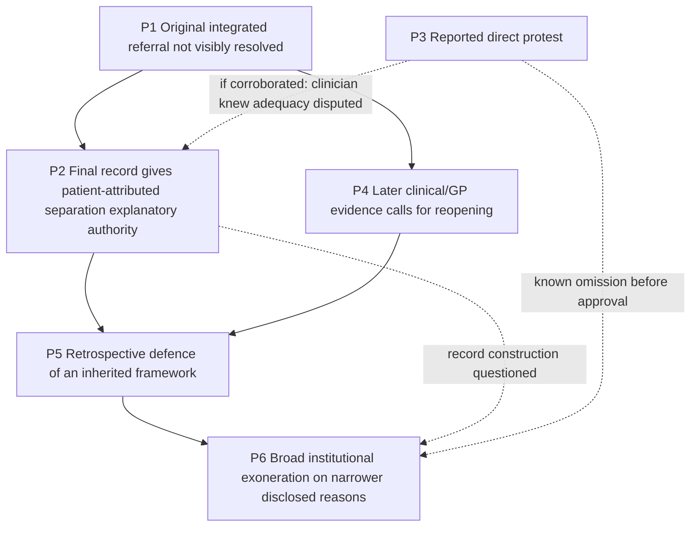

# Six Decisive Propositions the Hospital Must Answer

**Working evidential compression | 18 November 2026 | Version 1.0**

**Parent document:** `THE_25_ESSENTIAL_UNDERSTANDINGS.md`, K01–K25.  
**Purpose:** Convert a 25-point interconnected evidence map into six answerable propositions. Each proposition states (a) the proposition to be tested, (b) the combined evidence that makes an answer necessary, (c) the concrete answer and records required from the hospital, and (d) how an adequate response could confirm, qualify or defeat the proposition.

## Governing responsive-answer standard — The substitution of documentary defensibility for genuine medicine

The patient's affirmative allegation is that the post-protest construction of the 2017 account subordinated clinical investigation to the preservation of an existing professional disposition, and that the resulting framework impaired subsequent reassessment, including recognition of possible treatment-related harm and safeguarding when suffering became intolerable. This is an allegation to test, not a finding of intention, causation or liability. [The investigative essay](journalistic-essay.html#gravity-of-case) and [the gravest allegation](index.html#gravity-statement) set out the full narrative.

P1 requires the investigation of the referral, not merely a Parkinsonism diagnosis; P2 requires the source and provenance of the attribution, including the disputed manuscript addition; P3 requires the response to the protest, not a retrospective rationale; P4 requires the clinical reassessment of foot-specific medication evidence, including the later regimen and safety warnings; P5 requires a response to the alleged treatment-related harm as distinct from the rationale for caution; P6 requires evidence of independent review of those questions. The safety response must be accounted for even if the original allegation is defeated. An explanation of a decision is not a substitute for investigation of its consequences.

## The baseline question that crosses P1, P3 and P6

**The missing clinical baseline is not simply a later proof problem.** The 2017 referral put painful, abnormal feet, movement, tone and gait before the hospital as a connected clinical problem. An eight-day neurological admission offered the opportunity to document the relevant foot and motor findings, differential explanations, treatment effects and outstanding responsibilities. The reviewed account demonstrates substantial Parkinsonism work but does **not itself demonstrate** a fully articulated comparative baseline for the foot–movement relationship. What additional examination or pharmacological testing was indicated is an independent clinical-standard question, not a premise to be assumed.

**P1 asks** whether the baseline reasonably required to address the original referral was established or responsibly assigned. **P3 asks** what remained possible to observe, examine, explain or arrange when the patient reported protesting the insufficient foot investigation on 10 July, before the historical admission conditions were lost. **P6 asks** whether the 2025 review tested this original baseline deficiency instead of treating the 2017 interpretation as a sufficient surrogate for the missing comparative observations.

The *lost-baseline opportunity* means the original condition cannot later be re-examined under exactly the same circumstances. The *absent-baseline asymmetry* means a deficient baseline could both impede the patient's subsequent attempts to demonstrate change and make it easier for an inherited interpretation to retain authority. That possible effect is **not** evidence of a deliberate institutional strategy to preserve ignorance. Equally, the patient should not have to prove the clock-time at which the referral was read: the central questions are what the hospital received, what was known, what was documented, and how the question was handled.

**Specific records and expert tests:** full original GP referral and hospital triage/précis; 2017 complete examination, nursing, therapy, medication and foot assessment records; dated pain, palpation, toe-position, loading and response observations if any; discharge follow-up assignments; April 2018 note and later GP/podiatry reports; complete 2025 preliminary assessment/PAR, its evidence inventory and scope. Ask a relevant neurological expert to distinguish required baseline work from optional tests, and counsel to distinguish an inadequate investigation from an inadequate surviving record. Contrary records can materially defeat or narrow this proposition.

---

## The governing distinction

The issue is **not** whether Parkinsonism was correctly investigated, whether every medication choice was mistaken, or whether peripheral neuropathy was impossible. The issue is whether a **connected foot–toe-clawing–posture–tone–pain presentation** was investigated and either resolved or expressly assigned for continuing investigation; whether the final record faithfully described the patient's position; whether later findings prompted genuine reconsideration; and whether a hospital review answered those issues rather than a narrower medication dispute.

**Evidence vocabulary:** **D** = document directly supports the factual assertion; **M** = corroborated by different documentary sources; **T** = firsthand patient testimony; **I** = inference; **X** = missing controlling material. A documented *absence from the reviewed record* is not proof an event never occurred. Motive and intention are not needed for the central clinical case.

**Source key:** [C: canonical clinical transcription](https://github.com/TitanicParker/prima-facie/blob/main/REPAIRED_CANONICAL_V2.md) with CLIN labels; [H: manuscript images/transcription](https://github.com/TitanicParker/prima-facie/blob/main/The_Record_Before_the_Record_Updated.html); [DS: July specialist/discharge](https://github.com/TitanicParker/for-counsel/blob/main/docs/source-records/discharge-summary.html); [P: podiatry SAR](https://github.com/TitanicParker/case-evidence-ledger/blob/main/PODIATRY_SAR_2026_TRANSCRIPTION.md); [R: 25 March 2025 rebuttal](https://github.com/TitanicParker/for-counsel/blob/main/docs/source-records/official-rebuttal.html); [EH: September 2017 second opinion](https://github.com/TitanicParker/for-counsel/blob/main/docs/source-records/healy-response-2017-09-12.md). The original source documents control over extracted text.

---

## P1 — The referral was integrated; the hospital's answer was diagnostically narrower

**Decisive proposition.** The GP's 29 June 2017 urgent referral required specialist assessment of the connected presentation of painful abnormal feet, clawing, gait, rigidity/tone and progressive movement dysfunction. The hospital extensively investigated Parkinsonism, but its documented disposition did not establish how neurological posture and tone related to the painful foot lesions or clearly assign the unresolved causal question for neurological follow-up.

**Defined evidential combination.**
1. **Before referral (D/M):** GP examination 10 April 2017 documented bilateral pain, mallet toes, callus/pressure lesions and abnormal gait; 8 June described the need for an opinion on “gait, feet and ‘muscle tension’”; 12 June occupational-health concern corroborated gait; 23 June increased tone; 29 June urgent letter included clawing in bed, rigidity, initiation difficulty and employment risk (**C CLIN-000018–000028, -000064–000074, -000100–000111, -000190–000215, -000815–000890**).
2. **Hospital recognised and treated elements (D):** abnormal movement and a gait somewhat suggestive of dystonic posture rather than genuine foot drop; pes planus and hammertoes; Parkinsonism work-up; clonazepam for leg tension; podiatry referral (**C CLIN-001097–001121, -001153–001171, -001182–001188, -001225–001229, -001651–001653**).
3. **Disposition (D):** possible completely separate/peripheral neuropathic symptoms expressly “Not clear”; plan “As per above”; discharge summary concentrated on Parkinsonism and reported leg-tension treatment and podiatry referral (**C CLIN-001142–001149, -001613–001628, -000421–000425, -000484–000520**).

**Question the hospital must answer.** **Where, in the clinical material created during or immediately following admission, was the relationship of abnormal lower-limb tone/posture and toe clawing to recurrent painful pressure lesions examined, concluded upon or assigned to a named clinician for further investigation?** Identify the date, clinician, specific foot and gait examination, differential, investigation, disposition, referral scope and feedback loop to GP. Explain how this addressed *the actual 29 June referral*, not only the positive Parkinsonism findings.

**What would resolve or defeat it.** A dated, adequately reasoned neurological–podiatric assessment and explicit follow-up responsibility could materially defeat the proposition. Evidence of only a Parkinsonism diagnosis and lesion treatment would support the narrower-gap finding but not, by itself, prove a breach of the then-applicable standard of care.

**Consequence.** P1 is the foundation. The remaining propositions assess what happened when this gap was documented, managed, revisited, defended and reviewed.

**25-point dependencies:** **K01–K04, K06–K08, K14, K16**.

## P2 — The completed record strengthened a patient attribution without resolving the medical inference it appeared to support

**Decisive proposition.** The handwritten interview recorded the patient's recognition that pain and leg tension felt different and had different temporal prominence. The completed history described them as “not the same problem,” and the final impression said that he had **“in his own mind - markedly divorced”** them, adjacent to an uncertain peripheral-neuropathy possibility. This can make a patient's phenomenological distinction look like support for the clinician's causal partition, without demonstrating that the patient endorsed independent medical causes.

**Defined evidential combination.**
1. **Manuscript (D with transcription limitation):** three handwritten pages from the 3 July interview: tension dating to circa 2004; earlier 2014 presentation; foot problems treated from 2009–10; reduction of some pain after leaving bar work; continued tension more distinguishable (**H** manuscript pp.1–3; compare **C CLIN-000965–001000**).
2. **History and impression (D):** “not the same problem” already resembles manuscript “weren't the same”; **the decisive intensification is the doctor-authored ‘markedly divorced’ in the final impression**, not the mere appearance of “not the same” (**C CLIN-000974–000976, -001142–001149**).
3. **Potential clinical function (I):** the patient-attributed separation follows the hypothetical peripheral explanation, helping render separate management intelligible while uncertainty is acknowledged.

**Question the hospital must answer.** **What exact patient words, examination evidence or contemporaneous note justified the attribution that he had “markedly divorced” the experiences “in his own mind”?** State whether the clinician was recording (i) the patient's different sensations, (ii) the patient's belief in separate medical causes, or (iii) the clinician's interpretation. Identify how the passage was drafted, reviewed and transmitted, and whether the original manuscript accompanied it.

**What would resolve or defeat it.** An independent contemporaneous statement from the patient explicitly endorsing different underlying causes would weaken the attribution objection. A demonstrably accurate transcription plus transparent clinician interpretation would be different from an unsupported portrayal of the patient's own position. The text comparison alone does **not** prove forgery or bad faith.

**Consequence.** P2 establishes a potentially consequential **record-construction** issue independently of whether the 10 July protest is proven. Its downstream authority is tested in P5 and P6.

**25-point dependencies:** **K03, K05, K06, K10, K20, K23**.

## P3 — A reported pre-discharge challenge was not visibly resolved or preserved in the authorised account

**Decisive proposition.** The patient reports confronting the neurologist on 10 July 2017 about inadequate investigation of the feet before discharge. If that encounter occurred and was material, the final clinical account does not preserve the expressed concern, the clinician's response or a documented reopening or handover of the foot question. The final account was authorised **after** the alleged challenge, although its individual contested sentences may have been drafted earlier.

**Defined evidential combination.**
1. **Reported event (T, not independent proof):** patient says four medical students were asked to summon the neurologist, and he protested about the feet on Monday 10 July; earlier 2025 recounting had a one-day discrepancy, requiring witness-based date control ([protest evidence and source chronology](https://github.com/TitanicParker/legal/blob/main/18_PROTEST_EMERGENCE_AND_INSTITUTIONAL_CONDITIONS.md)).
2. **Authorisation and omission (D):** discharge 11 July; DaTscan addendum at transcription finalisation 13 July 21:41; discharge summary confirmed 17 July 19:30; no corresponding protest identified in the reviewed completed account (**C CLIN-000248–000261, -000403, -001629–001638**, DS).
3. **Attribution asymmetry (D/T/I):** clinician's confident “markedly divorced” patient-characterisation is present; contrary patient challenge is reported but absent (**P2**). The asymmetry becomes intention-relevant only if knowledge of the challenge is established.

**Question the hospital must answer.** **Did the neurologist meet the patient after being summoned before discharge; what precisely was said; was any further foot examination, explanation or referral decision made; and why was a material objection not recorded or relayed to the GP?** Identify students, ward roster, progress notes, discharge discussions and first draft/approval timestamps for the clinical impression.

**What would resolve or defeat it.** Credible corroboration and proof of no substantive response would materially strengthen a conscious-preservation case. A contemporaneous record of the discussion and reasoned response could weaken it. A 17 July confirmation **cannot alone prove** a sentence was rewritten after 10 July. The original March 2025 complaint did not yet present this detailed protest; the neurologist's March rebuttal cannot fairly be faulted for not answering that particular allegation then.

**Consequence.** P3 is the **intention-sensitive proposition**. P1 and P2 stand even if the event cannot be independently proved.

**25-point dependencies:** **K05, K09–K11, K23–K24**.

## P4 — Later independent information challenged the practical separation, but the specialist system did not demonstrably close the original loop

**Decisive proposition.** The clinical and primary-care record accumulated specific information that should have made the old foot–movement relationship reviewable: the neurologist's 2018 procyclidine-withdrawal foot report and PRKN suspicion, recurrent physical podiatry findings, the GP's 2019 explicit Parkinsonism–tone–clawing formulation, and severe renewed foot pain in 2023. The GP retained clinical agency but ultimately required specialist authority for neurological changes. More activity was not necessarily an integrated answer.

**Defined evidential combination.**
1. **2018 neurological intersection (D):** the neurologist recorded patient-reported recurrence of the original outer-left-foot symptom during procyclidine withdrawal and the contemporaneous PARK2/PRKN suspicion; separate 2017 Healy opinion raised PARK2 (**C CLIN-001887–001956**; **EH**). Withdrawal is a temporal association, not experimental proof.
2. **Independent GP/podiatry evidence (M):** recurring left fifth MTPJ lesions, clawed toes, pads/orthotics; March 2019 GP re-referral linked increased tone, abnormal gait and Parkinson's with “clawing feet” and pain (**P**; **C CLIN-003090–003107**). This **rebuts** the theory that the GP wholly accepted neurological-foot separation.
3. **2023 escalation and constrained access (D):** urgent 26 March GP referral described severe burning foot/lower-leg pain, reported death wish and earlier pain improving with Parkinson's control; GP-started pregabalin confirmed by nurse 28 March; consultant advised cancellation list amid clinic pressure and return to GP meanwhile (**C CLIN-002612–002688**). Later neurology did explore alternatives, including Fabry, and treated pain; 2024 note still recorded toe curling despite pregabalin relief (**C CLIN-002475–002491, -002698–002712**).
4. **Specialist prescribing dependency (D):** GP in 2025 and after December 2025 specialist review said changes to levodopa/new neurological treatment required specialist supervision (**C CLIN-005019–005025, -005268–005273**).

**Question the hospital must answer.** **After each material trigger—2018 withdrawal observation, 2019 GP/podiatry evidence if transmitted, March 2023 urgent referral, 2024 persistent toe curling—who considered whether dystonic posture and loading caused or contributed to foot lesions and pain; what was concluded; how was the GP informed; and what was the safety/triage response in 2023?** Supply relevant clinic assessments, communication logs and dates. Separate records the consultant received from information present only in the wider system.

**What would resolve or defeat it.** An identifiable repeated foot–movement/biomechanics work-up and communicated specialist plan would weaken a longitudinal non-reassessment claim. Medication adjustments and negative Fabry tests, without examination of this specific relationship, would not settle it. The GP was **not formally forbidden** from independent judgment; complex neurological prescribing legitimately needs specialist oversight.

**Consequence.** P4 explains **specialist-created informational and therapeutic dependency** without claiming that the GP stopped recognising the problem or that absolutely no reassessment occurred.

**25-point dependencies:** **K12–K19, K22, K25**.

## P5 — The 2025 rebuttal defended a narrower clinical decision and retrospectively smoothed the treatment history

**Decisive proposition.** The patient's 19 March 2025 complaint questioned diagnostic anchoring, failure to reassess persistent foot pain and the significance of Sinemet CR benefit. The neurologist's 25 March rebuttal gave substantial reasons for recognising Parkinsonism, delaying/escalating Sinemet cautiously and considering other diagnoses, but did not demonstrably answer why the original painful-foot/posture/tone presentation was partitioned or how that partition was later tested.

**Defined evidential combination.**
1. **Complaint (D):** 19 March 2025 complaint asked for independent review of 2017–2025 clinical reasoning, an explanation of long-standing pain and disclosure/preservation (**C CLIN-003439–003485**).
2. **Reply (D):** 25 March 2025 clinician defended Parkinsonism diagnosis, risks of young-onset levodopa/dyskinesias, knowledge of medication-responsive pain, Healy second opinion and Fabry testing, using terminology of “peripheral neuropathic pain symptomatologies” (**C CLIN-003237–003269**, **R**).
3. **Chronology mismatch requiring explanation (M/I):** March 2023 GP and nurse established GP initiation of pregabalin at 25mg BD for severe pain; the rebuttal described pregabalin “introduced ... in part to try to spare further Sinemet increase.” Later Sinemet-sparing rationale was genuine, but does not establish the GP's initial reason (**C CLIN-002635–002641, -002680–002684, -003263–003267**).
4. **Omitted historical context (D comparison):** September 2017 Healy PARK2 opinion and April 2018 patient's left-foot treatment-withdrawal response were not substantively integrated into the rebuttal's account of foot pain.

**Question the hospital must answer.** **Where in the 25 March response, or in the evidence supplied to reviewers, is the 2017 foot–posture–pain question answered?** Provide a side-by-side complaint allegation → contemporaneous evidence → response matrix. Explain precisely whether the 2025 pregabalin passage describes **original GP initiation** or **later specialist management**, and how the actual Healy/2018 findings were considered.

**What would resolve or defeat it.** A reasoned and contemporaneously grounded response to the original foot-mechanism issue would weaken this proposition. Valid levodopa-risk analysis alone would not. The rebuttal was not wholly irrelevant: the original complaint *did* include Sinemet response and treatment questions.

**Consequence.** P5 establishes the principal **retrospective-defence scope mismatch**, with a concrete test of narrative smoothing rather than an unsupported accusation of deceit.

**25-point dependencies:** **K12, K18, K20–K23**.

## P6 — The institution's no-deficit conclusion exceeded the scope of the explanation it disclosed, while the source record was itself contested

**Decisive proposition.** The 2025 PAR/SIMT concluded no deficit in care, but the signed outcome explained that conclusion principally through Sinemet timing, side-effect risks, other diagnoses considered and Sinemet's 2021 initiation. It did not demonstrate an independent review of the original GP question, disputed handwritten-to-typed attribution, alleged protest or foot-mechanism responsibility. The full PAR could change the assessment and has not been established from the material reviewed.

**Defined evidential combination.**
1. **Institutional outcome (D):** PAR presented to SIMT **27 August 2025**; outcome letter **3 September 2025** found “no deficit in the care provided” and communicated largely prescribing-focused reasoning (**C CLIN-005028–005065**).
2. **Prior notice (D institutional receipt, not personal SIMT knowledge):** Article 16 concerns **12/15 June 2025**, detailed hospital-facing protest-related Article 15 request **7 July**, Article 18/data-quality/review-source request **4 August**, all before SIMT meeting (**C**, 2025 notices; [protest chronology](https://github.com/TitanicParker/legal/blob/main/18_PROTEST_EMERGENCE_AND_INSTITUTIONAL_CONDITIONS.md)).
3. **Preservation of historical authority (D):** September 6 rectification refusal emphasised historical professional opinions and continuity; QPS January 26, 2026 stated December 2025 dystonia diagnosis did not require reopening previous governance determination (**C CLIN-005067–005101, -005512–005534**).
4. **Later genetic context (D with qualification):** 2026 report identifies two pathogenic PRKN variants; causative assessment requires them to be in **trans**, for which familial segregation was recommended; this is not, alone, proof of the foot mechanism (**C CLIN-006181–006212**).

**Question the hospital must answer.** **What were the PAR's terms of reference, evidence inventory, reviewer identities, decision minutes and explicit findings on (i) the original 29 June GP referral, (ii) the 2017 dystonic-looking foot/gait examination and clonazepam rationale, (iii) the handwritten/typed attribution, (iv) the reported protest notified before SIMT, (v) 2018/2019/2023 contrary evidence, and (vi) longitudinal clinical ownership of the foot issue?** What evidence-cleaning or dispute-annotation steps were used after June–August notices? Identify who personally saw each notice. Explain why the full no-deficit conclusion is supported beyond prescribing caution.

**What would resolve or defeat it.** A full independent PAR that demonstrably examined these sources and reasoned through the original problem could defeat the claim that the institution reviewed only the narrower question. A final letter explaining a broad exoneration primarily through Sinemet caution, without such internal work, leaves a substantial scope/independence deficiency. Article 18 correspondence does not alone establish unlawful processing.

**Consequence.** P6 is the **institutional-accountability proposition**. A valid defence of some clinical decisions need not validate the whole admission or the process by which its record was relied on.

**25-point dependencies:** **K05–K06, K09–K11, K18, K21–K25**.

---

## How the six propositions work together

**Dependencies and separability:**
- **P1** stands without the protest or genetic confirmation. It is an evidence-gap claim pending the hospital's contemporary examination/handover files, not a concluded standard-of-care breach.
- **P2** stands as a documented shift in *attributed meaning*, even if it originated before 10 July. Proven intention is a separate question.
- **P3** is the contingent conscious-preservation branch; do not let a witness dispute invalidate P1, P4 or P5.
- **P4** is independently strengthened by the 2019 GP record and 2023 referral; it also limits the simplistic allegation that no clinical work occurred.
- **P5** tests the difference between answering levodopa caution and answering original diagnostic/causal adequacy.
- **P6** addresses what the institution established, rather than assuming the missing full PAR's contents.

## The six hospital questions — compact schedule for review

| ID | Specific answer demanded | Essential documents to produce |
|---|---|---|
| **P1** | Where is the original foot–posture–tone–pain relationship investigated, resolved or explicitly handed over? | Complete 2017 intake, GP referral, inpatient examination, podiatry/neurology referrals, complex-case meeting materials and follow-up plan |
| **P2** | What exactly supports attributing “markedly divorced” to the patient's own mind, rather than marking it as clinician interpretation? | Three manuscript images, diplomatic transcription, dictated drafts, versions, final typed history/impression and author sign-off |
| **P3** | What happened at the reported 10 July encounter, and where is the challenge and response recorded? | Staff/student rosters, progress notes, discharge discussions, statement/response, drafting and approval audit log |
| **P4** | Which later 2018/2019/2023/2024 findings prompted reassessment of painful-foot mechanics and neurological responsibility, and how was GP informed? | Consultation letters, medication-withdrawal account, original podiatry/GP documents, urgent triage, safety plan, cross-specialty communications |
| **P5** | How did the 2025 rebuttal answer anchoring/foot causation rather than primarily levodopa timing, and how does its pregabalin chronology reconcile with 2023? | 19 March complaint, 25 March response/enclosures, 2023 GP prescription/nurse email, 2017 Healy and 2018 records, complaint–response matrix |
| **P6** | What did PAR/SIMT actually review, what contested evidence was tested, and what supports a broad no-deficit conclusion? | Full PAR, terms of reference, evidence inventory, minutes, reviewer list, notice-routing/acknowledgements, reasoned findings, later reconsideration decisions |

## Thresholds for an answer to count as responsive

An answer must **identify a specific contemporaneous record or witness**, state what proposition it proves, and distinguish **symptom treatment**, **identification of Parkinsonism**, **investigation of foot mechanism** and **clinical responsibility for follow-up**. Generic assertions that “podiatry was involved,” “alternatives were considered,” “Parkinsonism was correctly diagnosed,” or “Sinemet was appropriately delayed” do not alone answer P1. Likewise “the notes are reassuring” does not by itself answer a challenge to those notes' source and construction. The institution may legitimately answer that a mechanism remained uncertain, but it must then explain why the degree of assessment and the follow-up allocation were appropriate.

## Overall theory — the minimum claim that survives without proving bad faith

**The hospital established an appropriate-looking specialist pathway for Parkinsonism while its contemporaneous records left a clinically important causal relationship involving the painful feet unresolved or at least without an identified owner. Its completed account gave a strengthened patient-attributed separation and a provisional peripheral category practical authority. Later observations and GP referrals repeatedly created opportunities to revisit that allocation; treatment evolved, but an integrated explanation has not been identified. The 2025 consultant rebuttal and SIMT communication more clearly defend the Parkinsonism medication strategy than the original question. The institution must therefore produce the contemporaneous assessment and its independent review before the broad no-deficit conclusion can be accepted as a complete answer.**

This is the most parsimonious central case. **Conscious documentary preservation** remains a serious, separately testable branch under P3, not a required premise.

## Priority of proof

**First:** demand **P1 + P6** records together—original integrated referral/assessment and complete PAR evidence pack. They test the two endpoints: adequacy of the original disposition and adequacy of the institutional evaluation.

**Second:** test **P2 + P3** with original manuscript, drafting/audit records and the reported protest's witnesses. This determines whether record construction merely amplified an interpretation or consciously preserved it after challenge.

**Third:** use **P4 + P5** to assess whether later clinical evidence was effectively incorporated and whether the retrospective defence accurately describes the choices and the reasons they were made.

**Revision rule:** If the hospital produces a persuasive original foot–movement differential or a genuinely independent, source-complete PAR, revise or narrow these propositions. If it cannot, the central problem remains unaddressed irrespective of intentions.

**End of version 1.0.**