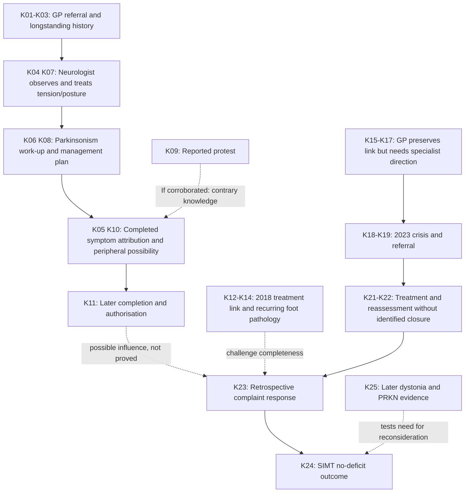

# The 25 Essential Understandings — An Interconnected Evidence Map of the Case

**Version:** 1.0  
**Prepared:** 18 November 2026  
**Scope:** Source-grounded synthesis of the original 2017 clinical presentation, contemporaneous recording, subsequent GP/podiatry and neurological care, 2025 complaint and institutional review, and evidence available in 2026. Companion to `WORKING_CASE_THEORY_AND_EVIDENCE_REGISTER.md`; does not amend primary sources.  
**Controlling question:** **Did a hospital investigation that substantially established Parkinsonism leave the GP's original foot–posture–tone–pain question without an allocated neurological answer, while its completed clinical narrative and later defence made that disposition increasingly authoritative?**

## Governing interpretation — The substitution of documentary defensibility for genuine medicine

The patient's affirmative allegation is that the post-protest construction of the 2017 account subordinated clinical investigation to the preservation of an existing professional disposition, and that the resulting framework impaired subsequent reassessment, including recognition of possible treatment-related harm and safeguarding when suffering became intolerable. This is an allegation to test, not a finding of intention, causation or liability. [The investigative essay](journalistic-essay.html#gravity-of-case) and [the gravest allegation](index.html#gravity-statement) set out the full narrative.

K01–K11 establish the original clinical question, the disputed record and notice; K12–K22 examine reopening evidence, including the original focal drug response, subsequent medication substitution, competing motor states, pregabalin benefit and its limits, and the 2023 distress; K23–K25 test the scope of defence and later evidence. At each junction distinguish an actual investigation or corrective action from a statement explaining the existing position. Preserve all K-identifiers and evidence statuses; this interpretive update does not upgrade any inference to established fact.

## Reading rules and source shorthand

- **D** = directly documented in the identified source; **M** = multiple substantially independent records; **T** = patient firsthand testimony (not independently corroborated merely by its repetition); **I** = inference to be tested; **U** = presently unresolved; **X** = dependent on missing material. A single entry may contain more than one status, with established facts and inferences separately specified.
- **C** = [canonical primary-source transcription](https://github.com/TitanicParker/prima-facie/blob/main/REPAIRED_CANONICAL_V2.md), cited using its `CLIN-` labels. These labels are locations in a transcription, not proof of original-source authentication. **H** = [handwritten history photographs and paired editorial transcription](https://github.com/TitanicParker/prima-facie/blob/main/The_Record_Before_the_Record_Updated.html), summarized in [source comparison](https://github.com/TitanicParker/prima-facie/blob/main/MASTER_CASE_FOR_COUNSEL.md). **DS** = [July 2017 consultant and discharge account](https://github.com/TitanicParker/for-counsel/blob/main/docs/source-records/discharge-summary.html). **P** = [podiatry records and 2019 GP referral](https://github.com/TitanicParker/case-evidence-ledger/blob/main/PODIATRY_SAR_2026_TRANSCRIPTION.md). **R** = [March 2025 treating-neurologist response](https://github.com/TitanicParker/for-counsel/blob/main/docs/source-records/official-rebuttal.html). **EH** = [September 2017 Prof Healy response](https://github.com/TitanicParker/for-counsel/blob/main/docs/source-records/healy-response-2017-09-12.md). All other cited items are in **C**, with document identifiers and CLIN locations.
- References to an **unidentified investigation or response** mean none was found in the reviewed corpus; they do not certify non-existence elsewhere. Attribution of knowledge to the neurologist requires evidence of receipt, observation or authorship; material held by another service is not automatically his personal knowledge.
- **Critical date controls:** clonazepam was *commenced during the admission*, but the drug-administration chart is needed to prove the precise first dose/night. The reported 10 July encounter predates the final discharge-account authorisation, but the first drafting date of its contested sentences is unestablished. The 2026 PRKN report identifies two pathogenic variants whose causal significance is conditional on their being **in trans**; segregation confirmation is requested by the laboratory.

## 25 essential understandings

### K01 — The GP's question was integrated before the hospital answered it

**Essential understanding.** The June 2017 referral joined painful abnormal feet, clawed toes, unusual gait, muscle tension, increased tone, impaired initiation and employment-threatening deterioration. It asked for neurological assessment of a developing *presentation*, not simply confirmation of Parkinsonism.

**Primary evidence.** GP examination 10 April; reviews 8, 12 and 23 June; urgent referral 29 June 2017 (**C CLIN-000018–000028, -000064–000074, -000100–000111, -000190–000215, -000815–000890**). The GP's phrase “gait, feet and ‘muscle tension’” occurs on 8 June.

**Local meaning.** The initial assessment must be audited against the symptoms for which assistance was requested, rather than only against the eventual primary diagnosis.

**Elsewhere illuminated.** **K05:** the discharge's separation should be measured against this original integrated presentation. **K16:** the 2019 GP referral shows that the initial question survived subsequent specialist care.

**Misreading.** The GP had *proved* a single neurological cause; he identified a reasonable relationship to investigate, not its mechanism.

**Gap.** Establish the original referral's receipt, full display and use in the neurologist's 2017 assessment, including any abbreviated hospital précis.

**Case consequence.** Foundational standard for the original clinical concern and all later answer audits. **Status: D/M; receipt details U.**

### K02 — April-to-June changed clinical recognition, not disease onset

**Essential understanding.** The April presentation involved already longstanding foot and gait problems; June brought progressively clearer neurological signs and functional deterioration. The referral was the culmination of a change in *recognition* of an existing condition.

**Primary evidence.** GP 10 April mallet toes, calluses and pressure areas; 8 June starting difficulty; 12 June occupational-health corroboration; 23 June increased leg tone and brisk upper-limb reflexes; 29 June urgent referral (**C CLIN-000018–000028, -000064–000074, -000100–000111, -000190–000215; -000851–000884**).

**Local meaning.** Explains why urgency escalated and why foot pathology was not a disposable background complaint.

**Elsewhere illuminated.** **K01:** adds the GP's independent clinical progression. **K03:** distinguishes recent deterioration from longstanding antecedent symptoms.

**Misreading.** Parkinsonism or dystonia first arose in June 2017.

**Gap.** Retrieve full prior GP/2014 records and occupational-health documents for external corroboration.

**Case consequence.** Strengthens historical continuity and specialist referral expectations. **Status: M; earlier external records X.**

### K03 — The neurologist himself dated the symptom complex back years

**Essential understanding.** The handwritten interview recorded bodily tension from around 2004, foot treatment from about 2009–2010 and a 2014 hospital presentation for physical arm-and-leg tension; the patient described 2017 as the “maturation” of the 2014 condition. The neurologist carried a roughly thirteen-year onset into the DaTscan rationale and specialist correspondence.

**Primary evidence.** **H** manuscript pp.1–3 and editorial transcript; **C CLIN-000965–001000, -001130, -001394–001400, -001724–001728**.

**Local meaning.** Neurology had an internally continuous historical narrative on which to base diagnosis and treatment, even though not every symptom's cause was established.

**Elsewhere illuminated.** **K04:** supports the relevance of the motor examination. **K07:** clarifies that clonazepam treated an established historical feature, not a newly incidental complaint.

**Misreading.** Thirteen years of a precisely confirmed molecular diagnosis; it was a retrospective symptom history.

**Gap.** Original 2014 encounter and earlier foot-treatment documents.

**Case consequence.** Provides clinical continuity independent of the later foot-separation thesis. **Status: D for what was recorded; historical events partly T/X.**

### K04 — The dystonic-looking foot/gait finding belonged to the 2017 evidence

**Essential understanding.** The original neurologist observed a gait with an appearance of foot drop *suggestive of dystonic posture*, but expressly “NOT FOOT DROP,” and also recorded foot deformities. The potential neurological-foot relationship therefore did not require hindsight from a later dystonia diagnosis.

**Primary evidence.** 2017 examination and impression **C CLIN-001084–001122**, particularly **CLIN-001097–001099** and **-001119–001121**; DS.

**Local meaning.** Generated a concrete question about whether abnormal tone/posture influenced clawing, foot loading and pain.

**Elsewhere illuminated.** **K06:** tests whether the 2017 care plan assigned responsibility for this finding. **K12:** makes later medication-sensitive focal symptoms more informative.

**Misreading.** “Suggestive” is a definitive dystonia diagnosis or proof that pressure lesions were neurologically caused.

**Gap.** Targeted contemporaneous foot examination, loading analysis, specialist discussion and referral contents.

**Case consequence.** Strong original clinical trigger for an integrated investigation. **Status: D; causal implication I/U.**

### K05 — A symptom distinction became a stronger patient-attributed separation

**Essential understanding.** The handwritten history distinguishes experiences of foot pain and leg tension, particularly after standing-related foot pain lessened. The typed history says they were “not the same problem,” and the impression says the patient had “in his own mind - markedly divorced” them beside the possible peripheral explanation.

**Primary evidence.** **H** manuscript p.3; **C CLIN-000968–000976, -001142–001149**; DS. The manuscript's editorial transcription already contains “weren't the same”; do **not** claim that the exact idea of difference first appeared in typed text.

**Local meaning.** Clinical *phenomenology* (different sensations) was placed beside an *aetiological* possibility (different underlying causes), with unusually emphatic attribution to the patient.

**Elsewhere illuminated.** **K10:** this is the central mechanism by which an uncertain interpretation could become an operational division. **K09:** the absence of the reported contrary objection makes the selectivity question more serious.

**Misreading.** A proved forged quotation or a patient-endorsed medical diagnosis of separate diseases.

**Gap.** Diplomatic handwritten transcription, all draft versions and dictation/typing provenance.

**Case consequence.** Core documentary-construction finding independent of proving intent. **Status: D comparison; meaning I; intention U.**

### K06 — The admission answered Parkinsonism more clearly than it answered painful feet

**Essential understanding.** Investigations, movement-disorder assessment, multidisciplinary discussions and medication planning substantially addressed Parkinsonism. The feet received podiatry attention and a provisional peripheral hypothesis, but no identified integrated neurological mechanism or explicit owner for completing that differential.

**Primary evidence.** Original referral **C CLIN-000815–000884**; 2017 examination/impression **-001097–001171**; podiatry recommendations **-001225–001229**; summary “Clonazepam was given at night...” and podiatry referral **-000343–000345**; plan **-001613–001628**.

**Local meaning.** Differentiates an impressive volume of clinical work from a complete answer to the GP's connected question.

**Elsewhere illuminated.** **K01:** defines what had to be addressed. **K20:** shows why a later defence of levodopa management may not answer this original scope issue.

**Misreading.** No foot treatment occurred, or every unresolved differential necessarily reflects unacceptable care.

**Gap.** Full 2017 multidisciplinary/podiatry records and a contemporary independent standard-of-care assessment.

**Case consequence.** Leading original clinical issue. **Status: D for acts/absence in reviewed record; adequacy I/X.**

### K07 — Clonazepam records neurological ownership of the longstanding tension

**Essential understanding.** Clonazepam was commenced *during* the July 2017 admission expressly for leg tension. The neurologist contemplated that nighttime procyclidine could remove its need: the abnormal tension was part of neurological management, not just an unowned peripheral symptom.

**Primary evidence.** **C CLIN-001182–001188, -001651–001653, -000343, -000357**; DS. Original discharge dose 0.25 mg nocte for two weeks.

**Local meaning.** Establishes specialist treatment of a longstanding component of the clinical history and a contemplated substitution within the Parkinsonism regimen.

**Elsewhere illuminated.** **K03:** connects treatment to the 2004/2014 symptom history. **K13:** later benzodiazepine/diazepam use should be evaluated through the *indication*, not assumed uninterrupted nightly clonazepam consumption.

**Misreading.** The first dose occurred on the very first night, or the drug proves foot pain was dystonic; exact first-dose time and causal effect are unproved.

**Gap.** Inpatient medication-administration chart, follow-up on nocturnal procyclidine, prescribing indications and actual frequency.

**Case consequence.** Independent treatment trace supporting the integrated clinical question. **Status: D; first-night claim U.**

### K08 — The 2017 plan was adjustable in prescriptions but less explicit about reopening premises

**Essential understanding.** The neurologist planned cautious delays to levodopa, gradual procyclidine titration and specialist follow-up, while stating that genetic diagnosis usually would not “actively change management.” This did *not* ban revision, but supplied no equivalent process for reconsidering why feet, posture and pain might be connected.

**Primary evidence.** **C CLIN-001166–001229, -001493–001497, -001601–001628**, including “Plan/Recommendations: As per above.”

**Local meaning.** Distinguishes medication-plan flexibility from re-examination of the underlying clinical problem definition.

**Elsewhere illuminated.** **K06:** tests what the plan left open. **K17:** shows how later GP prescribing dependence operated within specialist oversight.

**Misreading.** The genetic-management statement means the whole clinical strategy was permanently fixed.

**Gap.** Clinical reasons for not explicitly assigning foot-mechanism reassessment and evidence of later plan revisions.

**Case consequence.** Candidate management-path-dependence mechanism. **Status: D wording; entrenchment I.**

### K09 — The reported 10 July protest is knowledge evidence, not merely a narrative omission

**Essential understanding.** The patient reports directly challenging the neurologist before discharge about failure to investigate the feet, having asked four students to summon him. If corroborated, this establishes specific clinician knowledge of an objection to *adequacy*, distinct from knowledge that pain existed.

**Primary evidence.** Firsthand patient account and dated reconstruction in [protest evidential study](https://github.com/TitanicParker/legal/blob/main/18_PROTEST_EMERGENCE_AND_INSTITUTIONAL_CONDITIONS.md); absence of identified matching entry in the completed DS; chronology in [master case](https://github.com/TitanicParker/prima-facie/blob/main/MASTER_CASE_FOR_COUNSEL.md).

**Local meaning.** Raises whether discharge and account approval occurred despite a direct request to reopen the clinical question.

**Elsewhere illuminated.** **K05:** one patient-attributed position is strengthened while the allegedly expressed contrary challenge is absent. **K11:** distinguishes drafting from subsequent approval of the account.

**Misreading.** Omission proves fabrication, or the reported event is already independently corroborated by the students.

**Gap.** Trainee identities/rotas, contemporaneous notes, staff recollections, patient's earliest statements and clinician response.

**Case consequence.** Potentially high-force conscious-preservation theory, but contingent on testimony corroboration. **Status: T; corroboration X.**

### K10 — Possible peripheral neuropathy acquired practical authority without being established

**Essential understanding.** The July impression said foot/leg symptoms “may have been completely separate” or represented secondary peripheral neuropathy, perhaps related to past alcohol consumption, and expressly “Not clear.” The possibility nevertheless gave the discharged case a category through which continuing foot symptoms could be managed.

**Primary evidence.** **C CLIN-001142–001149**; DS; comparison to later assessments **C CLIN-002475–002490, -003240–003258**.

**Local meaning.** Distinguishes an *acknowledged hypothesis* from an *operational assumption*: clinicians need not claim certainty for a provisional explanation to structure subsequent actions.

**Elsewhere illuminated.** **K05:** patient attribution supplies apparent support for separation. **K20:** the 2025 rebuttal again begins from “peripheral neuropathic pain symptomatologies” while discussing a cause “of whatever cause.”

**Misreading.** Peripheral neuropathy was definitively diagnosed in July 2017; alternatively, that it was medically impossible.

**Gap.** Locate formal sensory/nerve-conduction findings and the first note that treated neuropathy as clinically confirmed rather than possible, if any.

**Case consequence.** Central pathway between initial account and retrospective explanatory framework. **Status: D hypothesis; downstream causal effect I.**

### K11 — Final authorisation after the protest is not proof of post-protest first drafting

**Essential understanding.** The reported protest falls on 10 July; discharge occurred 11 July; a DaTscan addendum was finalised 13 July at 21:41; the discharge summary was confirmed 17 July at 19:30. The text was authorised later, but the first drafting time of “markedly divorced” remains unknown.

**Primary evidence.** **C CLIN-000248–000261, -000403, -001629–001638**; DS; **K09** testimony.

**Local meaning.** Separates deliberate creation of a sentence *after* objection from approving or failing to revise a sentence *despite* knowledge of objection.

**Elsewhere illuminated.** **K09:** determines what the clinician may have known at approval. **K23:** matters when the hospital later relies on the approved record's authority.

**Misreading.** Signature/confirmation date proves the disputed wording was dictated after 10 July.

**Gap.** Native audit trail, versions, dictation dates, access logs, transcription workflow and actual dispatch timestamps.

**Case consequence.** Crucial intention/record-integrity test. **Status: D dates; event T; drafting U/X.**

### K12 — April 2018 joined PRKN suspicion and the original focal foot symptom

**Essential understanding.** During the same general period, the neurologist considered PRKN/PARK2 and recorded the patient's report that interruption of procyclidine was followed by rapid recurrence of symptoms at the original outer-left-foot corn. The conjunction supplied a reason to reassess posture/medication/foot effects, not a proof of one mechanism.

**Primary evidence.** April 2018 correspondence **C CLIN-001887–001956**, particularly the procyclidine-withdrawal account and **CLIN-001956**; earlier specialist genetic opinion **EH**, September 2017.

**Local meaning.** A medication perturbation brought the originally troublesome focal site back into neurological follow-up while the clinician suspected a genetic movement disorder.

**Elsewhere illuminated.** **K04:** made the earlier dystonic-looking gait relevant again. **K25:** later PRKN evidence increases the retrospective importance of the suspicion without establishing the original foot lesion's cause.

**Misreading.** A physical corn grew overnight, or withdrawal scientifically proved causation; the record preserves symptom report and temporal association.

**Gap.** Exact medication dates, clinical examination at withdrawal, photographic/podiatry correlation, and contemporaneous clinician response to that specific connection.

**Case consequence.** A top longitudinal reassessment opportunity and original connection discovered by joint reading. **Status: D clinician-recorded report and suspicion; causal inference I.**

### K13 — The clonazepam thread is continuity of indication, not uninterrupted ingestion

**Essential understanding.** By April 2018 the neurologist described Rivotril/clonazepam as controlling aspects of Parkinsonism-related muscular aches/spasm; use later became intermittent, then diazepam/Anxicalm substituted during supply shortages. The patient reports some benzodiazepine-family treatment for the same underlying problem in late 2026.

**Primary evidence.** **C CLIN-001911, -001934–001951, -002106–002108, -002385–002397, -002660, -002699, -002712**; 2026 continuation is patient report, not yet verified from current pharmacy chart.

**Local meaning.** A recurring treated phenomenon can persist without continuous nightly administration of one drug.

**Elsewhere illuminated.** **K07:** traces the original neurological indication. **K17:** demonstrates why changes to specialist-associated regimens can remain dependent on neurological guidance.

**Misreading.** Continuous daily clonazepam for nine years, or that diazepam and clonazepam have the same precise pharmacological effects or indication in every note.

**Gap.** Drug-dispensing, indication, actual-use records and review of ongoing need and alternatives.

**Case consequence.** Independent longitudinal trace of the tension problem, not foot-causation proof. **Status: D longitudinal documents; late-2026 continuation T.**

### K14 — Podiatry preserved physical pathology rather than merely a pain label

**Essential understanding.** Later podiatry records repeatedly document the left fifth MTPJ callus/corn, toe clawing, altered pressure sites and physical interventions—debridement, pads, insoles and toe props. The problem had observable structural and loading-related manifestations.

**Primary evidence.** **P**, clinic entries through 25 March 2019, including descriptions of left fifth MTPJ callus, clawed toes and orthotic measures; **C CLIN-003090–003107**.

**Local meaning.** A neuropathic *experience of pain* alone is not a full account of recurring focal pressure lesions and clawing.

**Elsewhere illuminated.** **K10:** sets a constraint on peripheral explanatory shorthand. **K15:** makes the GP's later integrated wording especially significant.

**Misreading.** Repeated podiatry treatment establishes dystonia as the sole cause; multiple biomechanical and dermatological influences remain possible.

**Gap.** Full pressure/biomechanical assessment, lesion mapping, footwear, sensory examination and coordinated neurological-podiatry findings.

**Case consequence.** Independent material corroboration of a persistent clinical problem. **Status: M for pathology; cause U.**

### K15 — The 2019 GP did not simply adopt neurological-foot separation

**Essential understanding.** The March 2019 GP podiatry re-referral explicitly linked foot problems to increased tone and abnormal gait associated with Parkinson's and noted “clawing feet” and pain. The GP retained an integrated understanding despite the hospital's earlier provisional division.

**Primary evidence.** **P**, 2019 referral “Medical History” and “Comments”; **C CLIN-003090–003107**.

**Local meaning.** Corrects a simplistic hypothesis that a specialist account extinguished the GP's independent clinical judgment.

**Elsewhere illuminated.** **K01:** shows persistence of the GP's original question. **K17:** separates *recognising* a potentially related problem from having specialist authority to settle and treat it.

**Misreading.** The GP established that foot lesions were neurological or that the treating neurologist personally saw this precise 2019 referral.

**Gap.** Recipient, correspondence routing, podiatry reply and evidence of neurologist awareness.

**Case consequence.** Strong independent counterweight and primary-care agency finding. **Status: D/M; specialist receipt U.**

### K16 — Podiatric treatment and neurological assignment are different actions

**Essential understanding.** The GP and hospital obtained podiatry involvement, and the patient received real foot interventions. This did not necessarily assign anyone to determine whether dystonic movement, abnormal muscle tone or pathological loading was the upstream contributor.

**Primary evidence.** GP 6 July 2017 priority call **C CLIN-000236–000245**; neurologist recommendation to GP to refer podiatry **-001225–001229**; **P** subsequent visits.

**Local meaning.** Makes the issue one of *division of clinical labour and ownership*, not an allegation that the feet were ignored in all respects.

**Elsewhere illuminated.** **K06:** explains why there can be extensive care but an unanswered original referral. **K18:** helps explain why renewed symptomatic activity in 2023 did not necessarily resolve aetiology.

**Misreading.** Podiatry referral itself proves the specialist was negligent, or proves causation was adequately assessed.

**Gap.** Exact referral wording, inter-service communications, shared plan and responsible clinician for the upstream question.

**Case consequence.** Defines a testable clinical-responsibility gap. **Status: D activities; adequacy U/I.**

### K17 — The GP retained diagnostic agency but relied on specialist therapeutic authority

**Essential understanding.** The GP acted independently—urgent referrals, podiatry re-referral, pregabalin initiation—but in 2025 and after the December 2025 specialist review expressly said levodopa/new neurological treatment changes required specialist guidance and monitoring.

**Primary evidence.** **C CLIN-003090–003107, -002635–002641, -005019–005025, -005268–005273**.

**Local meaning.** Identifies the practical dependency: primary care can recognise and escalate but cannot independently finish a complex specialist neurological treatment decision.

**Elsewhere illuminated.** **K08:** reveals why an established specialist plan may remain resilient. **K19:** the 2023 referral tests the real operational limits rather than hypothesising them.

**Misreading.** The neurologist formally prohibited GP independence, or specialist oversight is itself inappropriate.

**Gap.** Actual shared-care arrangements, GP letters seeking specific revised neurological-foot assessments and specialist responses.

**Case consequence.** Specialist-created *informational/treatment* constraint hypothesis, qualified by GP independence. **Status: D dependency; causal attribution to 2017 plan I.**

### K18 — The 2023 crisis made the stakes and recurrence unmistakable

**Essential understanding.** The GP's urgent 26 March 2023 referral described severe burning foot/lower-leg pain, major suffering and a reported death wish. It also cited prior arm pain that had settled with better Parkinsonism control—an explicit clinical reason to reconsider the relationship between neurological management and pain.

**Primary evidence.** Native-image-checked urgent referral **C CLIN-002623–002670**, especially **-002635–002641**.

**Local meaning.** Severe symptoms, safety concerns, and a prior movement-treatment/pain association were transmitted to Neurology; this was not a routine refill issue.

**Elsewhere illuminated.** **K19:** tests specialist response and immediate ownership. **K21:** establishes that pregabalin began as a GP response to severe pain, not as a clinician's originally formulated Sinemet-sparing regimen.

**Misreading.** Reported death wish proves a specific suicide-risk assessment did or did not take place; the referral establishes warning and concern, not the complete ensuing safety response.

**Gap.** Triage timing, clinical risk assessment, contact/care plan, GP contemporaneous follow-up and patient safety outcome.

**Case consequence.** Independent clinical safety and access-to-care issue. **Status: D source report; response completeness X.**

### K19 — Urgent re-referral achieved eventual attention, but immediate access was constrained

**Essential understanding.** The Parkinson's nurse informed the consultant on 28 March 2023 of debilitating pain despite GP-started pregabalin. A follow-up note documents cancellation-list placement due to clinic pressure and advice to return to GP if problems continued; later neurology reviews did undertake management and differential work.

**Primary evidence.** **C CLIN-002675–002688, -002612–002620**, subsequent 2023 review **-002475–002491**.

**Local meaning.** Shows both the practical specialist bottleneck and why “nothing happened” is false.

**Elsewhere illuminated.** **K17:** concrete specialist-dependency mechanics. **K22:** later clinical activity must be distinguished from completed reassessment of the foot mechanism.

**Misreading.** Cancellation-list placement proves the service never subsequently assessed the patient, or that the GP bore all care responsibility thereafter.

**Gap.** Full appointment/triage chronology, urgent referral acknowledgement, risk-management documentation and dates of ensuing appointments.

**Case consequence.** Tests longitudinal access and response adequacy. **Status: D; adequacy I/X.**

### K20 — The patient's attributed position was not stable across the years

**Essential understanding.** The 2017 impression says the patient had “markedly divorced” tension from painful feet. In 2023, the neurologist described the patient as believing the feet were a separate major problem while characterising himself as inclined to explain everything by Parkinsonism. The attribution had changed in context and function.

**Primary evidence.** **C CLIN-001146–001149, -002475–002480**, including the documented patient–clinician “misalignment.”

**Local meaning.** Patient accounts and clinician characterisations must not be treated as transparent, unchanging clinical facts.

**Elsewhere illuminated.** **K05:** demonstrates why patient-attributed wording requires source control. **K23:** later defence cannot use the 2017 interpretation as independent confirmation of what the patient had actually believed.

**Misreading.** The 2023 text proves deliberate deceit in 2017, or that the 2023 patient's beliefs accurately expressed an aetiological diagnosis.

**Gap.** Full 2023 consultation transcript or patient corrections, if any, and primary handwritten-to-typed 2017 production history.

**Case consequence.** Strong documentary contradiction concerning attributed understanding, not an established motive. **Status: D for authored representations; interpretation I.**

### K21 — Pregabalin history separates original prescribing purpose from later strategy

**Essential understanding.** The GP originally commenced pregabalin at 25 mg twice daily for the 2023 severe foot/lower-leg pain; the Parkinson's nurse confirmed this. The neurologist's 2025 rebuttal described pregabalin as introduced for neuropathic pain “in part to try to spare further Sinemet increase,” a rationale clearly expressed in later management but not established as the GP's original purpose.

**Primary evidence.** **C CLIN-002637–002641, -002680–002684, -003263–003267**; **R**.

**Local meaning.** A retrospectively valid reason for *continuing or adjusting* treatment should not silently become the reason for *initiating* it.

**Elsewhere illuminated.** **K18:** identifies actual prescribing circumstances. **K23:** provides a precise example of a retrospective account compressing separate phases into one coherent narrative.

**Misreading.** The neurologist never had a genuine Sinemet-sparing rationale; subsequent notes document that he did.

**Gap.** Complete GP initial prescription rationale, 2023 dose changes, 2025 prescribing decisions and whether the retrospective statement intended inception or later use.

**Case consequence.** High-value documentary-reconstruction test. **Status: M original GP initiation; I ambiguity of retrospective attribution.**

### K22 — Further differential tests were real, but did not resolve the original mechanism

**Essential understanding.** Later neurology considered Fabry disease and Parkinsonism/peripheral-neuropathy overlap, and negative alpha-galactosidase/beta-hexosaminidase results were subsequently reported. The 2024 note recorded improved foot pain on pregabalin with persistent activity-related toe curling. This represents real reassessment and treatment response, but not an identified integration of foot posture, pressure lesions and pain.

**Primary evidence.** **C CLIN-002475–002491, -002699–002712**.

**Local meaning.** Separates diagnostic activity, analgesic success, correction of rare-disease hypotheses and an answer to the recurrent biomechanics/motor question.

**Elsewhere illuminated.** **K14:** persistent mechanical findings require explanation alongside neuropathic sensations. **K24:** shows why citing “alternative diagnoses considered” does not prove that *this* question was investigated.

**Misreading.** Fabry testing was sham activity, or normal Fabry results exclude all peripheral causes.

**Gap.** Full examination and referral trail of any integrated foot–movement reassessment; full laboratory reports.

**Case consequence.** Substantive counterweight against an exaggerated “no reassessment” allegation while preserving precise outstanding question. **Status: D clinical activity; completeness U.**

### K23 — The 2025 rebuttal defended treatment caution more fully than the original problem-definition

**Essential understanding.** The patient's 19 March 2025 complaint alleged diagnostic anchoring and missed reassessment of prolonged painful feet, citing March Sinemet-CR response. The neurologist's 25 March reply substantially defended Parkinsonism diagnosis, levodopa timing, dyskinesia risk and specialist involvement, while continuing to frame the pain through possible peripheral neuropathic processes.

**Primary evidence.** Primary complaint **C CLIN-003439–003485**; clinician response **C CLIN-003237A–003269**; **R**.

**Local meaning.** A medically sophisticated answer to *why levodopa was used cautiously* is not necessarily an answer to *whether painful-foot causes were adequately investigated and reconsidered*.

**Elsewhere illuminated.** **K06:** exposes the original unanswered clinical scope. **K21:** tests accuracy of the retrospective chronology that bolstered the reply.

**Misreading.** The March complaint already alleged the detailed 10 July protest; that historical issue emerged in later correspondence. Nor was the reply wholly unresponsive: prescribing was part of the complaint.

**Gap.** Line-by-line complaint–response matrix and full enclosure/records actually provided to the complaint reviewer.

**Case consequence.** Strong retrospective-defence scope mismatch. **Status: D comparison; adequacy judgment I.**

### K24 — SIMT's broad no-deficit conclusion had narrower communicated reasoning

**Essential understanding.** The 3 September 2025 outcome reports a PAR presented 27 August and concludes “no deficit in the care provided,” citing particularly risks of early Sinemet, alternative diagnoses and first Sinemet prescription in 2021. It does not itself exhibit an independent original GP-referral/handwriting/protest/foot-mechanism audit.

**Primary evidence.** **C CLIN-005028–005065**, especially **-005042–005058**; original complaint **-003439–003485**; notices **-004916–004945**.

**Local meaning.** The *communicated reasons* more clearly justify Parkinsonism treatment strategy than the whole 2017–2025 clinical history.

**Elsewhere illuminated.** **K23:** the review's description resembles the rebuttal's narrower emphasis. **K05/K09:** disputed authorship and omitted patient position required testing if relied upon.

**Misreading.** The missing full PAR must have ignored the original referral; absence from the outcome letter is not proof of absence in internal deliberations.

**Gap.** Complete PAR, terms of reference, source inventory, reviewers, minutes, independence/conflict disclosures and response to contested-record notices.

**Case consequence.** Strongest institutional scope vulnerability, conditional on undisclosed review contents. **Status: D communication; internal process X.**

### K25 — Later dystonia/PRKN evidence cannot substitute for the original analysis—or be dismissed as irrelevant

**Essential understanding.** A December 2025 specialist assessment reportedly diagnosed dystonia; the 2026 genetic report identifies two pathogenic PRKN variants compatible with juvenile PARK2 if in compound-heterozygous configuration and recommends familial testing to establish phase. On 26 January 2026 QPS said the new dystonia diagnosis did not necessitate reopening prior reviews. These developments intensify—but do not themselves resolve—the earlier foot/posture question.

**Primary evidence.** Patient and GP correspondence regarding December specialist view **C CLIN-005268–005273** (original specialist report not reproduced there); QPS **-005512–005534**; genetic report **-006181–006212** (supplied September 2026); 2017 observation **K04** and 2018 suspicion **K12**.

**Local meaning.** Historical care must be judged against contemporaneous evidence; yet that evidence already included dystonic-looking gait and a movement-sensitive clinical course. A later molecular result is not required to make the original question reasonable.

**Elsewhere illuminated.** **K12:** earlier PRKN suspicion becomes more consequential. **K24:** later evidence tests whether the institution can distinguish not rewriting old diagnoses from genuinely reconsidering incomplete historical reasoning.

**Misreading.** Two pathogenic variants automatically establish their trans arrangement or the cause of every foot symptom; equally, that a later diagnosis is irrelevant to whether earlier known findings received an adequate response.

**Gap.** Original December 2025 specialist letter, parental/family segregation or other phasing proof, post-genetics integrated foot assessment and documented response from original hospital.

**Case consequence.** Latest diagnostic context and institutional-reopening test. **Status: D laboratory/QPS wording; specialist diagnosis partly indirect; phase U.**

---

## Evidential relationship map

This map describes *types* of connection: **→** documented information flow or temporal relation; **⇢** explanatory inference requiring proof of influence; **↔** independent corroboration or contrast. It does not present temporal succession alone as causation.

**Foundational clinical chain:** K01 + K02 + K03 establish what was presented and its longitudinal nature; K04 + K07 identify what Neurology itself observed/treated; K06 compares these with the actual plan. None needs the protest.

**Documentary mechanism:** K05 establishes interpretative intensification; K10 describes the provisional peripheral account; K11 distinguishes the moment of approval from the unknown moment of drafting. K09 would greatly strengthen a *conscious preservation* inference if independently corroborated. The wording comparison stands even if K09 is unproved.

**Independent tests of persistence:** K12 is a clinician-recorded 2018 medication-associated observation; K14 is a podiatry source; K15 is the GP's 2019 referral. They have distinct actors and provenance, so they do not simply repeat the 2017 discharge text.

**Consequences and feedback:** K16–K19 show care coordination and specialist dependence; K21 distinguishes an original GP act from the neurologist's later narrative; K22 demonstrates real alternative-diagnosis work; K23 shows the shape of the retrospective response; K24 tests institutional reliance; K25 asks whether new evidence changed the explanation. A closed causal loop *from discharge wording to each later act* is plausible, not documented as a universal fact.

## The indispensable selections

### Five foundational points

| K | Why indispensable |
|---|---|
| **K01** | Defines what the hospital was being asked to assess, preventing the Parkinsonism diagnosis from substituting for the entire referral. |
| **K03** | Shows the neurologist himself incorporated a pre-2017 historical syndrome, preventing an artificially short chronology. |
| **K04** | Supplies a contemporary neurological-foot observation, so the question is not solely hindsight. |
| **K05** | Identifies the precise transformation of patient description into specialist attribution. |
| **K06** | Sets the crucial clinical audit: documented treatment/investigation versus documented resolution and ownership. |

### Five most revealing investigation-generated connections

| K | Discovery, rather than mere pre-existing fact |
|---|---|
| **K07** | Connecting the neurologist's contemplated *procyclidine-for-clonazepam* substitution with his documented recognition of longstanding abnormal tension. |
| **K12** | Joint reading of 2018 PRKN suspicion and medication-associated recurrence of the original focal foot symptom. |
| **K15** | The 2019 GP referral refutes the simple thesis that specialist framing erased GP recognition, while exposing a different dependency. |
| **K21** | The GP-initiated pregabalin origin versus the retrospectively described Sinemet-sparing purpose: a precise source-to-reconstruction comparison. |
| **K24** | The distinction between a multidisciplinary review's existence and the breadth of the reasoning it actually communicated. |

“Original” here means an independently developed **cross-source connection or interpretation in this investigation**, not a claim that the underlying facts were first discovered by this assistant or absent from every pre-existing essay.

### Five strongest documentary tensions/contradictions

| K | Tension requiring a substantive answer |
|---|---|
| **K05** | Differentiable sensations in the handwritten account versus the stronger “markedly divorced” attribution within the aetiological impression. |
| **K09** | Reported direct complaint about uninvestigated feet versus absence of that objection from the approved account; conditional on corroboration. |
| **K15** | A possible separated foot disorder versus the GP's 2019 explicit Parkinsonian-tone/gait connection; not strictly incompatible but undermines a settled division. |
| **K21** | GP-initiated analgesia versus later language placing it within an overarching specialist Sinemet-sparing rationale. |
| **K23/K24** | Broad allegation of anchoring and original investigative omission versus a rebuttal/outcome primarily organised around levodopa timing and risk. |

### Five most consequential unanswered questions

| K | Question |
|---|---|
| **K06** | Was there any appropriately documented neurological evaluation or named handover for the foot–posture–loading relationship? |
| **K09** | Did the 10 July protest occur as described, and what did the neurologist say or do in response? |
| **K11** | When and by whom were the patient-attributed and peripheral passages first dictated, amended, reviewed and approved? |
| **K24** | Did the actual PAR independently examine the original GP referral, manuscript, protest and clinical ownership gap? |
| **K25** | Has a post-dystonia/post-PRKN specialist assessment connected the current mechanism to the original foot pathology, and what is the proven PRKN variant phase? |

## Evidence-status checklist

| Item | Established component | Inference, testimony or outstanding dependency | Next verification |
|---|---|---|---|
| [ ] **K01** | D/M GP findings/referral | Actual specialist receipt/consideration U | Native referral, intake and audit |
| [ ] **K02** | M April–June escalation | Earlier onset external sources X | Old GP/OH records |
| [ ] **K03** | D recorded long history | Historical diagnosis/2014 record X | 2014 MAU chart |
| [ ] **K04** | D dystonic-looking observation | Foot-lesion mechanism U | 2017 foot exam |
| [ ] **K05** | D text comparison | Meaning and deliberate choice I/U | Manuscript/images and versions |
| [ ] **K06** | D extensive neurological care | Adequacy/ownership U/X | Case notes, expert audit |
| [ ] **K07** | D clonazepam indication/plan | First dose U | Drug chart |
| [ ] **K08** | D strategy statements | Entrenchment mechanism I | Follow-up decision log |
| [ ] **K09** | T reported protest; D no identified entry | Independent corroboration X | Students/staff/ward records |
| [ ] **K10** | D provisional hypothesis | Confirmatory test/source U | Neuropathy investigation register |
| [ ] **K11** | D finalisation/confirmation dates | First drafting U | EHR audit trails |
| [ ] **K12** | D 2018 report/PRKN suspicion | Biological causation I | Medication/foot correlation |
| [ ] **K13** | D episodic drug history | Current use T; indication continuity I | Dispensing/indication log |
| [ ] **K14** | M repeated foot pathology | Upstream cause U | Podiatry biomechanics |
| [ ] **K15** | D GP 2019 linkage | Neurologist received it U | Referral routing |
| [ ] **K16** | D podiatry work | Neurological accountability unresolved | Shared-care notes |
| [ ] **K17** | D GP specialist-dependence statements | Specific causal role of 2017 account I | Correspondence and care pathways |
| [ ] **K18** | D GP serious-pain warning | Full safety response X | Risk/triage records |
| [ ] **K19** | D nurse/cancellation-list response | Adequacy and full timing X | Appointment timeline |
| [ ] **K20** | D contrasting representations | Patient's exact meaning U | Original letters/consult account |
| [ ] **K21** | M GP pregabalin initiation | Retrospective inception-purpose conflation I | Original scripts/2025 plan |
| [ ] **K22** | D Fabry work and toe curling | Integrated mechanical-neuro answer U | Cross-disciplinary assessment |
| [ ] **K23** | D complaint/response texts | Adequacy/scope I | Question-answer matrix |
| [ ] **K24** | D outcome and stated reasons | Actual PAR evidence X | PAR pack and minutes |
| [ ] **K25** | D pathogenic variants, QPS letter | Phase U; specialist letter indirect | Phasing and original dystonia opinion |

A checklist box is deliberately left unticked until the *item's unresolved part* has been closed; an unchecked item does not mean its established component is doubtful.

## Ten highest-value evidential tests — ranked by expected effect on explanation

| Priority | Precise test and required evidence | If supportive of concern | If contrary to concern |
|---|---|---|---|
| **1** | **Complete 2017 foot differential:** obtain admission bedside notes, nursing/physio records, footwear/sock-off assessment, podiatry referrals and specialist follow-up instructions; compare findings against 29 June GP referral. | Demonstrates whether linked symptoms were left unassessed or ownerless (K01/K04/K06/K16). | A contemporaneous integrated evaluation/explicit handover materially weakens the original clinical-gap theory. |
| **2** | **Discharge document genealogy:** native handwritten pages, dictation audio/logs, typed drafts, edits, timestamped authorisations, dispatched versions and access records. | Reveals when “markedly divorced” entered and whether opposing data could have been included (K05/K11). | An accurate early contemporaneous transcription with no material alteration limits post-protest reconstruction claims, though attribution issues may remain. |
| **3** | **10 July encounter corroboration:** trainee cohort lists, ward round/education rotas, ward diaries, clinician notes, students' independent accounts, earliest dated patient reports. | Establishes clinician notice of direct objection before approval (K09/K11). | Strong contradictory eyewitness evidence narrows conscious-preservation hypothesis; mere lack of records is non-dispositive. |
| **4** | **Full PAR/SIMT pack:** terms, evidence inventory, original GP referral/manuscript inclusion, minutes, author disclosures, independent reviewer questions, contested-data handling and decision trail. | Tests whether a broad no-deficit conclusion proceeded on narrower levodopa evidence (K23/K24). | A rigorous independent source-level review that specifically addresses foot causation materially strengthens institutional defence. |
| **5** | **Neuropathy proof/provenance:** all 2017–2026 sensory exams, nerve studies, alcohol attribution rationale, referrals, negative/positive testing and first categorical diagnostic entries. | Exposes operational use of an unconfirmed explanation (K10/K22). | Independent neuropathy diagnosis with explicit clinical relationship reassessment materially changes case mechanism. |
| **6** | **2018 perturbation audit:** exact procyclidine withdrawal/rechallenge, symptom dates, left fifth-MTPJ records and what neurologist concluded about recurrence alongside PRKN suspicion. | Elevates missed reassessment opportunity (K12/K14). | Contrary timing or alternative documented lesion explanation reduces causality inference without erasing the original problem. |
| **7** | **GP information-flow chain:** receipt dates, complete 2017 specialist letter, 2019 referral destination, podiatry responses, GP-to-neurology letters and actual shared-care plan. | Establishes whether GP knowledge repeatedly failed to generate specialist reassessment (K15–K17). | Documents a successful shared assessment or substantive specialist response, qualifying dependency claim. |
| **8** | **2023 crisis pathway:** urgent referral receipt/triage, suicide-risk response, cancellation-list dates, contact attempts, clinic date, prescribing chronology and outcome. | Tests whether severe safety information was handled as an access/management bottleneck (K18/K19). | Prompt documented coordinated risk and neurological assessment limits service-response criticism. |
| **9** | **Pregabalin source-to-rebuttal audit:** GP March 2023 first prescription, nurse correspondence, consultant 2023–2025 notes, March 2025 response and precise Sinemet-sparing rationale dates. | Shows backward projection of later rationale onto original GP decision (K21/K23). | Contemporary original GP/consultant evidence of intended Sinemet-sparing purpose would resolve or narrow discrepancy. |
| **10** | **Post-2025 integrated reappraisal and PRKN phasing:** original December dystonia specialist letter, 2026 genetics, family/segregation result, physical foot assessment and UHG-to-GP response. | Shows whether emerging evidence finally triggered neurological-foot redefinition or institutional non-reconsideration (K25). | A completed reassessment and explained cause/treatment plan would establish when the previously open question was ultimately addressed. |

## Final integrated explanation: what kind of case survives the 25 tests?

**The most economical leading theory is an unresolved integrated clinical presentation that acquired an authoritative but incomplete specialist disposition, followed by treatment activity and retrospective defence that did not demonstrably close the original causal and responsibility gap.**

This is **not** the thesis that Parkinsonism was wrongly diagnosed, that all peripheral pain was impossible, or that nothing helpful occurred. Those claims fail against the extensive 2017 investigation, real podiatry care, subsequent neurological adjustments, rare-disease investigations and documented pain improvement. Nor is the strongest theory that the GP passively accepted an erroneous story: **K15** proves the GP continued making a neurological-foot connection.

The structure instead is:

1. **Question supplied:** independent GP observations and historical continuity generated an integrated foot–gait–tone question (**K01–K03**).
2. **Relevant neurological signs recognised and treated:** dystonic-looking gait and longstanding tension were part of Neurology's own record (**K04, K07**).
3. **Disposition created:** substantial Parkinsonism work, podiatry care, an unresolved peripheral possibility and stronger patient-attributed symptom separation coexisted in the authorised narrative (**K05–K06, K08, K10–K11, K16**).
4. **Contrary or complicating evidence accumulated:** medication-associated focal symptoms, GP/podiatry links, continuing toe curling, acute pain and further diagnoses provided repeated opportunities to examine the original relationship (**K12–K15, K18–K22, K25**).
5. **Authority persisted:** primary care could recognise and escalate but relied on specialist decisions (**K17–K19**); the treating neurologist's 2025 rebuttal defended the Parkinsonism-treatment trajectory more fully than the original painful-foot question (**K21, K23**); the SIMT outcome announced no deficit with limited communicated reasoning on that original question (**K24**).

**Independent of the disputed protest:** K01–K08, K10, K12–K19, K21–K25 support a substantive clinical/documentary/governance inquiry. The existence of severe pain, physical foot pathology, treatment decisions and the precise complaint–rebuttal mismatch does not depend on proving conscious concealment.

**Dependent on corroborating the protest:** K09 together with K05 and K11 could establish the clinician knowingly approved a description of the patient's supposed separation while omitting his direct objection to the work's completeness. **Dependent on production evidence:** proving that the wording was deliberately *revised in reaction* to the protest requires the actual document-generation chronology. Approval despite notice is a different, potentially independently important theory.

**Dependent on presently inaccessible review materials:** K24 supports a demonstrated *explanatory deficit in the signed SIMT outcome*, not a certain finding that the internal PAR considered no wider evidence. The full review file could strengthen or seriously qualify that inference.

**The decisive organising distinction is between change in treatment and change in explanation.** Many treatments changed. What remains unidentified is a clinician-authored, clinically tested and clearly handed-over answer to how neurological posturing and tone related to recurrent painful foot lesions. The case is strongest when it asks **who owned that question, how it was tested, what the official record said about the patient's own position, and whether the later defence established that those duties were fulfilled**.

## Source provenance and revision control

**Priority source index:** original GP records/referral **C CLIN-000018–000225, -000815–000890**; original history **H**; 2017 examination/management **C CLIN-001084–001229**; original impression **-001142–001149**; July 2017 signed electronic discharge **-000248–000387**; 13 July addendum **-001629–001638**; April 2018 medication/PRKN **-001887–001956**; 2019 **P**; 2023 referral/nursing **-002612–002688**; 2023–2024 clinical **-002475–002491, -002698–002712**; 19 March complaint **-003439–003485**; 25 March rebuttal **-003237–003269**; 4 August Article 18 notice **-004916–004945**; SIMT outcome **-005028–005065**; 6 September rectification response **-005067–005101**; 26 January 2026 QPS response **-005512–005534**; 2026 PRKN report **-006181–006212**.

**Revision log:**
- **v1.0 — 18 November 2026:** Initial 25-item harvest; distinguished documentary fact, patient testimony, interpretation and missing source; corrected unsupported first-night clonazepam claim and premature certainty about PRKN variant phase; incorporated GP's 2019 counterevidence and 2023 specialist dependency; mapped alternative explanations, status checklist and ten discriminating tests.

**25 November 2026 — interpretive clarification:** Added governing interpretation; no change to K-identifiers or status ratings.

**Revision protocol:** Preserve stable K-identifiers; add new evidence as `E-YYYYMMDD-n`; update the affected K item's status and cross-links; record exactly which inference strengthened, weakened or was rejected. Retain rejected hypotheses and their reasons. Do not silently rewrite source quotations or change historical event dates to match new interpretations.